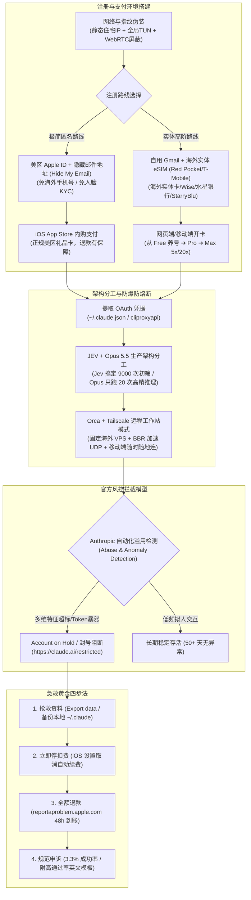
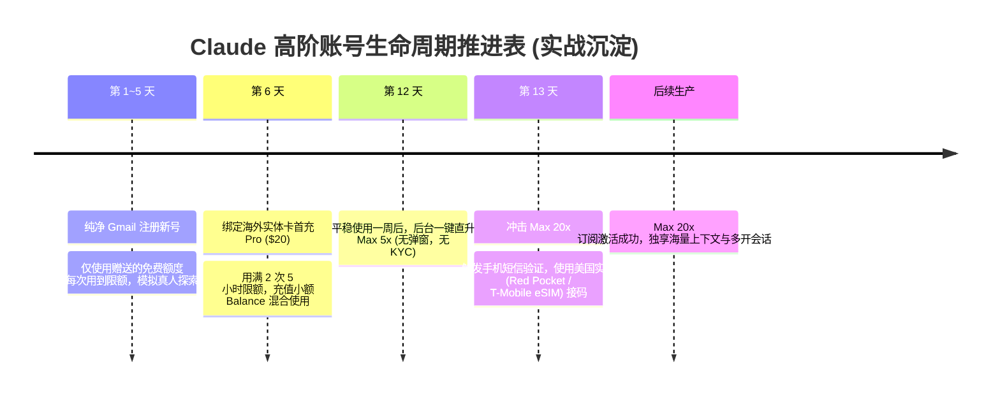
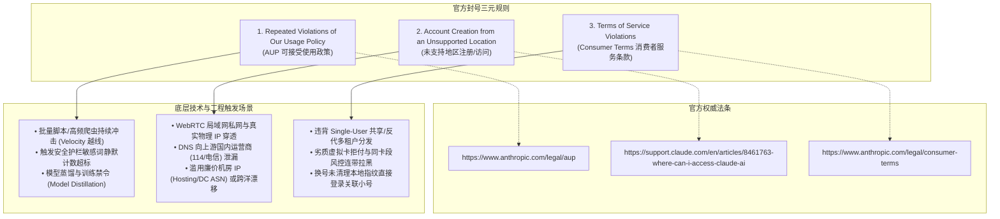
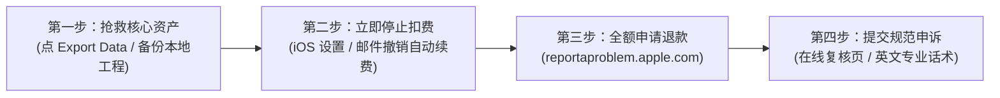

# 04. Claude Pro 与 Claude Code 注册支付、封号条款全景分析、申诉与多渠道退款实战

在海外大模型反代与号池工程建设中，**Claude（Anthropic 体系）是风控级别最高、号池损耗率最敏感的平台**，其风控严格程度远超 OpenAI。很多团队在构建基于 `cliproxyapi` 的多账号中转池或在 Linux 服务器上运行 Claude Code 自动化编写时，经常遭遇账号突然变灰、终端突发报错：
```text
● Your account is on hold and can't use Claude Code. View details or appeal: https://claude.ai/restricted
```

本篇结合 Anthropic 官方服务条款（Terms of Service）、可接受使用政策（AUP）、官方透明度报告、社区一手实战博主（雪踏乌云、劳伦斯、gkxspace、leo_xiaolei 等）的保号心得，系统梳理 **Claude 注册环境构建、纯净支付方案、封号底层逻辑、官方条文归因、急救黄金四步法、申诉模板** 以及 **苹果与网页全渠道退款实操 SOP**。

---

## 一、标准全链路业务与风控拓扑图



---

## 二、Claude Code 不被封号“焚诀”：远程工作站架构与 JEV 分工范式

### 1. 远程跳板工作站架构（Orca + Tailscale）
在云端服务器直接跑 Claude Code 时，若直接用国内网络或廉价机房 IP 裸连，非常容易因环境跳跃触发风控。社区实战派推崇的**“固定海外跳板焚诀”**：
1. **购买一台正规海外 VPS**（如美国、新加坡、日本等正规机房节点，网络干净）；
2. **在 VPS 宿主机登录 Claude Code 订阅**，保持本地认证环境绝对固定；
3. **安装配置 Orca 与 Tailscale**：
   * 通过 Tailscale 构建点对点加密私有虚拟内网，实现多设备互通；
   * 服务器开启 BBR 加速 UDP 流量，确保极速低延迟；
4. **全球无缝漫游**：无论在手机、iPad 还是办公电脑，只需打开 Orca 客户端连接至该固定服务器。Anthropic 服务端看到的永远是该海外服务器单一稳定的网络指纹，彻底隔绝因客户端频繁切网、移动基站漫游引发的风控。

---

### 2. JEV + Opus 5.5 架构分工（防止 Token 爆炸与财务熔断）

```{admonition} 核心认知：千万别让 Opus 5.5 干所有琐碎脏活！
:class: warning
很多团队把海量网页爬取、长文本初步清洗、多链接初筛全部丢给 Opus 5.5，导致单会话迅速膨胀至数千万甚至数亿 Token。不仅产生数倍的巨额账单（几十美元甚至上百美元），更会因单位时间内 Token 消耗速率（Velocity）过高，被 Anthropic 后台反爬与反蒸馏系统直接判定为异常滥用。
```

工业级开发推荐采用 **“轻量快速判定模型（如 Jev / TypeSafe）+ 旗舰大模型（Opus 5.5）”的双层漏斗架构**：

| 处理阶段 | 任务性质 | 承载模型 | 调用频次 | 处理成本与耗时 | 职责分工 |
| :--- | :--- | :--- | :--- | :--- | :--- |
| **前置初筛层** | 链接连通性判断、文本粗分类、特征打标、敏感词过滤 | **Jev** (小型专用模型) | **5,000 ~ 9,000 次** | 不到 1 分钟，总成本仅**几毛钱** | 快速过滤掉 99% 的无效噪音，完成大批量结构化判断。 |
| **深度决策层** | 终审裁决、高难度逻辑架构推演、成片导演编剧、归因解释 | **Claude Opus 5.5** | **仅 10 ~ 20 次** | 几秒完成，单次成本几分钱 | 集中所有高价值算力，只做最硬核的顶级推理。 |

* **成本差距**：若全部由 Opus 处理 9,000 次判定，成本将迅速暴增至 **40 美元以上**（差距高达 **200 倍**）；
* **防封收益**：大幅降低单个 Session 的上下文长度与调用频度，让账号始终保持在健康低负载绿区。

---

## 三、纯净注册与支付升级实操方案（白号培育）

### 1. 注册前环境检测与分值拉升（从 36 分提升至 98 分）
Anthropic 与专业 IP 质量库（如 `ipdata.co`、`ipinfo.io`）深度合作，在注册与支付阶段会执行多维反欺诈探测。

#### 核心检测指标与穿透权重：
$$\text{WebRTC 泄漏} > \text{DNS 泄漏} > \text{设备指纹/Keychain 标记} > \text{IPQS/MaxMind 欺诈分} > \text{数据中心 IP} > \text{付款卡}$$

#### 满分环境配置清单：
1. **网络链式代理与静态住宅 IP 落地**：
   * 采用海外住宅代理（如 Webshare、ProxyCheap 的 ISP 静态住宅 IP）作为落地节点，前置搭配商业梯子；
   * 在 Clash Verge / 代理客户端开启**全局 + 严格 TUN 虚拟网卡模式**，拦截所有底层流量；
2. **阻断 WebRTC 泄漏**：在浏览器安装 *WebRTC Leak Shield* 扩展，开启 Strict Protection，防止真实物理网卡内网 IP 与公网 IP 外泄；
3. **系统语言与时区对齐**：系统语言设为英文，时区改为与落地 IP 一致的美区或亚太对应时区；
4. **清理旧设备残留指纹**：
   * macOS 必须打开【钥匙串访问（Keychain Access）】搜索并删除所有包含 `claude`、`anthropic` 的废弃凭据；
   * 彻底删除用户目录下的残留配置：`rm -rf ~/.claude ~/.config/claude`；
   * 清理 Chrome/Edge 浏览器中 `claude.ai` 的全部 LocalStorage、IndexedDB 与 Cookie。

---

### 2. 方案 A：美区 Apple ID + 隐藏邮件地址（极简零门槛路线）
* **核心优势**：无需海外手机号、无需人脸认证、无需海外信用卡，退款成功率最高；
* **操作步骤**：
  1. 准备一台美区 Apple ID 的 iPhone，App Store 搜索下载官方 Claude App；
  2. 注册登录时选择 **“Continue with Apple”**，并勾选 **“隐藏我的邮件地址（Hide My Email）”**；
  3. 记录 Apple 自动分配给你的中继邮箱（格式如 `xxxx@privaterelay.appleid.com`）；
  4. 使用正规美区礼品卡（通过 Pockyt Shop 官方购买）充值至 Apple ID 余额，在 App 内一键内购订阅 Claude Pro；
  5. 后续在电脑或服务器上使用该随机中继邮箱登录，输入收到的邮箱验证码即可无缝使用。

---

### 3. 方案 B：自用 Gmail + 实体卡 + 阶梯养号升级路线（Max 20x 终极方案）
针对需要升级至 **Claude Max 5x 或 Max 20x** 的重度高阶开发者，实战验证最稳的阶梯升级 SOP：



* **支持的优质支付卡**：美国水星银行（Mercury Bank）商业卡、Capital One 实体卡、Wise、OCBC 华侨银行、StarryBlu，以及明确开放 AI 订阅商户场景的高质量商业虚拟卡。

---

### 4. 【核心升级】Claude Pro / Max 选档与被迫停工时间决策模型

在点击订阅前，最关键的是科学定档，而非盲目冲动消费：
- **Claude Pro ($20/月)**：基准额度 (1x)，适合日常文案校对、资料检索与轻度问答；
- **Claude Max 5x (约 $100/月)**：5倍额度，适合每天连续高频使用 2~4 小时、频繁投喂长上下文。**升级信号：一周被限流 2~3 次，每次干等数小时**；
- **Claude Max 20x (约 $200/月)**：20倍额度，整天挂机、**以 Claude Code 跑真实仓库工程重构**的主力利器。

```{tip}
**核心算法：用“被迫停工时间”算，别用感觉算！**  
Max 20x 与 5x 差价为 $100/月，按每月 22 个工作日折算，**每天仅多花约 $4.5 美元**。如果每周因为撞额度导致研发被迫中断等待超过 2 小时，按照工程师时薪核算，升级到 20x 属于必赚的确定性投资。因为订阅费的真正对手方是工时，不是钱包！
```

---

### 5. 【核心升级】付款两层法与绑卡被拒分诊冷却策略

全网绝大多数绑卡失败与账号封禁，根源都在于颠倒了付款排查顺序或在被拒后盲目连点重试：

#### 第一层：卡段（BIN）场景准入排查
发卡行是否开放 AI 订阅商户场景属于底层物理准入规则。若卡段本身禁止 AI 订阅，在客户端切换 100 次纯净 IP、修改 100 套地址都是徒劳。排查首要步骤是核验该卡段是否支持 Anthropic 订阅。

#### 第二层：卡与环境严格三维一致
- **三维对齐**：卡所属国 = 代理出网 IP 所在国 = 账单地址所在国（通常均为美国 US，同州最佳）；
- **原配地址照抄**：照抄随卡分配的原始美国地址，**Address Line 2（第二行）绝对留空**，严禁使用公开滥用的“免税州神仙地址”；
- **绑卡与扣款分离认知**：绑卡仅做 $0 验证授权（抄对即过），真正扣款发生在后续账期。Pro 建议常备 $\ge \$25$，Max 5x 备 $\ge \$110$，Max 20x 备 $\ge \$210$ 防范税差与掉档。

#### 绑卡被拒分诊表与冷却执行铁律：

| 消费明细表现 | 问题归属 | 正确对策 |
| :--- | :--- | :--- |
| **明细有记录：显示「单笔限额/余额不足」** | 卡侧资金问题 (占比 80%) | 充值提额覆盖“标价 + 税”后静置 1 小时再试 |
| **明细有记录：显示「CVC/有效期错误」** | 信息输入错误 (占比 20%) | 返回卡后台用复制按钮粘贴，杜绝手敲 |
| **明细【空空如也，一条记录都没有】** | **商户侧前置风控拦截** (发卡行未收到请求) | **换卡无用！** 停手排查账号年龄、IP 污染与三维一致性 |

```{warning}
**⛔ 严禁连续第 3 次重试！**  
第一次被拒立即停手，静置至少 1 小时；第二次被拒彻底冷却 10~24 小时。**短时间内连点三次会直接触发网关暴力防刷机制（Velocity Lockdown），账号将被推入深度观察黑名单秒拒！**  
*更多关于两层付款架构、团队按工具分卡隔离与降低异常信号哲学，请深度参阅：*  
👉 [【实战指南】Claude Pro / Max 订阅决策、付款两层法、防封风控与被拒分诊冷却全景手册](../../geek_notes_and_ai_dialogues/stage2_llm_dialogues_and_prompts/20_case_claude_pro_max_subscription_anti_ban_and_payment_triage_guide.md)
```

---

## 四、封号底层归因与 2025 透明度报告真相

### 1. 规模比想象的大：官方透明度报告数据曝光
根据 Anthropic 官方公布的最新 Transparency Report（透明度报告）：
* 仅 2025 下半年，官方在全球范围内累计封禁账号超过 **145 万个**；
* 全球申诉成功恢复率**仅为 3.3%**（即 100 次申诉仅有 3 个能够解封成功）；
* **四大基本判死刑的申诉场景**：
  1. 来自未支持地区（Unsupported Locations）；
  2. 涉及拼车/共享/第三方代充黑卡；
  3. 拿普通 Pro/Max 个人订阅高并发驱动第三方客户端或跑批处理 Agent；
  4. 批量抓取模型输出做模型蒸馏（Model Distillation）。

---

### 2. 封号与模型发布周期的“反蒸馏猎杀”
社区实测表明，封号高发期往往高度重合于新模型的发布节点（如 Opus 5、Opus 5.5、Fable 5.1 上线前后）：
* **原因**：每次新模型发布，全球黑产爬虫、套壳站、越狱攻击与蒸馏训练集群流量暴增，Anthropic 会在发布后 48~72 小时内**拉满自动化风控规则等级**，执行地毯式扫描，大批边缘行为账号集中暴雷；
* **新号前 72 小时最危险**：刚注册、刚绑卡就立刻高强度刷满并发，且账单地址与出网 IP 不一致的账号，几乎 100% 存活不过 24 小时。

---

### 3. 额度消耗 vs 账号风控：为什么“高强度 Coding”比“聊天”更容易撞墙？

高强度使用 Claude Code 比普通对话聊天更容易“撞额度”，这是官方机制和社区经验都高度支持的客观事实：
* **计算成本倍增机制**：Agent Coding 往往涉及自动化多文件扫描、超长上下文传递、多轮外部工具（Bash/Read/Write）连续调用与复杂推理，单次用户指令背后实际消耗的模型计算量和 Token 吞吐量，可能是单次普通聊天的数十甚至上百倍；
* **客观因果链去伪存真**：
  * **高强度 Coding $\rightarrow$ 更快耗尽额度**：**【强证据】**。Anthropic 官方通过 session / weekly / model limits 以及 Max 阶梯配额实施容量管控；
  * **高强度 Coding $\rightarrow$ 偶发异常行为 Signals**：**【合理推测】**。某些高度自动化、长耗时并发或批量执行的 Agent 行为，在流量特征上容易与反爬虫、反滥用监控信号重叠；
  * **“额度变黄即封号”或“24–48h 成本超 $100 即熔断”**：**【无官方证据】**。目前没有公开技术证据表明 Anthropic 存在“因为用户算力成本过高导致亏钱而封号”的直接因果链，应将其视为**社区经验性的传言与保守阈值**，而非官方证实规则。Anthropic 的官方设计是通过限制高成本用户的速率与配额维持经济性，而不是直接判定违规。
* **核心工程启示**：评估账号稳定性时，**切忌将“额度/容量控制”与“账户/政策风控”混为一谈**。防封的真正重心在于**网络环境、注册身份、WebRTC/DNS 泄漏防护与反蒸馏特征规避**，而非单纯压低合理的编程 Token 消耗。

---

### 4. 官网客服实证：Fin AI Agent 拒信全景剖析与三大官方条款深度对照

在号池与反代实战中，许多开发者在账号被封后向 `support@anthropic.com` 发邮件申诉，几乎 100% 会收到一封来自 **Fin AI Agent** 的官方标准回复。理解这封邮件的机制与法律条文映射，是决定“是该申诉、还是该立刻退款弃号”的关键前提。

#### 真实官方拒信原文（Fin AI Agent 自动化拦截）

```text
From: Fin AI Agent from Anthropic <support@mail.anthropic.com>
Subject: Re: [Your Ticket Subject]

Hi [User Name],

Thank you for reaching out regarding your account.

As part of our safety process, we may ban an account for a variety of reasons:
• Repeated Violations of Our Usage Policy
• Account Creation from an Unsupported Location
• Terms of Service Violations

If you feel your account has been wrongly suspended or terminated, you can fill out the appeal form with your account information so our Trust & Safety team can further investigate why your account was disabled. If they are able to lift the suspension, they will reach out with details on the status of your account.

If you have already completed the appeal form with your account information, our Safeguards team is processing your appeal. If they are able to lift the suspension, they will reach out with details on the status of your account.

For further clarity, members of the Anthropic Support team are unable to confirm the reasons why a suspension has taken place, nor do they have the ability to lift a ban. All inquiries regarding banned accounts must be done through the appeals form listed above. Further messages to the support inbox regarding this issue may not be responded to.

We appreciate your patience and understanding.
```

#### 官方客服底层流转逻辑揭秘
1. **Fin AI Agent 拦截过滤网关**：**Fin** 是海外顶级客户支持中枢 **Intercom** 推出的生成式 AI 智能客服。Anthropic 官方将其挂载在 `support@mail.anthropic.com` 邮箱入口，核心职责就是**无情拦截所有封号申诉邮件**，避免海量人工工单瘫痪人工客服团队；
2. **普通 Support 人员权限物理隔离**：邮件中明确指出：“*members of the Anthropic Support team are unable to confirm the reasons why a suspension has taken place, nor do they have the ability to lift a ban.*” —— 普通工单客服没有任何权限调取封号技术日志，更没有解封按钮；
3. **继续回复此邮件完全无效**：“*Further messages to the support inbox regarding this issue may not be responded to.*” —— 继续回复该邮件只会被系统标记为已解决或直接沉底；
4. **唯一法定裁决部门**：只有通过邮件中的 **appeal form（申诉表单）** 提交的诉求，才会转交至最高风控裁决部门：**Trust & Safety（信任与安全团队）** 或 **Safeguards（安全防护团队）**。

---

#### 三大封号元规则与官方条款全景对照

邮件中列举的三项核心理由并非空穴来风，它们分别锚定了 Anthropic 体系三大独立法律与政策条约：



| 官方条款分类 | 官方权威条约直达 | 典型法律条款摘要 | 工程号池/开发者高危触发场景 |
| :--- | :--- | :--- | :--- |
| **条款一：<br/>Repeated Violations of Our Usage Policy** | [Anthropic AUP 条款](https://www.anthropic.com/legal/aup) | 禁止有害内容生成（网络武器、欺诈、恶意代码），**严禁使用服务输出开发或训练竞争性大模型**。 | 1. **模型蒸馏与商业套利禁令**：使用自动化脚本批量跑结构化提取或代码生成，Prompt 模板高度僵化，被反爬/反蒸馏分类器命中。<br>2. **Token Velocity 异常**：开发者调用 Agent 改代码时单分钟抛出数十万 Token 上下文，单日等价物理成本触及 $50~$100 美元熔断线。<br>3. **静默安全护栏计数（Silent Strikes）**：代码调试时涉及端口扫描、弱口令测试、逆向分析等敏感片段，在后台静默累加计数，超标即触发“屡次违反”。 |
| **条款二：<br/>Account Creation from an Unsupported Location** | [Claude.ai 支持地区列表](https://support.claude.com/en/articles/8461763-where-can-i-access-claude-ai) | 服务仅面向官方公布的 159+ 个国家/地区开放。**中国大陆、中国香港、中国澳门、俄罗斯等明确不受支持**。 | 1. **WebRTC 协议内网穿透（隐形死因）**：未安装 WebRTC 阻断插件，STUN/TURN 协议绕过普通代理暴露 `192.168.x.x` 或真实物理公网 IP。<br>2. **DNS 向上游泄漏**：代理未开 TUN 虚拟网卡全局拦截，DNS 依然向国内运营商解析。<br>3. **数据中心 IP（Hosting/DC ASN）**：使用 AWS/Vultr/Linode 等机房节点注册，欺诈评分极高，被判定为非自然人代理跳板。<br>4. **地理瞬移（IP Hopping）**：短时间内跨大洋频繁切节点，违反物理移动规律。 |
| **条款三：<br/>Terms of Service Violations** | [Anthropic Consumer Terms](https://www.anthropic.com/legal/consumer-terms) | **第 2 节：每个账户仅限单一用户使用（Single-User Only）**；<br>**第 4 节：严禁创建多个账户以规避速率限制或封禁历史**。 | 1. **一号多用与反代拼车（Multi-Tenant）**：利用 `cliproxyapi` 将单个 Pro 账号共享给团队多人高并发取用，Session/Token 并发碰撞。<br>2. **支付风控与黑卡拒付连带拉黑**：绑定的劣质虚拟卡段内其他用户发生 Chargeback（恶意拒付），Stripe 将整个卡段标记为高危欺诈。<br>3. **未清指纹“马甲小号”秒关联**：旧号被封后，在同一 Linux 机器上未清理 `~/.claude.json` 中的 `userID` 和 `machineID` 就登录新号，直接被判定为小号批量操作。 |

#### 收到该邮件后的应对决策树
1. **立刻放弃邮件直回**：不要继续回复 `support@mail.anthropic.com`，邮件直接沉底，浪费宝贵的申诉与退款黄金周期；
2. **评估申诉价值（官方恢复率仅 3.3%）**：
   - 如果账号价值极高且自认合规：立即填写邮件中附带的 **appeal form**，申诉要点务必针对上述三大条款逐一辩驳（参考第五节申诉模板）；
   - 如果账号使用的是普通虚拟卡直充或机房节点：基本属于判死刑范畴，**不要寄希望于解封**；
3. **极速止损退款**：iOS 内购订阅立即前往 [reportaproblem.apple.com](https://reportaproblem.apple.com) 申请 48 小时极速退款，挽回 20 美元；
4. **彻底物理重置本机**：若计划换号，必须立即执行下文第八节及 05 专篇的 **Linux 五级设备指纹深度清除 SOP**，粉碎 `userID`、`machineID` 与 `/tmp/claude-0`，杜绝新号一登即封。

---


## 五、【Claude 封号急救指南】黄金四步法

一旦遭遇账号被封或收到限制通知，**切忌惊慌！切忌在同一设备或 IP 上疯狂切节点反复登录！** 遵循以下标准四步法：



### 第一步：抢救核心工程资产（立刻执行）
1. **Web 端数据**：在封号或受限页面点击 **“Export your data”**，等待官方发送数据归档邮件，邮件到达后立即点击下载（链接通常 24 小时内有效）；
2. **Claude Code 本地工程**：
   * 账号被封丝毫不会损坏本地磁盘上的代码与历史会话；
   * 本地核心配置文件（`CLAUDE.md`、`~/.claude/`、项目根目录下的 `.claude/`）以及我们前面提取的全部 Markdown 会话，立即全部 Commit 并 Push 至私有 Git 仓库备份。

---

### 第二步：停止自动续费（绝大部分人遗忘的致命漏项）
```{important}
**被封号 ≠ 自动停止扣费！**
许多开发者账号被封后不管不顾，结果次月信用卡或 Apple ID 依然被扣除 $20 美元月费！
```
* **Apple 订阅取消 SOP**：
  * 打开 iPhone【设置】➔ 点击顶部【Apple 账户头像】➔【订阅】；
  * 在活跃订阅中找到【Claude】➔ 点击最底部的**【取消订阅】**；
* **官网信用卡直充取消**：若无法登录网页后台，立即向 `support@anthropic.com` 发送邮件，声明账号已被禁用，要求立即终止该账户的自动扣费（Cancel Recurring Billing）。

---

### 第三步：全渠道退款实操 SOP（挽回损失核心操作）

#### 1. iOS App Store 苹果官方 48 小时极速退款（成功率 > 90%）
由于苹果对内购采用中心化担保机制，只要账号封禁导致服务无法使用，向苹果申请退款极为顺畅：

1. **登录苹果官方售后服务台**：浏览器打开 [reportaproblem.apple.com](https://reportaproblem.apple.com)，登录付款使用的美区 Apple ID；
2. **提交退款意向**：
   * “我需要（I'd like to）”下拉选择：**“请求退款（Request a refund）”**；
   * 次级原因下拉选择：**“其他（Other）”** 或 **“我的购买未按预期工作（My purchase does not work as expected）”**；
3. **勾选 Claude 订单**：在消费列表中勾选 **Claude Pro Subscription ($20.00)**；
4. **填入标准退款申述文案（直接复制）**：
   ```text
   I paid for the Claude Pro subscription through the Apple App Store, but my Claude account was recently disabled/suspended by the service provider, and I can no longer access the service I paid for. I would like to request a full refund for this unusable subscription. Thank you for your assistance.
   ```
5. **处理与到账**：Apple 通常在 **24~48 小时内**给出审核结果。审核通过后，20 美元全额原路退回到 Apple ID 余额或原支付卡中。

#### 2. 网页端 Stripe / 信用卡渠道退款
* 若是通过网页直接绑卡：访问 [support.anthropic.com](https://support.anthropic.com)，通过客服入口提供付款账单（Invoice PDF）及封号页面截图，说明服务在购买后异常中断，要求人工退款；
* **慎用发卡行拒付（Chargeback）**：除非金额巨大且客服完全失联，否则不要轻易走银行 Chargeback，因为这会导致你的姓名、卡号和账单地址被 Stripe 全球反欺诈网络永久拉黑。

---

### 第四步：官方申诉流程与高通过率中英文模板

#### 1. 申诉入口
* **入口一（最快）**：登录 `claude.ai`，在封号提示弹窗中直接点击 **“Request a review”** 或 **“Submit an Appeal”** 访问官方审核表单；
* **入口二**：直接发送邮件至安全合规团队：`support@anthropic.com` 与 `appeals@anthropic.com`。

#### 2. 经典申诉模板（已成功解封的真实案例模板）

```text
Subject: Appeal for Account Review - [Your Email Address] - Account ID: [Optional]

Hello Anthropic Trust & Safety Team,

My Claude account (email: [Your Email Address]) appears to have been disabled. I believe this may be a false positive. I use Claude strictly for legitimate personal purposes: product copywriting, software translation/localization, reviewing code snippets for my personal projects, and drafting technical notes. I have never engaged in any prohibited activities under your Acceptable Use Policy.

Possible triggers I can think of and the corrective steps I have taken:
• Network / Environment: I occasionally used a proxy service while traveling for connectivity. I understand this may trigger security anomalies. I have standardized my network environment and disabled proxy hopping.
• Request Frequency: During a recent coding task, I ran several consecutive code analysis sessions within a short span. I now realize this may have generated an unusually high context volume. Moving forward, I will strictly keep my usage within normal interactive limits and avoid any automated loops.
• Single-User Policy: I confirm this is my sole account and I have never shared my credentials or used multi-tenant reverse proxies.

I have thoroughly re-read Anthropic’s Terms of Service and Usage Policy and will strictly adhere to them. Could you please review my account and consider reinstating my access? If additional identity or usage verification is required, I am ready to provide it immediately.

Thank you very much for your time and assistance.

Best regards,
[Your Name]
```

---

## 六、反代号池（cliproxyapi）高可用自愈配置实战

在多账号反代号池建设中，不能将所有希望寄托于“单个账号永远不封”，而必须在系统架构层实现**“坏号自动熔断、多号动态轮换、流量拟人削峰”**：

### 1. 坏号秒级自动隔离下线
在 `cliproxyapi` 中配置错误拦截探针，一旦检测到上游返回 `account_on_hold`、`403 Forbidden` 或 `user_restricted`，调度器立即对对应的 `auths/claude-*.json` 进行标记锁定：
```json
{
  "email": "AnnamaeTock180@outlook.com",
  "disabled": true,
  "disabled_reason": "account_on_hold",
  "disabled_timestamp": 1790353284,
  "auto_failover": true
}
```
隔离后的坏号不再参与负载均衡轮询，下游业务调用会自动无感转移（Failover）至下一个健康活跃账号。

### 2. 单号 Token Velocity 熔断限流保护
* **设定软配额限制**：在号池中间件中设置单账号单日累计等价成本上限（推荐 **$25~$30 美元**）；
* **进入平滑冷却**：一旦某账号当天消耗触及软配额，调度器自动将其标记为 `cooldown` 并暂停分发 12 小时，强制引导流量切换至其他备用账号，彻底消除单日几亿 Token 引发官方财务风控的隐患。

---

## 七、权威博主与实战方案索引导航

| 博主 / 资源 | 核心实战方向 | 典型参考方案 |
| :--- | :--- | :--- |
| **雪踏乌云 (@Pluvio9yte)** | 封号防关联、住宅代理、海外手机卡 | • [Clash Verge 简单配置 IP 链式代理教程](https://x.com/Pluvio9yte)<br>• [科学上网住宅 IP 完全指南与多卡保号横评](https://x.com/Pluvio9yte) |
| **劳伦斯 (@LawrenceW_Zen)** | 官方原生极简订阅、独享住宅配置 | • [超简单！一句提示词搞定专属 VPS + 住宅 IP 配置](https://x.com/LawrenceW_Zen)<br>• [原汁原味的 Claude 官方极简订阅指南](https://x.com/LawrenceW_Zen) |
| **@gkxspace** | 满血驱动 Claude Code、静态住宅实战 | • [ProxyCheap 静态住宅 IP + 境外卡开通 Claude Max 实操](https://x.com/gkxspace) |
| **@leo_xiaolei** | 纯美区长效环境、iOS 内购避坑 | • [美版设备 + T-Mobile 实卡 + 礼品卡 56 天零风控经验复盘](https://x.com/leo_xiaolei) |

---

## 八、Linux 生产环境 Claude Code 追踪痕迹清除与换号/卸载 SOP（逆向实证）

在实际工程号池运维中，账号被封（`account_on_hold`）之后，**切忌在未清理设备指纹的情况下直接登录新号**，否则极易触发 Anthropic 的联合设备关联导致“连环封号”。

基于 Claude Code 源码逆向与开源安全审计规范（参考 `win4r/cc-notebook` 与 `pnedfff/claude-env-cleanup`），Linux 环境下的完整清理与换号避坑核心要点如下：

### 1. 核心追踪特征与 Linux 本地落盘位置
* **一级追踪标识（设备唯一身份）**：`~/.claude.json` 中保存的 `userID`（64位十六进制随机主键）、`machineID`、`anonymousId` 以及 `oauthAccount`（账号 UUID、邮箱、组织角色等）；
* **Linux OAuth 凭据明文落盘**：`~/.claude/.credentials.json`（保存 AccessToken、RefreshToken，无桌面 Keyring 时直接明文落盘）；
* **遥测与特性开关**：`~/.claude/telemetry/`、`~/.claude/statsig/`（Stable ID）；
* **会话与磁盘隐秘巨兽**：`~/.claude/history.jsonl`、`~/.claude/sessions/`，以及经常暴增至 **1GB~5GB** 的 `/tmp/claude-0` 临时工作区与 diff 缓存；
* **系统配置与环境变量**：`~/.local/share/applications/claude-code-url-handler.desktop` 以及 `~/.bashrc` 中的 `CLAUDE_CODE_DISABLE_MOUSE`。

### 2. Linux 极速无痕清理与卸载命令
若需在 Linux 机器上彻底清除残留并卸载 Claude Code，执行以下标准流水线：

```bash
# 1. 终止所有运行中进程与后台终端会话 (tmux/nohup)
pkill -9 -f 'claude --permission-mode' 2>/dev/null || true
tmux kill-session -t claude 2>/dev/null || true

# 2. 全局卸载 npm 包并确认二进制移除
npm uninstall -g @anthropic-ai/claude-code
rm -f /usr/local/bin/claude ~/.local/bin/claude

# 3. 物理粉碎所有追踪标识、凭据、遥测与巨型临时缓存
rm -rf ~/.claude ~/.claude.json ~/.cache/claude-cli-nodejs /tmp/claude-*
rm -f ~/.local/share/applications/claude-code-url-handler.desktop

# 4. 清除各工程项目下的项目级 .claude 隐藏配置
find /root -name ".claude" -type d -exec rm -rf {} + 2>/dev/null

# 5. 清理 ~/.bashrc 中的残留环境变量
sed -i '/CLAUDE_/d' ~/.bashrc
sed -i '/ANTHROPIC_BASE_URL/d' ~/.bashrc
```

```{seealso}
关于 Claude Code 在 Linux 下的 51.2 万行源码逆向细节、五级深度清理拓扑图、自动化一键 Python 运维脚本及换号网络纯净度复核 Checklist，请直接参阅后续进阶篇：  
👉 [05. Linux 生产环境 Claude Code 追踪数据逆向分析、五级指纹无痕清除与彻底卸载实战](05_claude_code_linux_tracking_cleanup_and_fingerprint_reset.md)
```

