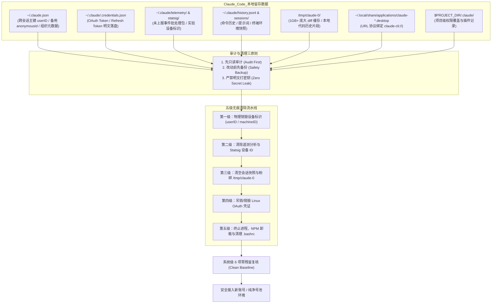

# 05. Linux 生产环境 Claude Code 追踪数据逆向分析、五级指纹无痕清除与彻底卸载实战

在海外大模型反代与高可用号池工程实践中，许多团队经常在 Linux 生产服务器或跳板 VPS 上直接运行官方 Claude Code 进行自动化工程开发。然而，一旦某账号触发风控被封（`account_on_hold`），或者因网络波动、并发异常导致封号，**直接退出登录换一个新号登录，往往会在几分钟到几小时内遭遇连环封号（连环诛九族）**。

这是因为 Claude Code 会在本地操作系统中埋下深度的**多级设备标识、遥测事件、分析缓存、OAuth 凭据及会话快照**。如果不在底层将这些残留指纹物理粉碎，Anthropic 后台的反滥用系统将瞬间识别出“同一台被风控设备的再次注册/登录请求”，直接将新号秒杀。

本篇基于 **Claude Code 源码（51.2 万行 TypeScript 逆向快照）** 以及开源审计规范（参考 `win4r/cc-notebook` 与 `pnedfff/claude-env-cleanup`），深度拆解 Claude Code 在 **Linux 系统** 下的数据留存机制，并提供一套生产级的**五级无痕清除、安全审计、彻底卸载与换号指纹重置实战 SOP**。

---

## 一、全链路设备指纹与清理拓扑图



---

## 二、背景与逆向剖析：Claude Code 在 Linux 上究竟追踪了什么？

通过逆向分析 Claude Code 核心通信模块可知，官方**不收集网卡 MAC 地址、CPU 型号、物理内存大小或 GPU 硬件指纹**，但构建了一套极其严密、基于软件层与数据流向的用户追踪体系：

### 1. 核心追踪标识与 Linux 存储位置

| 追踪标识 | 持久性 | Linux 存储位置 | 字段说明与风控机制 |
| :--- | :--- | :--- | :--- |
| `userID` | **永久** | `~/.claude.json` | 随机生成的 64 位十六进制字符串，跨终端、跨会话追踪的核心主键。 |
| `anonymousId` | **永久** | `~/.claude.json` | 格式为 `claudecode.v1.<uuid>`，备用匿名追踪 ID。 |
| `machineID` | **永久** | `~/.claude.json` | 机器环境识别码，换号不换设备时的主关联依据。 |
| `accountUuid` | 绑定账号 | `~/.claude.json` $\rightarrow$ `oauthAccount` | OAuth 登录后绑定的 Anthropic 组织与账号全局 UUID。 |
| `emailAddress` | 绑定账号 | `~/.claude.json` $\rightarrow$ `oauthAccount` | 登录邮箱地址及订阅计划、计费属性（`billingType`、`seatTier`）。 |
| `firstStartTime` | 永久 | `~/.claude.json` | 首次启动时间戳，用于设备生命周期归因。 |
| `Statsig Stable ID` | 永久 | `~/.claude/statsig/` | GrowthBook / Statsig 特性开关系统的设备级标识。 |
| `rh` (仓库哈希) | 动态 | 每次 API 请求 Header | Git 远程仓库 URL 的 SHA256 前 16 位，按代码库维度关联。 |
| **Linux OAuth 凭据** | 永久 | `~/.claude/.credentials.json` | **Linux 专属特异性**：macOS 存储于 Keychain，Linux 无图形桌面时直接明文落盘于此文件！ |

### 2. 遥测与事件数据流向
Claude Code 内部包含三路后台上报链路：
1. **Anthropic 1P 事件流**：通过 `/api/event_logging/batch` 上报完整环境数据、命令执行状态与账户属性；若网络不通，堆积于 `~/.claude/telemetry/`；
2. **Datadog 脱敏链路**：上报至 `https://http-intake.logs.us5.datadoghq.com`；
3. **OTLP 链路**：针对自建 OpenTelemetry 收集器的可选端点。

---

## 三、工程清理三铁律（安全审计原则）

在生产服务器实施清理操作时，必须遵循以下标准规范：

1. **先只读审计（Audit First）**：绝不盲目执行 `rm -rf`，先遍历系统中所有可能存在的进程、安装包、桌面映射、临时目录与环境变量，确认影响范围；
2. **改动前先备份（Safety Backup）**：尽管账号已被封，但本地可能存在未提交的业务代码 diff、会话分析提示词或项目级配置，执行操作前必须生成带时间戳的归档文件；
3. **严禁明文打印密钥（Zero Secret Leak）**：脚本与日志输出中，遇到 API Key、AccessToken、RefreshToken 时仅汇报“存在性”，绝不能打印密钥原始内容至终端或屏幕。

---

## 四、Linux 五级无痕清除流水线实战

针对 Linux 系统（Ubuntu / Debian / CentOS / Alpine / RHEL），标准清理 SOP 分为以下五级：

### 第一级：重置设备标识与机器指纹（最核心）
跨会话追踪的主键直接保存在 `~/.claude.json` 中。
- **纯重置模式（保留其他个人偏好）**：
  ```bash
  python3 -c "
  import json, os
  p = os.path.expanduser('~/.claude.json')
  if os.path.exists(p):
      with open(p, 'r') as f: d = json.load(f)
      keys_to_del = ['userID', 'anonymousId', 'machineID', 'firstStartTime', 'claudeCodeFirstTokenDate', 'oauthAccount']
      for k in keys_to_del:
          d.pop(k, None)
      with open(p, 'w') as f: json.dump(d, f, indent=2)
      print('已成功重置核心设备追踪标识')
  "
  ```
- **彻底清除模式（准备换号/彻底卸载）**：
  ```bash
  rm -f ~/.claude.json
  ```

### 第二级：清除遥测、分析缓存与特性开关
未上报的异常事件包和设备特征开关必须物理抹除：
```bash
# 1. 遥测与分析缓存
rm -rf ~/.claude/telemetry/
# 2. Statsig 与设备特征标识
rm -rf ~/.claude/statsig/
# 3. 统计与模型目录缓存
rm -f ~/.claude/stats-cache.json
rm -rf ~/.claude/cache/model-catalog/
rm -rf ~/.claude/cache/
# 4. 运行时更新标记
rm -f ~/.claude/.last-update-result.json ~/.claude/.last-cleanup
```

### 第三级：清空本地历史、会话快照与磁盘隐秘巨兽
除了 `history.jsonl`，Linux 服务器上最容易被忽视的是 **`/tmp/claude-0` 临时目录**：
```{admonition} 警惕 /tmp/claude-0 磁盘与隐私刺客！
:class: danger
Claude Code 在 Linux 下会将代码文件的编辑 diff、Bash 运行上下文、历史快照暂存到 `/tmp/claude-{UID}` 中。在长期运行的代码库中，该目录往往迅速膨胀至 **1GB ~ 5GB 以上**，不仅严重侵占系统根分区，还留存了完整的敏感业务代码！
```

清理命令：
```bash
# 1. 完整输入提示词与历史
rm -f ~/.claude/history.jsonl
# 2. 会话快照与剪贴板哈希
rm -rf ~/.claude/sessions/
rm -rf ~/.claude/paste-cache/
# 3. 文件修改记录与调试日志
rm -rf ~/.claude/file-history/
rm -rf ~/.claude/debug/
# 4. Shell 环境快照与会话变量
rm -rf ~/.claude/shell-snapshots/
rm -rf ~/.claude/session-env/
# 5. 云端同步技能与插件缓存
rm -rf ~/.claude/skills/synced/
rm -rf ~/.claude/plugins/
# 6. 清理巨型临时工作区（释放数十万个小文件与数 GB 空间）
rm -rf /tmp/claude-*
# 7. 项目级隐藏配置（遍历清除）
find /root -name ".claude" -type d -exec rm -rf {} + 2>/dev/null
```

### 第四级：销毁 Linux OAuth 凭证与组织关联
在 Linux 生产环境中，OAuth Token 保存于：
```bash
# 查看凭据是否存在（安全检查，不打印内容）
test -f ~/.claude/.credentials.json && echo "发现本地 Linux OAuth 凭据，正在销毁..."
rm -f ~/.claude/.credentials.json
```

### 第五级：终止运行进程、卸载 CLI 与清理环境变量
1. **终止运行中进程与后台任务（如 tmux / nohup）**：
   ```bash
   # 检查并杀掉 claude 进程
   pkill -9 -f 'claude --permission-mode' 2>/dev/null || true
   # 关闭专用 tmux 窗口（若有）
   tmux kill-session -t claude 2>/dev/null || true
   ```
2. **全局卸载 NPM 包**：
   ```bash
   npm uninstall -g @anthropic-ai/claude-code
   # 检查是否存在其他 node 版本下的可执行文件
   rm -f /usr/local/bin/claude ~/.local/bin/claude
   ```
3. **清理桌面协议与 URL Handler 映射**：
   ```bash
   rm -f ~/.local/share/applications/claude-code-url-handler.desktop
   update-desktop-database ~/.local/share/applications 2>/dev/null || true
   ```
4. **清理 Shell 配置文件残留**：
   检查并从 `~/.bashrc`、`~/.zshrc`、`/etc/environment` 中移除相关环境变量：
   ```bash
   # 移除 CLAUDE_CODE_DISABLE_MOUSE、ANTHROPIC_BASE_URL 等定义
   sed -i '/CLAUDE_/d' ~/.bashrc
   sed -i '/ANTHROPIC_/d' ~/.bashrc
   ```

---

## 五、自动化生产级清理与审计脚本实战

为了便于在多台反代服务器或 CI/CD 流水线中批量执行，我们编写了一套完备的 Python 自动化运维脚本：

```python
#!/usr/bin/env python3
"""
Linux Claude Code 环境深度审计与无痕清理脚本
遵循原则：先只读审计 -> 确认后创建安全归档 -> 执行物理粉碎 -> 系统级 6 项复核
"""

import os
import sys
import shutil
import glob
import json
import tarfile
import subprocess
import pathlib
from datetime import datetime

HOME = pathlib.Path.home()
TIMESTAMP = datetime.now().strftime("%Y%m%d_%H%M%S")

TARGET_PATHS = [
    HOME / ".claude",
    HOME / ".claude.json",
    HOME / ".claude-code-now-last-dir",
    HOME / ".cache" / "claude-cli-nodejs",
    HOME / ".local" / "share" / "applications" / "claude-code-url-handler.desktop",
    pathlib.Path("/tmp/claude-0"),
]

def audit_environment():
    print("=" * 60)
    print(" 阶段一：系统只读安全审计（Audit）")
    print("=" * 60)
    
    # 1. 进程检查
    ps = subprocess.run(["ps", "-eo", "pid,user,args"], capture_output=True, text=True)
    active_procs = [l for l in ps.stdout.splitlines() if "claude" in l.lower() and "python3" not in l and "grep" not in l]
    print(f"[*] 活跃进程: {len(active_procs)} 个")
    for p in active_procs:
        print(f"    -> {p}")

    # 2. 全局包与二进制检查
    claude_bin = shutil.which("claude")
    print(f"[*] 可执行程序 (which claude): {claude_bin if claude_bin else '未找到 (干净)'}")

    # 3. 磁盘物理残留检查
    print("[*] 磁盘文件与目录排查:")
    found_targets = []
    for t in TARGET_PATHS:
        if t.exists():
            found_targets.append(t)
            is_dir = t.is_dir()
            size = sum(os.path.getsize(os.path.join(dp, fn)) for dp, dn, fns in os.walk(t) for fn in fns) if is_dir else t.stat().st_size
            print(f"    [!] 发现残留: {t} ({'目录' if is_dir else '文件'}, 大小: {size/1024/1024:.2f} MB)")
            
    # 4. 项目级配置
    proj_claudes = list(pathlib.Path("/root").glob("**/02project/**/.claude"))
    for pc in proj_claudes:
        found_targets.append(pc)
        print(f"    [!] 发现项目级配置: {pc}")

    return active_procs, found_targets

def execute_safe_cleanup(backup=False):
    active_procs, found_targets = audit_environment()
    
    if backup and found_targets:
        backup_dir = HOME / f".claude-cleanup-backup-{TIMESTAMP}"
        backup_dir.mkdir(parents=True, exist_ok=True)
        print(f"\n[*] 正在执行安全归档备份至: {backup_dir}")
        for t in found_targets:
            dest = backup_dir / t.name
            if t.is_dir():
                shutil.copytree(t, dest, dirs_exist_ok=True)
            elif t.is_file():
                shutil.copy2(t, dest)
        print("[+] 备份完成。")

    print("\n" + "=" * 60)
    print(" 阶段二：终止进程与卸载全局组件")
    print("=" * 60)
    
    # 终止 tmux / 进程
    subprocess.run(["tmux", "kill-session", "-t", "claude"], capture_output=True)
    subprocess.run(["pkill", "-9", "-f", "claude --permission-mode"], capture_output=True)
    print("[+] 已终止所有活跃 Claude 进程与后台终端会话。")

    # NPM 卸载
    if shutil.which("npm"):
        print("[*] 正在卸载全局 @anthropic-ai/claude-code 包...")
        subprocess.run(["npm", "uninstall", "-g", "@anthropic-ai/claude-code"], capture_output=True)
        print("[+] 全局 NPM 包卸载完毕。")

    print("\n" + "=" * 60)
    print(" 阶段三：物理粉碎残留数据与指纹信息")
    print("=" * 60)
    
    for t in found_targets:
        try:
            if t.is_dir():
                shutil.rmtree(t, ignore_errors=True)
            elif t.is_file():
                t.unlink(missing_ok=True)
            print(f"[+] 已安全删除: {t}")
        except Exception as e:
            print(f"[-] 删除失败 {t}: {e}")

    # 清理 .bashrc 环境变量
    bashrc_path = HOME / ".bashrc"
    if bashrc_path.exists():
        with open(bashrc_path, "r") as f:
            lines = f.readlines()
        clean_lines = [l for l in lines if not any(k in l for k in ["CLAUDE_", "ANTHROPIC_BASE_URL"])]
        with open(bashrc_path, "w") as f:
            f.writelines(clean_lines)
        print("[+] 已从 ~/.bashrc 中清除 Claude 相关环境变量。")

    print("\n" + "=" * 60)
    print(" 阶段四：系统级 6 项零残留复核（Verification）")
    print("=" * 60)
    
    v1 = shutil.which("claude") is None
    v2 = len(glob.glob(str(HOME / ".claude*"))) == 0
    v3 = not os.path.exists("/tmp/claude-0")
    print(f"1. 二进制命令行 (which claude): {'PASS (干净)' if v1 else 'FAIL'}")
    print(f"2. 家目录配置与追踪主键 (~/.claude*): {'PASS (无残留)' if v2 else 'FAIL'}")
    print(f"3. 临时工作区 (/tmp/claude-0): {'PASS (已释放)' if v3 else 'FAIL'}")
    print("\n[SUCCESS] 本机 Claude Code 痕迹已彻底净化，满足换号冷启动要求！")

if __name__ == "__main__":
    # 默认直接执行清理（不保留备份）
    execute_safe_cleanup(backup=False)
```

---

## 六、封号后“换号重生”环境基线与网络防关联 Checklist

完成物理清理之后，在同一台机器上使用全新 Claude 账号或加入中转号池前，必须按照以下清单逐一核验网络与操作系统指纹：

| 校验模块 | 检查项 | 标准合格判定标准 | 异常风险与对策 |
| :--- | :--- | :--- | :--- |
| **出口公网 IP** | `curl ipinfo.io` | **原生住宅 IP（ISP）**，国家与拟订阅地区完全一致。 | 若显示机房 Hosting / DataCenter，立即更换落地代理。 |
| **DNS 泄漏** | `https://ip.net.coffee/claude/` | DNS 解析服务器节点全部位于海外，无国内运营商解析。 | 开启客户端 DoH (DNS-over-HTTPS) 或 Fake-IP TUN 模式。 |
| **WebRTC 穿透** | `https://ippure.com/claude` | WebRTC 检测为 Disabled 或返回代理出口公网 IP。 | 严禁外泄真实局域网私网 IP（如 `192.168.x.x`）。 |
| **系统时间与时区** | `timedatectl` | 时区对齐（如 `America/New_York` 或 `Asia/Singapore`）。 | `timedatectl set-timezone America/New_York` |
| **语言环境 (Locale)** | `locale` | `en_US.UTF-8`（避免中文终端环境直连）。 | `export LANG=en_US.UTF-8` |
| **代码仓库 Remote** | `git remote -v` | 避免在新号会话中直接挂载曾被封账号操作过的私有仓库。 | 修改 remote 或新建干净 worktree，阻断 `rh` (仓库哈希) 关联。 |

---

## 七、小结与工程沉淀

通过对 Claude Code 底层通信与存储机制的逆向拆解，我们明确了：
1. **封号不仅是封 IP 和卡号，更是对客户端状态的联合绞杀**；
2. 在 Linux 生产环境中，`~/.claude.json` 中的 `userID`/`machineID` 是跨会话的主设备凭证，而 `/tmp/claude-0` 则是极易被忽视的体积与隐私泄露盲区；
3. 遵循 **“先审计 -> 彻底停用进程 -> 物理粉碎配置文件与临时目录 -> 环境变量净化 -> 网络三维核验”** 的标准 SOP，才能确保后续新采买的账号拥有绝对纯净的生存土壤。
