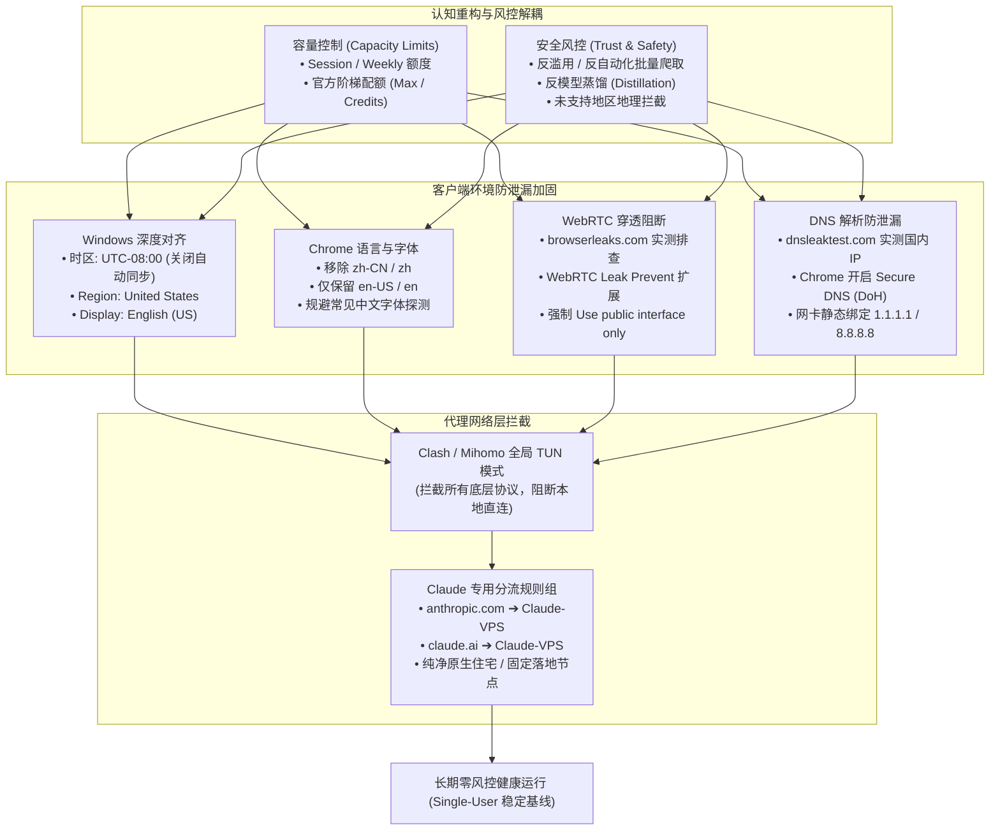

# 06. Claude 防封实战进阶：额度与风控变量解耦、反蒸馏规避、WebRTC/DNS 泄漏根治与 Clash/Mihomo 规则配置

在构建海外大模型反代号池与高频使用 Claude Code 的过程中，**“刚充值 Pro 没几天就被封”、“高强度写代码突然变灰”、“换号之后新号连续被秒杀”** 是让无数开发者极度头疼的核心痛点。

针对这些问题，社区中充斥着大量似是而非的玄学猜测（如“因为写代码让 Anthropic 亏钱所以封号”、“额度变黄就是封号倒计时”）。如果无法在底层将**“额度耗尽（容量控制）”**与**“账号风控（安全政策）”**两个变量彻底拆开，开发者就会陷入不断盲目换卡、换梯子、伪造假身份的死循环。

本篇基于官方服务条款、大量社区一线 suspension 封号真实样本的逆向溯源，系统梳理：
1. **认知重塑**：解耦额度消耗与封号风控，去伪存真；
2. **反模型蒸馏（Anti-Distillation）**：拆解 5 类无效蒸馏特征，避免正常 Agent 编程被安全风控误判；
3. **连坐封号证据链分析**：理清 5 大环境因素的关联权重，确立“原生长期稳定流”与“全链路物理隔离流”双轨战略；
4. **客户端与浏览器全栈防泄漏实战 SOP**：覆盖 Windows 地区/时区/语言/字体指纹对齐，实测根治 WebRTC 与 DNS 泄漏；
5. **Clash / Mihomo 工业级分流配置**：专用策略组、Claude 官方全域名分流规则与严格 TUN 模式部署。

---

## 一、全链路防封加固与指纹净化拓扑图



---

## 二、认知重塑：额度消耗 vs 账号风控的客观因果链

很多开发者误以为“只要用得多、成本高，Anthropic 就会封号”。我们需要以严谨的工程证据链打破这一误区：

### 1. 为什么高强度 Claude Code 极易撞额度？
* **计算成本倍增的物理本质**：Agent Coding 必然伴随大量自动化上下文传递（工程目录扫描、长文件读取、多轮 Bash/Diff 工具交互推理）。用户发出的一句简单指令（如“重构此模块”），背后可能触发模型上万甚至数十万 Token 的反复吞吐；
* **额度撞墙 $\neq$ 账号封禁**：
  * **撞额度（Rate Limit Hit）**：属于**系统容量控制（Capacity Management）**。官方通过 5 小时滚动窗口、每周配额、模型切换提示进行约束，这是明文规则保护服务器资源；
  * **封号（Account on Hold / Ban）**：属于**安全政策风控（Trust & Safety）**，由反滥用、反欺诈与反爬虫分类器驱动。

### 2. 证据链评级与辟谣清单

| 常见社区论点 | 证据等级 | 客观事实与技术定性 |
| :--- | :---: | :--- |
| **高强度 Coding $\rightarrow$ 更快耗尽额度** | **【强证据】** | 官方机制。长上下文与多工具循环必然导致 Token 迅速消耗，官方提供 Max 5x/20x 阶梯套餐承载该需求。 |
| **高强度 Coding $\rightarrow$ 偶发异常风控 Signals** | **【合理推测】** | 高度频繁、批量自动化循环的代码抓取行为，在流量特征上可能与反滥用监控指标重叠。 |
| **“额度进度条变黄即代表即将封号”** | **【无证据】** | 进度条变黄纯粹是额度使用率提醒（如超过 80%），与安全风控惩罚机制无关。 |
| **“24–48h API 等价成本超 $100 会触发熔断封号”** | **【无证据】** | 属于**社区经验性传言与保守阈值**。Anthropic 是通过限制速率来维持订阅经济性，没有任何公开技术证据表明存在“因用户算力高导致官方亏损而直接封号”的规则。 |

```{tip}
**核心启示**：防封研究的核心不是刻意压低编程时的 Token 用量，而是把精力集中在 **IP 信誉、网络稳定、注册身份一致性、WebRTC/DNS 零泄漏** 以及 **避免异常自动化行为特征** 上。
```

---

## 三、反模型蒸馏（Anti-Distillation）防御机制与 5 类特征避坑

根据 Anthropic [AUP 政策](https://www.anthropic.com/legal/aup)，严禁利用模型输出去训练或微调其他竞争性 AI 模型。系统后台部署了专门的模型蒸馏与爬虫探测算法，若日常使用模式高度贴近“自动化生成训练数据集”，账号将被风控系统误杀。

在模型训练领域，5 类典型“无效蒸馏数据”特征正是官方反蒸馏监控的重点抓取画像：

| 无效蒸馏数据类型 | Teacher 数据特征 | 产生的问题与风控标记 | 开发者的正确使用姿势（防误判） |
| :--- | :--- | :--- | :--- |
| **已掌握** | Student 模型本来就会的极浅常识 | 梯度价值极低，纯粹是大量刷接口刷量 | 避免用自动化脚本反复刷“Hello World”或基础语法检测。 |
| **冗余** | 大量高度重复、模板化、固定结构的问题与答案 | 信息密度极低，典型的数据集爬取特征 | 避免使用完全机械固定的 Prompt 模板发起上千次批量抓取。 |
| **错误** | Teacher 产生幻觉、逻辑严重崩塌的错答案 | 负监督数据，引发频繁的报错与重试 | 避免写自动化脚本忽略错误在死循环中无限自动重试。 |
| **不匹配** | 蒸馏能力与目标垂直场景完全不符 | 数据学了用不上，杂乱的大规模通用灌水 | 保持会话具有明确的上下文连贯性与交互迭代性。 |
| **过难** | 极其晦涩复杂、长篇大论，逻辑深不见底 | 单次推理耗费超大，转移效率低 | 遇到超大工程时拆分子任务分步推进，避免单指令逼迫模型输出几十万行超限内容。 |

---

## 四、连坐封号关联维度实证与双轨养号战略

当一个账号被封，很多团队最担心“同一张卡、同一台手机、同一个 VPS 会不会导致其他账号连坐封号”。以下是基于官方行为模式与实测经验的客观评估：

### 1. 五大环境因素关联风险实测表

| 考察因素 | Anthropic 是否能感知？ | 是否有证据证明“连坐封号”？ | 实战建议与应对对策 |
| :--- | :---: | :---: | :--- |
| **VPS 公网 IP** | **是**（每次请求记录） | **无必然连坐证据** | 优先检查 IP 的地理位置（海外受支持地区）、信誉分值（非机房 ASN），避免节点频繁切换。若旧号被封，建议按前文清空指纹后再换 IP。 |
| **iPhone / 移动设备** | **能识别会话设备指纹** | **无公开连坐证据** | 完全没必要因为封号去扔掉或更换物理手机。只需卸载 App 重装、清理钥匙串缓存即可。 |
| **Apple App Store 支付** | **否**（Apple 中心化处理） | **无公开证据** | Apple 不向 Anthropic 暴露你的底层信用卡卡号，**没必要为了防封更换 Apple 支付设备**。 |
| **Apple 账户 / 账单信息** | 部分元数据经安全机制传递 | 无公开“跨账号封禁规则” | **切忌频繁捏造虚假身份**。使用稳定、真实的海外 Apple ID 正常内购最稳妥。 |
| **注册邮箱 / 手机号 / 身份** | **是**（账户体系核心标识） | **【强关联】** | 邮箱若被封则永久失效。必须使用稳定、独立的高权重 Gmail 或企业邮箱，绑定真实海外实卡号码。 |

### 2. 双轨养号战略选择

针对不同业务场景，推荐以下两种成熟模式：

* **路线 A：单一真实用户长期原生稳定流（强烈推荐主力号）**
  * **公式**：**同一个真实用户 + 稳定设备 + 稳定海外地区 + 独立稳定 VPS + 官方原生客户端 + 正常正规支付（美区 Apple 礼品卡内购）**；
  * **优势**：行为画像完全符合正常海外个人开发者，零造假，生存周期可达数月甚至一年以上。
* **路线 B：全链路物理隔离全新流（针对被封后的新号冷启动）**
  * **公式**：**新原生住宅 VPS/IP + 新 Apple ID + 新礼品卡支付 + 新注册独立邮箱 + 新海外接码手机号 + 本地五级指纹彻底物理粉碎**；
  * **优势**：各环节切断所有数据链路映射，彻底消除“马甲小号连坐”风险。

---

## 五、客户端与浏览器全栈防泄漏实战 SOP（从系统到浏览器）

Anthropic 前端页面部署了极其严密的指纹收集脚本，**如果网络走了代理，但系统时区、浏览器语言、WebRTC、DNS 依然指向中国，直接形成“逻辑自相矛盾”，成为未支持地区拦截的首要死因**。

### 1. 核心自查网站（必须达标）
* **WebRTC 穿透检测**：[https://browserleaks.com/webrtc](https://browserleaks.com/webrtc)
* **DNS 泄漏检测**：[https://www.dnsleaktest.com/](https://www.dnsleaktest.com/)
* **真实案例警示**：某开发者使用美区代理，但 WebRTC 页面实测直接暴露：`WebRTC: 223.153.95.48 China Changsha`；DNS 测试检测出一长串国内电信 IP `14.215.166.121`，导致账号注册当天即被拦截。

---

### 2. Windows 操作系统环境全面对齐

#### 第一部分：修改 Windows 地区和时区
1. **进入设置路径**：
   * 开始菜单 $\rightarrow$ 设置 $\rightarrow$ 时间和语言（Time & language） $\rightarrow$ 日期和时间（Date & time）；
2. **修改时区（Time zone）**：
   * 原设置通常为：`(UTC+08:00) Beijing, Chongqing, Hong Kong, Urumqi`；
   * 修改为与落地代理一致的美区时区，推荐：
     * 洛杉矶/西雅图：`(UTC-08:00) Pacific Time (US & Canada)`
     * 纽约/东部：`(UTC-05:00) Eastern Time (US & Canada)`
3. **关键操作：务必关闭“自动设置时区（Set time zone automatically）”**，否则 Windows 会通过 Wi-Fi 基站定位自动强行改回东八区！

#### 第二部分：修改 Windows Region（国家与地区）
* **路径**：设置 $\rightarrow$ 时间和语言 $\rightarrow$ 语言和区域（Language & region）；
* **国家或地区（Country or region）**：将 `China` 修改为 **`United States`**；
* **区域格式（Regional format）**：将 `中文(简体，中国)` 修改为 **`English (United States)`**。

#### 第三部分：修改 Windows Display Language（显示语言）
* **路径**：设置 $\rightarrow$ 时间和语言 $\rightarrow$ 语言和区域；
* **Windows 显示语言（Windows display language）**：建议安装并设为 **`English (United States)`**。

---

### 3. Chrome 浏览器深度对齐与指纹净化

#### 第四部分：浏览器语言彻底修改（最关键一步）
Claude 网页端核心读取的是浏览器的 `navigator.languages` 属性。
1. 在 Chrome 地址栏输入：`chrome://settings/languages`；
2. **彻底删除中文字符集**：
   * 移除 `Chinese (Simplified)`、`中文（简体）`、`zh-CN`、`zh`；
3. **配置英文第一优先级**：
   * 第一位：`English (United States)`
   * 第二位：`English`
4. **配置完成后必须彻底重启 Chrome**。

#### 第五部分：中文字体指纹探测与规避
现代反欺诈系统会探测系统内置字体，若检测到 `Microsoft YaHei`（微软雅黑）、`SimSun`（宋体）、`NSimSun`（新宋体），即证明系统存在深度的中文 Windows 环境。通过修改上述系统语言与区域格式，可大幅降低字体探针在指纹计算中的异常权重。

---

### 4. 彻底解决 WebRTC IP 泄漏（根除 Changsha 穿透）

WebRTC 协议通过 STUN 服务器探查物理链路，会直接无视 HTTP 代理暴露真实公网 IP。

* **方案一：Chrome 原生底层 Flag 开启匿名化**：
  1. 在 Chrome 地址栏输入：`chrome://flags`；
  2. 搜索 `WebRTC`；
  3. 找到 **`Anonymize local IPs exposed by WebRTC`**，将其从 `Default` 修改为 **`Enabled`**；
  4. 点击右下角 **Relaunch** 重启浏览器。
* **方案二（生产级强力推荐）：安装 WebRTC Leak Prevent 扩展**：
  1. Chrome 应用商店搜索安装 **WebRTC Leak Prevent** 插件；
  2. 进入插件设置选项，在 *IP handling policy* 下拉菜单中选择：
     $$\textbf{Use public interface only} \quad \text{或} \quad \textbf{Disable non-proxied UDP}$$
  3. 保存并访问 `https://browserleaks.com/webrtc` 重新测试，确保真实 IP 完全消失，仅显示代理出口 IP 或为 `Disabled`。

---

### 5. 彻底解决 DNS 泄漏（阻止国内运营商解析）

若你的出网 IP 是美国，但 DNS 泄露测试出现 `14.215.166.121`（国内电信/联通），Anthropic 瞬间即可识别代理环境。

* **方案一：Chrome 开启安全 DNS（DoH 协议加密）**：
  1. 打开 Chrome 设置：`chrome://settings/security`；
  2. 找到 **使用安全 DNS（Use secure DNS）** 并开启；
  3. 选择 **“使用（With）”** $\rightarrow$ 自定义推荐：
     * **Cloudflare (1.1.1.1)** 或 **Google (8.8.8.8)**；
  4. 开启后，浏览器所有域名解析走加密 HTTPS 隧道，彻底切断本地运营商监听。
* **方案二：Windows 网卡 IPv4 DNS 静态绑定**：
  1. 打开 Windows 控制面板 $\rightarrow$ 网络和 Internet $\rightarrow$ 网络连接；
  2. 右键单击当前活跃的网卡（Wi-Fi 或 以太网） $\rightarrow$ 点击 **属性（Properties）**；
  3. 双击打开 **Internet 协议版本 4 (TCP/IPv4)**；
  4. 勾选 **“使用下面的 DNS 服务器地址（Use the following DNS server addresses）”**：
     * 首选 DNS 服务器：`1.1.1.1`（Cloudflare）或 `8.8.8.8`（Google）
     * 备用 DNS 服务器：`1.0.0.1` 或 `8.8.4.4`
  5. 点击确定保存。

---

## 六、Clash / Mihomo 专用分流规则与 TUN 模式配置

为了杜绝任何流量在无意识下裸连直通，必须在代理客户端配置**专用策略组 + 官方全域名分流 + 全局 TUN 模式**。

### 1. 核心 Claude 域名规则清单（prepend 注入）
在 Clash / Clash Verge / Mihomo 的配置文件中，在规则首部优先注入以下规则：

```yaml
# Claude & Anthropic 专用分流规则
prepend:
  - DOMAIN-SUFFIX,anthropic.com,Claude-VPS
  - DOMAIN-SUFFIX,claude.ai,Claude-VPS
  - DOMAIN-SUFFIX,claude.com,Claude-VPS
  - DOMAIN-SUFFIX,claudeusercontent.com,Claude-VPS

append: []
delete: []
```

```{note}
将上述规则中的 `Claude-VPS` 替换为您在代理软件中配置的实际节点策略组名称（该策略组必须锁定为**固定的纯净海外原生住宅代理或海外自建 VPS 节点**）。
```

### 2. 策略组与 TUN 虚拟网卡设置
1. **新建独立策略组 `Claude-VPS`**：
   * 类型：`select`；
   * 仅挂载 1~2 个长期固定的优质海外落地节点，**严禁将该策略组设置为 `url-test`（自动测速切节点）**，防止在后台因毫秒级延迟差异导致出网 IP 频繁横跳；
2. **开启系统全局 TUN 虚拟网卡模式**：
   * 在 Clash Verge / Mihomo 中打开 **TUN 模式（TUN Mode）**；
   * 勾选 **严格路由（Strict Route）** 与 **Fake-IP**；
   * 开启 TUN 之后，系统底层（包括命令行终端、PowerShell、Claude Code CLI、Curl 请求）所有未经代理的直连流量将被强制接管，从网络物理层彻底消灭 DNS 与 WebRTC 旁路泄漏。

---

## 七、全套防封验收 Checklist（通关测试）

在正式登录或使用新 Claude 账号之前，务必按顺序通过以下 6 项验收测试：

- [ ] **1. WebRTC 穿透测试**：访问 `https://browserleaks.com/webrtc`，确认无任何中国内网/公网 IP 暴露；
- [ ] **2. DNS 泄漏测试**：访问 `https://www.dnsleaktest.com/` 执行 Extended Test，确认解析节点 100% 位于海外；
- [ ] **3. 系统时区与区域**：Windows 时区确认为 `(UTC-08:00)` 或目标海外时区，自动时区已关闭；区域与格式为 `United States / English`；
- [ ] **4. 浏览器语言指纹**：Chrome `navigator.languages` 第一位为 `en-US`，无任何 `zh-CN` 或 `zh` 标记；
- [ ] **5. Clash TUN 与策略锁定**：TUN 虚拟网卡正常点亮，`Claude-VPS` 策略组固定单一稳定节点，无自动漂移；
- [ ] **6. 终端与代码环境**：若是 Linux 服务器，已完成 05 篇的五级指纹清理，`/tmp/claude-*` 与 `~/.claude.json` 无旧号残留。

通过以上六重加固，即可为 Claude Pro 与 Claude Code 搭建起一座真正的工业级“防风控避风港”。
