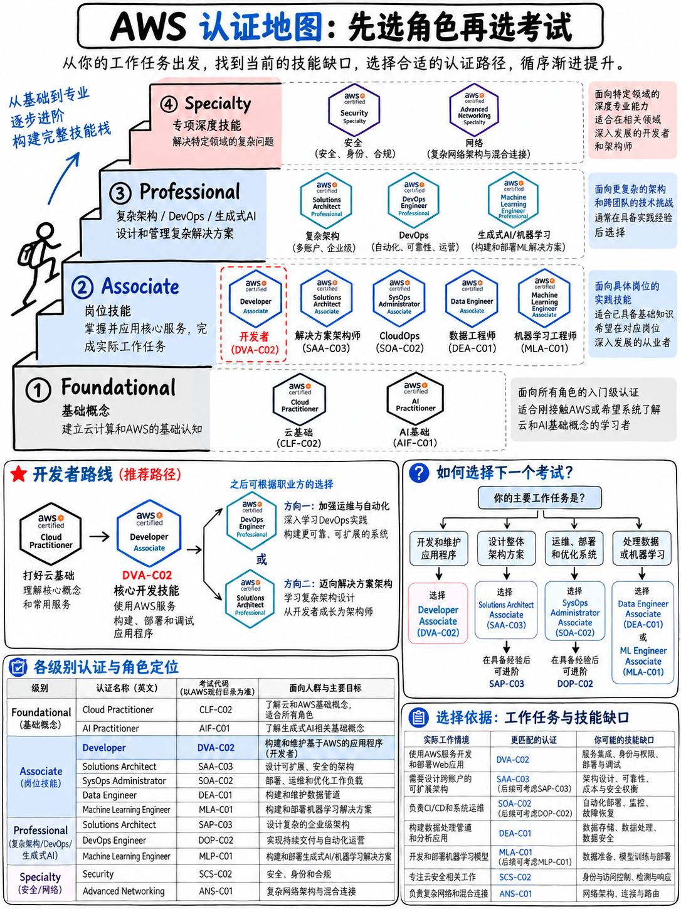

# 0.1 AWS 认证体系与全量现行考试代码清单 (The AWS Certification Series)

:::{danger}
**在开始所有内容之前，请务必先阅读 {doc}`03-the-dva-c03-deadline`。** 本课程体系针对的 **DVA-C02 考试最终可考日期为 2026 年 11 月 30 日**，随后将被 DVA-C03 取代 [5]。当前基准时间为 2026 年 10 月 13 日。这个时间节点直接决定了你接下来要做出的每一个备战决策。
:::



## 0.1.1 认证体系的层级划分

AWS 将其认证划分为四个主要等级，外加新增的商业技术路线。每项考试都拥有唯一的**考试代号（Code）**——由代表考试名称的字母缩写与代表版本的 `-C0n` 组成。由于 AWS 在版本迭代时会复用相同的认证*名称*，因此**考试代号是判断学习资料是否依然有效的唯一可靠依据**。

```
 商业路线 (BUSINESS)      AI Business Strategist (beta)
 ─────────────────────────────────────────────────────────────────────────
 基础级 (FOUNDATIONAL)   Cloud Practitioner (CLF-C02) · AI Practitioner (AIF-C01)
                         无需经验假设 · 考试时长 90 分钟 · 及格分 700
 ─────────────────────────────────────────────────────────────────────────
 助理级 (ASSOCIATE)      Solutions Architect (SAA-C03) · Developer (DVA-C02 → C03)
                         CloudOps Engineer (SOA-C03) · Data Engineer (DEA-C01)
                         Machine Learning Engineer (MLA-C01 → C02)
                         建议约 1 年实战经验 · 考试时长 130 分钟 · 及格分 720
 ─────────────────────────────────────────────────────────────────────────
 专业级 (PROFESSIONAL)   Solutions Architect (SAP-C02 → C03)
                         DevOps Engineer (DOP-C02)
                         Generative AI Developer (AIP-C01)
                         建议约 2 年全面实操经验 · 考试时长 180 分钟 · 及格分 750
 ─────────────────────────────────────────────────────────────────────────
 专项级 (SPECIALTY)      Security (SCS-C02) · Advanced Networking (ANS-C01, 即将退役)
                         深耕垂直技术领域 · 考试时长 170–180 分钟 · 及格分 750
```

## 0.1.2 现行全量考试一览：代号、考点权重与考试形式

以下所有数据均直接引自各考试官方发布的 **AWS Exam Guide PDF 原文**（于 2026 年 10 月 13 日下载核对）。表中已注明各指南版本号，方便你比对当前查阅的官方文档。

### 基础级 (Foundational)

| 维度 | **AWS Certified Cloud Practitioner** | **AWS Certified AI Practitioner** |
|---|---|---|
| 考试代号 | **CLF-C02** (指南版本 v1.0) [6] | **AIF-C01** (指南版本 v1.4) [7] |
| 计分题 / 不计分题 | 50 题 / 15 题 | 50 题 / 15 题 |
| 知识域与权重 | 云概念 24% · 安全与合规 30% · 云技术与服务 34% · 计费、定价与支持 12% | AI 与 ML 基础 20% · 生成式 AI 基础 24% · 基础模型的应用 28% · 负责任 AI 指南 14% · AI 解决方案的安全、合规与治理 14% |
| 及格分数 | 700 分 | 700 分 |

### 助理级 (Associate)

| 维度 | **Solutions Architect** | **Developer** | **CloudOps Engineer** | **Data Engineer** | **ML Engineer** |
|---|---|---|---|---|---|
| 考试代号 | **SAA-C03** (v1.1) [8] | **DVA-C02** (v1.3) [1] | **SOA-C03** [9] | **DEA-C01** (v1.0) [10] | **MLA-C01** (v1.0) [11] |
| 计分题 / 不计分题 | 50 题 / 15 题 | 50 题 / 15 题 | 50 题 / 15 题 | 50 题 / 15 题 | 50 题 / 15 题 |
| 知识域与权重 | 安全架构 30% · 弹性架构 26% · 高性能架构 24% · 成本优化架构 20% | 开发 32% · 安全 26% · 部署 24% · 故障排查与优化 18% | 监控/日志/分析/补救/性能 22% · 可靠性与业务连续性 22% · 部署、配置与自动化 22% · 安全与合规 16% · 网络与内容分发 18% | 数据摄取与转换 34% · 数据存储管理 26% · 数据运维与支持 22% · 数据安全与治理 18% | 数据准备 28% · ML 模型开发 26% · 部署与编排 22% · 监控、维护与安全 24% |
| 及格分数 | 720 分 | 720 分 | 720 分 | 720 分 | 720 分 |

:::{note}
**SOA-C02 已正式退役。** AWS Certified SysOps Administrator – Associate 已更名并由 **AWS Certified CloudOps Engineer – Associate (SOA-C03)** 取代：该考试于 2025 年 9 月 9 日开放注册，SOA-C02 最后一考为 2025 年 9 月 29 日，SOA-C03 于 2025 年 9 月 30 日起正式开考 [12]。目前旧版 SOA-C02 指南 (v2.3) 仍残留在 AWS 服务器上，这正是极易误导考生的典型情况——其旧版 6 个知识域（20/16/18/16/18/12）**并非**现行的 5 个知识域（22/22/22/16/18）。
:::

### 专业级 (Professional)

| 维度 | **Solutions Architect – Professional** | **DevOps Engineer – Professional** | **Generative AI Developer – Professional** |
|---|---|---|---|
| 考试代号 | **SAP-C02** (v1.2) [13] → **SAP-C03** | **DOP-C02** (v1.6) [14] | **AIP-C01** |
| 计分题 / 不计分题 | **65 题 / 10 题** | **65 题 / 10 题** | 参见 §0.1.4 说明 |
| 知识域与权重 | 组织复杂性设计 26% · 新解决方案设计 29% · 持续改进 25% · 迁移与现代化 20% | SDLC 自动化 22% · 配置管理与 IaC 17% · 高弹性云解决方案 15% · 监控与日志 15% · 事件与事故响应 14% · 安全与合规 17% | — |
| 及格分数 | 750 分 | 750 分 | 750 分 |

### 专项级 (Specialty)

| 维度 | **Security – Specialty** | **Advanced Networking – Specialty** |
|---|---|---|
| 考试代号 | **SCS-C02** (v1.1) [15] | **ANS-C01** (v2.0) [16] |
| 计分题 / 不计分题 | 50 题 / 15 题 | 50 题 / 15 题 |
| 知识域与权重 | 威胁检测与事件响应 14% · 安全日志与监控 18% · 基础设施安全 20% · 身份与访问管理 16% · 数据保护 18% · 管理与安全治理 14% | 网络设计 30% · 网络实施 26% · 网络管理与运维 20% · 网络安全、合规与治理 24% |
| 及格分数 | 750 分 | 750 分 |
| 备注 | — | **将于 2026 年 12 月 31 日正式退役** [4] |

## 0.1.3 值得关注的共通规律

所有 Associate（助理级）与 Foundational（基础级）考试在**考卷结构上完全一致**：总计 65 题，其中 50 道计分题，15 道不计分预备题（Pretest Items，不标明），最终转换为 100–1,000 分的量表分（Scaled Score），并采用**补偿性计分模型（Compensatory Scoring）**——你无需在每个知识域都达到及格线，只要总分达标即可通过考试 [1][6][7][8][9][10][11]。

Professional（专业级）考试则为 75 题（65 道计分题，10 道不计分题），及格线提升至 **750 分** [13][14]。

这种结构上的统一带来了一个极大的战术红利：**你在备战 DVA-C02 过程中掌握的应试技巧与题型剖析方法，可以直接无缝迁移到其他任何一门 AWS 认证考试中。** 模块 {doc}`../60-exam-technique/01-how-aws-questions-work` 所讲授的解题框架，将在你的整个 AWS 职业生涯中长期受益。

## 0.1.4 当前处于换代交替期的考试清单

当前正处于 AWS 认证体系极为少见的大规模迭代交替期。截至 2026 年 10 月 13 日，有四门考试正处于过渡更替节点：

| 考试名称 | 当前变动状态 | 关键时间节点 [5] |
|---|---|---|
| **Developer – Associate** | DVA-C02 → **DVA-C03** | **2026 年 10 月 27 日**开放新版报名 · **2026 年 11 月 30 日**为 DVA-C02 最后一考 · **2026 年 12 月 1 日** DVA-C03 正式开考 |
| **Solutions Architect – Professional** | SAP-C02 → **SAP-C03** | **2026 年 10 月 27 日**开放新版报名 · **2026 年 11 月 16 日**为 SAP-C02 最后一考 · **2026 年 11 月 17 日** SAP-C03 正式开考 |
| **ML Engineer – Associate** | MLA-C01 → **MLA-C02** | 2026 年 9 月 1 日开放 Beta 报名 · 2026 年 9 月 29 日起进行 Beta 考试 · **2027 年 1 月 14 日**正式上线（全语种 MLA-C01 同步退役） |
| **Advanced Networking – Specialty** | **即将退役** | 最终考试日为 **2026 年 12 月 31 日** [4] |

:::{important}
**AIP-C01（AWS Certified Generative AI Developer – Professional）为全新推出的专业级认证。** 它在一年前尚不存在。对于开发者而言，它是完成 DVA 后的自然进阶路线，且通过该考试还可直接刷新延展助理级 Data Engineer 与 ML Engineer 认证的有效期 [3]。在编写本手册时，除考试代号外，部分底层考纲细节尚未完全见诸 AWS 官方一级入口，因此标注为 **[待二次核实 (Unverified)]**——在制定针对该认证的学习计划前，请务必核对 aws.amazon.com/certification 官方主页。
:::

## 0.1.5 DVA 的定位及其真正考查目标

Developer – Associate 考试旨在验证“候选人在使用 AWS 服务开发、测试、部署和调试基于 AWS 云的应用程序方面的专业熟练程度” [1]。在实际体系中，它精准介于 SAA（侧重宏观架构设计）与 DOP（侧重生产级专业运维实战）之间：

```
      CLF-C02  “什么是 AWS？”
         │
         ├────────────────┬─────────────────┬──────────────────┐
         ▼                ▼                 ▼                  ▼
      SAA-C03          DVA-C02           SOA-C03            DEA-C01
      设计云架构       构建应用代码      保障平台运行       数据流转与处理
         │                │                 │
         └────────┬───────┴─────────────────┘
                  ▼
         SAP-C02 / DOP-C02          AIP-C01
         专业级纵深架构/运维        生成式 AI 全栈开发
```

**DVA 与 SAA 的根本差异在哪里？** 这也是无数人在考过 SAA 后折戟 DVA 的最核心原因：DVA 考查的是**“我如何在代码层面上实现它”**，而不是**“我应该挑选哪一款服务”**。它要求你对 Lambda 环境变量、DynamoDB 条件写入（Conditional Writes）、API Gateway 阶段变量（Stage Variables）、CodeDeploy 的 `appspec.yml` 生命周期钩子以及 AWS X-Ray 注解（Annotations）等具体、实操性的编码与运维细节了如指掌。考试指南甚至明确将宏观架构设计**排除在考纲之外**：“设计架构（例如分布式系统、微服务、数据库模式与建模）”和“设计并创建 CI/CD 流水线”均被列为目标候选人*不需要*承担的任务 [1]。

## 0.1.6 考试费用与容易忽略的五折优惠券

| 认证级别 | 报名费用 [2] |
|---|---|
| 基础级 (Foundational) | 100 美元 |
| 助理级 (Associate，含 DVA-C02) | **150 美元** |
| 专业级 (Professional) | 300 美元 |
| 专项级 (Specialty) | 300 美元 |

:::{tip}
**只要你考取了任意一门 AWS 认证，你的 AWS Certification Account 中就会自动发放一张用于下一门考试的 50% 折扣券（半价优惠券）** [2][3]。如果你计划考取两门认证，考试顺序会有直接的经济差异：先考便宜的科目，仅在你需要建立初阶信心时才有意义；而先考 150 美元的 Associate，再将半价券用于 300 美元的 Professional，能够直接为你立省 150 美元。
:::

## 0.1.7 证书有效期与再认证机制

- 每一张 AWS 认证证书的有效期均为 **3 年** [2]。
- **再认证（Renewal）**：通过同科目的最新版本考试，或通过对应的高级别考试，即可让证书有效期再延长 3 年 [3]。对于 Developer – Associate，考取 **AWS Certified DevOps Engineer – Professional (DOP-C02)** 即可直接使其自动展期 [2][3]。
- **维护模式（Maintenance）**：拥有有效的 AWS Skill Builder 订阅且证书在到期前 90 天内，可通过特定在线评估增加 **1 年**有效期 [3]。
- Cloud Practitioner 证书在到期前 6 个月内，可通过参与 AWS Cloud Quest 游戏化学习途径**免费**完成再认证——“无需考试，无需备考” [3]。

关于考过之后一周内的证书维护策略与进阶规划，可参阅 {doc}`../80-toolkit/07-resources-free-and-paid`。

## 0.1.8 本模块后续章节导读

- {doc}`02-dva-c02-at-a-glance` —— 一页纸速览 DVA-C02 核心考情
- {doc}`03-the-dva-c03-deadline` —— **在预约考位之前，务必优先通读本篇**
- {doc}`04-exam-mechanics-and-scoring` —— 深入解析 65 题取 50 题、720/1000 量表分与补偿性计分制
- {doc}`05-booking-policies-and-exam-day` —— 报名步骤、改期重考规则、证件要求与在线监考要点
- {doc}`06-priority-triage` —— 备考攻坚优先级：学什么、按什么顺序学以及战略性放弃什么
- {doc}`07-glossary-and-service-shortnames` —— 必考术语表与 AWS 官方缩略词对应规则

若想了解其他非 DVA 认证考试的极简速查导引，请从模块 {doc}`../10-other-exams/01-foundational-clf-c02-aif-c01` 开始阅读。
