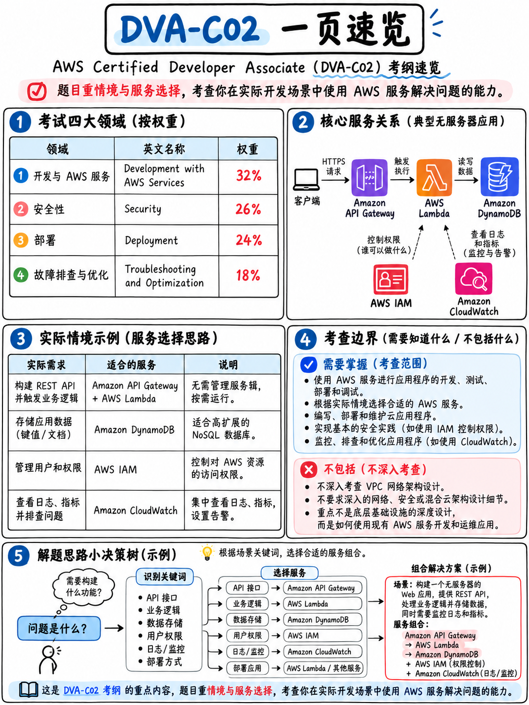

# 0.2 DVA-C02 考试全景速览 (DVA-C02 at a Glance)



本页所有数据与结论均直接引自或推算自 **AWS Certified Developer – Associate (DVA-C02) Exam Guide（版本 1.3）** [1] 以及 AWS 官方认证主页 [2]。

## 0.2.1 核心考情与硬性指标

| 考查维度 | 官方标准与参数规定 |
|---|---|
| **考试代号** | DVA-C02（官方考试指南版本 1.3） |
| **题目总数** | **65 题** —— 包含 50 道计分题与 **15 道不计分预备题（Pretest Items）**，卷面中不予标明 |
| **考试时长** | **130 分钟**（如申请 ESL 延时则为 160 分钟） |
| **试题题型** | 单选题（4 选 1）与多选题（5 选 2 或更多） |
| **分数区间** | 量表分 **100–1,000 分**；**最低及格线为 720 分** |
| **计分模型** | **补偿性计分（Compensatory）** —— 不设单项知识域及格线，总分达标即可通过 |
| **猜题规则** | “未作答题目记为错误；答错不倒扣分（There is no penalty for guessing）” |
| **报名费用** | 150 美元（可用上一门认证获得的 50% 优惠券抵扣为 75 美元） |
| **考试形式** | Pearson VUE 线下授权考点 **或** 居家/办公室线上监考（OnVUE） |
| **支持语言** | 英语、日语、韩语、葡萄牙语（巴西）、**简体中文**、西班牙语（拉丁美洲） |
| **证书有效期** | 3 年 |
| **最终可考日** | **2026 年 11 月 30 日** —— 详见 {doc}`03-the-dva-c03-deadline` |

## 0.2.2 四大知识域权重分布

> - 知识域 1：使用 AWS 服务进行开发（Development with AWS Services，占计分内容 **32%**）
> - 知识域 2：安全性（Security，占计分内容 **26%**）
> - 知识域 3：部署（Deployment，占计分内容 **24%**）
> - 知识域 4：故障排查与优化（Troubleshooting and Optimization，占计分内容 **18%**） [1]

按全卷 50 道计分题进行折算（**本手册根据权重比例测算**，AWS 官方承诺比例而非固定题数）：

```
 知识域 1  使用 AWS 服务进行开发       32%  ████████████████  约 16 题
 知识域 2  安全性                      26%  █████████████     约 13 题
 知识域 3  部署                        24%  ████████████      约 12 题
 知识域 4  故障排查与优化              18%  █████████         约 9  题
                                                              ──
                                                              50 题
```

:::{important}
**及格要求为 100–1,000 量表分中的 720 分，这并不等同于要做对 72% 的题目。** 量表分绝非简单的答对百分比——AWS 官方指出，量表分用于“平衡可能存在轻微难度差异的多套试卷（equate scores across multiple exam forms that might have slightly different difficulty levels）” [1]，且官方从未公开原始正确题数到量表分的换算曲线。网络上广泛流传的“必须答对 50 题中的 36 题”只是一种民间估算，并非 AWS 官方规则。详情参阅 {doc}`04-exam-mechanics-and-scoring`。
:::

## 0.2.3 AWS 官方对目标考生的定义

> “目标候选人应具备 1 年或以上使用 AWS 服务开发和维护应用程序的实际动手经验。” [1]

此外还需具备通用的 IT 专业素养：“精通至少一种高级编程语言”、“理解应用程序生命周期管理”、“具备开发功能性应用程序的能力”、“熟练使用开发工具” [1]。

:::{tip}
**你并不一定需要整整一年的真实 AWS 上线经验才能通过考试**，很多开发者在数周的系统突击后便顺利通过。但整套试卷的命题风格完全是*假定你拥有动手经验*来编写的。这也是本课程体系为每个知识点均配齐动手实操命令的原因（详见 {doc}`../80-toolkit/01-hands-on-lab-plan`）。对于 DVA 这门侧重工程实践的考试而言，在 AWS 控制台和 CLI 中实操 3 个小时，其提分效果远胜于刷 10 个小时的纯理论视频。
:::

## 0.2.4 明确划定在考纲范围外的技能

AWS 在指南中明确列出了目标候选人**不承担**的岗位职责 [1]：

> - 设计系统架构（例如分布式系统、微服务架构、数据库模式设计与建模）。
> - **设计并创建 CI/CD 流水线。**
> - 管理 IAM 用户与用户组。
> - 管理物理/虚拟服务器及操作系统底层。
> - 设计 AWS 网络基础设施（例如 Amazon Virtual Private Cloud [Amazon VPC]、AWS Direct Connect）。

:::{warning}
**请务必仔细研读第二条，这也是考生最常产生误解的地方。** “设计” CI/CD 流水线不在考查范围内，但**“使用”**流水线恰恰是知识域 3 任务 4 的重中之重——“使用 AWS CI/CD 服务部署代码”，官方指南为此列出了 8 条具体的技能说明 [1]。你必须清楚如何提交代码触发构建、精通 `buildspec.yml` 与 `appspec.yml` 的结构与钩子、选择部署策略并执行版本回滚。你只是不需要从零为整个企业设计一套流水线底层拓扑。

这一准则贯穿了整份考纲：**你的身份是在云平台上编码与交付的开发者，而不是制定全局基础设施标准的大架构师。**
:::

## 0.2.5 考纲内服务清单：比你想象的要少得多

AWS 在指南附录中公布了完整的考纲覆盖服务清单 [1]，总计仅 44 款服务。以下按照官方分类整理——这就是你需要攻克的核心技术范围：

| 分类领域 | 考纲内服务清单 |
|---|---|
| **分析 (Analytics)** | Athena · Kinesis · OpenSearch Service |
| **应用集成 (Application Integration)** | AppSync · EventBridge · SNS · SQS · Step Functions |
| **计算 (Compute)** | EC2 · Elastic Beanstalk · **Lambda** · SAM |
| **容器 (Containers)** | Copilot · ECR · ECS · EKS |
| **数据库 (Database)** | Aurora · **DynamoDB** · ElastiCache · MemoryDB · RDS |
| **开发工具 (Developer Tools)** | Amplify · CloudShell · CodeArtifact · CodeBuild · CodeDeploy · CodeGuru · CodePipeline · **X-Ray** |
| **管理与治理 (Management and Governance)** | AppConfig · CDK · **CloudFormation** · CloudTrail · **CloudWatch** · CloudWatch Logs · AWS CLI · Systems Manager |
| **网络与内容分发 (Networking and Content Delivery)** | **API Gateway** · CloudFront · ELB · Route 53 · VPC |
| **安全、身份与合规 (Security, Identity, and Compliance)** | ACM · **Cognito** · **IAM** · **KMS** · Private CA · **Secrets Manager** · STS · WAF |
| **存储 (Storage)** | EBS · EFS · **S3** · S3 Glacier |

::::{danger}
**在 DVA-C02 官方考试指南全文中，AWS CodeCommit 出现的次数为 0。** 无论是任务说明、技能点还是附录服务清单中，都没有它的身影 [1]——这一点已通过对指南文本的全词检索确认。指南实际表述为“基于 Git 的版本控制工具（例如 **Git**）”。

这一点至关重要，因为大量陈旧的网络培训资料仍在拿整整一个章节讲解 CodeCommit。AWS 早在 2024 年 7 月就已停止对新用户开放 CodeCommit，考纲早已同步剔除。**请重点攻克 `git`、CodeBuild、CodeDeploy、CodePipeline 与 CodeArtifact；千万不要在 CodeCommit 上浪费哪怕一个小时。** 参见 {doc}`../90-references/02-outdated-advice-red-flags`。
::::

官方同时公布了明确的**考纲外服务（Out-of-scope）** [1]，粗略浏览即可让你彻底放下心理负担：QuickSight、Chime、Connect、WorkMail、AppStream 2.0、WorkSpaces、Device Farm、GameLift、Lex、Polly、Rekognition、AWS Managed Services、Service Catalog、Elastic Transcoder、Application Discovery Service、Application Migration Service、DMS、Shield（Standard 和 Advanced）、Snow Family、Storage Gateway。

## 0.2.6 支撑起全卷考点的五大核心服务

**基于本课程体系对官方技能点与服务映射关系的归纳**（AWS 官方未公开单项服务的具体出题比重）：

```
 Lambda          ████████████████████████  横跨四大知识域无处不在
 IAM             ████████████████████      权限策略、执行角色、STS、资源策略
 DynamoDB        ██████████████            主键/索引设计、容量计算、Streams、缓存
 API Gateway     █████████████             Stages、Authorizers、集成类型、CORS
 CloudWatch      ███████████               Logs、指标、告警、EMF、Logs Insights
 ───────────────────────────────────────────────────────────────────────────────
 次重点梯队：     S3 · KMS · Cognito · CloudFormation/SAM · SQS/SNS/EventBridge ·
                 CodeBuild/CodeDeploy/CodePipeline · X-Ray · ECS/ECR · Step Functions ·
                 Secrets Manager / Parameter Store / AppConfig · ElastiCache
```

**只要你彻底吃透了 AWS Lambda，你就已经拿下了各个知识域最核心的大半壁江山。** 这正是为什么 {doc}`../20-development/02-lambda-deep-dive` 是本手册中篇幅最长的一章，也是为什么所有学习计划都会将其安排在第一天。

## 0.2.7 后续学习路径导引

| 你的当前需求 | 推荐跳转章节 |
|---|---|
| 权衡应该趁早考 C02 还是等待报考 C03 | {doc}`03-the-dva-c03-deadline` |
| 彻底搞懂及格分判定与防丢分技巧 | {doc}`04-exam-mechanics-and-scoring` |
| 了解报名通道、证件合规与考场红线 | {doc}`05-booking-policies-and-exam-day` |
| 立即开启高能学习路线 | {doc}`06-priority-triage` |
| 查看按天规划的冲刺排期计划 | {doc}`../80-toolkit/05-study-plans` |
