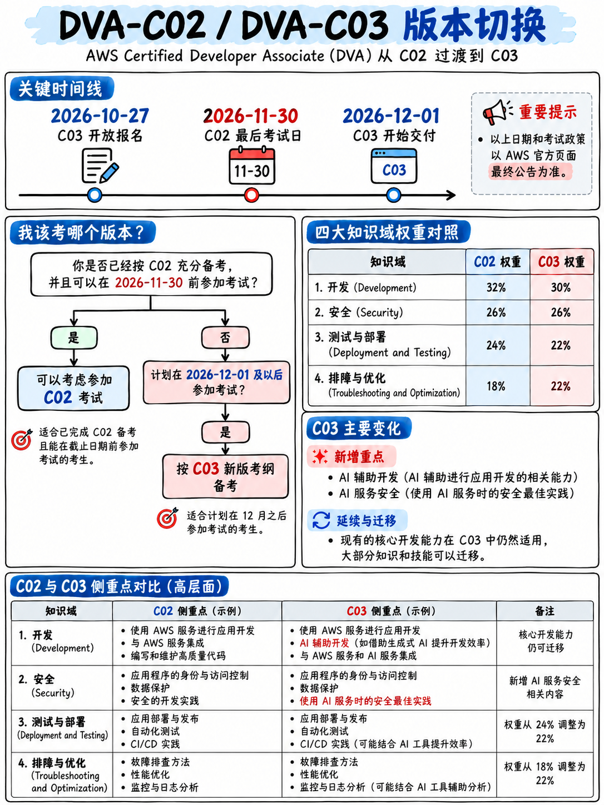

# 0.3 DVA-C03 改版关键时间节点与报考决策 (The DVA-C03 Deadline)

:::{danger}
**参加 DVA-C02 考试的最后截止日期为 2026 年 11 月 30 日。**

其迭代替代版本 **DVA-C03** 的注册报名通道将于 **2026 年 10 月 27 日**正式开放，并将于 **2026 年 12 月 1 日**起全面开考 [2][5]。

本课程体系编写于 **2026 年 10 月 13 日**。这意味着距离 DVA-C02 停考仅剩 **48 天**——且必须在 11 月 30 日或之前*实际完成考试*，而绝不仅仅是在该日期前提交预约。
:::



## 0.3.1 官方改版公告原文梳理

摘自 AWS 培训与认证官方博客 2026 年 9 月发布公告 [5]：

> “Registration for the updated exam (DVA-C03) will open on October 27, 2026, with GA delivery beginning December 1, 2026.”
> （更新版考试 DVA-C03 的报名将于 2026 年 10 月 27 日开放，正式开考时间为 2026 年 12 月 1 日。）

> “The last day to take the current version of the exam (DVA-C02) will be November 30, 2026.”
> （现行版本考试 DVA-C02 的最终考试日为 2026 年 11 月 30 日。）

AWS 官方 Developer – Associate 认证主页顶部横幅提示 [2]：

> “This exam is being updated. Registration for the updated version (DVA-C03) opens October 27, 2026.”
> “The last day to take the current exam (DVA-C02) is November 30, 2026.”
> “Check back here on October 27 for more information about the DVA-C03 exam and exam preparation resources.”

:::{important}
**通过 DVA-C02 取得的认证证书含金量丝毫不会降低。** AWS 明确声明，已取得的 DVA-C02 认证证书“在其原定的整个有效期内完全有效” [5]。你在 11 月 29 日通过 C02 所获得的 3 年有效认证，与你在次年 1 月通过 C03 所获得的认证徽章具有完全相同的权威性，徽章上绝不会标注任何区别性小字或星号。
:::

## 0.3.2 报考决策树与战略建议

```
 你能否在 2026 年 11 月 30 日或之前，现实地完成备考并成功锁定考位？
        │
        ├── 能够做到 ──► 坚决报考 DVA-C02。本手册正是针对该版本精准打造，
        │                 官方考纲稳定详尽，社区积淀了极其成熟的题库经验。
        │                 建议【立即锁定考位】——退役前最后两周考位极为紧张。
        │
        └── 确实来不及 ──► 做好准备报考 DVA-C03。依然完全可以使用本手册复习：
                          大约 85% 的核心技术考点保持不变（详见 §0.3.4）。
                          待 10 月 27 日官方发布新版大纲后，再针对性补充
                          §0.3.5 中所列出的增量考点即可。
```

**对于在 2026 年 10 月阅读本书的大多数考生而言，我们最实在的建议是：全力冲刺 DVA-C02。** 这纯粹出于战术考量而非主观情绪：

1. **考核目标高度明确稳定**：长达 16 页的考纲详尽罗列了每一个 Task 和 Skill 声明，官方提供了经过长期检验的样题，真题题库特征稳定。
2. **切忌做新版考试的“第一批小白鼠”**：任何新版考试上线后的头几个月，外界复习资料与真实考题均存在显著脱节，官方的新版配套样题在初期也极度匮乏。
3. **C03 引入了必须从头死磕的新增模块**：包含 AI 接口安全规范、AI 辅助编程工具链以及容器编排深水区（详见 §0.3.5）。
4. **进退自如，沉淀通用**：即便突击过程中计划有变，本手册模块 20 至 50 中的所有代码与架构知识在新旧两版中完全重合。

:::{warning}
**切忌将考期直接预约在 11 月 29 日或 30 日！** 万一考试当天突发状况（如身体不适、在线监考网络中断或验身失败、缺考等），你将没有任何挽回机会。因为根据 AWS 官方重考政策，考试未通过后必须**强制等待 14 个自然日**才能重新报考 [17]——届时 DVA-C02 将已永久停考下线。**务必最迟在 11 月中旬（例如 11 月 16 日前）完成首考**，这样即便首战失利，在 14 天等待期后依然能赶在 11 月 30 日进行二次突击。

倒推时间线：**2026 年 11 月 16 日**前进行首战，才能稳妥预留出 **11 月 30 日**的重考补救窗口。这才是你真正的生死截止线。
:::

## 0.3.3 冲刺期学习策略的三大转变

由于面对刚性截止日，你的备战策略必须与常规复习有所区分（这也正是 {doc}`../80-toolkit/05-study-plans` 中学习计划的核心设计原则）：

1. **先抢定考位，再开始看书**：一个不可更改的考试日期，是保证 2 至 6 周冲刺计划不被拖延症吞噬的唯一动力，且临近停考各考点名额非常稀缺。
2. **广度优先于极致深度**：在临近截止日的情况下，绝不能为了搞懂仅占 1~2 题的 DynamoDB 极端容量换算而耗费整整 4 天时间。学会抓大放小，详见 {doc}`06-priority-triage`。
3. **官方样题前置精读，切勿留在考前才看**：通读 {doc}`../70-practice/02-official-sample-questions-walkthrough`。这是官方公开发布的、100% 具备 DVA-C02 纯正血统的黄金试题，能让你第一天就建立起对“官方出题口吻”的直觉。

## 0.3.4 DVA-C03 中保持不变的核心内容

AWS 在改版官方公告中同步披露了 C03 的知识域分布 [5]：

| 知识域 | DVA-C02 [1] | DVA-C03 [5] |
|---|---|---|
| 使用 AWS 服务进行开发 (Development with AWS Services) | **32%** | **30%** |
| 安全性 (Security) | **26%** | **26%** |
| 部署 (Deployment) → **测试与部署 (Testing and Deployment)** | **24%** | **22%** |
| 故障排查与优化 (Troubleshooting and Optimization) | **18%** | **22%** |

核心考试机制完全保持原样：**130 分钟，65 题（50 题计分，15 题预备题），报名费 150 美元，及格线 720/1,000 分，Pearson VUE 交付** [5]。

:::{tip}
**这是非常平缓的一次版本换代。** 四大知识域仅有一处微调了名称，权重变动仅在 2 到 4 个百分点之间，题型与评分机制完全一致。**本手册第 20、30、40 和 50 模块中讲解的所有云服务与代码逻辑，新旧两版完全通用。** 唯独只有当前这篇关于改版时间节点的文章是具备特定时效性的。
:::

## 0.3.5 DVA-C03 的新增内容解析

根据 AWS 官方披露公告 [5]，新版新增及调整的要点包括：

**1. 新增安全子任务——AI 安全（AI security）**
> “新增任务 2.3（AI 安全，涵盖 5 项技能点）”，考查针对 AI 服务的访问鉴权控制、数据隐私隔离保护、敏感内容过滤与 Prompt 注入防御机制、AI Agent 交互安全以及日志中敏感信息的脱敏。

**2. 贯穿全卷的 AI 辅助软件开发** —— 在代码生成与审查、自动化测试编写、CI/CD 辅助配置、报错诊断排查以及性能优化建议等全生命周期中使用生成式 AI 工具。

**3. 容器技术的考查深度显著增加** —— 重点考查使用 Amazon ECR 进行镜像构建与生命周期管理，以及基于 ECS、EKS 和 AWS Fargate 的部署治理。

**4. 考纲新增纳管服务（官方原文引用）**：
> “New in-scope services: Amazon Bedrock, Amazon Bedrock AgentCore, Amazon Q, Kiro, Amazon Data Firehose, AWS PrivateLink”
> （包括 Bedrock 基础模型托管、Bedrock AgentCore、Amazon Q 开发者助手、Kiro、Data Firehose 以及用于私网接入的 PrivateLink）

**5. 考纲技能点合并精简** —— AWS 指出 DynamoDB 考查点由 4 项合并为 1 项，安全从 13 项合并为 7 项，测试从 11 项合并为 5 项，可观测性从 8 项合并为 5 项，性能优化从 9 项合并为 6 项 [5]。技能描述更宽泛宏观，但考查的基础底层服务没有变化。

**6. 明确列入考纲外的技术** —— “提示词工程（Prompt engineering）、RAG 架构底层算法、底层 AI 模型算法选型、Amazon SageMaker AI 模型训练平台，以及全局 AI 治理合规框架设计”均不在 C03 考查范围内 [5]。

::::{note}
**如果最终必须参加 C03 考试，请务必吃透第 6 点。** AWS 明确强调，新增的 AI 内容聚焦于**开发者如何安全地调用与集成 AI 托管服务**，而不是考核算法调优或底层模型训练。若转战 C03，增量内容大致为：Amazon Bedrock API 基础调用、Guardrails 内容安全过滤机制、Prompt 注入安全防御、调用 AI 服务时的 IAM 细粒度授权、日志隐私脱敏，外加 ECS/EKS/Fargate 的容器配置实操。在消化完本手册后，仅需多花几天突击上述增量，即可从容应战 C03。
::::

## 0.3.6 如果你在 2026 年 11 月 30 日之后阅读本文

此时 DVA-C02 已正式载入史册，你将直接迎战 DVA-C03。本手册依然是你最核心、最扎实的学习底座（参见 §0.3.4），但你需要进行以下补充：

1. **从官网下载最新的 DVA-C03 Exam Guide PDF**，并以其作为最高指导规范。{doc}`../90-references/01-sources-and-reliability` 中列明了官方最新文档获取路径。
2. 重新研读上文 §0.3.5，重点补齐 Bedrock、Amazon Q 和现代容器化部署的增量知识点。
3. 注意在 {doc}`02-dva-c02-at-a-glance` 中的权重分布有 2~4% 的小幅浮动，“Deployment” 知识域名称已微调为 “Testing and Deployment”。
4. 严格遵循 {doc}`../90-references/02-outdated-advice-red-flags` 中的辨伪法则：在 C03 上线后的相当长一段时间内，**市面上绝大多数所谓“最新真题”不过是把 DVA-C02 的旧题换了个标题年份而已**，请务必保持清醒。

## 0.3.7 同期处于更迭周期的其他认证考试

若你计划在拿下一门证书后继续挑战下一门，请一并记录以下关键考期更迭线 [4][5]：

| 认证考试 | 关键换代节点 |
|---|---|
| **SAP-C02** (Solutions Architect – Professional) | **2026 年 11 月 16 日**为最后一考；次日（11 月 17 日）正式由 SAP-C03 取代 |
| **MLA-C01** (ML Engineer – Associate) | 于 **2027 年 1 月 14 日**在全语种下线退役，正式由 MLA-C02 取代 |
| **ANS-C01** (Advanced Networking – Specialty) | 于 **2026 年 12 月 31 日**全面停止考试，该认证正式退出历史舞台 |

更全面的发展路径与选型建议，请参阅 {doc}`01-the-aws-certification-series` §0.1.4 与 {doc}`../10-other-exams/05-choosing-your-path`。
