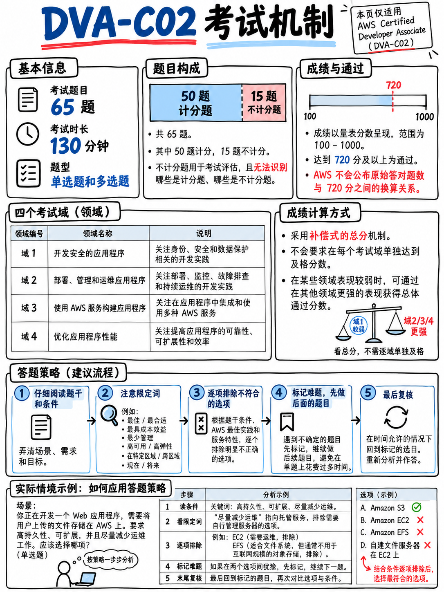

# 0.4 考试机制与计分规则深度剖析 (Exam Mechanics and Scoring)



## 0.4.1 AWS 官方公布的计分规则

AWS 官方考试指南中关于计分逻辑的原话如下：

> “未作答的题目将记为不正确；答错题目不倒扣分。考试包含 50 道影响最终成绩的计分题目。” [1]

> “考试包含 15 道不影响最终成绩的不计分测试题目。AWS 收集考生在这些不计分题目上的答题表现数据，以评估其在未来转为正式计分题目的可行性。**这些不计分测试题目在卷面上不会被专门标出。**” [1]

> “你的考试结果以 100 至 1,000 分的量表分（Scaled Score）形式呈现，最低通过分数为 720 分。……量表分模型有助于平衡可能存在微小难度差异的多套试卷的分数公平性。” [1]

> “本次考试采用**补偿性计分模型（Compensatory Scoring Model）**，这意味着你无需在每个知识域都达到及格线，只要整场考试的总分达到及格标准即可通过。” [1]

> “你的成绩单中可能包含一份显示你在各个知识域具体表现水平的分类评估表。……**请在解读知识域维度的反馈时保持审慎。**” [1]

## 0.4.2 衍生出的七大实战应试推论

**1. 整套试卷中有 15 道题完全不计分，且你无法分辨它们。**
这占据了整张试卷的 **23%**。这意味着你考场上遇到的每四道让你抓狂的难题中，就大约有一道其实根本不影响你的成绩，它只是在消耗你的宝贵时间。**实操原则：如果一道题目考查的是你闻所未闻的生僻服务，或者提问角度极其荒谬诡异，请给自己最多 60 秒时间，标记（Flag）后随便蒙一个选项并立刻进入下一题。** 绝不要让这类题目打乱你的做题心态与呼吸节奏——这是基于 AWS 预备测试题机制推导出的最科学应试心理。

**2. 720 分绝不等于 72% 的正确率。**
量表分是通过复杂的统计学模型对你的原始答对题数进行的换算映射，AWS 官方从未公开具体的换算函数。根据试卷题库批次难度，这个映射曲线是*动态平衡*的——这正是“平衡不同难度试卷”的真实含义 [1]。任何断言“必须精确答对 50 道题中的 36 题”的说法，都仅仅是民间经验估算。

::::{important}
**本手册建议的自测安全线为：在接近真实的模拟题中稳定达到 75%–80% 的正确率。**
这是**基于专业考评分析给出的容错区间，而非 AWS 官方声明**：假设 100~1000 分呈绝对线性分布，720 分对应的理论答对率约为 69%；而市面上的模拟练习题往往在情境综合度上略低于官方真题。将目标锁定在 75%–80%，能在考场面对难度波动与心理压力时留出充足的安全边际。
::::

**3. 考场上坚决不要留下一道空白题目。**
既然答错不倒扣分，未作答直接判错 [1]，那么即便纯靠概率盲猜，四选一单选题也有 25% 的拿分概率；留白则是百分之百拿 0 分。**请牢记：在考试剩余最后 5 分钟时，必须确保卷面上所有剩余题目都已勾选了选项。**

**4. 补偿性计分意味着你绝不会因为单项知识域发挥失常而直接挂科。**
哪怕你在第 4 知识域（故障排查与优化，仅占 18%，约 9 题）全军覆没，其他三个高权重知识域的优秀表现也完全能将你送过及格线。这为我们提供了战略分诊、抓大放小的战术依据（详见 {doc}`06-priority-triage`）——当然反之亦然：没有任何一个知识域可以让你在其余知识域彻底放弃的情况下单挑大梁。

**5. 多选题会在题干中明确注明需要选几个选项。**
题干末尾必定会有醒目的 `(Select TWO.)` 或 `(Select THREE.)` 提示，这在 AWS 官方公布的全部 10 道样题中无一例外 [18]。AWS 官方并未明确多选题是否存在部分得分（Partial Credit）——此项**[待二次核实 (Unverified)]**。在考场上务必将其视为“全对才给分”的规则严谨对待，值得为此多花 20 秒仔细逐项核对。

**6. 成绩单上的知识域等级评价仅具备宏观参考价值。**
AWS 官方特意提示考生“保持审慎” [1]——因为分配到每个知识域的计分题目仅在 9 到 16 题左右，样本量极小，单题的波动就会对分类评级产生巨大偏差。若未通过，该反馈只能用于指导你*大致看哪部分内容*，切莫因此得出“自己天生学不会安全”的极端结论。

**7. 考完后不会当场立刻出成绩。**
官方规定：“最终考试结果将在考试结束后**五个工作日内**发布至你的 AWS Certification Account” [17]。通常情况下，通过/未通过的状态在考后当天深夜或次日就会在系统更新，但请做好等待数日的心理预期。

## 0.4.3 时间分配法则：130 分钟与 65 道题目

在全卷 130 分钟内完成 65 道题，意味着平均**每道题有 120 秒（2 分钟）**的裕度。在业界同类技术认证中，这个时间预算是非常充裕的——DVA 考查的核心并不是阅读极限速度，而是概念的精准掌握。但题目之间的用时方差极大：

| 题目特征类型 | 目标建议耗时 | 耗时原因与应对策略 |
|---|---|---|
| 纯短句记忆题（如询问某项功能的归属服务） | 45–60 秒 | 知道就是知道，不知道想再久也回忆不出来 |
| 标准场景题（4 选项，常规篇幅） | 90–120 秒 | 考场上最常见的基本盘题型 |
| 多选题（从 5 个或更多选项中选 2~3 个） | 150 秒 | 必须对 5 个选项逐一排查真伪 |
| 携带长代码段、IAM 策略或构建文件的大场景题 | 180 秒 | 读取 JSON/YAML 语法细节极其消耗视线专注度 |
| 真正完全陌生的死角题目 | **60 秒内盲猜并标记** | 保护全局时钟，绝不恋战 |

```
 考场节奏监控检查点 (总计 130 分钟，65 道题)
 ────────────────────────────────────────────────────────────
 完成 20 题时  ──►  已用时约 40 分钟   （步调极为稳健）
 完成 40 题时  ──►  已用时约 80 分钟
 完成 65 题时  ──►  已用时约 110 分钟，留出充裕的 20 分钟用于检查
 ────────────────────────────────────────────────────────────
 若在任意检查点发现自己进度落后超过 8 分钟，应立即坚决执行
 “对难题快速猜选并加标记（Flag），先行推进行进节奏”的减负策略。
```

:::{tip}
**与某些线性锁死题目的考试不同，AWS 认证系统允许在整场考试内随意前后翻页复查。**
考场界面提供了非常方便的 Flag（标记）功能。务必采用标准应试节奏：**第一轮地毯式作答，绝不留空，边做边标记存疑题；第二轮集中所有剩余时间定向攻克已标记的难关。** 永远不要带着未作答的空题结束第一轮。
:::

## 0.4.4 试题的两大标准形态：剖析官方样题

AWS 官方公布的 10 道 DVA-C02 样题 [18] 全部严格遵循以下两种题型骨架：

**单项选择题（Multiple choice）** —— 包含“一个正确选项与三个错误选项（干扰项 Distractors）” [1]：

> “A company is migrating a legacy application to Amazon EC2 instances. The application uses a user name and password that are stored in the source code… the company needs to implement a secure way to store and **automatically rotate** the database credentials. **Which solution will meet these requirements?**” [18]
> （一家公司正将遗留应用迁移至 EC2，代码中硬编码了账号密码……需要安全存储并**自动轮换**数据库凭据。哪种方案满足要求？）

**多项选择题（Multiple response）** —— “从五个或更多选项中选出两个或更多正确答案” [1]：

> “A developer is creating a web application that must give users the ability to post comments and receive feedback in near real time. **Which solutions will meet these requirements? (Select TWO.)**” [18]
> （开发者正在构建 Web 应用，要求用户近实时发表评论并接收反馈。哪些方案满足要求？（选择两项。））

请注意题干共享的标准结构解剖，这正是 {doc}`../60-exam-technique/01-how-aws-questions-work` 中破题逻辑的核心密码：

```
 背景描述 (SCENARIO)      业务主体是谁、正在开发什么系统、当前现存技术拓扑
 核心约束 (REQUIREMENT)   决定答案走向的硬性限制条件，通常位于提问前的最后一句
 提问主干 (QUESTION)      “Which solution will meet these requirements?”
 决策限定词 (QUALIFIER)   MOST, LEAST, MOST cost-effective, LEAST operational overhead
                         （通常以全大写加粗呈现，用于在两个看似均可行的选项中做决断）
```

AWS 出题人极其喜欢将核心排他词全大写突出，例如：*“How can the developer maintain these environments with the **LEAST** amount of configuration?”* [18]。当出现大写限定词时，它肩负着淘汰另外两个“在技术上可行但在管理成本上过于繁重”的干扰项的决定性任务。

## 0.4.5 服务缩写与简称规则

官方指南明确指出：

> “为减轻考生的阅读认知负荷，AWS Certification 在本次考试中对包含缩写或括号补充说明的知名服务采用官方简称。例如，Amazon Simple Notification Service (Amazon SNS) 在考试中直接呈现为 Amazon SNS。
>
> 考场界面针对每道题均提供了帮助（Help）功能，其中包含考试涉及的 AWS 服务简称与其完整全称对照表。” [1]

这意味着两件事：第一，**你在卷面上看到的将是 “Amazon SNS” 而非冗长的全名**，因此必须对服务简称具备肌肉记忆；第二，**每道题界面中都有一个内置的 Help 悬浮窗**，点开即可查阅完整名称清单（虽然熟练的考生通常完全不需要用到它）。

但官方也同时发出预警：“并非所有缩写都会在卷面展开或收录在 Help 清单中……（例如 Amazon API Gateway、Amazon EMR）。考试还可能包含假定目标受众理应掌握的其他通用技术缩写” [1]。你需要完全倒背如流的完整缩写表已在 {doc}`07-glossary-and-service-shortnames` 中全部备齐。

## 0.4.6 成绩单呈现的信息与重考规则约束

- **Pass 或 Fail 状态**，以及你的最终量表分数值 [1][17]。
- 一份**各知识域表现分级表**（显示 Meets competencies 或 Needs improvement），附带官方审慎参考说明 [1]。
- 可在考后通过系统直接下载带防伪特征的官方成绩单 PDF（进入 AWS Certification Account 里的 **Exam History** 标签页） [17]。

:::{warning}
**考试通过后，两年内不得重考同一科目** —— “一旦通过考试，在两年内你将无法再次报考同一门考试” [17]。而万一考试未能通过，“你必须**强制等待 14 个自然日**后方可重新预约下一次考试”，且“重考次数不设上限，但**每一次重考都必须全额缴纳全额报名费用**” [17]。

由于 DVA-C02 将于 2026 年 11 月 30 日彻底停考下线，该 14 天等待期成了不可逾越的硬门槛。这直接决定了你绝对不能在最后两周才匆忙初战，详见 {doc}`03-the-dva-c03-deadline` §0.3.2。
:::
