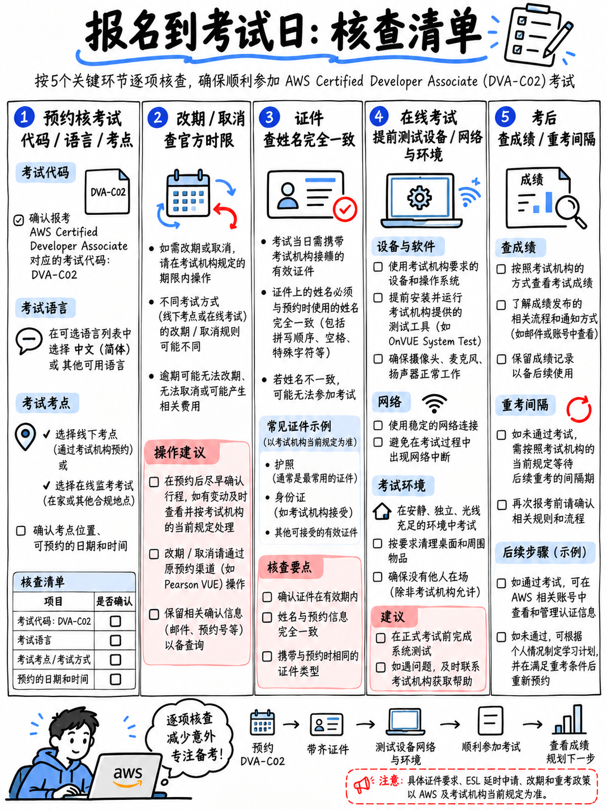

# 0.5 报名流程、考试政策与考场实战守则 (Booking Policies and Exam Day)

以下所有政策规定均直接引自 AWS 培训与认证官方政策条例 [17][19] 及官方考试首页 [2]。

## 0.5.1 报考与预约流程

1. **注册创建 AWS 认证专属账户（AWS Certification Account）**：“要安排认证考试，你必须先创建一个 AWS Certification Account” [19]。请注意，此账户与日常登录 AWS 控制台的云上 AWS Account 相互独立。
2. **选择考试交付方式**：可选择前往 Pearson VUE 线下官方授权考点，或选择在家庭/办公室进行**在线监考（Online Proctored / OnVUE）** [2]。
3. **支付考试费用**：标准报考费用为 **150 美元**；若此前已获得过任意 AWS 认证，可直接填入 Certification Account 内存储的 50% 折扣券代码，仅需支付 75 美元 [2][3]。
4. **通过 Pearson VUE 系统选择考期与场次**完成最终预约。

:::{danger}
**如果你打算参加 DVA-C02 考试，请立即预约考位！** 官方设定的最后考试截止日为 **2026 年 11 月 30 日** [2][5]，根据往届惯例，任何一门即将停考的认证在最后两周的考位都会在极短时间内被抢订一空。强烈建议将初考日期定在 **11 月 16 日或更早**，以便为可能需要的 14 天重考等待期预留安全窗口——详见 {doc}`03-the-dva-c03-deadline` §0.3.2。
:::

## 0.5.2 改期与取消考位政策

| 业务动作 | 官方执行政策 [19] |
|---|---|
| **改期时间窗口** | “考生最早可在原定考试预约时间前 **24 小时**发起改期。” |
| **改期次数上限** | “每次考试预约最多仅支持改期 **两次（twice）**。” |
| **不足 24 小时限制** | “在距原定考试时间不足 24 小时内，系统将不再允许取消或改期。” |
| **缺考或超时取消** | “将直接导致**考试全额费用被没收（forfeiture of your exam fee）**，概不退还。” |
| **提早 24 小时以上取消** | “全额退回考生在购买时所支付的考试费用。” |

## 0.5.3 证件身份核验要求

- 必须提供在非受制裁国家常住的**由政府签发的有效身份证件** [19]。
- 如果你持有的非考试所在国签发的居民身份证（欧盟居民卡除外），则必须出具**国籍国签发的国际旅行护照（Passport）**作为首要第一有效证件 [19]。
- 考场要求同时出示**第二辅助证件（Secondary ID）**（例如包含本人印刷体姓名和亲笔签名的信用卡、借记卡或驾照等） [19]。
- 线上监考与线下考点在证件细节要求上略有不同——在预约完成后，请务必核对 Pearson VUE 确认信中的细则列表。

:::{warning}
**你证件上的姓名拼写必须与在 AWS 认证系统中填写的英文姓名 100% 绝对一致！** 这是历年来导致考生在考场门口被直接拒绝入场且当场没收报名费的最常见原因（例如中文拼音姓与名的颠倒、多填或少填中间名）。请在预约当天立即进行逐字复核，绝不要拖到考试当天现场才发现错误。
:::

## 0.5.4 考试融通措施与母语非英语考生福利：ESL +30

> “对于持有残障医疗证明的考生，可申请合规融通措施。”相关申请“必须在每次预约具体考试之前完成审批。” [19]

除上述常规融通外，还有一项大多数普通考生毫不知情、却享有合法申请权利的重磅福利：

::::{important}
**ESL +30（英语非母语考生 30 分钟延时机制）。**
凡是母语非英语的考生，只要在报考**英文版本**的 AWS 认证考试时，均有资格申请延长 **30 分钟**的考试时间。AWS 官方政策明确规定，该项融通申请一旦生效，“将永久适用于该考生后续所有新注册的考试” [19]。

这意味着 DVA-C02 的作答时间将直接由 130 分钟暴增至 **160 分钟**——在无需提供任何医疗证明的前提下，免费获得高达 23% 的答题时间增量。该申请必须在你的 AWS Certification Account 里的 **Exam Accommodations** 标签页内提前开通，**务必在点击安排考试前完成激活**。

如果英语不是你的第一母语，且你打算选择英文考卷，请务必在报名前激活此功能。它完全免费，且能彻底消除整场考试中可能存在的任何时间压力。
::::

此外需要说明的是，DVA-C02 官方本身就直接提供了**简体中文、日语、韩语、葡萄牙语（巴西）以及拉丁美洲西班牙语**试卷 [2]。如果你更习惯母语语境，直接报考简体中文卷是完全合规且高效的选择——但需要做好心理准备：业界大部分优质的技术深度解析、官方技术白皮书和底层 CLI 报错信息均为英文，母语参考可能会面临在备考时建立的是一套英文术语脑图，而在考场上阅读的是翻译后中文字句的语境切换成本。详见 {doc}`../80-toolkit/06-exam-day-checklist` §8.6.6。

## 0.5.5 在线监考（OnVUE）的核心避坑指南

在线监考虽然在家即可考试，但也是各种意外事故与判违规的高发区。监考规定由 Pearson VUE 执行，但直接后果由考生承担：一旦验身失败或判罚中断，报名费直接作废。

- **必须提前数天使用考试当天实际使用的电脑与网络进行系统环境测试（System Test）**，切莫在考前一小时才临时测试。
- **物理桌面必须 100% 净空**：必须在封闭房间内进行，视野范围内不得出现外接第二显示器、智能手表、手机、实体草稿纸与笔。官方严禁使用实体白板，考试软件内内置了电子虚拟白板。
- **考试全程严禁任何其他人进入房间**。一旦监控画面中出现任何第三人推门或说话，监考员将立即直接掐断考试并判违规。
- 考前签到流程通常耗时 15–30 分钟：需要用手机拍摄环境四周照片、核验身份证件，并通过摄像头进行 360 度无死角空间巡检。
- 极力推荐使用稳定的有线网络连接（网线直连路由器），家用 Wi-Fi 的偶发抖动极易导致监考视频流中断。

:::{tip}
**如果你对网络稳定性、房间私密性或监考软件兼容性有任何一丝顾虑，强烈建议直接预约线下实体考点。** 考试本身的技术难度已经足够高，没有必要再在考场上分心去伺候挑剔的线上监考系统。线下考点提供标准化设备、合规网络、实体储物柜与实体草稿板，且绝不用担心家人或室友突然开门打扰。
:::

## 0.5.6 成绩公布与重考政策对照

| 考务环节 | 官方政策细则 [17] |
|---|---|
| **成绩出具时限** | “最终成绩将在考试结束后**五个工作日内**更新至考生的 AWS Certification Account 中。” |
| **成绩单获取方式** | 登录 Certification Account → 点击 **Exam History** 标签页 → 查看 **Score Report** 下载 PDF |
| **考试未通过重考** | “必须自考试当日起**强制等待整整 14 个自然日**，方可获得重新报考的资格。” |
| **重考次数上限** | “官方对考生的重考总次数**不设任何上限**。” |
| **重考报名费用** | “每一次重考预约，考生都必须**全额支付全额考试报名费用**。” |
| **通过后重考限制** | “一旦考生顺利通过某门考试，在**两年之内**系统将严禁其再次报考同一门考试。” |

## 0.5.7 考场保密协议与题库辨伪

在进入正式试题前，考生必须强制接受一份保密协议（NDA）。**严禁在考后以任何形式传播、记录、买卖真实的真题文本。**

除合规要求外，从纯实战角度出发：网络上倒卖的所谓“真题题库（Exam dumps）”质量极度堪忧，错误答案泛滥成灾，往往充斥着早已退役的旧版题目。尤其是对于 DVA 而言，坊间许多旧资料甚至还在沿用 2023 年 C01 时代的废弃考点。

本手册附带的 {doc}`../70-practice/03-mini-mock-65-questions` 以及各知识域专项练习题，全部是**对照 AWS 官方大纲核心任务点独立编写的高质量原创模拟题**。市面上唯一绝对真实合规且代表 DVA-C02 正统出题标准的，仅有 AWS 官方公开的 10 道标准样题 [18]，我们在 {doc}`../70-practice/02-official-sample-questions-walkthrough` 中进行了逐字逐句的深度透视。

## 0.5.8 考试当天三大黄金法则

完整考场清单请查阅 {doc}`../80-toolkit/06-exam-day-checklist`。这里提炼考场最关键的三大制胜法宝：

1. **宁早勿晚，提前签到**：实体考场请至少提前 30 分钟抵达现场，预留充足时间完成证件登记与储物安检。
2. **第一遍通刷全卷，边做边标记，决不允许空题**：随后利用剩余时间对 Flagged 题目进行二次集中攻关（参见 {doc}`04-exam-mechanics-and-scoring` §0.4.3）。
3. **养成“先读题干末尾核心问句”的破题习惯**：答案的走向往往藏在最后那句硬性约束中——例如 *least operational overhead*（最低运维开销）、*most cost-effective*（最具成本效益）、*in near real time*（近实时响应），它能在秒级时间内帮你从两个看似皆通的技术方案中锁定唯一胜出者。
