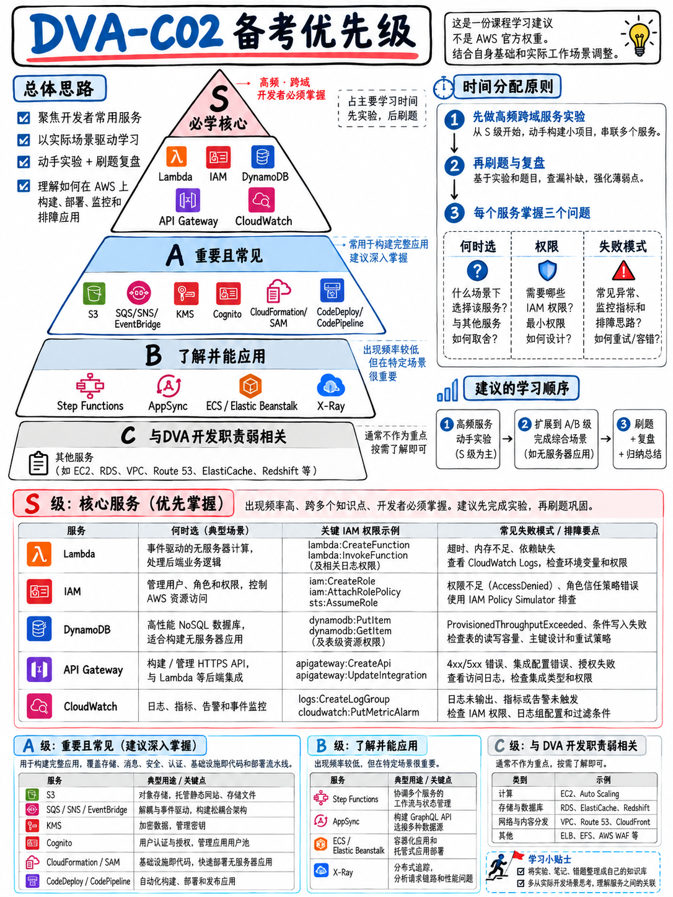

# 0.6 优先级分诊：学什么、按什么顺序学以及战略性放弃什么 (Priority Triage)



**本章节为本课程体系的战略核心分析**，直接基于 AWS 官方公布的考纲权重比例提炼而成 [1]。它构成了你的全局战略方向，后续所有章节均为战术落地。

## 0.6.1 考题算术与服务分布真相

全卷共 50 道正式计分题，分布在四大知识域，涵盖 44 款考纲覆盖服务。

| 知识域 | 权重比例 | 对应折算计分题数 |
|---|---|---|
| 知识域 1 · 使用 AWS 服务进行开发 | 32% | **约 16 题** |
| 知识域 2 · 安全性 | 26% | **约 13 题** |
| 知识域 3 · 部署 | 24% | **约 12 题** |
| 知识域 4 · 故障排查与优化 | 18% | **约 9 题** |

:::{important}
**如果将 50 道题目均摊到 44 款服务上，平均每款服务仅对应约 1 道计分题。**
这意味着：没有任何单一服务能够单独主宰整场考试的胜负；同时，也几乎没有任何一款非核心服务漏学，就会凭一己之力导致你挂科。但卷面题目的真实分布呈现极强的**长尾倾斜效应**：极少数服务作为核心载体横跨四大知识域无处不在，而绝大多数边缘服务在整张卷面上往往只露面一次、甚至根本不出现。

**高效通关的唯一黄金法则：精通 5 大核心服务，熟练掌握 15 款骨干服务，对其余边缘服务仅保留基础概念印象。**
:::

## 0.6.2 贯穿四大知识域的五大核心服务

这些服务并不是各自孤立地占据 2% 的考卷份额——它们几乎渗透到了考场上的每一道综合场景题中：

| 核心服务 | 渗透出现的知识域 | 为什么它能够持续产生复利效应？ |
|---|---|---|
| **AWS Lambda** | **全部四大知识域** | **开发**（函数编写、事件源映射）、**安全**（执行角色、环境变量 KMS 加密）、**部署**（版本、别名、层、SAM 编排）、**排错**（CloudWatch 日志、X-Ray 追踪、内存配置优化、并发限制报错） |
| **IAM** | **全部四大知识域** | 贯穿所有涉及权限校验的题目，以及绝大部分跨服务调用（Service-to-Service）场景 |
| **Amazon DynamoDB** | 知识域 1, 2, 4 | 分区键与索引设计、读写容量异常（ProvisionedThroughputExceeded）、数据落盘加密、DAX 缓存、DynamoDB Streams |
| **Amazon API Gateway** | 知识域 1, 2, 3, 4 | 后端集成机制、Lambda Authorizer、阶段与阶段变量（Stage Variables）、API 缓存、4xx 与 5xx 状态码排错 |
| **Amazon CloudWatch** | 知识域 1, 3, 4 | CloudWatch Logs、自定义指标、告警、EMF 嵌入式指标格式、Logs Insights 检索、CI/CD 部署失败排障 |

**只要你把这五款核心服务彻底摸透，你就已经稳稳拿下了整张试卷过半的考分。** 这正是为什么 {doc}`../20-development/02-lambda-deep-dive` 是本手册中篇幅最庞大的单体章节，也是为什么所有备考计划都必须以它为第一突破口。

## 0.6.3 服务重要性天梯榜

### S 级（Tier S）—— 必须优先攻克，绝无商量余地

| 学习模块 | 对应手册章节 | 核心价值定位 |
|---|---|---|
| Lambda：底层配置、版本与别名、Lambda Layers、并发控制、事件源驱动、常见运行时报错 | {doc}`../20-development/02-lambda-deep-dive` | 卷面出镜率最高的核心引擎，横跨所有知识域 |
| IAM 策略判定逻辑（Policy Evaluation）、角色 vs 用户、基于资源的策略（Resource-based）、STS | {doc}`../30-security/02-iam-policies-and-roles` | 支撑起全卷约四分之一题目的权限底层基石 |
| DynamoDB 键值设计、LSI 与 GSI 索引、读写容量计算、一致性模型、Streams 数据流 | {doc}`../20-development/04-dynamodb` | 知识密度极高、考查极具实操性与区分度的必考重点 |
| API Gateway 部署阶段、阶段变量、自定义授权方、多种集成类型差异 | {doc}`../20-development/03-api-gateway` | 在海量无服务器架构场景中与 Lambda 深度绑定出现 |
| AWS 题干结构剖析与核心排他限定词识别技巧 | {doc}`../60-exam-technique/01-how-aws-questions-work` | 通用答题利器，全盘赋能全部 50 道正式计分题 |

### A 级（Tier A）—— 构筑高分底盘的骨干服务

- **异步消息系统**：SQS / SNS / EventBridge 的选型分流与解耦场景（{doc}`../20-development/06-messaging-sqs-sns-eventbridge-kinesis`）
- **数据加密规范**：AWS KMS 与信封加密（Envelope Encryption）机制（{doc}`../30-security/04-kms-and-encryption`）
- **身份认证机制**：Cognito 用户池（User Pools）与身份池（Identity Pools）的区别（{doc}`../30-security/03-cognito-and-federation`）
- **配置与凭据存储**：Secrets Manager vs Parameter Store vs AppConfig 的定位（{doc}`../30-security/05-secrets-and-config`）
- **声明式无服务器编排**：CloudFormation 与 SAM，包含 `sam local` 本地调试（{doc}`../40-deployment/02-cloudformation-sam-cdk`）
- **托管持续交付**：CodeBuild 的 `buildspec.yml`、CodeDeploy 的 `appspec.yml` 与 CodePipeline 流水线（{doc}`../40-deployment/03-cicd-pipeline-services`）
- **部署发布策略**：金丝雀部署（Canary）、线性部署（Linear）、蓝绿部署（Blue/Green）与滚动部署（Rolling）（{doc}`../40-deployment/04-deployment-strategies`）
- **云端可观测性**：CloudWatch Logs、指标筛选器（Metric Filters）、告警与 EMF 格式（{doc}`../50-troubleshooting/02-cloudwatch-logs-metrics-alarms`）
- **分布式链路追踪**：AWS X-Ray：段（Segments）、子段、注解（Annotations）与元数据（Metadata）、采样规则（{doc}`../50-troubleshooting/03-x-ray-and-tracing`）
- **对象存储开发**：Amazon S3 存储桶类别、预签名 URL（Presigned URLs）、分段上传、加密机制（{doc}`../20-development/05-s3-and-storage`）

### B 级（Tier B）—— 若时间充裕，按顺序查漏补缺

- Step Functions 工作流状态机与 AppSync GraphQL 架构（{doc}`../20-development/07-step-functions-and-appsync`）
- 容器底座：ECS / ECR / Fargate 核心概念（{doc}`../40-deployment/05-containers-ecs-ecr-eks`）
- 缓存加速体系：ElastiCache 与 DynamoDB DAX 策略对比（{doc}`../50-troubleshooting/05-optimization-and-caching`）
- Elastic Beanstalk 的部署策略与配置文件机制（{doc}`../40-deployment/06-elastic-beanstalk-and-amplify`）
- Kinesis Data Streams 分区键（Partition Key）与分片（Shard）扩缩容
- CloudFront 缓存行为（Cache Behaviors）与签名 Cookie / 签名 URL

### C 级（Tier C）—— 战略性坚决放弃

:::{danger}
以下每一项内容都会吞噬你数小时乃至数天的时间，但在 DVA-C02 考卷中的产出几乎为零。**学会果断舍弃，是短期高效冲刺通过考试的最核心底牌。**
:::

| 坚决放弃的内容 | 放弃的客观依据 |
|---|---|
| **AWS CodeCommit** | **在 DVA-C02 考试指南中出现次数为 0**——既非任务，非技能，也不在考纲服务清单中 [1]。AWS 早在 2024 年就停止了新用户注册。 |
| 宏观企业架构设计、微服务拆分理论、数据库建模 | 官方明确列为目标候选人的**考纲外范畴（Out of scope）** [1] |
| 从零开始设计全局企业级 CI/CD 流水线架构 | 考纲明确排除——考纲考查的是**使用**流水线部署服务 [1] |
| VPC 复杂子网划分、路由表、Direct Connect、Transit Gateway | “设计 AWS 网络基础设施”明确属于考纲外 [1]。你仅需搞懂“Lambda 如何接入 VPC”以及安全组基本配置 |
| IAM 用户与用户组的行政管理运维 | 属于考纲外 [1]。重点在角色（Roles）、策略（Policies）与 STS 临时凭据 |
| EC2 底层复杂实例规格族、Auto Scaling 底层缩放算法、ELB 算法细节 | 属于 SAA 与 SOA 的考查重点。DVA 仅考查将代码部署上去的最简流程 |
| SageMaker、Rekognition、Polly、Lex、QuickSight、Snow 系列、Storage Gateway、DMS、AWS Shield | 均明确位于 AWS 官方公布的**考纲外服务清单**中 [1] |
| 死记硬背所有服务的极端软硬配额（Limits） | 仅有极个别关键参数有考查价值。{doc}`../80-toolkit/03-numbers-and-limits` 中已列出精简清单 |
| 网络上倒卖的真题题库（Dumps） | 违反考生保密协议，答案漏洞百出，且大多脱胎于已退役的 DVA-C01 |

## 0.6.4 备考时间预算科学分配

针对认真高效的短期突击备考，本手册推荐的时间配比如下：

```
 Lambda + 事件驱动集成 + SAM 本地编排         ███████████████████  19%
 IAM, KMS, Cognito, 密钥与参数管理 (知识域 2) ████████████████     16%
 DynamoDB + S3 + 缓存策略                    █████████████        13%
 API Gateway 路由、阶段变量与鉴权            █████████             9%
 CI/CD: CodeBuild/Deploy/Pipeline + 发布策略  █████████████        13%
 CloudFormation / SAM / CDK 声明式定义       ███████               7%
 CloudWatch + X-Ray + 异常调试诊断           ███████████          11%
 消息传递：SQS/SNS/EventBridge/Kinesis        ███████               7%
 动手动手实验（穿插于各模块中，而非孤立进行） ──
 考前计时全真模拟 + 错题本复盘               █████                5%
```

请关注两个关键现象：**知识域 2（安全）虽然官方权重高达 26%，但这里仅分配 16% 的纯理论学习时间**——因为 IAM 与 KMS 的知识点在后续所有代码与部署章节中会被反复运用强化，属于在实战中二次吸收；而 **Lambda 独占了超过任何单项知识域的时间配比**——因为学透 Lambda 本身，就等于直接搞定了各大知识域的核心考点。

## 0.6.5 本课程学习推进次序建议

```
 ┌──────────────────────────────────────────────────────────────────────┐
 │  1. 00-foundations                  约 2 小时   吃透考试规则与改版时间线 │
 │  2. 60-exam-technique/01 + 02       约 2 小时   掌握题干破题与限定词解码 │
 │  3. 20-development (优先攻克 Lambda) 约 12 小时  拿下占比 32% 的核心枢纽  │
 │  4. 30-security                     约 8 小时   攻克占比 26% 的安全底座  │
 │  5. 40-deployment                   约 9 小时   搞定占比 24% 的持续交付  │
 │  6. 50-troubleshooting              约 6 小时   拿下占比 18% 的可观测性  │
 │  7. 80-toolkit 动手实验：从第 2 天起穿插进行，绝对不要堆到最后才做   │
 │  8. 70-practice 练习题：从第 3 天起交替刷题，考前完成全真迷你模考     │
 └──────────────────────────────────────────────────────────────────────┘
```

:::{tip}
**实验必须随学随练，切忌拖延至全部学完才做！**
DVA-C02 的题目具有非常鲜明的工程落地属性——例如 `appspec.yml` 中钩子的先后执行顺序、API Gateway 阶段变量的动态路由配置、DynamoDB 报出的是哪种特定异常类。在本地使用 SAM 亲手部署一次无服务器应用所带来的肌肉记忆，比硬看 3 个小时概念文档深刻得多，它能帮助你在考场上一秒区分出“真懂”与“蒙猜”。
{doc}`../80-toolkit/01-hands-on-lab-plan` 提供了 9 个精炼实验，均在 1 小时内即可完成，且 100% 覆盖在 AWS 免费套餐（Free Tier）安全额度内。
:::

## 0.6.6 如果你的复习时间不足一周

1. 通读 {doc}`03-the-dva-c03-deadline` —— 再次确认你的考期是否在合法安全窗口内。
2. 研读 {doc}`../60-exam-technique/01-how-aws-questions-work` 与 {doc}`../60-exam-technique/02-keyword-to-service-map` —— 至少通读两遍，建立解题雷达。
3. 精读 {doc}`../20-development/02-lambda-deep-dive` —— 全文无死角吃透。
4. 攻克 {doc}`../30-security/02-iam-policies-and-roles` 与 {doc}`../30-security/04-kms-and-encryption`。
5. 掌握 {doc}`../20-development/04-dynamodb` 与 {doc}`../20-development/03-api-gateway`。
6. 掌握 {doc}`../40-deployment/03-cicd-pipeline-services` 与 {doc}`../40-deployment/04-deployment-strategies`。
7. 认真研读 {doc}`../70-practice/02-official-sample-questions-walkthrough`，随后在限时模式下完成 {doc}`../70-practice/03-mini-mock-65-questions`。
8. 考前最后一晚通读 {doc}`../80-toolkit/02-cheat-sheets` 核心速查表。

在这个紧迫节奏下，你可以问心无愧地直接跳过 Step Functions、AppSync、EKS、Elastic Beanstalk、Kinesis 深度细节以及 Amplify。{doc}`../80-toolkit/05-study-plans` 中的“7 天冲刺计划”详细规划了每一天的具体任务。
