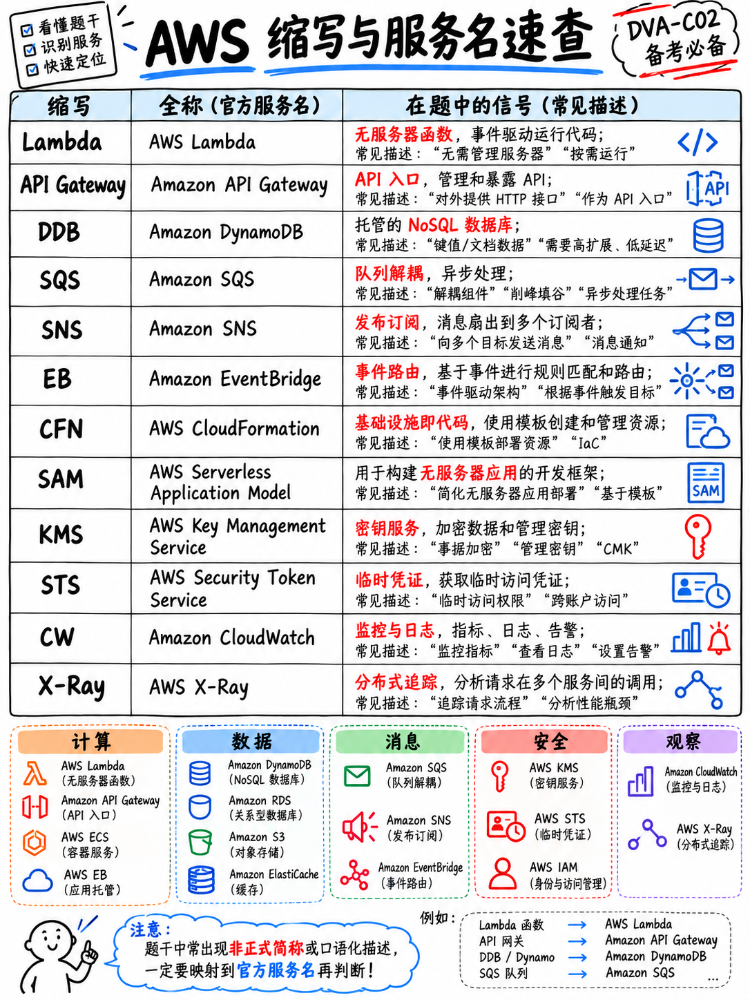

# 0.7 术语表、缩略语与核心服务简称速查 (Glossary and Service Shortnames)

AWS 官方明确声明：为降低阅读负担，考试在题干与选项中会直接使用**官方服务简称**，且每道题目的帮助（Help）功能中均附有简称列表；但官方同时也发出提醒：“并非所有缩写都会被完全展开……考试还可能包含假定目标受众理应掌握的其他通用技术缩写” [1]。本页即为你整理并呈现所有必须掌握的缩写与核心概念集合。

## 0.7.1 认证专属高频词汇

ECO / Exam Guide (考试指南)
: AWS 官方发布的权威指南 PDF，具有界定考试范围的最高法律效力。DVA-C02 对应版本为 v1.3 [1]。若任何第三方资料与该指南冲突，一律以官方指南为准。

Scored vs unscored (计分题 vs 不计分预备题)
: 全卷 65 题中仅有 50 题真正计分；**15 题为不计分的预备测试题（Pretest Items）**，在卷面上不予标明 [1]。

Scaled score (量表分)
: 分值区间为 100–1,000 分，助理级（Associate）考试的**及格线统一为 720 分**。量表分是加权映射分，绝非卷面答对题目的简单百分比 [1]。

Compensatory scoring (补偿性计分模型)
: 评判是否通过只看全卷折算后的最终总分，不设单项知识域合格线，偏科不会导致单科淘汰 [1]。

Qualifier (决策限定词)
: 题干末尾通常以全大写突出的排他性条件——如 **MOST**、**LEAST**、**BEST**、**MOST cost-effective**（最具成本效益）、**LEAST operational overhead**（最低运维开销）。它是从两个在技术上均成立的选项中挑选唯一标准答案的决定性裁决尺。

Operational overhead (运维开销 / 运维负担)
: AWS 官方对“系统上线后所需持续投入的人力维护与管理成本”的统称。凡是题干出现“Least operational overhead”，几乎无一例外偏向选择 **AWS 托管服务（Managed Services）** 或 **无服务器方案（Serverless）**。

## 0.7.2 必须具备秒级反应能力的核心服务简称对照表

| 官方简称 | 英文全称 | 核心功能一句话提炼 |
|---|---|---|
| **ACM** | AWS Certificate Manager | 免费配置、管理与自动续订公有及私有 TLS/SSL 证书 |
| **API Gateway** | Amazon API Gateway | 托管 API 入口网关，支持 REST、HTTP 以及双向 WebSocket API |
| **AppConfig** | AWS AppConfig | 动态特性开关（Feature Flags）与运行时配置管理，支持自动验证与瞬时回滚 |
| **AppSync** | AWS AppSync | 托管 GraphQL 服务，具备实时数据同步与离线数据操作能力 |
| **Aurora** | Amazon Aurora | 专为云打造的高性能关系型数据库，完全兼容 MySQL 与 PostgreSQL |
| **CDK** | AWS Cloud Development Kit | 使用主流高级编程语言编写 IaC，自动合成为底层的 CloudFormation 模板 |
| **CLI** | AWS Command Line Interface | 统一的命令行管理工具（以 `aws ...` 命令调用各服务 API） |
| **CloudFormation** | AWS CloudFormation | 声明式 IaC 基础设施即代码引擎，使用 JSON/YAML 定义堆栈（Stacks）与更改集 |
| **CloudFront** | Amazon CloudFront | 全球分布式内容分发网络（CDN），提供低延迟边缘缓存与安全防护 |
| **CloudTrail** | AWS CloudTrail | **API 调用审计日志** —— 详细记录“谁在何时通过哪个 IP 发起了何种 API 请求” |
| **CloudWatch** | Amazon CloudWatch | **指标监控、告警触发、仪表板展示** |
| **CloudWatch Logs** | — | 日志组（Log Groups）、日志流、指标筛选器（Metric Filters）与 Logs Insights 检索 |
| **Cognito** | Amazon Cognito | 包含**用户池（User Pools，负责注册认证）**与**身份池（Identity Pools，负责换取 AWS 凭据）** |
| **CodeArtifact** | AWS CodeArtifact | 托管的私有依赖包管理服务（兼容 npm、pip、Maven、Gradle、NuGet） |
| **CodeBuild** | AWS CodeBuild | 全托管持续集成构建服务；由项目根目录的 `buildspec.yml` 驱动 |
| **CodeDeploy** | AWS CodeDeploy | 自动化部署引擎，支持部署至 EC2、Lambda 与 ECS；由 `appspec.yml` 驱动 |
| **CodeGuru** | Amazon CodeGuru | 包含 Profiler（运行时性能瓶颈剖析）与 Reviewer（代码安全与坏味道自动化审查） |
| **CodePipeline** | AWS CodePipeline | 持续交付流水线编排服务，串联源端拉取、构建与部署各阶段（Stages） |
| **Copilot** | AWS Copilot | 面向容器化架构的命令行工具，简化容器在 ECS/Fargate/App Runner 上的部署流程 |
| **DAX** | Amazon DynamoDB Accelerator | 专为 **DynamoDB 前置打造的托管内存缓存**，实现微秒级（Microsecond）超低延迟读取 |
| **DynamoDB** | Amazon DynamoDB | 完全托管的高性能分布式键值（Key-Value）与文档型 NoSQL 数据库 |
| **EBS** | Amazon Elastic Block Store | 为 EC2 虚拟机提供的持久化高性能块存储卷（Block Storage） |
| **EC2** | Amazon Elastic Compute Cloud | 提供可弹性扩展的安全云虚拟服务器（Virtual Machines） |
| **ECR** | Amazon Elastic Container Registry | 安全可靠的托管私有 Docker / OCI 容器镜像仓库 |
| **ECS** | Amazon Elastic Container Service | AWS 原生高扩展度容器编排与集群生命周期管理系统 |
| **EFS** | Amazon Elastic File System | 托管无服务器弹性 NFS 文件系统；可被多个 EC2 乃至 **Lambda 函数**并发挂载 |
| **EKS** | Amazon Elastic Kubernetes Service | 官方托管的高可用 Kubernetes（K8s）运行环境 |
| **ElastiCache** | Amazon ElastiCache | 内存级数据缓存服务，全面兼容 Redis 与 Memcached 引擎协议 |
| **ELB** | Elastic Load Balancing | 弹性负载均衡，下设 ALB（应用型 HTTP/HTTPS）、NLB（网络型超低延迟 TCP/UDP）与 GWLB |
| **EventBridge** | Amazon EventBridge | 无服务器事件总线，利用声明式规则实现松散耦合解耦，支持定时与 SaaS 事件接入 |
| **IAM** | AWS Identity and Access Management | 身份与访问控制管理中心：管理用户、用户组、IAM 角色与 JSON 权限策略 |
| **Kinesis** | Amazon Kinesis | Data Streams 负责多分片实时大数据流摄取与处理；Firehose 负责批量加载落盘 |
| **KMS** | AWS Key Management Service | 托管密钥管理服务，创建并管理加密密钥，实现多层信封加密（Envelope Encryption） |
| **Lambda** | AWS Lambda | 核心事件驱动无服务器计算服务，按毫秒计费执行函数代码 |
| **MemoryDB** | Amazon MemoryDB | 具备极高数据强持久性、超快读写并兼容 Redis 协议的内存数据库 |
| **OpenSearch** | Amazon OpenSearch Service | 托管的全文检索、结构化搜索与海量运行日志交互式聚合分析服务 |
| **RDS** | Amazon Relational Database Service | 传统关系型数据库托管服务（支持 MySQL、PostgreSQL、Oracle、SQL Server 等） |
| **Route 53** | Amazon Route 53 | 高可用、高可扩展的权威云端 DNS 域名解析与网络流量健康检查服务 |
| **S3** | Amazon Simple Storage Service | 海量分布式对象存储服务，提供 99.999999999%（11 个 9）的数据持久性 |
| **SAM** | AWS Serverless Application Model | 专为 Serverless 优化的开源声明式扩展框架，配套强大 CLI（`sam local`、`sam deploy`） |
| **Secrets Manager** | AWS Secrets Manager | 保护机密数据与数据库连接串，支持结合 Lambda 实现**全自动定期凭据轮换** |
| **SNS** | Amazon Simple Notification Service | 高可用多对多发布/订阅（Pub/Sub）消息服务，常用于实现架构“扇出（Fan-out）” |
| **SQS** | Amazon Simple Queue Service | 分布式消息队列托管服务，支持标准队列（最大吞吐）与 FIFO 队列（严格保序与去重） |
| **SSM** | AWS Systems Manager | 包含参数仓库（Parameter Store）、Session Manager、Run Command 等统一运维套件 |
| **Step Functions** | AWS Step Functions | 可视化分布式任务状态机编排引擎，支持对长时间运行的有状态工作流进行协同控制 |
| **STS** | AWS Security Token Service | 临时安全凭据分发中心，核心操作为 `AssumeRole` 生成具备时效的临时密钥 |
| **WAF** | AWS WAF | 针对 Web 流量的应用层防护防火墙，阻断 SQL 注入、XSS 及恶意爬虫请求 |
| **X-Ray** | AWS X-Ray | 分布式调用链路追踪服务，提供性能耗时瓶颈分析、调用瀑布流与微服务依赖拓扑图 |

## 0.7.3 考纲默认掌握的通用工程缩写

ARN (Amazon Resource Name)
: 亚马逊资源名称，全网唯一资源标识符——格式为 `arn:aws:service:region:account-id:resource`。像 IAM 与 S3 存储桶这类全局作用域（Global）资源，其中 `region` 字段留空。

API / SDK / CLI
: 开发者操作与集成 AWS 云资源的三大标准通道。考题中出现的“编程式访问（Programmatic access）”，特指在应用程序代码中借助 AWS SDK 或在脚本中通过 CLI 配合 IAM 角色的凭据进行调用。

CRUD (Create, Read, Update, Delete)
: 增删改查四个基本数据持久化动作 [1]。

DLQ (Dead-Letter Queue / 死信队列)
: 用于隔离存储因多次消费重试依然失败的消息，防止问题数据阻滞正常队列消费，便于后续人工排查。

EMF (Embedded Metric Format / 嵌入式指标格式)
: CloudWatch 官方规范——只需在应用日志中打印符合约定的结构化 JSON 字符串，CloudWatch 服务即可自动异步提取并生成自定义监控指标，零开销零延迟。此概念在指南中被明确提及 [1]。

ENI (Elastic Network Interface / 弹性网络接口)
: 虚拟网卡。在涉及“让 Lambda 函数安全访问专有 VPC 内的私网资源（如私有 RDS）”时是必考网络基石。

GSI / LSI (Global Secondary Index / Local Secondary Index)
: DynamoDB 表上的两类二级索引。GSI 的分区键和排序键可任意指定，仅支持最终一致性；LSI 必须共享表的分区键，仅允许自定义不同的排序键，支持强一致性读取。

IaC (Infrastructure as Code / 基础设施即代码)
: 将云端资源声明为代码文件的工程方法——包含 CloudFormation、AWS SAM 以及 AWS CDK [1]。

IdP (Identity Provider / 身份提供商)
: 联合身份验证的数据源（如企业内部基于 SAML 2.0 的 Active Directory、或基于 OIDC 的 Google/Apple 社交账号）。

JWT (JSON Web Token)
: 开放标准身份令牌。Cognito 用户池在完成用户鉴权后，会签发 **ID Token**、**Access Token** 与 **Refresh Token** [1]。

OIDC / SAML
: 现代联合身份协议。AWS 考纲要求候选人熟悉基于 SAML 与 OpenID Connect (OIDC) 进行单点登录（SSO）与临时凭据置换的流程 [1]。

PII / PHI (Personally Identifiable Information / Protected Health Information)
: 个人身份敏感信息 / 受保护健康隐私数据——考纲中列出的需要重点实施加密与权限隔离的数据合规类型 [1]。

RBAC (Role-Based Access Control)
: 基于角色的权限访问控制模型 [1]。

RCU / WCU (Read/Write Capacity Unit)
: DynamoDB 预置容量模型下的读容量单位与写容量单位计量标准。

SigV4 (AWS Signature Version 4)
: AWS 签名算法第 4 版，用于在发送 HTTP REST 请求时对请求头和 Payload 进行签名鉴权。AWS 官方第 4 题样题直接考查该机制 [18]。

SSE (Server-Side Encryption)
: 服务端数据加密模式——在 S3 中细分为 SSE-S3（S3 托管密钥）、SSE-KMS（KMS 托管密钥）与 SSE-C（客户自行提供密钥）。

TTL (Time to Live / 生存时间)
: 记录或缓存项的有效生命周期——涵盖 DynamoDB 数据过期自动清除、本地内存缓存时效、DNS 解析缓存以及 CloudFront 边缘缓存过期。

VTL (Velocity Template Language)
: 广泛应用于 API Gateway 映射模板（Mapping Templates）与 AppSync 数据解析器（Resolvers）中的数据塑形转换脚本语言。

## 0.7.4 官方考纲明确点名的高频架构概念

幂等性 (Idempotency)
: 对同一个操作重复执行多次，所产生的系统副作用与仅执行一次完全相同。在官方知识域 1 任务 1 中被重点强调 [1]。这是为什么在使用标准 SQS 队列（遵循“至少投递一次 At-least-once”原则）时，消费者逻辑必须具备幂等处理能力的根本原因。

带抖动的指数退避 (Exponential backoff with jitter)
: 在请求遭遇节流或临时异常时，按指数递增的时间间隔进行重试，并在等待时长中加入随机波动（Jitter），以避免瞬时惊群效应彻底压垮后端服务。该机制被考纲明确纳入容错设计规范 [1]，且已被深度内置于 AWS SDK 官方库中。

有状态 vs 无状态 (Stateful vs stateless)
: 知识域 1 重点考查项 [1]。从你的业务代码执行角度来看，Lambda 函数在各次请求调用*之间*必须严格保持无状态，哪怕底层计算容器实例可能会在短时间内被复用。

紧密耦合 vs 松散耦合 (Tightly vs loosely coupled)
: 知识域 1 任务 1 明确考查项 [1]。引入 SQS 消息队列与 SNS/EventBridge 广播总线是打破系统强依赖、实现松散解耦的核心手段。

同步调用 vs 异步调用 (Synchronous vs asynchronous)
: 决定了系统底层的异常捕获链路：同步调用（如 API Gateway 代理调用 Lambda）发生报错时直接将异常同步回传给客户端调用方；异步调用（如 S3 事件触发 Lambda）在报错后会自动进行重试，并支持将投递失败的事件导流至死信队列（DLQ）或 Lambda Destinations（目标事件总线）。

扇出架构 (Fan-out)
: 单个事件源触发多个并发独立消费者协同处理。AWS 云端最经典的标准架构范式是 **SNS 主题绑定广播至多个平行的 SQS 队列**。此模式在考纲中被直接点名考查 [1]。

反应式协同 vs 集中式编排 (Choreography vs orchestration)
: 现代微服务架构协作的两大模式 [1]。Choreography（反应协同）表现为各个微服务自主监听事件总线并做出局部响应（基于 EventBridge 实现）；Orchestration（集中编排）则由一个中央状态机明确调度并掌控所有步骤的执行流程（基于 Step Functions 实现）。

最终一致性 vs 强一致性 (Eventually vs strongly consistent)
: DynamoDB 数据读取默认遵循最终一致性（以极低成本获取更高吞吐与高可用）；但在金融或库存结账等关键路径中，可通过显式指定参数开启强一致性读取（读取消耗的 RCU 翻倍）。请牢记：GSI 全局二级索引**仅支持**最终一致性。

信封加密 (Envelope encryption)
: 核心原理为“先使用明文数据密钥（Data Key）对业务数据实施加密，随后利用由 KMS 托管的客户主密钥（KMS Key）对该数据密钥进行二次加密封存”。官方第 6 题样题直接以该原理为核心破题点 [18]。

惰性加载 / 直写 / TTL (Lazy loading / write-through / TTL)
: 考纲明确点名的三大缓存更新策略 [1]。官方第 7 题样题直接要求考生**根据伪代码片段**准确辨析出惰性加载（Cache-Aside / Lazy Loading）的实现模式 [18]。

高基数分区键 (High-cardinality partition key)
: 指包含海量离散不同取值（如全局唯一的 UUID、用户 ID 或交易单号）的主键属性。合理选用高基数键能确保数据和并发流量均匀分布在底层物理分区上，彻底杜绝数据热点（Hot Partitions）。

## 0.7.5 本速查页的最佳使用姿势

不要试图在备考的第一天就从头到尾死记硬背本页所有内容。先通读一遍建立整体雷达索引，确保在后续阅读手册时不至于对缩写感到茫然；在后续刷真题或模拟练习时，一旦遇到模糊或被你一掠而过的冷僻名词，随时翻回本页定向查阅。

考前最后一周的极致压缩版高频记忆卡片，请直接使用 {doc}`../80-toolkit/02-cheat-sheets`。
