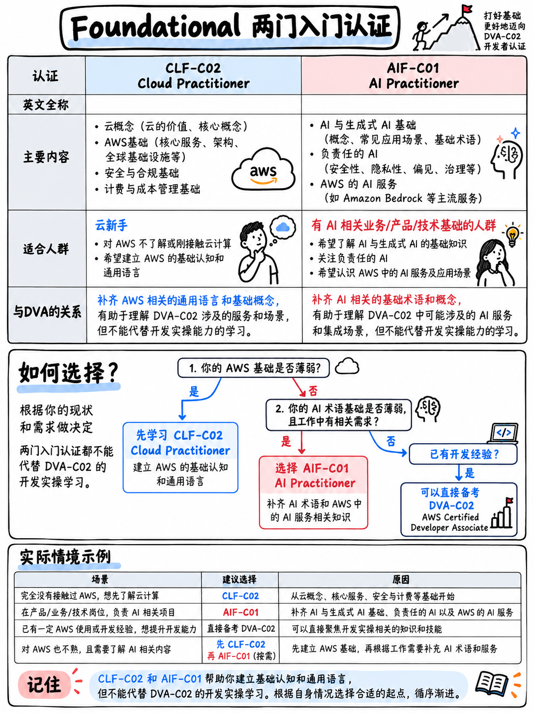

# 1.1 基础级认证：CLF-C02 与 AIF-C01 (Foundational: CLF-C02 & AIF-C01)

:::{note}
**第 10 模块内容特意保持精简。** 本套教程应大家要求对每个认证类别进行系统梳理，但核心重点始终聚焦于 DVA-C02。此处的每一页都旨在提供一份“单次阅读即可掌握”的定位指南：考试是什么、适合哪些人群、官方考试指南规定的领域划分与权重占比，以及大致需要投入的备战精力。若你决定报考其中某项认证，请下载其专属的官方考试指南（参见 {doc}`../90-references/01-sources-and-reliability`）并将其作为核心考试大纲。
:::

## 1.1.1 AWS Certified Cloud Practitioner (CLF-C02)

| | |
|---|---|
| 认证代号 | **CLF-C02**，考试指南版本 1.0 [6] |
| 级别 | 基础级 (Foundational) |
| 考试形式 | 65 道题 —— **50 道计分，15 道不计分** |
| 考试时长 | 90 分钟 |
| 及格分数 | **700** / 1,000 分 |
| 报考费用 | 100 美元 [2] |

**考试领域与权重占比** [6]:

| 领域 | 权重 |
|---|---|
| 1 · 云概念 (Cloud Concepts) | 24% |
| 2 · 安全与合规 (Security and Compliance) | 30% |
| 3 · 云技术与服务 (Cloud Technology and Services) | 34% |
| 4 · 计费、定价与支持 (Billing, Pricing, and Support) | 12% |

**实际考察内容。** 追求广度而不设深度：什么是云计算、责任共担模型、Well-Architected Framework（良好架构框架）各大支柱、核心服务分类、定价模型、技术支持计划以及免费套餐（Free Tier）。这是一门**专业词汇与基础认知**考试，而非纯技术实操考试 —— 题目绝不会要求你手写 IAM 策略或配置复杂的架构。

**适合报考人群。** AWS 初学者、非工程技术岗位人员（销售、项目管理、财务等商务人员），以及希望在挑战助理级考试前通过一次轻松通关建立信心的考生。

:::{tip}
**开发者在报考 DVA-C02 之前需要先考 CLF-C02 吗？通常不需要。** 它的考试费用为 100 美元，大约耗费 15–25 小时学习时间，而它涵盖的绝大多数内容在 DVA 中都被视为默认已知的背景知识。报考它唯一合理的理由是：通过它可以为你赢取一张 **50% 的考试折扣代金券** [2][3]，在后续报考 DVA 时可立省 75 美元 —— 这样折算下来，仅需花费约 25 美元的净成本即可拿到一枚稳操胜券的首张认证徽章。如果你需要心理提振与仪式感，它的实际成本近乎可以忽略；如果不需要，请直接跳过直奔 DVA。

另外需要注意的是，Cloud Practitioner 是目前唯一可以通过 AWS Cloud Quest **免费**重新认证的 AWS 认证，且“无需考试或额外备考” [3]。
:::

## 1.1.2 AWS Certified AI Practitioner (AIF-C01)

| | |
|---|---|
| 认证代号 | **AIF-C01**，考试指南版本 1.4 [7] |
| 级别 | 基础级 (Foundational) |
| 考试形式 | 65 道题 —— **50 道计分，15 道不计分** |
| 考试时长 | 90 分钟 |
| 及格分数 | **700** / 1,000 分 |
| 报考费用 | 100 美元 [2] |

**考试领域与权重占比** [7]:

| 领域 | 权重 |
|---|---|
| 1 · AI 与 ML 基础 (Fundamentals of AI and ML) | 20% |
| 2 · 生成式 AI 基础 (Fundamentals of Generative AI) | 24% |
| 3 · 基模型应用 (Applications of Foundation Models) | 28% |
| 4 · 负责任的 AI 指南 (Guidelines for Responsible AI) | 14% |
| 5 · AI 解决方案的安全、合规与治理 (Security, Compliance, and Governance for AI Solutions) | 14% |

**实际考察内容。** AWS 生态下的 AI 概念认知与素养：什么是基模型（Foundation Model）、提示词工程（Prompt Engineering）与微调（Fine-tuning）的应用场景、何时选用 Amazon Bedrock 与 Amazon SageMaker、负责任的 AI（Responsible AI）关注的核心议题（偏见、透明度、可解释性），以及如何保障 AI 工作负载的安全与治理。**不考数学公式，不考模型训练算法，不考代码实现。**

**适合报考人群。** 开发者及需要掌握行业通用 AI 专业术语的非专业技术人员。对于所在团队正在开发或集成生成式 AI 功能的开发者而言，它是与 DVA 极为契合的伴随认证。

:::{important}
**AIF-C01 对开发者的相关性正在显著提升，而非降低。** DVA-C03 新增了一整项关于 AI 安全的任务（包括 AI 服务的访问管理、内容过滤、提示词注入防护、日志中敏感内容的脱敏保护），并将 **Amazon Bedrock、Bedrock AgentCore、Amazon Q 以及 Kiro** 纳入考纲范围 [5]。如果你最终参加的是 DVA-C03 而非 DVA-C02，那么 AIF-C01 的前两个领域正是应对这一考纲增量极佳的预热学习材料 —— 详情参见 {doc}`../00-foundations/03-the-dva-c03-deadline` 第 0.3.5 节。
:::

## 1.1.3 两项认证的共性特征

这两门基础级认证具有与所有助理级考试完全一致的题型结构 —— 均为 65 道题、50 道计分、采用补偿性计分模型 —— 唯一差异仅在于考试时间（90 分钟对比 130 分钟）与及格分数线（700 分对比 720 分）。你在 {doc}`../60-exam-technique/01-how-aws-questions-work` 中学到的所有关于**如何**审题和拆解 AWS 题干的做题技巧，均可原封不动地直接套用。
