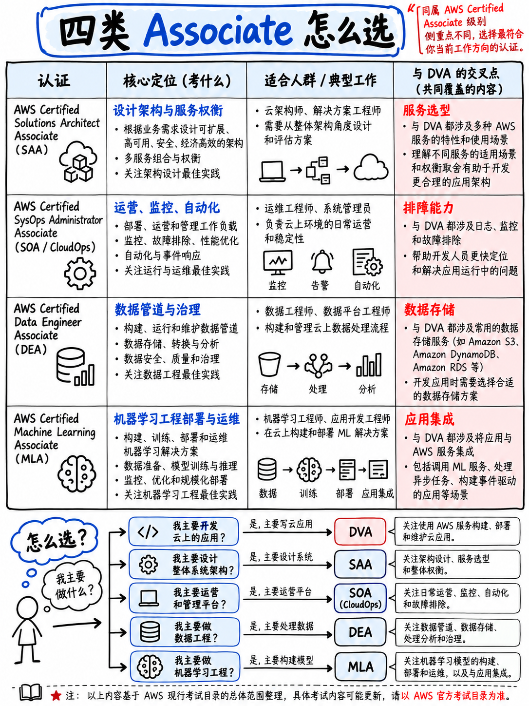

# 1.2 助理级认证：SAA-C03、SOA-C03、DEA-C01 与 MLA-C01 (Associate: SAA-C03, SOA-C03, DEA-C01, MLA-C01)

除 DVA-C02 之外的另外四门助理级认证。所有助理级考试都与 DVA 共享完全相同的考试规格：**65 道题、50 道计分、15 道不计分、130 分钟、及格线 720/1,000 分、报考费 150 美元、采用补偿性计分** [8][9][10][11]。

## 1.2.1 AWS Certified Solutions Architect – Associate (SAA-C03)

| | |
|---|---|
| 认证代号 | **SAA-C03**，考试指南版本 1.1 [8] |
| 考试领域 | 设计安全架构 (Design Secure Architectures) **30%** · 设计具有韧性的架构 (Design Resilient Architectures) **26%** · 设计高性能架构 (Design High-Performing Architectures) **24%** · 设计成本优化架构 (Design Cost-Optimized Architectures) **20%** |

**实际考察内容。** 服务的*选型*与*架构设计*：在给定业务需求的前提下，选用哪种服务组合能够在成本最低、韧性最强、安全性最高的前提下达成目标。重点涵盖 VPC 网络规划、S3 存储类型分级、数据库选型、跨可用区（AZ）的高可用设计以及成本优化。

::::{important}
**SAA 与 DVA —— 关键区别所在，也是导致手握其中一门认证的考生在另一门折戟的根本原因。**

| | SAA-C03 | DVA-C02 |
|---|---|---|
| 核心问题 | *我该选择哪款服务？* | *我该如何将其实现与跑通？* |
| 典型考察内容 | VPC 架构设计、可用区容灾切换、S3 存储类别分级、RDS 多可用区 (Multi-AZ) 对比只读副本 (Read Replicas) | Lambda 环境变量、DynamoDB 条件写入、API Gateway 阶段变量 (Stage Variables)、`appspec.yml` 生命周期钩子、X-Ray 跟踪注解 (Annotations) |
| 广度与深度 | 覆盖约 100 款服务的宏观选型 | 深度聚焦约 20 款核心服务，且 DVA 考试指南明确将架构设计列为**超纲内容** [1] |

两者内容重合度大约为 40%。拥有 SAA 认证确实对攻克 DVA 大有裨益 —— 但绝不能互相替代，DVA 所要求的具体工程实现细节，恰恰是 SAA 根本不会过问的内容。
::::

**备考顺序。** 如果两门都想拿下且本身是开发者，**建议优先报考 DVA**（趁 C02 仍在有效窗口期内，参见 {doc}`../00-foundations/03-the-dva-c03-deadline`），随后再利用获得的 50% 折扣代金券攻克 SAA。

## 1.2.2 AWS Certified CloudOps Engineer – Associate (SOA-C03)

| | |
|---|---|
| 认证代号 | **SOA-C03** [9] |
| 原名称 | AWS Certified SysOps Administrator – Associate (**SOA-C02**) |
| 考试领域 | 监控、日志、分析、修正与性能优化 **22%** · 可靠性与业务连续性 **22%** · 部署、配置与自动化 **22%** · 安全与合规 **16%** · 网络与内容分发 **18%** |

**实际考察内容。** 生产工作负载的运行与运维：监控与告警设置、备份与灾难恢复、系统补丁更新、借助 Systems Manager 进行自动化运维、故障事件修正、网络日常运维、成本与性能调优。

:::{danger}
**考试更名是购买备考资料时最容易踩入的陷阱。** SOA-C02 已于 **2025 年 9 月 29 日**正式退役；SOA-C03 于 **2025 年 9 月 30 日**开始交付 [12]。旧版 SOA-C02 考试指南虽然目前仍可从 AWS 服务器下载，但其 **6 个领域**（权重占比 20/16/18/16/18/12）与当前实行的 **5 个领域**（权重占比 22/22/22/16/18）完全不同 [9]。

你在市面上见到的任何冠以“AWS SysOps Administrator Associate”标题的课程，顾名思义都是为已退役的旧考试编写的。在付费购买任何材料前，务必仔细核对 **SOA-C03** 这一精确代码。
:::

**与 DVA 的重叠度。** 共享 CloudWatch、CloudFormation、IAM 以及基础部署概念。核心区别在于：CloudOps 绝不会要求你手写业务应用代码，但在网络拓扑和日常运维深度上要深得多。

## 1.2.3 AWS Certified Data Engineer – Associate (DEA-C01)

| | |
|---|---|
| 认证代号 | **DEA-C01**，考试指南版本 1.0 [10] |
| 考试领域 | 数据摄取与转换 (Data Ingestion and Transformation) **34%** · 数据存储管理 (Data Store Management) **26%** · 数据运维与支持 (Data Operations and Support) **22%** · 数据安全与治理 (Data Security and Governance) **18%** |

**实际考察内容。** 构建与运维数据管道：AWS Glue、Kinesis / Amazon Data Firehose、EMR、Redshift、Athena、Lake Formation、S3 数据湖架构、数据分区与文件格式（Parquet）、工作流编排以及数据治理。

**与 DVA 的重叠度。** 较为有限 —— 尽管 Lambda、S3、DynamoDB、IAM 与 CloudWatch 等服务反复出现，但其核心考查重心（Glue、Redshift、Athena、Lake Formation）几乎完全超出了 DVA 的大纲考查范围 [1]。

**适合报考人群。** 正在向数据平台或数据工程方向转型的开发者。另外需要注意，通过 **AWS Certified Generative AI Developer – Professional** 可以直接刷新续期 DEA 的认证有效期 [3]。

## 1.2.4 AWS Certified Machine Learning Engineer – Associate (MLA-C01 → MLA-C02)

| | |
|---|---|
| 认证代号 | **MLA-C01**，考试指南版本 1.0 [11] —— **目前正过渡至 MLA-C02** |
| 考试领域 | 机器学习数据准备 **28%** · 机器学习模型开发 **26%** · 机器学习工作流的部署与编排 **22%** · 机器学习解决方案的监控、维护与安全 **24%** |

**实际考察内容。** 机器学习工程落地与工程化（MLOps）：特征工程、SageMaker 模型训练与托管部署、模型性能监控与数据漂移检测、ML CI/CD 自动化流水线，以及 ML 工作负载的安全防护。其重心偏向 MLOps 工程实践，而非纯粹的数据科学理论。

:::{warning}
**MLA 认证正处于版本交替期。** **MLA-C02** 的公测报名已于 2026 年 9 月 1 日开启，公测交付自 2026 年 9 月 29 日起进行；MLA-C01 英语版最后考试日为 2026 年 9 月 28 日；**全语言通用正式发布（GA）定于 2027 年 1 月 14 日，届时 MLA-C01 在全球范围内正式退役** [5]。MLA-C02 新增了生成式 AI、Agentic AI（智能体 AI）、基模型 / 大语言模型（LLM）以及对 Amazon Bedrock 的扩展考查，考试领域大纲结构保持不变 [5]。

如果你正在考虑这一认证，建议直接等待 MLA-C02 正式上线（GA），而不要花费精力去备战即将在 1 月彻底作废的旧版本。
:::

## 1.2.5 助理级认证选型指南

| 如果你的核心工作是… | 推荐报考 |
|---|---|
| 在 AWS 上编写业务应用代码 | **DVA-C02**（本课程核心目标） |
| 云基础设施架构选型与容量评估 | SAA-C03 |
| 维护生产系统的稳定运行与运维监控 | SOA-C03 |
| 构建数据流动、清洗与转换管道 | DEA-C01 |
| 机器学习模型上线与工程化运营 | MLA-C02（2027 年 1 月起正式开考） |

关于不同考试的报考顺序安排与代金券折算策略，请进一步参阅 {doc}`05-choosing-your-path`。
