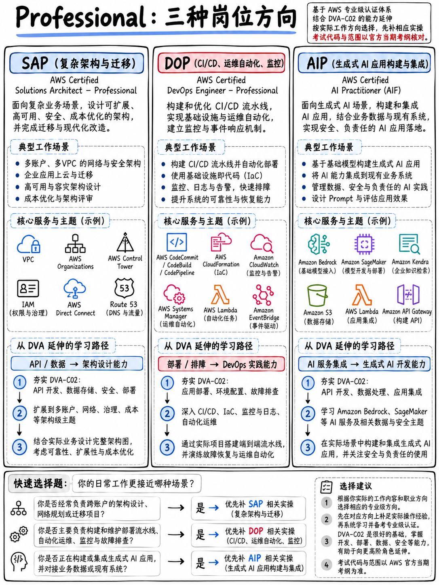

# 1.3 专业级认证：SAP-C02、DOP-C02 与 AIP-C01 (Professional: SAP-C02, DOP-C02, AIP-C01)



专业级考试在结构上与助理级存在显著不同：**75 道题 —— 65 道计分，10 道不计分 —— 考试时长 180 分钟，及格线 750/1,000 分，报考费 300 美元** [13][14][2]。题干篇幅明显更长，通常包含多个段落的复杂业务场景，且往往存在多个看似合理的备选答案，它们之间的优劣仅仅取决于某一个微妙的前提约束。

## 1.3.1 AWS Certified DevOps Engineer – Professional (DOP-C02)

**拿下 DVA-C02 后的自然演进首选**，并且考过即可直接刷新续期 DVA 证书 [2][3]。

| | |
|---|---|
| 认证代号 | **DOP-C02**，考试指南版本 1.6 [14] |
| 考试领域 | SDLC 自动化 (SDLC Automation) **22%** · 配置管理与 IaC (Configuration Management and IaC) **17%** · 高韧性云解决方案 (Resilient Cloud Solutions) **15%** · 监控与日志记录 (Monitoring and Logging) **15%** · 事件与故障响应 (Incident and Event Response) **14%** · 安全与合规 (Security and Compliance) **17%** |

**实际考察内容。** 涵盖 DVA 领域 3（部署）与领域 4（故障排查与优化）所涉及的全部主题，但上升至企业级专业深度与跨组织维度：包含人工审批与跨账号部署的高级流水线、大规模蓝绿部署策略、CloudFormation StackSets（堆栈集）、AWS Config 规则与自动配置漂移修正、多账号统一治理、自动化事件响应机制以及企业级可观测性战略。

::::{important}
**与 DVA-C02 的知识重合度居全 AWS 认证体系之首。** DVA 的领域 3（部署，占比 24%）与领域 4（故障排查与优化，占比 18%）直接映射至 DOP 的领域 1（SDLC 自动化，22%）、领域 2（IaC，17%）以及领域 4（监控与日志，15%）。

从实战角度来看：**你在模块 {doc}`../40-deployment/01-domain-overview` 与 {doc}`../50-troubleshooting/01-domain-overview` 中学到的全部内容，都可以直接复用于 DOP。** 如果你计划在一年内挑战 DOP，那么在学习这两个模块时就要比 DVA 基础要求挖得更深一些 —— 这是 AWS 认证体系中最划算的“一鱼两吃”。

从重新认证的角度看：通过 DOP-C02 将会**自动将你的 Developer – Associate 认证有效期再顺延 3 年** [2][3]，这意味着你永远无需再次重考 DVA。
::::

## 1.3.2 AWS Certified Solutions Architect – Professional (SAP-C02 → SAP-C03)

| | |
|---|---|
| 认证代号 | **SAP-C02**，考试指南版本 1.2 [13] —— **正过渡至 SAP-C03** |
| 考试领域 | 针对复杂组织的解决方案设计 **26%** · 新解决方案设计 **29%** · 现有解决方案的持续改进 **25%** · 加速工作负载迁移与现代化 **20%** |

**实际考察内容。** 企业级超大规模架构体系：基于 AWS Organizations 和 AWS Control Tower 的多账号管理架构、混合云网络连接、企业级上云迁移策略、大规模成本精细化治理，以及横跨数十种 AWS 复杂服务的架构权衡分析。被公认为 AWS 认证体系中难度最高的一门考试。

:::{warning}
**SAP 同样正处于版本交接窗口，其时间表几乎与 DVA 同步。** **SAP-C03** 的考试报名已于 **2026 年 10 月 27 日**开放；**参加 SAP-C02 的最后一天是 2026 年 11 月 16 日**；SAP-C03 通用正式交付（GA）自 **2026 年 11 月 17 日**开启 [5]。SAP-C03 新增了生成式 / 智能体 AI、高韧性工程、云原生架构模式、DevSecOps 与可观测性、数据分析架构以及后量子密码学（Post-quantum cryptography）等前沿内容 [5]。正式发布后的考试格式为：180 分钟、75 道题、费用 300 美元 [5]。

如果你正在权衡是否报考 SAP，请务必注意它的退役截止日期比 DVA **还要提前整整两周**。
:::

**实际报考先决条件。** AWS 官方建议考生具备约两年的实际动手架构经验。在没有拿下 SAA 的情况下直接从 DVA 跨越到 SAP 虽然并非不可能，但在实践中极为罕见。

## 1.3.3 AWS Certified Generative AI Developer – Professional (AIP-C01)

| | |
|---|---|
| 认证代号 | **AIP-C01** |
| 级别 | 专业级 (Professional) |
| 当前状态 | 全新认证 —— 2026 年完成公测，目前已正式面向大众开放 |

**实际考察内容。** 在 AWS 上构建生成式 AI 生产应用：Amazon Bedrock、AI 智能体（Agents）、检索增强生成（RAG）、模型性能评估、护栏机制（Guardrails），以及在生产环境中部署和运行大模型时的安全合规与成本控制维度。

:::{warning}
**[待官方进一步核实]。** 除认证代号及其作为专业级认证的事实之外，截至本课程编写时，尚无法从 AWS 官方一手信源中彻底核实 AIP-C01 的最终确切题目数量、考试时长与正式定价。第三方信源的说法存在分歧 —— 有报道称考试为 205 分钟、85 道题；另有信源称是 65 道计分题加 10 道不计分题；报考费用也分别出现过 150 美元（对应公测优惠价）与 300 美元两种标注。**在围绕该考试制定备考计划前，请务必查阅 aws.amazon.com/certification 获取最新官方终审标准。**
:::

**开发者为何仍需高度关注它。** 核心原因有二：第一，它是续期刷新 Data Engineer – Associate 与 Machine Learning Engineer – Associate 有效期的官方通道之一 [3]；第二，它所考察的核心专业技术，正是 **DVA-C03** 从 2026 年 12 月起以助理级深度开始正式考察的核心板块 —— 包括 Bedrock、AgentCore、Amazon Q、内容过滤与提示词注入防御等 [5]。

## 1.3.4 专业级认证选型路径图

```
 日常编写业务应用代码并负责上线交付
        │
        ├── 同时负责 CI/CD 流水线、生产部署与 On-call 运维 ──► DOP-C02
        │        (并且能够自动续期刷新你的 DVA 认证)
        │
        ├── 正逐步转向企业级架构设计与复杂系统规划 ──► SAP-C03
        │        (通常建议先考取 SAA-C03 积累基础)
        │
        └── 正在主导或构建生成式 AI 业务功能 ──► AIP-C01
```

**对于绝大多数刚拿下 DVA-C02 的开发者而言，最佳选择无疑是 DOP-C02** —— 极高的知识重叠度、无缝直接顺延已取得的认证有效期，且考察的均是日常工作中天天打交道的工具链与最佳实践。
