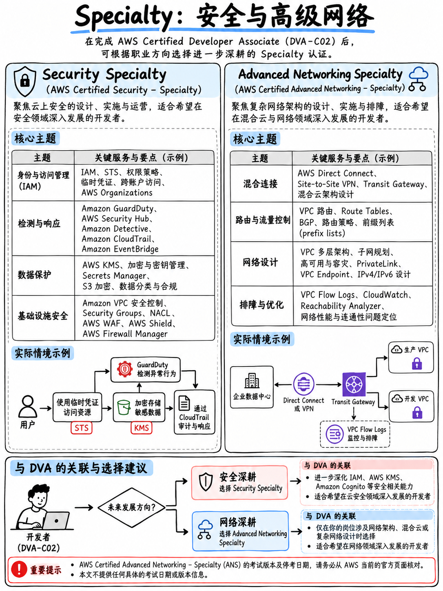

# 1.4 专项级认证：SCS-C02 与 ANS-C01 (Specialty: SCS-C02 & ANS-C01)



目前仍处于活跃状态的专项级认证仅存两门。两者均为 **65 道题 —— 50 道计分，15 道不计分 —— 及格线 750/1,000 分，报考费 300 美元** [15][16][2]。

:::{note}
专项级认证体系过去曾庞大得多。Big Data（大数据）、Data Analytics（数据分析）、Database（数据库）、Machine Learning（机器学习）以及 SAP on AWS 等专项级认证均已陆续退役，而 Advanced Networking（高级网络）也定于 2026 年底正式退役。AWS 已将这些专项领域的精髓内容整合分流至助理级和专业级认证体系中 —— 例如 DEA-C01 承接了数据分析板块，MLA 则全面承接了机器学习板块。
:::

## 1.4.1 AWS Certified Security – Specialty (SCS-C02)

| | |
|---|---|
| 认证代号 | **SCS-C02**，考试指南版本 1.1 [15] |
| 考试领域 | 威胁检测与事件响应 (Threat Detection and Incident Response) **14%** · 安全日志记录与监控 (Security Logging and Monitoring) **18%** · 基础设施安全 (Infrastructure Security) **20%** · 身份与访问管理 (Identity and Access Management) **16%** · 数据保护 (Data Protection) **18%** · 管理与安全治理 (Management and Security Governance) **14%** |

**实际考察内容。** 纵深安全防御机制：GuardDuty、Security Hub、Detective、Inspector、Macie、应急响应运维手册（Runbooks）、VPC 网络安全架构、KMS 与 CloudHSM 密钥管理体系、SSL/TLS 证书生命周期管理、AWS Organizations 服务控制策略（SCP）、AWS Config 合规规则以及企业级跨账号访问模式。

::::{important}
**与 DVA 领域 2（安全，占比 26%）虽然存在交集，但实际考查视角截然不同。** DVA 关注的是*业务应用如何完成身份鉴权与加密* —— IAM 角色绑定、Cognito 令牌机制、KMS 信封加密（Envelope Encryption）、Secrets Manager 凭据自动轮转。而 SCS 考查的则是*整个云上账号体系如何进行纵深防御、实时威胁侦测与合规治理* —— 两者职责分工截然不同。

两者真正高度重合的硬核知识点在于 **IAM 策略评估逻辑机制与 KMS 密钥机制**。正因如此，如果你的长远目标包含 Security – Specialty 认证，那么本课程中的 {doc}`../30-security/02-iam-policies-and-roles` 与 {doc}`../30-security/04-kms-and-encryption` 便是最值得你超前深挖、彻底吃透的两篇核心教程。
::::

**适合报考人群。** 云安全工程师，以及在金融、医疗等强合规行业工作的开发人员。它是目前最具生命力、也是当前唯一未被列入退役排期的专项级认证。

## 1.4.2 AWS Certified Advanced Networking – Specialty (ANS-C01)

| | |
|---|---|
| 认证代号 | **ANS-C01**，考试指南版本 2.0 [16] |
| 考试领域 | 网络设计 (Network Design) **30%** · 网络实现 (Network Implementation) **26%** · 网络管理与运维 (Network Management and Operation) **20%** · 网络安全、合规与治理 (Network Security, Compliance, and Governance) **24%** |

**实际考察内容。** 混合云与超大规模复杂网络：Direct Connect（专线）、Transit Gateway（中继网关）、企业级 VPN、Route 53 高级路由策略、VPC 对等连接（Peering）与 VPC 终端节点（Endpoints）、网络吞吐性能调优以及网络边界安全控制。

:::{danger}
**ANS-C01 将于 2026 年 12 月 31 日正式退役** [4]。AWS 官方认证页面已明确标注“AWS Certified Advanced Networking - Specialty (retires December 31, 2026)”。在本课程编写查证的一手信源中，官方尚未公布任何后续替代认证。

除非你能够确保在今年年底之前完成考试交付，否则切勿在此时启动该认证的备考。
:::

**与 DVA 的关联度。** 极低。DVA 官方考试指南已明确将“设计 AWS 网络基础设施（例如 Amazon Virtual Private Cloud [Amazon VPC]、AWS Direct Connect 等）”列为目标考生的**超纲范围** [1]。备考 DVA 时，你只需要掌握将 Lambda 函数接入 VPC 以及理解安全组（Security Groups）规则的必要网络常识即可 —— 相关内容已在 {doc}`../20-development/02-lambda-deep-dive` 中详尽阐述。

## 1.4.3 你是否有必要考取专项级认证？

专项级认证**并不是**拿完助理级认证后的常规进阶下一步。它们预设考生已经在该专业垂直领域深耕了数年实战经验，其难度定位与 300 美元的定价体系也印证了这一点。

```
 拿下 DVA-C02 之后，更为合理的认证进阶路线为：
   DVA-C02  ──►  DOP-C02 (刷新续期 DVA)  ──►  仅在全职从事安全岗位时选择 SCS-C02
                    或
   DVA-C02  ──►  SAA-C03 (横向拓展架构广度)  ──►  SAP-C03
```

有关包含报考成本核算在内的完整选型决策树，请参阅 {doc}`05-choosing-your-path`。
