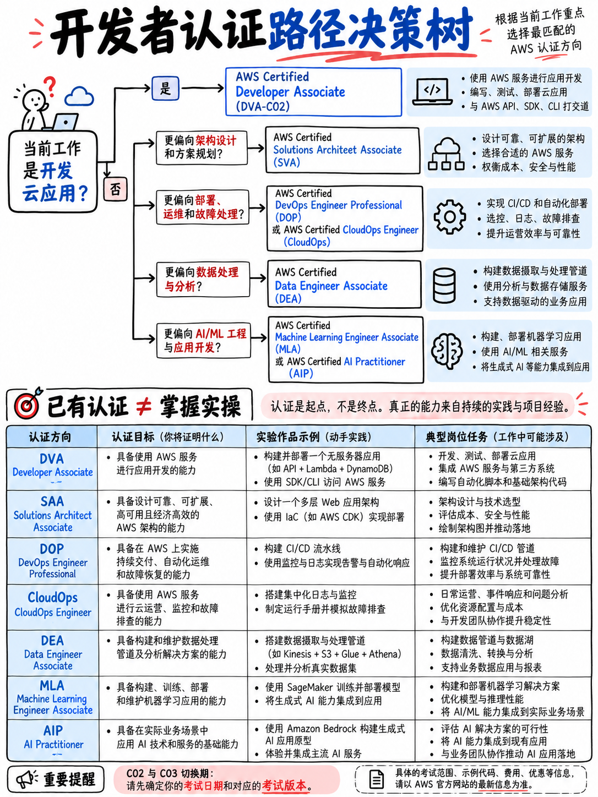

# 1.5 选择你的认证路径 (Choosing Your Path)



## 1.5.1 现行认证全景图（一览表）

| 认证级别 | 认证名称 | 考试代码 | 计分 / 不计分题数 | 及格分 | 报考费用 (USD) [2] |
|---|---|---|---|---|---|
| 基础级 (Foundational) | Cloud Practitioner | **CLF-C02** | 50 / 15 | 700 | 100 |
| 基础级 (Foundational) | AI Practitioner | **AIF-C01** | 50 / 15 | 700 | 100 |
| 助理级 (Associate) | Solutions Architect | **SAA-C03** | 50 / 15 | 720 | 150 |
| 助理级 (Associate) | **Developer** | **DVA-C02** → C03 | 50 / 15 | 720 | 150 |
| 助理级 (Associate) | CloudOps Engineer | **SOA-C03** | 50 / 15 | 720 | 150 |
| 助理级 (Associate) | Data Engineer | **DEA-C01** | 50 / 15 | 720 | 150 |
| 助理级 (Associate) | ML Engineer | **MLA-C01** → C02 | 50 / 15 | 720 | 150 |
| 专业级 (Professional) | Solutions Architect | **SAP-C02** → C03 | 65 / 10 | 750 | 300 |
| 专业级 (Professional) | DevOps Engineer | **DOP-C02** | 65 / 10 | 750 | 300 |
| 专业级 (Professional) | Generative AI Developer | **AIP-C01** | [待官方核实] | 750 | [待官方核实] |
| 专项级 (Specialty) | Security | **SCS-C02** | 50 / 15 | 750 | 300 |
| 专项级 (Specialty) | Advanced Networking | **ANS-C01** | 50 / 15 | 750 | 300 |
| 商务级 (Business) | AI Business Strategist | beta (公测中) | — | — | — |

各项认证的代码与权重均直接引自 AWS 各自官方考试指南；一手数据来源与指南版本对照请参阅 {doc}`../90-references/01-sources-and-reliability`。

## 1.5.2 认证迭代与退役日历

截至 2026 年 10 月 13 日所有已明确具体日期的认证事件汇总 [4][5]：

```
 2026 年 ──────────────────────────────────────────────────────────────────
  10 月 27 日   DVA-C03 开启报名 · SAP-C03 开启报名
  11 月 16 日   ◄── SAP-C02 最后考试日
  11 月 17 日   SAP-C03 全面正式交付 (GA)
  11 月 30 日   ◄── DVA-C02 最后考试日          ★ 与你切身相关的死线
  12 月  1 日   DVA-C03 全面正式交付 (GA)
  12 月 31 日   ◄── ANS-C01 正式永久退役
 2027 年 ──────────────────────────────────────────────────────────────────
   1 月 14 日   MLA-C02 全面交付 (GA) · MLA-C01 全语种正式退役
```

## 1.5.3 开发者的最佳认证进阶路线

```
                        ┌─────────────────┐
     可选项 ───────────►│    CLF-C02      │  仅为获取 50% 折扣代金券
                        │  Cloud Pract.   │  与积累初战信心
                        └────────┬────────┘
                                 ▼
                        ┌─────────────────┐
                        │    DVA-C02      │  ★ 你当前所处的位置
                        │   Developer     │     最后期限 2026 年 11 月 30 日
                        └────────┬────────┘
                   ┌─────────────┼─────────────┐
                   ▼             ▼             ▼
            ┌───────────┐ ┌───────────┐ ┌────────────┐
            │  DOP-C02  │ │  SAA-C03  │ │  AIF-C01   │
            │  DevOps   │ │ Architect │ │ AI Pract.  │
            │  Pro      │ │           │ │            │
            └─────┬─────┘ └─────┬─────┘ └─────┬──────┘
                  │             ▼             ▼
                  │      ┌───────────┐ ┌────────────┐
                  │      │  SAP-C03  │ │  AIP-C01   │
                  │      │ Architect │ │  GenAI Dev │
                  │      │  Pro      │ │  Pro       │
                  │      └───────────┘ └────────────┘
                  ▼
            直接刷新顺延 DVA 有效期 3 年
```

**针对在职开发者的默认最佳推荐：当前立即拿下 DVA-C02，并在一年内考取 DOP-C02。** DOP 与 DVA 在整个 AWS 认证体系中知识重合度最高，且考取 DOP 可以直接刷新顺延你的 Developer 认证 [2][3]，从而让你彻底免受再次重考 DVA 之苦。

## 1.5.4 折扣代金券的成本精算

只要考取任意一门 AWS 认证，你的认证账户中就会自动获赠一张用于报考下一门认证的 **50% 折扣代金券** [2][3]。

| 报考规划方案 | 费用计算 (美元) |
|---|---|
| 仅考 DVA | 150 |
| 先考 CLF 再考 DVA | 100 + 75 = **175** |
| 先考 DVA 再考 SAA | 150 + 75 = **225** |
| 先考 DVA 再考 DOP | 150 + 150 = **300** |
| CLF → DVA → DOP | 100 + 75 + 150 = **325** |

:::{tip}
**请务必将 50% 代金券用在你计划参加的最昂贵的一门考试上。** 在 300 美元的专业级考试上使用 50% 代金券可立省 150 美元；而在 150 美元的助理级考试上使用仅能省下 75 美元。如果你的整体规划中包含专业级认证，切勿把代金券随意消耗在助理级考试上。

考前需要确认的一项细节：代金券的具体使用条款与有效期由 AWS 官方决定，截至本教程整理时，除“存在 50% 折扣代金券”这一事实外，具体的有效期细则未能在一手官方源中完全交叉验证 —— 属于 **[待官方核实]** 状态。
:::

## 1.5.5 本教程知识的复用度迁移表

| 如果你后续继续攻读… | 可从本套教程中直接复用的模块与知识 |
|---|---|
| **DOP-C02** | 模块 {doc}`../40-deployment/01-domain-overview` 与 {doc}`../50-troubleshooting/01-domain-overview` 几乎整套直接复用，外加 IAM 策略与 CloudFormation 核心机制 |
| **SAA-C03** | {doc}`../20-development/05-s3-and-storage`、{doc}`../20-development/04-dynamodb`、{doc}`../30-security/02-iam-policies-and-roles` 以及消息队列与解耦服务 |
| **SOA-C03** | CloudWatch 监控与告警、CloudFormation、部署策略、IAM 权限 |
| **SCS-C02** | {doc}`../30-security/02-iam-policies-and-roles` 与 {doc}`../30-security/04-kms-and-encryption` 核心加密体系 |
| **DVA-C03** | 模块 20 至 50 的绝大多数核心工程内容 —— 详见 {doc}`../00-foundations/03-the-dva-c03-deadline` 第 0.3.4 节 |
| **任意 AWS 考试** | {doc}`../60-exam-technique/01-how-aws-questions-work` —— 题型拆解与做题战术在全体系所有考试中完全通用 |

## 1.5.6 关于“刷证”的坦诚忠告

AWS 认证是求职招聘中的初筛硬门槛，也是系统化建立大型公有云技术体系认知的极佳框架。但它们绝对不能直接作为你具备构建与运维大规模生产系统能力的证据，资深技术面试官对两者的差异心知肚明。

从 DVA 学习中获益最大的开发者，永远是那些踏实完成动手实验的人（参见 {doc}`../80-toolkit/01-hands-on-lab-plan`）—— 因为在通关之后，他们不仅能收获一纸证书，更能亲手通过 CI/CD 自动化流水线独立部署并调优一套无服务器（Serverless）生产级应用，而这正是认证徽章背后真正的价值所在。

现在，请返回 {doc}`../00-foundations/06-priority-triage`，立即从 Lambda 核心实战正式启程。
