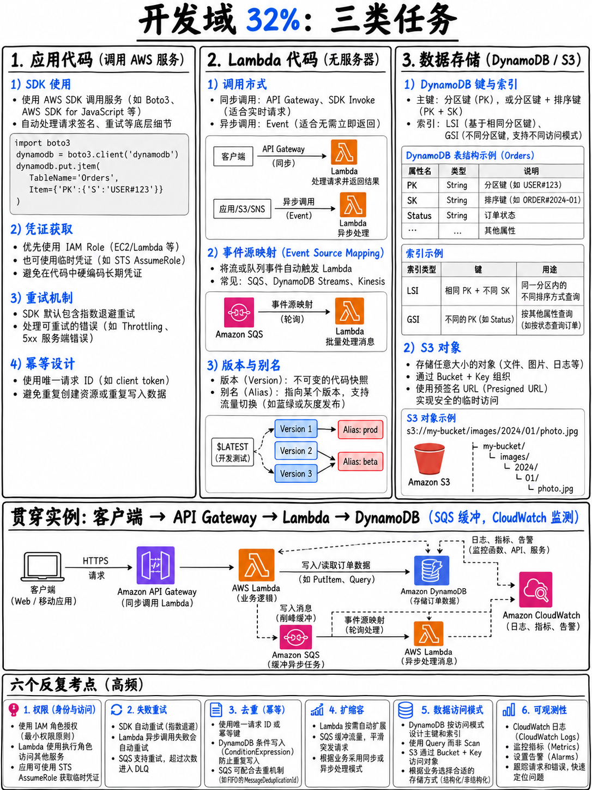

# 2.1 域 1 概览：基于 AWS 服务的应用开发 (Domain 1 — Development with AWS Services 32%)



## 2.1.1 域 1 考核全貌与权重结构

| 维度 | 官方标准与分布 |
|---|---|
| 考试权重 | 占全部计分内容的 **32%** [1] |
| ≈ 计分题量 | 50 道计分题中约占 **16 题** |
| 考核任务 (Tasks) | 3 项核心任务 |

AWS 官方考试指南规定的三项任务陈述 [1]：

1. **为托管在 AWS 上的应用程序编写代码 (Develop code for applications hosted on AWS)**
2. **为 AWS Lambda 编写代码 (Develop code for AWS Lambda)**
3. **在应用程序开发中使用数据存储 (Use data stores in application development)**

值得高度关注的是：AWS Lambda 独占了一整个完整的考核任务（Task 2）。在整份考试指南中，没有任何其他单一服务享受过这种待遇。

## 2.1.2 各任务实际考查技能与考点拆解

### 任务 1 —— 为托管在 AWS 上的应用程序编写代码

**核心知识 (Knowledge of)** [1]：架构模式（事件驱动架构、微服务架构、单体架构、事件协同 choreography、集中编排 orchestration、**扇出架构 fanout**）· **幂等性 (Idempotency)** · 有状态 vs 无状态架构 (stateful vs stateless) · 紧密耦合 vs 松散耦合 (tightly vs loosely coupled) · 容错设计模式（**带有抖动的指数退避重试 retries with exponential backoff and jitter**、**死信队列 dead-letter queues**）· 同步 vs 异步交互 (synchronous vs asynchronous)。

**实战技能 (Skills in)** [1]：使用特定编程语言（Java、C#、Python、JavaScript、TypeScript、Go）构建容错应用程序 · 构建与维护 API（请求/响应数据转换、输入验证规则、HTTP 状态码重写）· **编写并运行单元测试（例如使用 AWS SAM）** · 编写代码调用消息服务 · 通过 API 与 SDK 与 AWS 服务交互 · 处理数据流式传输 (data streaming)。

→ 对应章节：{doc}`06-messaging-sqs-sns-eventbridge-kinesis`、{doc}`08-sdks-cli-and-patterns`、{doc}`03-api-gateway`

### 任务 2 —— 为 AWS Lambda 编写代码

**核心知识 (Knowledge of)** [1]：**事件源映射 (Event source mapping)** · 无状态应用设计 · 单元测试策略 · 事件驱动架构 · 弹性可扩展性 · **在 Lambda 代码中访问 VPC 内的私有资源**。

**实战技能 (Skills in)** [1]：配置函数（**环境变量、内存大小、并发控制、超时时间、运行时 runtime、处理程序 handler、层 layers、扩展 extensions、触发器 triggers、目标 destinations**）· 处理事件生命周期与运行时错误（**Lambda Destinations、死信队列 DLQs**）· 编写与运行测试代码 · 将 Lambda 与各类 AWS 服务深度集成 · **对 Lambda 进行调优以获得极致性能与性价比**。

→ 对应章节：{doc}`02-lambda-deep-dive`

### 任务 3 —— 在应用程序开发中使用数据存储

**核心知识 (Knowledge of)** [1]：关系型与非关系型数据库对比 · CRUD 操作 · **高基数分区键 (High-cardinality partition keys)** · 云存储选型与考量 · **一致性模型（强一致性 strongly consistent、最终一致性 eventually consistent）** · **查询 Query vs 扫描 Scan** · **DynamoDB 键与索引设计** · **缓存策略（写穿 write-through、读穿 read-through、惰性加载 lazy loading、生存时间 TTL）** · **S3 存储分层与生命周期管理** · 临时存储 vs 持久化存储。

**实战技能 (Skills in)** [1]：数据序列化与反序列化 · 数据存储的日常使用与维护 · 管理数据生命周期与归档 · 使用数据缓存服务提升读取吞吐。

→ 对应章节：{doc}`04-dynamodb`、{doc}`05-s3-and-storage`、{doc}`../50-troubleshooting/05-optimization-and-caching`

## 2.1.3 本教程模块结构与优先级分布

| 文件 | 涵盖内容 | 备考优先级 |
|---|---|---|
| {doc}`02-lambda-deep-dive` | 彻底覆盖 Task 2 全貌，外加 Task 1 的半壁江山 | **Tier S (核心必考)** |
| {doc}`03-api-gateway` | REST/HTTP/WebSocket、数据转换、输入校验、状态码控制 | **Tier S (核心必考)** |
| {doc}`04-dynamodb` | Task 3 权重最高的单体数据库服务 | **Tier S (核心必考)** |
| {doc}`05-s3-and-storage` | S3 存储分层、生命周期、EBS 与 EFS 对比 | Tier A (重要支撑) |
| {doc}`06-messaging-sqs-sns-eventbridge-kinesis` | 消息队列、主题扇出、流式传输、死信队列 DLQ | Tier A (重要支撑) |
| {doc}`07-step-functions-and-appsync` | 分布式工作流编排与 GraphQL 实时推送 | Tier B (专项突破) |
| {doc}`08-sdks-cli-and-patterns` | SDK 凭证链、幂等性、指数退避重试、API 分页机制 | Tier A (重要支撑) |
| {doc}`09-development-practice-set` | 30 道精选高质量实战演练题与深度解析 | — |

## 2.1.4 贯穿域 1 的六大黄金法则与高频思想

**1. 幂等性 (Idempotency)。** 考试指南中被明确命名的核心概念 [1]。如果某个操作可能会被重复投递——在使用 SQS 标准队列、SNS 以及 Lambda 异步调用时，这几乎是**必然发生的**——消费者在第二次执行时必须产出与首次完全一致的结果。常见的工程解法包括：在 DynamoDB 中基于唯一去重键进行条件写入（Conditional Write）、使用 SQS FIFO 队列的消息去重 ID（Message Deduplication ID），或者使用天生具备幂等性的操作（例如执行 `PUT` 覆盖而非自增 `INCREMENT`）。

**2. 带有随机抖动的指数退避 (Exponential backoff with jitter)。** 同样在指南中明确点名 [1]。重试间隔按照 100 ms、200 ms、400 ms… 递增，并在时间间隔中引入随机抖动（Jitter），防止数千个客户端在同一时刻统一步调重试而引发“惊群效应”（Thundering Herd）。**AWS SDK 内部已默认封装了该机制**——当考题询问“开发者应如何妥善处理限流 Throttling”时，标准正确选项往往是“使用带有指数退避的重试”或“利用 SDK 内置重试机制”，而不是第一反应就去“申请提高配额 (Request a quota increase)”。

**3. 死信队列 (Dead-Letter Queues, DLQ)。** 专门用于接收并隔离连续失败多次消息的目标队列。SQS 原生支持 DLQ，SNS 支持为订阅配置 DLQ，Lambda 异步调用也支持 DLQ（以及更新一代的 Lambda **Destinations**，它不仅能捕获失败，还能记录执行成功事件）。

**4. 同步 vs 异步调用 (Synchronous vs Asynchronous)。** 这一根本区别直接决定了架构的错误处理路径：

```
 同步调用 SYNCHRONOUS  (API Gateway → Lambda, SDK Invoke RequestResponse)
     执行错误会直接「返回给调用方」(BACK TO THE CALLER)。Lambda 服务自身绝不自动重试。
     必须由客户端自行处理异常并决定是否重试。

 异步调用 ASYNCHRONOUS (S3 事件, SNS, EventBridge, SDK Invoke Event)
     Lambda 服务会在后台自动「重试 2 次」（总共尝试 3 次），
     若依然失败，则将事件投递至配置的死信队列 (DLQ) 或失败目标 (On-Failure Destination)。

 基于轮询 / 事件源映射 POLL-BASED / EVENT SOURCE MAPPING (SQS, Kinesis, DynamoDB Streams)
     由 Lambda 服务内部的轮询器拉取，并根据数据源的规则进行重试；
     对于流式数据源（Kinesis/DynamoDB Streams），单个毒丸记录（Poison-Pill）会导致整个分片阻塞。
```

**5. 松散耦合 (Loose coupling)。** 在组件与服务之间插入队列或发布/订阅主题，使其中一个组件发生故障或遭遇突发峰值时，下游不会被拖垮，两者可独立弹性伸缩。在考试中，面对“下游服务无法承受瞬时高并发写入/调用”的题目，首选解法几乎永远是插入一个**消息队列 (Queue)**，而不是直接换用更大规格的计算实例。

**6. 事件协同 (Choreography) vs 集中编排 (Orchestration)。** 协同（Choreography）指各个独立服务各自监听事件并被动响应（**EventBridge**）；编排（Orchestration）则由一个中心状态机控制器严格驱动各个步骤，维护显式状态流转、单步重试与异常分支路由（**Step Functions**）。一旦题干中出现“工作流 (Workflow)”、“步骤序列 (Sequence of steps)”、“针对特定单步重试 (Retry individual steps)”或“可视化工作流 (Visual workflow)”，标准答案直指 Step Functions。

## 2.1.5 极速复习备忘 (Fast Revision)

- **Lambda 是域 1 的绝对核心**，更是整场 DVA-C02 考试的枢纽。
- **幂等性 (Idempotency)** 与**带抖动的指数退避 (Exponential backoff with jitter)** 是考试中的高频关键考点，绝非停留在表面的理论概念。
- 同步错误直接抛回给调用端；异步错误自动重试 2 次后丢入 DLQ 或 Destination；流式错误若不加以控制会阻塞整个 Shard 分片。
- 解耦与削峰填谷的首选方案永远是引入消息队列（SQS）。
- 事件协同选 EventBridge；复杂业务工作流集中编排选 Step Functions。
- 缓存策略（惰性加载 Lazy Loading、写穿 Write-Through、TTL 生存时间）在官方指南中被明确点名，并且在 AWS 官方样题中直接出现 [18]。
