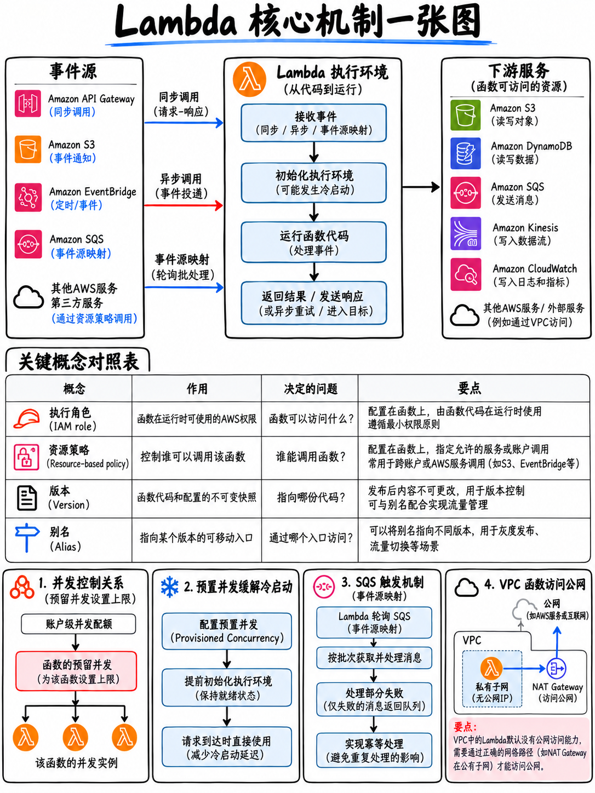

# 2.2 AWS Lambda 深度剖析：执行环境、并发、事件源与核心配置 (AWS Lambda Deep Dive)



:::{important}
**Tier S 核心考点，全套备考资料中单体价值最高的一份指南。** Lambda 在考试指南的域 1 中单独占有一个专属的考核任务（Task 2）[1]，并贯穿了域 2（执行角色 Execution Roles、环境变量加密）、域 3（版本、别名、层、SAM、灰度部署策略）以及域 4（日志收集、X-Ray 链路追踪、内存调优、并发节流错误）。建议预留至少 3 小时专项攻坚并亲自完成动手实验。
:::

## 2.2.1 一图看懂 Lambda 执行模型与冷启动机制

```
 事件 EVENT  ──►  Lambda 服务
                      │
                      ├─ 是否存在可复用的暖执行环境 (Warm Environment)？
                      │       否 ──►  【冷启动 COLD START】
                      │                ├ 下载函数代码包 / 容器镜像
                      │                ├ 启动运行时环境 (Runtime)
                      │                ├ 执行 INIT 初始化代码 (位于 handler 函数外部)
                      │                └ 随后调用执行 handler 处理函数
                      │       是 ──►  【直接复用】：跳过 INIT，仅调用执行 handler 处理函数
                      ▼
             用户处理函数 YOUR HANDLER(event, context)
                      │
                      └─ 返回结果、抛出异常或超时终止
```

**对编写业务代码的核心指导（绝对必考点）：**

| 放在处理函数外部 (INIT 阶段) | 放在处理函数内部 (Handler) |
|---|---|
| 初始化 SDK 客户端、建立数据库连接池、加载全局配置文件 | 任何强依赖于本次特定传入事件（event）的业务计算 |
| 每个执行环境生命周期内仅运行一次，而非每次请求都运行 | 每次函数被调用触发时均会执行 |
| 计入 **Init** 初始化阶段耗时并计费，且受到 10 秒 Init 上限限制 | 计入常规函数调用的执行耗时 (Invocation Duration) |

任何保存在 `/tmp` 临时目录或模块全局变量中的数据，在下一次调用复用该执行环境时**可能**仍然存在——但应用程序在架构设计上**绝不可强依赖于此**。官方指南将“设计无状态应用程序 (Stateless applications)”列为明确考点 [1]。

## 2.2.2 核心配置参数与必考硬指标

| 配置项 | 规格范围 / 阈值 | 核心考点与设计原则 |
|---|---|---|
| **内存 (Memory)** | **128 MB – 10,240 MB**，步长 1 MB | **CPU 算力与内存大小严格线性绑定。** 这是性能与成本调优的最核心杠杆 |
| **超时时间 (Timeout)** | 1 秒 – **900 秒 (15 分钟)** | 默认 3 秒。运行时间超过 15 分钟的任务不适合作为单一 Lambda 执行 |
| **`/tmp` 临时存储** | **512 MB – 10,240 MB** | 可读写的本地临时暂存盘，同一环境连续调用间可共享 |
| **环境变量 (Env Vars)** | **总计 4 KB** | 静态存储时通过 KMS 默认密钥加密；亦支持通过客户自管密钥 (CMK) 进行传输与辅助加密 |
| **直接上传 Zip 代码包** | **50 MB** (压缩包上限) | 更大的包必须先上传至 S3 存储桶，再由 Lambda 拉取 |
| **解压后代码包体积** | **250 MB** (含全部层 Layers) | 极为容易踩中的硬性配额上限 |
| **容器镜像体积** | **10 GB** | 当解压后依赖超过 250 MB 时的标准解决方案 |
| **层数量 (Layers)** | 单函数最多 **5 个** | 层的总体积一并计入 250 MB 配额内 |
| **并发执行数 (Concurrency)**| 单区域默认 1,000 | 软性配额；可通过提工单申请提升 |
| **调用载荷 (Payload)** | 同步调用 6 MB，**异步调用 256 KB** | 超出限制时的标准做法：将大对象存入 S3，并在事件中仅传递对象 Key |

::::{tip}
**内存是核心调优杠杆，而“盲目延长超时时间”往往是错误选项。** 由于 CPU 算力随内存分配成比例提升，计算密集型函数在更高内存下运行耗时会骤降，往往导致**总成本更低或持平**：内存翻倍，耗时减半，计费相同但性能提升一倍。考试指南将“确定应用程序所需的最小内存和算力”列为核心技能 [1]。

当题目描述某函数发生超时（Timing out）且**正在进行大量密集计算**时，首要排查和调整的是**内存配置**；若题目描述函数因**等待外部资源响应**而超时，则应排查下游依赖服务性能、VPC/NAT 网关链路或 SDK 客户端是否缺失合理的超时配置。
::::

## 2.2.3 权限模型深度辨析：执行角色 vs 资源策略

```
 ┌────────────────────────────────────────────────────────────────────┐
 │ 执行角色 EXECUTION ROLE                                             │
 │ Lambda 自身主动「代入」(ASSUMES) 的 IAM 角色，用于访问其他云服务   │
 │ 定义：“我的函数代码被允许去做什么事情”                              │
 │ 例如：dynamodb:PutItem, s3:GetObject, logs:CreateLogStream         │
 └────────────────────────────────────────────────────────────────────┘
 ┌────────────────────────────────────────────────────────────────────┐
 │ 资源策略 RESOURCE-BASED POLICY (函数策略 Function Policy)          │
 │ 直接附加在 Lambda 函数实体上，声明谁拥有触发此函数的权限           │
 │ 定义：“谁被允许调用/触发我”                                        │
 │ 例如：apigateway.amazonaws.com, s3.amazonaws.com, 跨账号 AWS 主体  │
 └────────────────────────────────────────────────────────────────────┘
```

**AWS 官方样题第 5 题精准考核了这一本质区别** [18]：某开发者为 Lambda 函数编写了 IAM 策略，该函数需要读取 S3 存储桶并向 CloudWatch Logs 写入日志。正确答案是：“创建一个 Lambda **执行角色 (Execution Role)**…… 将该 IAM 策略附加到该角色上。将该 Lambda 执行角色分配给该 Lambda 函数”——而干扰项则设计为创建 IAM **用户 (User)**，或将访问密钥硬编码在环境变量中。AWS 官方解析写道：“Lambda 函数的执行角色授予该函数访问 AWS 服务和资源的权限。你在创建函数时指定该角色，并在函数被调用时由 Lambda 自动代入” [18]。

:::{danger}
**绝不要在 Lambda 环境变量中存放硬编码的 IAM Access Keys 访问凭证。** 在 DVA 考试中，此类选项永远是百分之百的错误干扰项，正确答案毫无例外都是分配**角色 (Role)**。该原则同样适用于 EC2（实例配置文件 Instance Profile）、ECS（任务角色 Task Role）和 CodeBuild（服务角色 Service Role）。
:::

托管策略 `AWSLambdaBasicExecutionRole` 仅授予最基础的 CloudWatch Logs 日志权限（`CreateLogGroup`、`CreateLogStream`、`PutLogEvents`）。**如果函数运行后完全没有生成任何日志输出，首先要检查是否缺失该基础权限**——参见 {doc}`../50-troubleshooting/02-cloudwatch-logs-metrics-alarms`。

## 2.2.4 三大调用类型与失败重试机制

| 调用类型 | 触发源示例 | 重试机制 | 失败异常处理路径 |
|---|---|---|---|
| **同步调用** (`RequestResponse`) | API Gateway、ALB、Cognito 触发器、SDK 直接调用、Step Functions | **Lambda 服务本身不进行重试** | 异常直接返回给调用客户端，由调用方负责重试 |
| **异步调用** (`Event`) | S3 事件通知、SNS 主题、EventBridge、SDK 携带 `InvocationType=Event` | **自动重试 2 次**（共执行 3 次） | 投递至失败目标 (**Destination**) 或死信队列 (**DLQ**)；可配置 `MaximumEventAge` 与 `MaximumRetryAttempts` |
| **事件源映射** (基于轮询 Poll-based) | SQS、Kinesis Data Streams、DynamoDB Streams、Amazon MQ、MSK | 依据具体数据源规则而定 | 详见 §2.2.5 章节拆解 |

::::{important}
**目标 (Destinations) vs 死信队列 (DLQ) —— 考试最高频对比考点。**

| 特性对比 | 死信队列 (DLQ) | Lambda 目标 (Destinations) |
|---|---|---|
| 捕获事件范围 | **仅捕获失败事件** | **捕获成功 (Success) 与失败 (Failure)** |
| 投递目标支持 | 仅限 SQS 或 SNS | 支持 SQS、SNS、**Lambda**、**EventBridge** |
| 携带载荷内容 | 仅包含原始的输入事件 payload | 包含请求输入 **以及** 完整的响应结果/错误堆栈上下文 |
| 适用调用场景 | 异步调用 | 异步调用，以及流式数据的事件源映射 |

**Destinations 是更现代化、信息量更丰富的首选方案。** 当考题要求将调用失败的*具体诊断原因*（堆栈轨迹、错误码、原始请求上下文）路由到下游系统做进一步自动化分析时，正确答案必须选 **Destination** 而不是 DLQ。
::::

## 2.2.5 事件源映射 (Event Source Mapping, ESM)

事件源映射是由 AWS Lambda 服务内部托管并运行的高可用轮询器（Poller）。考试指南中明确将其列为核心考察知识 [1]。

| 数据源 | 批处理容量 (Batching) | 顺序性保障 | 故障与失败处理机制 |
|---|---|---|---|
| **SQS 标准队列** | 单批次最多 **10,000** 条 | 无顺序保证 | 处理失败的消息将在可见性超时（Visibility Timeout）到期后重新回到队列；配合队列本身的 **Redrive Policy** 路由至 DLQ。使用**部分批次响应** (`ReportBatchItemFailures`) 可精准仅标记失败条目，避免整批全量重试 |
| **SQS FIFO 队列** | 单分组最多 10 条 | 严格基于 **Message Group ID** 保证顺序 | 出现故障时会阻塞该特定 Message Group 的后续消费，直至处理完毕或被移除 |
| **Kinesis 数据流** | 单批次最多 10,000 条记录 | **基于分片 (Shard)** 严格保序 | 默认情况下，只要单批次中有一条记录处理失败，**整个分片将被完全阻塞**。解决方式：开启 `BisectBatchOnFunctionError`（出错时自动对半拆分批次）、设置 `MaximumRetryAttempts`、配置 `MaximumRecordAgeInSeconds` 或绑定**失败目标 (On-Failure Destination)** |
| **DynamoDB Streams** | 最多 10,000 条 | **基于分片 (Shard)** 严格保序 | 故障阻塞机制与治理参数完全同 Kinesis 一致 |

:::{danger}
**经典 Kinesis / DynamoDB Streams 考场陷阱场景：** “由于单条异常格式的畸形记录（Poison-Pill 毒丸记录），导致该分片的所有数据处理完全停滞，消费积压（Backlog）持续激增。” 官方标准考核的治理组合拳为：**出错时对半拆分批次** (`BisectBatchOnFunctionError`)、限制最大重试次数 (`MaximumRetryAttempts`)、限制记录最大存活时长 (`MaximumRecordAgeInSeconds`)，并将废弃数据路由至**失败目标 (On-Failure Destination)**。“增加函数超时时间”和“添加更多 Shard 分片”绝不可能解决毒丸记录引起的死锁阻塞。
:::

**SQS 可见性超时与 Lambda 超时的黄金法则：** AWS 官方最佳实践强烈建议将 SQS 队列的可见性超时（Visibility Timeout）设置为**函数超时的至少 6 倍**。如果可见性超时*小于*函数的实际执行时间，在当前函数仍在处理某条消息时，该消息就会在队列中提前重新变为可见，从而被**另一个并发实例重复拉取消费——造成严重的重复消费 Bug。** 该场景在考试中屡见不鲜，标准答案是调高可见性超时（并在业务代码端做好幂等性保护）。

## 2.2.6 版本 (Versions) 与别名 (Aliases)：灰度发布与环境管理

```
 $LATEST          可变状态，开发者持续编辑更新的代码版本
    │
    │  PublishVersion 发布固定版本
    ▼
 版本 1  ─┐       不可变状态：代码逻辑 + 环境变量配置完全固化
 版本 2  ─┤       每个版本分配独立的固定 ARN
 版本 3  ─┘
    ▲
    │  别名充当可灵活移动的指针，并支持按权重流量分流 (SHIFT TRAFFIC)
 ┌──┴─────────────────────────────────────────────┐
 │  别名 "prod"  →  90% 流量给版本 2，10% 流量给版本 3 │  加权别名 (Weighted Alias)
 │  别名 "dev"   →  指向 $LATEST                  │
 └─────────────────────────────────────────────────┘
```

- **版本 (Version)** 具备不可变性（Immutable）。已发布的版本无法更改其代码或配置——这正是其保障生产环境确定性的核心所在。
- **别名 (Alias)** 是带有自定义名称的指针，拥有固定的独立 ARN。外部客户端只需稳定调用该别名 ARN；运维人员通过平滑切换别名所指向的目标版本即可完成上线。
- **加权别名 (Weighted Aliases)** 允许在两个正式版本之间按百分比动态分配流量——这是金丝雀发布（Canary）与线性渐进式发布（Linear Deployments）的底层基石（参见 {doc}`../40-deployment/04-deployment-strategies`）。
- **环境变量是版本快照的一部分**，因此 dev 与 prod 之间的配置差异必须由外部载入——例如通过 Parameter Store、Secrets Manager、AppConfig，或者借助 **API Gateway 阶段变量 (Stage Variables)** 动态传递并路由至对应的 Lambda 别名。

**AWS 官方样题第 8 题精准考核了此架构** [18]：使用“最少管理配置量”在单一架构中维护 dev 和 prod 两套独立环境。正确答案为单一 REST API：“通过使用 **阶段变量 (Stage Variable)** 替代固定别名，将 API 与 Lambda 函数集成。将 API 部署到两个不同的阶段：dev 和 prod。在每个阶段中创建阶段变量，并将不同的 Lambda 别名作为其变量值” [18]。

## 2.2.7 Lambda 层 (Layers)

层（Layer）本质是一个包含通用依赖库、自定义运行时或扩展组件的 `.zip` 归档包，挂载在执行环境的 `/opt` 目录下。

- 单个函数**最多挂载 5 个层**；包含所有层在内的解压后总代码体积依然受限于 **250 MB**。
- 层具备**版本管理机制**，并支持跨函数、跨 AWS 账户安全共享。
- 专门解决“部署包过大上传缓慢”以及“多个微服务函数重复打包通用共享依赖库”的问题。

**AWS 官方样题第 10 题直接考查该场景** [18]：为避免超出函数包体积配额，打包时移除了某些依赖，导致函数运行时找不到依赖报错。标准解法：“创建一个包含所需缺失依赖的 **Lambda 层 (Layer)**。将该层附加至该 Lambda 函数” [18]。

## 2.2.8 并发机制精讲：非保留、保留与预置并发

| 并发类型 | 定义与机制 | 核心应用场景 |
|---|---|---|
| **非保留并发 (Unreserved)** | 共享当前区域默认分配的全局并发池（默认 1,000） | 默认常规行为 |
| **保留并发 (Reserved)** | 从全局并发池中划拨出一段**专属硬性上限**分配给指定函数 | 保护下游关系型数据库不被连接打爆；或**确保**关键业务函数拥有绝对算力配额。**将其设置为 0 可立即彻底熔断该函数**——考试中合法的“秒级紧急停用函数”手段 |
| **预置并发 (Provisioned)** | 提前在后台初始化就绪的冷环境，持续保温 | **彻底消除冷启动**，专为延迟极其敏感的在线交易接口服务。空闲就绪期间同样产生计费 |

```
 线上典型症状                                考场标准解题方向
 ─────────────────────────────────────────────────────────────────────────
 "TooManyRequestsException", 429,          已触发并发上限（节流） →
 "Rate Exceeded"                           申请调高配额，或配置保留并发，
                                           或在入口层（API Gateway）限流削峰

 “每天清晨的第一笔用户请求响应极慢”         冷启动问题 (COLD START) → 开启预置并发
                                           (Provisioned Concurrency) 或 Java SnapStart

 “大量并发的 Lambda 实例把下游 RDS         配置保留并发作为实例并发上限熔断保护
  数据库连接池彻底打爆崩塌”                 （同时配合架构引入 RDS Proxy）

 “发现安全合规漏洞，必须立即停用某函数”     将该函数的保留并发直接设置为 0 (Reserved Concurrency = 0)
```

**SnapStart**（初始针对 Java，目前支持更多运行时）会在部署阶段对已初始化完成的执行环境进行内存与快照持久化，当发生调用时直接从快照恢复，**在无需支付预置并发额外闲置费用的前提下极大幅度削减冷启动时间**。若题目专门针对 **Java 运行时的冷启动优化**，SnapStart 是最具针对性的现代解法。

## 2.2.9 Lambda 在 VPC 内的运行与网络拓扑

考试指南核心考点：“在 Lambda 代码中访问 VPC 内的私有资源” [1]。

- 将函数关联至指定的 **私有子网 (Subnets) 与安全组 (Security Groups)**，即可打通前往 VPC 私有资源（如 RDS、ElastiCache 集群、私有内部 ALB）的网络通信链路。
- **关联了 VPC 的 Lambda 函数立即丧失直接访问公网的能力。** 若要访问外部公网或公网 AWS 服务端点，必须在公网子网中部署 **NAT 网关 (NAT Gateway)** 并配置路由表，或者为特定 AWS 服务创建 **VPC 终端节点 (VPC Endpoints)**。
- 现代 Lambda 采用了底层 Hyperplane ENI 架构，VPC 绑定不再引入以往长达数十秒的冷启动惩罚——但“关联 VPC 后失去默认公网路由”依然是经典必考陷阱。

:::{warning}
**最具代表性的 VPC 考题套路：** “某开发者将函数接入 VPC 以便读取私有 RDS 数据库后，该函数对公网第三方 API、AWS Secrets Manager 或 Amazon S3 的调用立即出现超时报错（Timeout）。” 根因：失去了默认公网出网路由。修复方案：在公共子网中挂载 **NAT 网关**（针对通用互联网流量），或配置对应服务的 **VPC 终端节点 (VPC Endpoint)**（针对 AWS 原生服务）。请务必牢记 Secrets Manager、DynamoDB、S3 以及 KMS 均原生支持 VPC Endpoint——当仅需访问 AWS 托管服务时，创建 VPC Endpoint 往往是安全性最高且最具性价比的选项。
:::

## 2.2.10 Lambda 扩展 (Extensions) 与自定义运行时

- **扩展 (Extensions)** 与主业务函数在同一执行环境内伴生运行，主要用于系统遥测监控（Telemetry）、凭证与秘钥本地缓存、动态配置读取。属于考试指南中配置项技能的明确考点 [1]。
- **AWS Parameters and Secrets Lambda Extension** 在执行环境内本地缓存 Parameter Store 与 Secrets Manager 的敏感配置——这是应对“函数在每次触发时都频繁调用 Secrets Manager 导致遭遇 API 限流、响应缓慢且账单飙升”的标准解法。
- **自定义运行时 (Custom Runtimes)** 基于 Lambda Runtime API 运行，通常以包含可执行 `bootstrap` 引导文件的 Layer 形式交付。

## 2.2.11 本地测试与调试：AWS SAM 实战

考试指南明确考核：“在开发环境中编写并运行单元测试（例如使用 AWS Serverless Application Model [AWS SAM]）” [1]。

```bash
# 初始化脚手架、编译构建并在本地针对测试事件运行函数
sam init
sam build
sam local invoke MyFunction --event events/event.json

# 在本地 http://127.0.0.1:3000 上快速启动并模拟整套 API Gateway 路由
sam local start-api

# 为各类支持的 AWS 事件源快速生成高度拟真的官方测试 JSON 事件模版
sam local generate-event s3 put > events/s3-put.json
sam local generate-event apigateway aws-proxy > events/api.json

# 实时追踪并输出远端已部署 Lambda 函数的 CloudWatch 运行时日志流
sam logs -n MyFunction --stack-name my-stack --tail
```

**`sam local generate-event` 命令必须能够望名生知**——它正是官方指南所要求的“生成应用程序测试事件（例如用于测试 Lambda、API Gateway、AWS SAM 资源的 JSON 载荷）”的标准官方工具 [1]。

## 2.2.12 极速复习备忘 (Fast Revision)

- **内存范围 128 MB–10,240 MB；CPU 算力严格与之线性绑定。单次执行超时上限 15 分钟。** `/tmp` 临时盘 512 MB–10 GB。环境变量上限 4 KB。代码包限制为压缩 50 MB / 解压 250 MB / 容器镜像 10 GB。**每个函数最多绑定 5 个层。**
- **执行角色 (Execution Role)** = 函数自身被允许调用什么外部服务。**资源策略 (Resource-based Policy)** = 谁被允许触发该函数。**严禁在环境变量中硬编码 IAM 访问秘钥。**
- 同步调用：无自动重试，错误直接返回调用方。异步调用：**自动重试 2 次**，随后进入 DLQ 或 Destination。流式源：单个异常记录若未妥善治理会**阻塞整个分片 (Block the shard)**。
- **Destinations 相比 DLQ 不仅能捕获成功和失败，还能保留请求与异常的完整上下文细节。**
- SQS 可见性超时必须大于等于函数超时的 **6 倍**，否则必定产生重复消息并发消费。
- **发布版本固化不可变；别名支持灵活指针漂移与按权重金丝雀流量分流。**
- 彻底解决冷启动 → **预置并发 (Provisioned Concurrency)** 或 Java SnapStart。保护下游免被打崩 → **保留并发 (Reserved Concurrency)**。紧急阻断某函数运行 → 保留并发设为 0。
- **接入 VPC 的 Lambda 默认失去公网访问权限**，必须依赖 NAT 网关或专用 VPC Endpoint 建立路由。
- 代码包体积超标 → 抽离通用公共库至 **Layer**（或直接容器化打包至 10 GB）。
- 本地调试三板斧：**`sam local invoke`、`sam local start-api` 与 `sam local generate-event`**。
