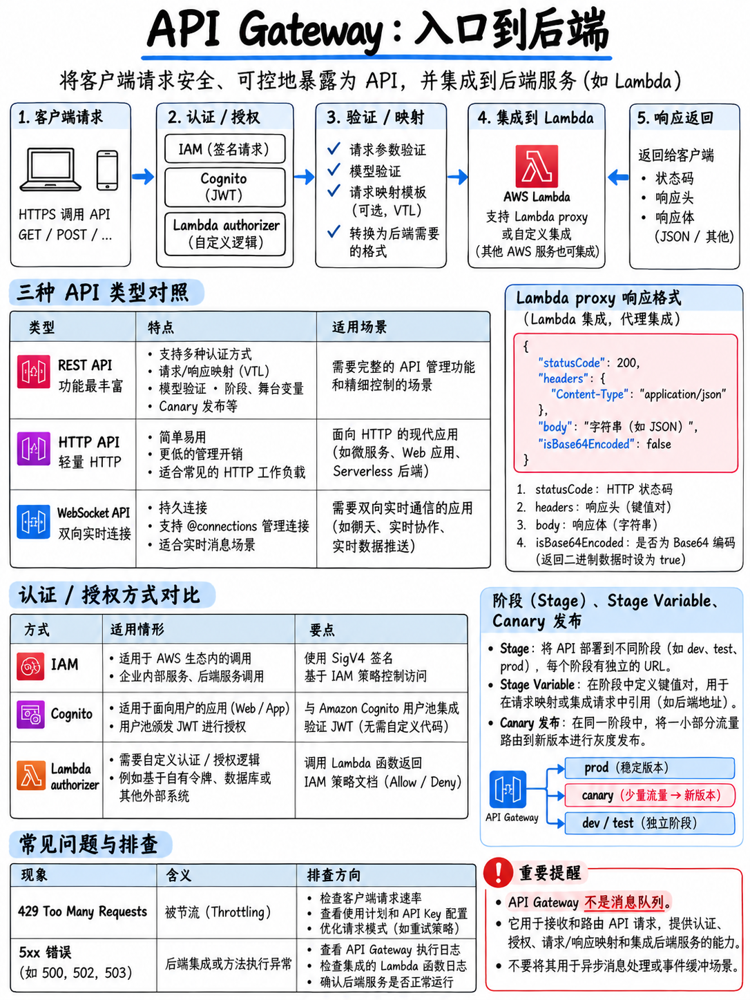

# 2.3 Amazon API Gateway：API 类型、集成、鉴权与流量控制 (Amazon API Gateway)



**Tier S 核心考点。** API Gateway 是绝大多数无服务器架构（Serverless）与云原生系统的统一入口网关。官方指南在域 1 中明确要求掌握“创建、扩展与维护 API（例如请求/响应数据映射转换、强制执行输入验证规则、重写状态码）” [1]，并且跨越三个考试域深度考查部署阶段（Stages）、阶段变量（Stage Variables）以及授权方（Authorizers）的落地实践。

## 2.3.1 三大 API 核心类型与技术选型

| 核心特性 | **REST API** | **HTTP API** | **WebSocket API** |
|---|---|---|---|
| **适用场景** | 需要企业级全功能 API 治理套件 | 面向 Lambda/HTTP 代理的轻量、低延迟、极致低成本场景 | **双向、持久有状态**的全双工长连接场景 |
| **成本对比** | 标准计费水平 | **比 REST API 便宜约 70%** | 按连接时长与消息数计费 |
| **支持的鉴权** | IAM、Cognito、**Lambda 自定义授权方（TOKEN 与 REQUEST）** | JWT、Lambda、IAM | Lambda、IAM |
| **VTL 映射模板** | **支持** (Velocity Template Language) | 不支持 | 支持 |
| **请求输入校验** | **支持** (基于 JSON Schema 模型) | 不支持 | 不支持 |
| **API 密钥与使用计划** | **支持** (API Keys & Usage Plans) | 不支持 | 不支持 |
| **网关级响应缓存** | **支持** | 不支持 | 不支持 |
| **金丝雀灰度发布** | **支持** | 不支持 | 不支持 |
| **私有 API (VPC 端点)**| 支持 | 不支持 | 不支持 |
| **AWS WAF 防火墙** | 支持 | 不支持 (仅直接挂载 ALB/CloudFront) | 不支持 |

:::{tip}
**考场秒杀决策准则：**
一旦题干中出现：需要数据映射模板、请求参数校验拦截、API 密钥、针对客户的用量配额计划（Usage Plans）、网关响应缓存、Canary 灰度发布、WAF 防火墙防护或私有 VPC 终端节点部署？→ 毫不犹豫选择 **REST API**。
若仅需要为后端 Lambda/HTTP 服务搭建低成本、低延迟的简单代理网关，且认证仅需标准的 JWT/OIDC 校验？→ 优先选择 **HTTP API**。
若业务场景要求服务器主动**双向实时推送 (Server-Push)** 数据至客户端——如在线聊天室、股票即时行情看板、“准实时 (Near Real Time)”双向数据流？→ 必须选择 **WebSocket API**。

AWS 官方样题第 2 题的核心考核点正在于此：用户需要“发布评论并准实时接收反馈信息”→ “在 Amazon API Gateway 中创建 **WebSocket API**”（以及配合 AWS AppSync）是官方给出的两个标准正确解 [18]。
:::

## 2.3.2 后端集成类型剖析

| 集成类型 | 工作机制与核心定位 |
|---|---|
| **`AWS_PROXY`** (Lambda 代理集成) | API Gateway 将客户端的完整 HTTP 请求以标准化 JSON 事件直接透传给 Lambda；Lambda 必须返回规范约定的响应数据结构。**官方默认推荐且为最常见考点** |
| **`AWS`** (Lambda 自定义集成) | 开发者编写 **VTL 映射模板** 自由清洗转换请求与响应报文。当必须重塑载荷或基于异常重写状态码时采用 |
| **`HTTP_PROXY`** | 原样穿透代理至后端的公网或私有 HTTP 端点 |
| **`HTTP`** | 带有 VTL 映射模板的自定义 HTTP 端点集成 |
| **`MOCK`** | API Gateway 无需调用任何后端直接静态响应。**标准用于 Mock 联调集成、处理 CORS 预检请求 (OPTIONS)，以及在后端服务尚未就绪前进行契约联调** |

官方考试指南明确点名考查：“为 API 执行 Mock 模拟集成并解决集成依赖项”以及“使用模拟端点开展集成测试” [1]。**因此 `MOCK` 属于必须熟练掌握的正式考点，绝非边缘冷门特性。**

### Lambda 代理集成标准响应格式

当采用 `AWS_PROXY` 集成模式时，后端 Lambda 函数返回的字典对象必须严格遵循以下 Schema，否则前端客户端会立即收到 **502 Bad Gateway** 错误：

```json
{
  "isBase64Encoded": false,
  "statusCode": 200,
  "headers": { 
    "Content-Type": "application/json",
    "Access-Control-Allow-Origin": "*" 
  },
  "body": "{\"message\":\"hello world\"}"
}
```

**`body` 字段的值必须是序列化后的字符串 (String)**，绝不能直接返回原生的 JSON Object。直接把原生字典/对象赋给 `body` 是线上与考题场景中导致 502 错误的最经典元凶。

## 2.3.3 部署阶段 (Stages) 与阶段变量 (Stage Variables)

**阶段 (Stage)** 代表 API 的一个命名部署环境快照，如 `dev`、`test`、`prod`。每个阶段分配独立的对外访问 URL：`https://{api-id}.execute-api.{region}.amazonaws.com/{stage}`。

**阶段变量 (Stage Variables)** 是直接附加在指定 Stage 上的键值对配置，主要应用于：

- 动态配置集成目标 URI，精准指向不同的 Lambda **别名 (Alias)**：
  `arn:aws:lambda:...:function:myFunc:${stageVariables.lambdaAlias}`
- 配置不同阶段对应的后端 HTTP 集成终端地址
- 在 VTL 映射模板中以 `$stageVariables.variableName` 方式动态读取
- 随着上下文透传给 Lambda 处理函数

::::{important}
**AWS 官方样题第 8 题的核心原型** [18]。针对开发环境（dev）与生产环境（prod），仅使用单一 Lambda 函数（含两个别名），以“最少的配置维护量”管理双环境：

> “创建一个 REST API。通过使用 **阶段变量 (Stage Variable)** 替代固定别名，将该 API 与 Lambda 函数深度集成。将该 API 分别部署到两个不同的阶段：dev 与 prod。在每个阶段中创建阶段变量，并将对应的 Lambda 别名作为变量值。通过不同的阶段 URL 访问对应的环境。”

官方权威解析总结：“你可以利用 API Gateway 阶段变量灵活引用同一个具有多个版本和别名的 AWS Lambda 函数” [18]。

**阶段变量 + Lambda 别名是 DVA-C02 体系中环境治理的最标准化范式**，请务必作为固定解题肌肉记忆牢固掌握。
::::

**未重新部署 Stage 导致改动不生效：** 在控制台或通过接口修改了 API 资源路径或方法配置后，必须执行 **部署 API (Deploy API)** 操作将其发布至目标 Stage，否则线上路由永远运行着旧版本的定义。这是经典的排错场景。

## 2.3.4 身份鉴权与访问控制方案

| 鉴权机制 | 校验逻辑与实现方式 | 典型应用场景 |
|---|---|---|
| **IAM 鉴权** (`AWS_IAM`) | 请求方使用 AWS 访问凭证通过 **SigV4** 算法签名；网关校验调用者 IAM 策略 | AWS 内部主体间的受控调用：跨账号调用、EC2 实例配置文件、Lambda 内部调用 |
| **Cognito 用户池** (`COGNITO_USER_POOLS`) | 客户端在 Header 中携带 Cognito 发行的 **ID Token**；API Gateway 原生验证 JWT 签名与过期时间 | 采用 Cognito User Pool 作为最终终端用户登录体系的应用 |
| **Lambda 授权方 —— TOKEN 模式** | Lambda 授权函数接收传入的 Bearer Token，解码验签后动态返回一份 **IAM Policy** 文档 | 自定义 JWT 校验、OAuth2 外部三方统一认证 |
| **Lambda 授权方 —— REQUEST 模式** | Lambda 授权函数接收 Headers、查询字符串、请求路径参数与上下文对象 | 鉴权逻辑需要综合评估 Header 之外的多维参数（如 IP、Path、Cookie） |
| **资源策略 (Resource Policy)** | 直接挂载在 API 实体上的白名单/黑名单策略，支持按账号、VPC Endpoint、CIDR 拦截 | 强制限制特定 IP 访问、限制仅限指定 VPC 内部通过 Interface Endpoint 调用 |
| **API 密钥与使用计划** | 用于标识*调用方租户身份*并绑定**限流速率与月度配额**。**绝不属于安全身份认证** | SaaS 商业化调用计费、按租户分级限流防刷 |

:::{danger}
**API Key 不是安全认证机制 (API keys are not authentication)。** 它的本质是在网关层标识调用方以进行计量扣费和配额节流。考题若询问“如何对 API 进行安全鉴权以保护敏感接口”，任何单一采用 API Key 的选项都是为粗心考生量身定制的典型干扰项。
:::

**AWS 官方样题第 4 题解析** [18]：仅允许特定外部 AWS 账号的 IAM 用户访问内部 API。官方双选正确答案为：“创建 IAM 权限策略并附加给对应 IAM 用户，将 API 方法的认证方式配置为 **`AWS_IAM`**，使用 **Signature Version 4 (SigV4)** 协议为 API 请求签名” **以及** “为该 API 创建 **资源策略 (Resource Policy)**，仅显式放行对应外部账号的 IAM 用户” [18]。

**授权方缓存机制 (Authorizer Caching)：** 自定义 Lambda 授权方默认开启 300 秒（TTL=300s）的结果缓存。当题目出现“自定义授权函数调用次数过多、网关延迟升高且产生高额额外函数账单”时，解题方向是合理配置或启用授权方缓存。

## 2.3.5 请求验证、数据转换与状态码重写

考试指南重点考查的三项能力 [1]：

**1. 请求输入校验 (Request Validation)** —— 在 API 方法上挂载基于 **JSON Schema 的模型定义 (Model)**。API Gateway 在网关层直接对客户端发来的 Body 载荷或 Query/Header 参数进行合规性拦截，非法请求直接就地拒绝并返回 **400 Bad Request**，**根本不会触发后端的 Lambda 函数**。这是“防止非法请求打入后端浪费算力与费用”的标准最佳实践。

**2. 映射模板 (Mapping Templates - VTL)** —— 在请求进入后端之前转换数据形态，或在响应返回客户端前重塑输出结构。必须使用非代理模式（`AWS` 或 `HTTP` 集成）。

```velocity
## 极简请求参数清洗映射模板示例
{
  "userId": "$input.params('id')",
  "body": $input.json('$')
}
```

**3. 状态码重写 (Overriding Status Codes)** —— 通过配置 **集成响应 (Integration Response)**，使用正则表达式匹配后端抛出的错误异常信息（如 Lambda 抛出的自定义错误字符串），从而将默认的 HTTP 200/500 智能映射重写为标准的 HTTP 400 或 404 响应码。这正是考纲中“实施输入验证规则并覆盖状态码”的核心实现机理。

## 2.3.6 跨域资源共享 (CORS) 深度避坑

当浏览器端 JavaScript 试图向不同源域名的 API 发起跨域异步请求时，浏览器会先自动发送一次 `OPTIONS` 预检请求（Preflight Request）。网关端必须在响应中显式返回包含 `Access-Control-Allow-Origin`、`-Headers` 和 `-Methods` 的响应头。

- 对于 **Lambda 代理集成 (`AWS_PROXY`)**：后端 Lambda 函数的代码响应逻辑中，**必须由开发者显式在 `headers` 字典中返回 CORS 相关响应头**。
- 对于 **非代理集成**：直接在控制台针对目标资源一键启用 CORS，API Gateway 会自动为你生成一个 **`MOCK` 类型的 `OPTIONS` 方法**。
- **排错金标准：** 若前端浏览器控制台抛出 CORS 跨域错误，但查阅 API Gateway 访问日志和后端 Lambda 日志中**完全没有任何该请求的踪迹**，说明 `OPTIONS` 预检请求在最前端即被拒绝，真实请求从未抵达网关内部。

## 2.3.7 限流节流、配额管理与缓存优化

| 治理层级 | 限流机制与行为表现 |
|---|---|
| **账户级全局限流** | 区域维度的默认稳定速率上限（Steady-State Token Bucket）与突发并发桶（Burst）；属于软配额 |
| **阶段 / 方法级限流** | 为指定的 Stage 或关键资源 Method 独立配置更低的限流阈值，防止非核心接口耗尽资源 |
| **使用计划限流 (Usage Plan)**| 绑定至指定 API Key：限制每秒请求速率 (Rate)、突发请求量 (Burst) 以及**周期配额 (Quota)**（如每天/每月上限） |
| **超限客户端表现** | 统一向客户端返回 **HTTP 429 Too Many Requests** 错误 |
| **阶段级缓存 (Caching)** | 针对整个 Stage 开启，容量 0.5 GB 至 237 GB。默认 TTL **300 秒**，上限 3600 秒。支持加密，并支持客户端携带 `Cache-Control: max-age=0` 请求头进行缓存穿透刷新（需具备 `InvalidateCache` 权限） |

官方考试指南将“基于请求头进行内容缓存”列为核心技能 [1]——在 API Gateway 中，具体操作即是将特定的 Request Header 勾选添加到 **缓存键 (Cache Key)** 中，使得携带不同请求头值的请求能够命中独立的缓存副本。

## 2.3.8 核心 HTTP 状态码快速研判清单

| 状态码 | API Gateway 场景下的根因判定与排查路径 |
|---|---|
| **400** | Bad Request —— 通常由于网关层的请求参数验证模型（Request Validation）判定载荷不符合 Schema 规范而主动拦截 |
| **403** | Forbidden —— 授权方判定拒绝、资源策略拦截、WAF 规则拦截封禁，或请求未正确携带合法 API Key |
| **429** | **Too Many Requests** —— 触发了账户级、阶段级或使用计划配额的限流阈值 |
| **502** | **Bad Gateway** —— 后端返回的数据无法被网关正常解析。**在 Lambda 代理集成中，99% 的根因是函数返回的 JSON 结构缺少 `statusCode` 或 `body` 未序列化为纯字符串** |
| **503** | Service Unavailable —— 后端服务器出现过载宕机或网络无法连通 |
| **504** | **Gateway Timeout** —— 后端集成超时。**API Gateway 的单次集成硬性超时上限为 29 秒**，远小于 Lambda 的 15 分钟上限 |

:::{warning}
**必须牢记 29 秒超时铁律。** 即使后端的 Lambda 函数配置了 60 秒乃至 15 分钟的超时上限，一旦挂载在 REST API 后面，只要函数运行超过 29 秒，API Gateway 就会无情切断连接并向前端吐出 **504 Gateway Timeout**。若考题设计了“后端需要执行长达数分钟的繁重批处理或复杂计算”的在线 API 题目，标准正确答案是**全面重构为异步架构**——API Gateway 立即向客户端返回 **HTTP 202 Accepted**，后台通过 SQS 或 Step Functions 异步消化，绝不能寄希望于在 API Gateway 上调大超时配置。
:::

## 2.3.9 阶段金丝雀发布 (Canary Deployments)

在 REST API 的 Stage 中可一键激活 **Canary 金丝雀发布**。系统会创建一个并行的 Canary 部署环境，允许开发者指定将一定百分比的现网真实生产流量（如 5% 或 10%）引导至新部署的 API 版本，并生成独立的 CloudWatch 性能监控指标与日志流。它构成了 API Gateway 层的流量金丝雀体系，而后端 Lambda 层的金丝雀流量分发则依托于加权别名（Weighted Aliases）协同实现（参见 {doc}`../40-deployment/04-deployment-strategies`）。

## 2.3.10 极速复习备忘 (Fast Revision)

- **REST API** 专攻数据转换、Schema 验证、API 密钥配额、缓存、金丝雀灰度、WAF 及私有端点。**HTTP API** 专攻轻量极简低成本代理。**WebSocket API** 专攻双向全双工长连接与准实时服务端主动推送。
- `AWS_PROXY` 为默认最常用代理集成模式；`MOCK` 是 Mock 联调及 CORS 预检的固定解。
- Lambda 代理响应必须携带 `statusCode` 且 `body` 必须为**纯字符串**——否则引发 **502** 灾难。
- **阶段变量 (Stage Variables) + Lambda 别名 (Aliases)** = 最少管理配置量的多环境治理神级组合。任何 API 配置修改后必须重新执行 **Deploy** 才能生效。
- 鉴权体系：IAM 验 SigV4 签名 · Cognito 用户池直接校验 JWT · 自定义 Lambda TOKEN/REQUEST 授权方 · 资源策略主打跨账号隔离。**牢记 API 密钥只负责计量限流，不负责安全认证。**
- **429** 代表限流节流；**502** 代表后端返回格式崩坏；**504** 代表触发了不可更改的 **29 秒** 集成超时死线。
- 网关缓存依附于 Stage 级别，默认 TTL 300 秒；支持基于请求头 Header 定制独立缓存键。
