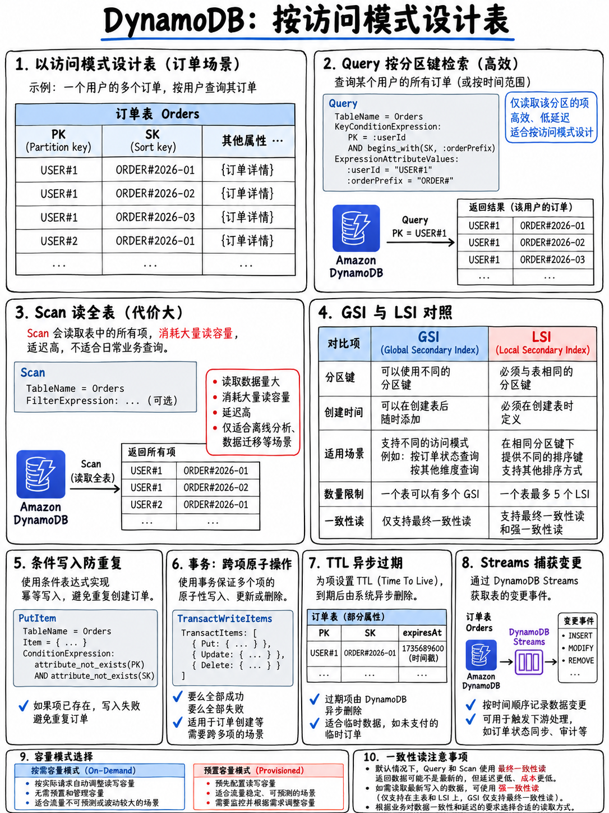

# 2.4 Amazon DynamoDB：数据建模、索引设计、容量计算与事务 (Amazon DynamoDB)



**Tier S 核心必考。** 官方考试指南在域 1 任务 3 中明确点名考核 DynamoDB 键与索引设计、高基数分区键、一致性模型以及 Query 与 Scan 的深层对比 [1]，同时 DynamoDB 的身影持续穿插于域 2 安全体系（静态加密、细粒度行级访问控制）和域 4 故障排查与性能调优（Throttling 异常、DAX 缓存加速）之中。

## 2.4.1 主键设计与底层数据模型

```
 表 TABLE
  └── 数据项 ITEM  (单条上限 400 KB，包含所有属性名与属性值)
       ├── 分区键 PARTITION KEY (Hash 键) — 决定数据落在哪个物理分区 (Partition)
       ├── 排序键 SORT KEY (Range 键)     — 可选；决定同一分区内数据的物理排序
       └── 其他普通属性                   — 无预设模式 (Schemaless)
```

- **简单主键 (Simple Primary Key)** = 仅包含分区键（Partition Key）。分区键在全表范围内必须绝对全局唯一。
- **复合主键 (Composite Primary Key)** = 分区键 + 排序键（Sort Key）。两者的**联合组合**在全表中必须唯一；允许多个 Item 共享完全相同的分区键。

::::{important}
**高基数分区键 (High-Cardinality Partition Keys)。** 官方指南明确要求的核心考点：“采用高基数分区键以实现**均衡的分区物理访问** (balanced partition access)” [1]。

如果分区键的取值范围极其离散度低（基数低），海量请求就会全部疯狂冲击极少数物理分区，形成严重的**热点分区 (Hot Partition)** 灾难——导致即使整个数据表维度的已消耗读写容量远低于预置供给的总容量，特定物理分区依然会遭遇限流拦截（Throttling）。

| 糟糕的分区键设计 | 导致热点的原因 | 推荐的优秀改良设计 |
|---|---|---|
| `status` (仅有 3 种枚举值) | 全局仅有 3 个物理分区承担全量流量 | 改用 `orderId` 作为分区键 |
| `date` (直接使用当天日期) | 当天的所有新增写入全量打入同一个物理分区 | 采用添加随机盐后缀 `date#randomSuffix`，或使用 `customerId` 作为分区键并将日期设为排序键 |
| `country` (国家代码) | 人口密集大国的分区严重偏斜倾斜 | 改用离散度极高的 `userId` |

**考场典型特征描述：** “CloudWatch 监控显示表整体消耗的吞吐容量远低于配置的预置容量，但业务写入却频繁被限流抛出 ProvisionedThroughputExceededException” → 根本原因锁定为**热点分区 (Hot Partition) / 低基数分区键导致流量分布极不均衡**。
::::

## 2.4.2 二级索引全景对比：LSI vs GSI (考场最高频)

| 核心特性 | **LSI 本地二级索引 (Local Secondary Index)** | **GSI 全局二级索引 (Global Secondary Index)** |
|---|---|---|
| **分区键 (PK)** | **必须与基表的分区键完全相同** | **可以是任意其他属性** |
| **排序键 (SK)** | 必须是另一个与基表不同的属性 | 可以是任意其他属性（或无排序键） |
| **创建时机** | **仅能在建表时创建。** 后续无法动态追加或删除 | **任何时刻**均可自由在线追加创建或删除 |
| **单表数量限制**| 每张表最多 **5 个** | 每张表默认最多 **20 个**（可申请调高配额） |
| **容量管理模式**| **完全共享基表的** RCU 与 WCU | **拥有完全独立专属的** RCU 与 WCU |
| **一致性支持** | **支持强一致性读 (Strong) 或最终一致性读** | **仅支持最终一致性读 (Eventually Consistent Only)** |
| **存储大小约束**| 单个分区键值对应的数据总量不能超过 10 GB | 无任何存储体积限制 |

:::{danger}
**四个考场上反复轮番考察的绝对铁律：**

1. **基表建好之后绝无法补建 LSI。** 一旦题目中提到“业务迭代需要对已有的现网 DynamoDB 表支持新的查询维度”，标准答案永远是创建 **GSI**，绝不要选 LSI。
2. **GSI 绝不支持强一致性读取。** 只要题干中强调“必须对非主键属性实施强一致性读取 (Strongly Consistent Read)”，GSI 立即被一票否决。
3. **GSI 具备独立的吞吐容量配置。** 若 GSI 的写容量配额（WCU）配置过低被耗尽引发限流，**会导致向基表写入数据同样被限流阻塞 (Throttled)**——这是极其容易让初学者震惊的连锁故障机制，也是官方高频考核点。
4. **LSI 强制共享基表的容量池**，且分区键必须与主表完全一致。
:::

**投影属性 (Projections)** 决定了哪些字段会被冗余复制到二级索引中：`KEYS_ONLY`（仅主键属性）、`INCLUDE`（显式包含指定常用业务属性）、`ALL`（完整全量属性复制）。更紧凑的投影占用的存储更少、写入索引更快速；但若查询请求需要读取未包含在投影内的属性，DynamoDB 必须反向回表拉取，消耗额外的读容量（而对于 GSI 而言，如果查询字段未投影，甚至无法支持回表过滤，字段直接缺失不可见）。

## 2.4.3 查询 Query vs 全表扫描 Scan 深度剖析

考试指南明确考核的核心知识点：“Query 与 Scan 操作的本质区别与性能代价” [1]。

| 对比维度 | **Query 查询操作** | **Scan 扫描操作** |
|---|---|---|
| **读取范围** | 仅精确检索具备指定**分区键 (Partition Key)** 的相关条目 | **无脑遍历扫描整张表的所有数据项** |
| **资源效率** | 效率极高，仅针对命中的物理分区消耗极少 RCU | 极其昂贵低效，只要被扫过的数据无论是否匹配均全量消耗读容量 |
| **必备入参** | 必须传入分区键等于精确值（Equality）；排序键条件支持可选的范围运算 | 无需任何键参数即可运行 |
| **Filter 表达式**| 在数据被读取出之后，**在内存中执行后置过滤** | 在全表被扫描出之后，**在内存中执行后置过滤** |

::::{warning}
**Filter 过滤表达式绝不能帮你节省任何读容量 RCU。** FilterExpression 是在物理层将数据读取至内存之后才生效的后置逻辑，系统依然会按照被检索扫描的总数据量向你计费，随后将不匹配的结果丢弃。“添加 FilterExpression 以削减读取成本”在考试中永远是用于迷惑考生的典型干扰项。

**解决“当前 Scan 操作太慢且吞吐费用爆炸”的唯一根本正解：通过设计二级索引 (GSI)，将低效的 Scan 全面重构为高效精准的 Query 操作。** 备用优化手段包括：使用并行扫描 Parallel Scan（耗时缩短但瞬时消耗更多 RCU）、精简投影字段、或者配合分页拉取。
::::

**分页机制 (Pagination)：** 无论是 Query 还是 Scan，单次 API 响应的数据载荷被严格限制在 **1 MB 上限**。若本次操作未读取完毕，响应体中会携带 `LastEvaluatedKey`；客户端代码必须在下次请求中将其作为 `ExclusiveStartKey` 传入以继续拉取下一页。在实际开发和试题中，“代码读取数据总是不完整、莫名其妙缺失记录”往往是因为遗漏了分页游标的处理。

## 2.4.4 数据一致性模型 (Consistency Models)

| 一致性级别 | 特性机制与成本表现 |
|---|---|
| **最终一致性读 (Eventually Consistent Read)** | 默认模式。由于数据多副本异步同步，极小概率读取到刚写入的旧数据副本。**计费仅需消耗一半的 RCU** |
| **强一致性读 (Strongly Consistent Read)** | 保证必然返回在它之前所有已成功写入的最新数据。计费消耗双倍于最终一致性读的 RCU。**GSI 索引完全不支持强一致读**，且全局表（Global Tables）跨区域复制也无法实现跨区强一致 |
| **事务读 (Transactional Read)** | 提供跨多行数据的原子 ACID 隔离读取（`TransactGetItems`，单次最多 100 项/4 MB）。**成本等同于 2 倍强一致性读** |

## 2.4.5 容量模式与必考算术换算 (RCU / WCU)

| 模式对比 | **预置容量模式 (Provisioned)** | **按量计费模式 (On-Demand)** |
|---|---|---|
| **配置方式** | 手动指定显式的 RCU 与 WCU 数值 | 无需配置任何容量规格 |
| **计费表现** | 业务流量平稳可预测时单价更经济划算 | 严格按实际请求量（Request Units）计费；单次请求单价较高 |
| **最佳场景** | 流量基线稳定清晰；可配合 **Auto Scaling** 弹性伸缩 | **流量完全无法预测、突发峰谷波动剧烈**、或全新冷启动上线的新业务 |

**核心计量单位换算公式（考场必考，必须深深刻在脑海中）：**

```
 1 WCU  = 针对体积不超过 1 KB 的数据项，提供每秒 1 次的标准写入
 1 RCU  = 针对体积不超过 4 KB 的数据项，提供每秒 1 次的「强一致性」读取
        = 针对体积不超过 4 KB 的数据项，提供每秒 2 次的「最终一致性」读取

 计算容量时：必须先将单条 Item 体积「向上取整 (Round UP)」至最小计量步长，再乘以每秒请求频次！
```

*实战算术示例 1：* 业务每秒需要对单条体积为 6 KB 的数据项执行 100 次强一致性读取：
6 KB → 向上取整为 **2 × 4 KB** = 每次强一致读取消耗 2 RCU → 100 × 2 = **200 RCU**。
若业务切换为最终一致性读取：200 ÷ 2 = **100 RCU**。

*实战算术示例 2：* 业务每秒需要对单条体积为 3 KB 的数据项执行 50 次写入：
3 KB → 向上取整为 **3 WCU** → 50 × 3 = **150 WCU**。

**限流异常处理路径：** 线上触发 `ProvisionedThroughputExceededException` 时的标准处理优先级顺序：
第一步：利用客户端 SDK 内置的**带有随机抖动的指数退避重试 (Exponential Backoff with Jitter)**；
第二步：排查主键设计是否存在**热点分区 (Hot Partition)** 并优化离散度；
第三步：配置 **Auto Scaling** 自动扩缩容，或将突发波动的表切换为 **On-Demand** 模式；
第四步：对于读多写少的极高并发读取场景，引入 **DAX (DynamoDB Accelerator)** 内存加速集群。

## 2.4.6 写入操作高级特性：条件写入、原子计数器与 ACID 事务

**条件写入 (Conditional Writes)** —— 通过配置 `ConditionExpression`，只有在满足特定条件表达式时写入才会成功，否则立即抛出 `ConditionalCheckFailedException`。这是构建以下高级特性的底层基石：

- **乐观锁机制 (Optimistic Locking)**：为数据项维护一个自增的 `version` 属性，写入时传入 `ConditionExpression: version = :expected`，并在写入成功时原子递增版本号。如果抛出异常，说明已被并发请求抢先修改，业务层捕获后重新读取重试。
- **幂等性去重 (Idempotency)**：使用 `attribute_not_exists(pk)` 保证“仅当该唯一主键不存在时才执行插入”具备严格原子性——这是解决 SQS 标准队列消息至少一次投递导致的重复消费问题的行业标准解法。

**原子计数器 (Atomic Counters)** —— 利用 `UpdateExpression: SET count = count + :inc` 实施无条件数字累加。请务必注意：**原子计数器不具备幂等性**；若客户端因网络抖动发生重试，计数器会重复累加导致数字虚高。对幂等性有严格要求的业务必须使用带条件的写入。

**ACID 事务 (Transactions)** —— `TransactWriteItems` 与 `TransactGetItems` 提供全成功或全回滚（All-or-Nothing）的跨表/跨行强事务支持，单次事务最多涵盖 **100 个数据项** 或 4 MB 体积，限制在单一 AWS 账户和区域内。消耗 **2 倍** 的常规读写容量。

**批处理操作 (Batch Operations)** —— `BatchWriteItem`（单次上限 25 项 / 16 MB）与 `BatchGetItem`（单次上限 100 项 / 16 MB）**绝不具备 ACID 事务性**；各条目独立执行，部分条目写入失败时会原样装入 `UnprocessedItems` 字段返回，**必须由客户端编写重试逻辑予以消化**。

## 2.4.7 变更流 Streams、生存时间 TTL 与 DAX 内存加速

**DynamoDB Streams** —— 捕获数据表中发生的所有 Item 级别的变更明细，提供长达 24 小时的时间有序变更日志流，常通过事件源映射无缝触发 Lambda 函数。

| 流视图类型 `StreamViewType` | 变更事件中包含的数据内容 |
|---|---|
| `KEYS_ONLY` | 仅捕获发生变更的数据项的主键属性 |
| `NEW_IMAGE` | 捕获发生变更后的整条最新数据项全貌 |
| `OLD_IMAGE` | 捕获发生变更前的整条历史数据项全貌 |
| `NEW_AND_OLD_IMAGES` | **同时捕获修改前与修改后的完整数据项**（用于业务比对新旧差异的唯一正确选择） |

高频考查场景：向 OpenSearch 异步近实时同步数据建立全文索引、在数据变更时主动淘汰缓存、异动触发 SNS 通知、维护跨表聚合统计、审计日志留痕。

**生存时间 (TTL, Time to Live)** —— 指定某个存储 **以秒为单位的 Unix Epoch 时间戳** 的属性字段；DynamoDB 后台服务会在数据过期后将其**全免费自动清理删除**（通常在 48 小时内完成物理清除）。被 TTL 删除的记录同样会流入 DynamoDB Streams。这是“自动过期清理大量过期会话 Session 数据且完全不消耗宝贵写容量 WCU”的标准正解。

**DAX (DynamoDB Accelerator)** —— 专为 DynamoDB 量身定制的专用内存缓存集群，提供极致的**微秒级 (Microsecond)** 读取延迟。提供完全 API 兼容的 SDK 客户端，代码改造量趋近于零。采用写穿（Write-Through）策略保证写入同步。

:::{tip}
**DAX vs ElastiCache 架构选型对照：**
DAX 是专为 DynamoDB 深度定制的专用缓存，保持原生 API 兼容，当考题专门针对“大幅加速 DynamoDB 读取吞吐并降至微秒级”时是绝对正解。
ElastiCache（Redis/Memcached）则是通用分布式缓存中间件，适用于全栈共享缓存、需要复杂数据结构或挂载在关系型数据库前端的场景。
**特别警告：DAX 对写密集型场景毫无助益**，且其提供的是**最终一致性读取 (Eventually Consistent)**——若考题明确强制要求强一致性读，选择 DAX 则是致命错误。
:::

## 2.4.8 安全加密与高阶特性精要

- **静态加密 (Encryption at Rest) 默认强制全量启用**（默认采用 AWS 拥有的自有密钥；亦可选用 AWS 托管的 KMS 密钥或客户自管 KMS 密钥）。
- **细粒度行级访问控制 (Fine-Grained Access Control)**：在 IAM 策略的 Condition 条件块中利用 `dynamodb:LeadingKeys` 配合 `${www.amazon.com:user_id}` 变量，强制限定登录用户仅能对主键等于其自身用户 ID 的行记录进行读写操作——这是配合 Cognito 身份池实现“每位移动端 App 用户仅被允许读取其名下私有数据”的经典教科书级考点。
- **PartiQL** —— 允许使用类似 SQL 语法的语句对 DynamoDB 执行 CRUD。虽然带来了 SQL 的编码便利，但其底层仍旧严格遵循 DynamoDB 的容量计费与索引路由约束。
- **全局表 (Global Tables)** —— 基于 DynamoDB Streams 实现的跨多区域、多活（Multi-Active）数据自动双向复制；跨 Region 之间严格为**最终一致性 (Eventually Consistent)**，冲突基于最后写入胜出（Last-Writer-Wins）策略决断。

## 2.4.9 极速复习备忘 (Fast Revision)

- 单条 Item 上限 **400 KB**。Query/Scan 单次响应上限 **1 MB**——务必通过游标 `LastEvaluatedKey` 处理分页。
- **LSI：建表时定死、分区键必同、共享基表容量、支持强一致性、单表限 5 个。GSI：随时增删、主键任意、专属独立容量、仅支持最终一致性、单表限 20 个。**
- **已有现网数据表需要新查询维度 → 必然选择 GSI。**
- **GSI 的写容量被打满限流会直接拖垮并反向限流基表的正常写入。**
- FilterExpression **无法** 节省任何 RCU。解决低效 Scan 的终极手段是建立二级索引化为 Query。
- **1 WCU = 1 KB 写入；1 RCU = 1 次 4 KB 强一致读或 2 次 4 KB 最终一致读。** 算术前单条体积先向上取整。
- 遇限流 → 指数退避重试、治理热点分区、开启 Auto Scaling/On-Demand、引入 DAX。
- `ConditionExpression` 赋予你实现**乐观锁 (Optimistic Locking)** 与 **写入幂等性 (Idempotency)** 的核心超能力。
- 变更流：需比对新旧改动必选 `NEW_AND_OLD_IMAGES`。TTL 自动清理完全免费不耗写容量。
- **DynamoDB 读取加速首选 DAX；通用复杂数据结构缓存选 ElastiCache。**
