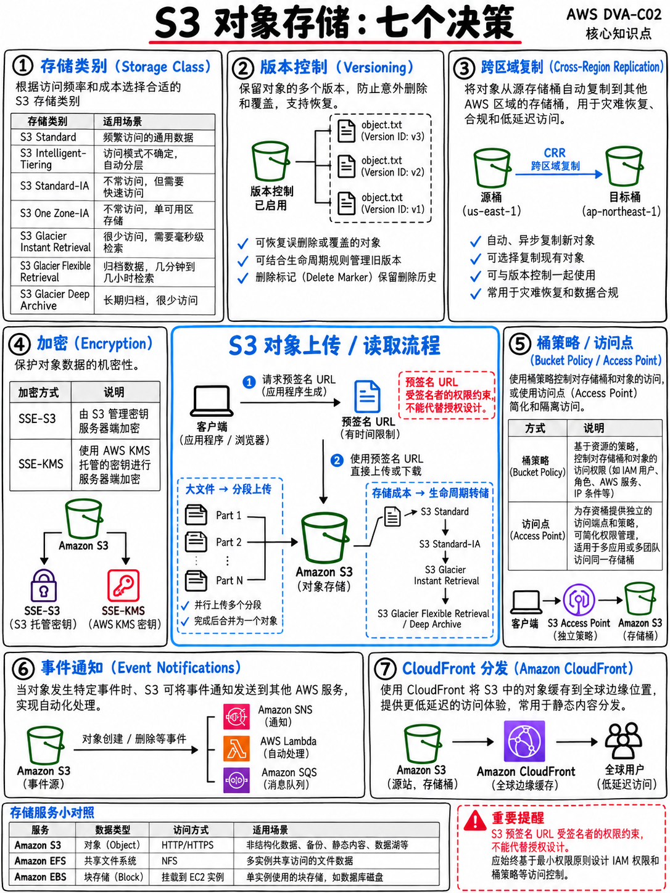

# 2.5 Amazon S3 与存储服务：存储分层、生命周期、上传机制与加密 (Amazon S3 and Storage Services)



官方考试指南在域 1 任务 3 中明确考核：“Amazon S3 存储层与生命周期管理”、“云存储选项（文件存储、对象存储、数据库）”以及“临时数据存储与持久化数据存储模式的差异” [1]。

## 2.5.1 三大云存储形态全景辨析：对象、块与文件

| 对比维度 | **对象存储 (Object)** —— S3 | **块存储 (Block)** —— EBS | **文件存储 (File)** —— EFS |
|---|---|---|---|
| **访问协议** | HTTPS REST API，通过唯一 Key 寻址 | 直接挂载到单台 EC2 裸设备（或通过 Multi-Attach） | 标准 NFS 协议网络挂载，支持海量并发客户端 |
| **共享范围** | 基于权限策略实现全球任意客户端共享 | 同一时间通常仅限单台实例，局限于单一可用区 (AZ) | 跨多可用区多实例并发共享，**且原生支持 Lambda 挂载** |
| **典型用途** | 静态前端托管、用户大文件上传、数据湖、备份归档 | 虚拟机根系统卷、EC2 上的自建数据库持久化卷 | 多容器共享代码/配置、Lambda 需要超 10 GB 存储或共享状态 |
| **持久性特性**| 具备 99.999999999% (11 个 9) 极端持久性 | 持久化存储（**EC2 实例存储 Instance Store 属于临时存储**）| 持久化、跨多可用区强容灾存储 |

**临时存储 vs 持久化存储考点辨析** [1]：EC2 的 **实例存储 (Instance Store)** 以及 Lambda 的本地挂载盘 `/tmp` 均属于**临时存储 (Ephemeral Storage)**——当实例停机重启、或者 Lambda 暖环境被平台回收释放时，存储中的数据将彻底永久丢失。而 EBS 卷、EFS 文件系统以及 S3 存储桶中的数据则属于**持久化存储 (Persistent Storage)**。

## 2.5.2 S3 存储分层类别的核心选型

| 存储类别 | 适用业务场景特征 | 检索延迟表现与收费特征 |
|---|---|---|
| **S3 Standard (标准级)** | 高频访问的热点核心业务数据 | 毫秒级即时响应；无数据检索费用 |
| **S3 Intelligent-Tiering (智能分层)** | **数据访问模式完全未知、或随时间剧烈动态波动** | 毫秒级即时响应；根据访问频次全自动智能迁移降本 |
| **S3 Standard-IA (低频访问)** | 访问频率较低，但被调用时要求毫秒级即时取回 | 毫秒级即时响应；单价更低，但按检索量收取取回费 |
| **S3 One Zone-IA (单可用区低频)**| 访问频次低、**且即使丢失也可以通过源头重新生成** | 毫秒级即时响应；仅存储在单一可用区，成本更低 |
| **S3 Glacier Instant Retrieval (即时检索归档)** | 极低频访问的历史归档，但一旦需要必须毫秒级就绪 | **毫秒级即时取回**；归档级低廉存储成本，有较高检索费 |
| **S3 Glacier Flexible Retrieval (灵活检索归档)** | 常规长周期合规归档，对取回时效有容忍度 | 取回耗时从**数分钟至数小时**不等 |
| **S3 Glacier Deep Archive (深度归档)** | 长期极端冷备份（如留存 7–10 年的法务凭证），成本最低 | 取回耗时通常需要 **12 小时以内** |

:::{tip}
**考场高频题眼与秒杀关键词：**
题干出现“访问模式完全未知 (Access patterns are unknown) / 随时间波动无法预测 / 不希望产生人工分析运维成本” → 绝对锁定 **S3 Intelligent-Tiering**。
题干出现“根据合规法律要求必须将审计凭证归档保存 7 年，且几乎永远不会被读取” → 绝对锁定 **S3 Glacier Deep Archive**。
题干出现“存储属于衍生派生数据，丢失后可随时重新批量计算生成” → 锁定 **S3 One Zone-IA**。
:::

## 2.5.3 存储桶生命周期管理规则 (Lifecycle Rules)

在存储桶或指定目录前缀（Prefix）上配置生命周期自动化策略，包含两大动作类型：

- **转换动作 (Transition)** —— 在数据创建满 N 天后，自动平滑下沉迁移到单价更便宜的冷存储类别。
- **到期动作 (Expiration)** —— 在对象创建满 N 天后自动物理删除；同时可用于自动清理超期未完成的分段上传数据分块以及过期的删除标记。

```
 第 0 天    S3 Standard (标准存储)
 第 30 天   → 自动下沉至 S3 Standard-IA (低频访问)
 第 90 天   → 自动下沉至 S3 Glacier Flexible Retrieval (灵活归档)
 第 365 天  → 自动下沉至 S3 Glacier Deep Archive (深度归档)
 第 2555 天 → Expiration 到期彻底物理销毁删除
```

:::{warning}
**生产与考场避坑重点：必须配置中止未完成的分段上传规则 (Abort incomplete multipart uploads)。** 在上传大文件时，如果客户端中断了上传流程，已成功上传的各数据分块将静默残留在存储桶后台（控制台常规对象列表中不可见），并被 AWS 永久持续计费。考题中经常出现“S3 账单莫名其妙奇高，找不到大文件存在”的场景，标准正解即是“配置生命周期规则，在 7 天后自动中止并清理未完成的分段上传”。
:::

## 2.5.4 数据上传技术：分段上传与预签名 URL

**分段上传 (Multipart Upload)** —— 将超大对象切分成若干个分块，并发向 S3 发起并行上传，并在特定分块传输失败时仅针对该分块执行重试。

- 对于大于 **100 MB** 的对象，AWS **强烈建议**采用分段上传。
- 对于大于 **5 GB** 的对象（单次 HTTP PUT 的物理上限），**强制必须**采用分段上传。
- 单个 S3 存储对象的物理体积上限为 **5 TB**。
- 若上传失败或中断，未组装的碎片分块会持续占用容量计费——对应上述生命周期清理规则。

**预签名 URL (Presigned URLs)** —— 由拥有合法 IAM 权限的服务端（如 Lambda 或 EC2）动态生成一段带有短期有效签名的临时 URL，使得完全没有 AWS 凭证的外部客户端（如前端 Web 浏览器）能够直接向指定的 S3 对象发起受控的 HTTP `GET` 下载或 `PUT` 直传。

```bash
# 生成有效期为 1 小时的临时 S3 上传/下载预签名 URL
aws s3 presign s3://my-bucket/report.pdf --expires-in 3600
```

::::{important}
**考场最高频出现的预签名 URL 经典大题场景：**
“前端用户需要从浏览器直接上传高达数 GB 的大文件至 S3，既不能将文件穿透自己的应用服务器（避免打爆服务器带宽与内存），又绝不能向浏览器客户端暴露分发任何 AWS IAM 访问凭据。”

→ 标准解法：业务服务器（或 API Gateway + Lambda）动态生成一个具备 `PutObject` 权限的 **预签名 URL (Presigned URL)** 并将其以 JSON 形式返回给浏览器端，前端 JavaScript 随后使用标准 HTTP PUT 将文件直接流式上传至 S3。

**权限穿透本质：** 预签名 URL 继承的是**生成该 URL 的服务端主体（如 Lambda 的 Execution Role）所拥有的权限**。因此，服务端的执行角色自身必须具备对该桶的写入授权。考场上看到“将存储桶设为公开公开可写”、“在前端 App 代码中硬编码 Access Key”或“通过应用服务器流式代理中转大文件”的选项，必须立即坚决排除。
::::

## 2.5.5 存储加密体系与 KMS 性能优化

| 加密模式 | 密钥管理主体 | 考点核心与性能特征 |
|---|---|---|
| **SSE-S3** (`AES256`) | AWS 平台全托管 | 平台默认开启；所有新上传的对象自动享有此静态加密 |
| **SSE-KMS** (`aws:kms`) | KMS 托管（AWS 托管密钥或客户自管 CMK） | **每次加解密均在 CloudTrail 中留存完备审计日志**，支持独立密钥轮换与精细权限控制。在高频访问下容易**遭遇 KMS 请求配额限流**——必须启用 **S3 存储桶密钥 (S3 Bucket Keys)** 削减 99% 以上的 KMS 调用频次 |
| **DSSE-KMS** | 双重层级 KMS 加密 | 极严格的政府与特殊合规行业要求 |
| **SSE-C** | **客户端在发起每个请求时动态自行提供加密密钥** | AWS 绝不持久保存该密钥；一旦密钥丢失，存储在云端的数据将彻底无法恢复 |
| **客户端加密 (Client-Side)**| 在数据离开本地上传之前由业务程序自行加密 | AWS 平台自始至终仅能接触到加密密文 |

:::{tip}
**考场加密秒杀决策规则：**
“企业安全合规审计要求必须对对象的每次加解密行为具备独立可审计日志留痕，且必须支持人工密钥轮换与吊销” → 锁定 **SSE-KMS**。
“大规模高并发 S3 业务在启用了 SSE-KMS 加密后，频繁遭遇 KMS API 限流 (KMS Throttling)” → 锁定 **开启 S3 Bucket Keys**。
“企业合规要求加密密钥本身绝不能离开本地机房私有环境” → 锁定 **客户端加密 (Client-Side Encryption)** 或 **SSE-C**。
:::

**通过桶策略强制加密传输：** 在 S3 存储桶策略（Bucket Policy）中编写显式拒绝规则，当请求未携带 `aws:SecureTransport: "true"`（非 HTTPS）或者上传请求缺少 `s3:x-amz-server-side-encryption` 标头时，直接无条件 Deny 拦截。

## 2.5.6 版本控制、跨区复制与对象锁定

- **版本控制 (Versioning)** —— 存储桶一旦开启版本控制，就**再也无法被彻底永久关闭**，仅能被设置为“暂停 (Suspended)”。当用户执行删除操作时，系统并不会物理抹去数据，而是会生成一个 **删除标记 (Delete Marker)**；只有通过指定 Version ID 才能进行物理硬删除。
- **MFA 删除 (MFA Delete)** —— 必须提供多因素硬件/虚拟认证令牌才能永久物理删除特定对象版本或修改桶版本状态。
- **对象锁定 (Object Lock)** —— 提供 WORM (Write Once, Read Many) 写入一次不可篡改模型，满足法务合规。必须依赖版本控制。
- **跨区域/同区域复制 (CRR / SRR)** —— 源桶与目标桶**必须同时开启版本控制**；开启复制后，默认仅自动同步增量写入的新对象，存量老对象必须借助 S3 批量复制（Batch Replication）补齐。

## 2.5.7 访问控制策略与安全决策链路

```
 用户发起的 S3 请求是否被允许？
   ├─ 检查调用者自身的 IAM 身份权限策略 (Identity-based Policy)
   ├─ 检查目标 S3 存储桶上的桶策略 (Bucket Policy)
   ├─ 检查 阻止公网访问 设置 (Block Public Access) ← 无论上层如何配置，具备全局一票否决权
   └─ (对象 ACL 访问控制列表 — 属于历史遗留机制，新桶默认已被禁用)

 决策铁律：在链路任何一环只要匹配到显式的拒绝规则 (Explicit DENY)，立即判定无条件拒绝！
```

**阻止公网访问 (Block Public Access, BPA) 默认处于开启状态**，是防御“防止任何员工因配置失误导致存储桶意外对公网全量泄漏”的官方最推荐防线。

**跨账户授权访问：** 标准实践是由资源持有方在自己的 S3 存储桶策略中编写授权块，显式将访问权限授予外部目标账户的 IAM 主体（Role 或 User），同时外部账户需在其本地 IAM 策略中放行该操作。

## 2.5.8 事件通知与核心特性精要

- **S3 事件通知 (S3 Event Notifications)** —— 支持在产生 `s3:ObjectCreated:*`、`s3:ObjectRemoved:*` 等事件时，向下游 Lambda、SQS、SNS 或 EventBridge 广播投递消息。**触发 Lambda 属于异步调用 (Asynchronous Invocation)**，严格遵循失败自动重试 2 次及 DLQ/Destination 路由规则（参见 {doc}`02-lambda-deep-dive` §2.2.4）。AWS 官方样题第 5 题正是依托此模式构建 [18]。
- **EventBridge 深度集成** —— 开启后相较于原生事件通知，支持更精细丰富的高级 JSON 模式过滤（例如按文件大小、特定扩展名等复杂组合过滤）。
- **完全强一致性读 (Strong Read-After-Write Consistency)** —— S3 目前对所有针对对象的操作（包括全新对象的 PUT、覆盖修改对象的 PUT 以及 DELETE 操作）均提供严格的“写后即强一致性读”保障。任何教材或网帖若依然提及“覆盖更新与删除具备最终一致性延迟”，均属于严重过时的陈旧错误。
- **S3 Select** —— 支持通过简单的 SQL 语法直接筛选检索存储于单个对象内部的数据记录（支持 CSV、JSON、Parquet），只将匹配的行数据流式返回给客户端，显著减少从 S3 下载全量大文件产生的网络传输开销。
- **传输加速 (Transfer Acceleration)** —— 让异地客户端通过遍布全球的 CloudFront 边缘节点（Edge Locations）接入 AWS 骨干网络高速直达 S3；标准用于解决“跨大洲跨国用户上传大文件速度极其缓慢”的业务痛点。
- **静态网站托管 (Static Website Hosting)** —— 考试最推荐的企业级正解是 **S3 + Amazon CloudFront**，并配置 **源访问控制 (Origin Access Control, OAC)**，确保 S3 存储桶维持在完全私有状态，仅允许 CloudFront CDN 回源读取。

## 2.5.9 极速复习备忘 (Fast Revision)

- 对象存储选 S3，块存储选 EBS，多端网络共享文件选 EFS。EC2 实例存储与 Lambda `/tmp` 均属于**临时存储 (Ephemeral)**。
- **数据访问规律未知或随时间不可预测 → S3 Intelligent-Tiering。**
- 分段上传：**大于 100 MB 推荐使用，大于 5 GB 强制必须使用**；单个对象最大 5 TB。**务必配置生命周期规则定期中止并清理未完成的分段碎片。**
- **预签名 URL (Presigned URL)** = 允许外部客户端在无需持有 AWS 凭证的前提下受控直传/下载，继承生成方的 IAM 权限。
- **SSE-KMS** 提供独立审计日志与密钥轮换；高频请求遭遇限流必须启用 **S3 Bucket Keys**。
- 版本控制无法彻底关闭，只能暂停；执行删除会创建**删除标记 (Delete Marker)**。
- **阻止公网访问 (BPA)** 拥有一票否决权；显式拒绝（Explicit Deny）压倒一切放行。
- S3 事件通知触发 Lambda 属于**异步调用**：自动重试 2 次，之后进入 DLQ 或 Destination。
- S3 全面提供**写后读强一致性 (Strong Read-After-Write Consistency)**。
