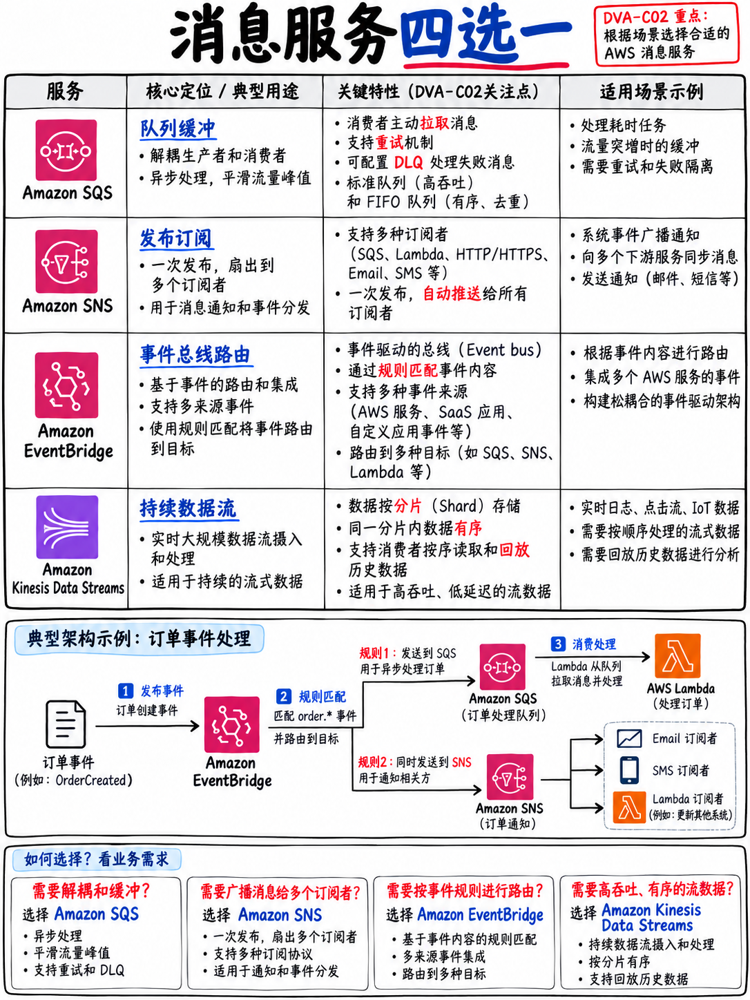

# 2.6 消息与流式传输：SQS、SNS、EventBridge 与 Kinesis (Messaging and Streaming: SQS, SNS, EventBridge, Kinesis)



官方考试指南在域 1 中明确考核：“编写代码使用消息传递服务”、“使用 AWS 服务处理数据流式传输 (Data Streaming)”、扇出架构（Fanout）、死信队列（DLQ）以及事件协同（Choreography）与集中编排（Orchestration）的架构权衡 [1]。在多款服务之间做出精准的技术选型是高频考题。

## 2.6.1 消息与事件总线核心选型决策矩阵

| 业务核心诉求 | 官方推荐标准服务 |
|---|---|
| 需要**消息队列 (Queue)**：单个消费者组消费每条消息，实现系统解耦与高并发削峰缓冲 | **Amazon SQS** |
| 需要**发布/订阅 (Pub/Sub) 扇出**：单条消息需要向成千上万个独立订阅方广播分发 | **Amazon SNS** |
| 需要**基于内容的事件智能路由与过滤**：连接 AWS 托管服务、SaaS 第三方软件与自建系统；**定时任务调度** | **Amazon EventBridge** |
| 需要**严格时间有序、支持历史回溯重放 (Replayable) 的海量数据流**，服务多个独立消费者组 | **Amazon Kinesis Data Streams** |
| 需要**零代码无服务器直接将流式数据转储写入 S3 / Redshift / OpenSearch** | **Amazon Data Firehose** |
| 需要**编排多步骤复杂工作流**，包含显式状态机、单步超时重试、异常分支判断与人工介入审批 | **AWS Step Functions** |

```
 经典扇出架构 FAN-OUT（官方考试指南明确点名的必考模式 [1]）：

                 ┌──► SQS 队列 A ──► Lambda (计费结算消费者 Billing)
   发布者 ──► SNS ──► SQS 队列 B ──► Lambda (大数据分析消费者 Analytics)
                 └──► SQS 队列 C ──► Lambda (短信推送消费者 Notifications)

 架构优势：每个 SQS 队列独立充当消息缓冲区。
 某个下游业务消费缓慢或宕机重试，绝不会阻塞拖垮其他消费者，各自享有独立的重试生命周期与隔离。
```

## 2.6.2 Amazon SQS：标准队列与 FIFO 队列机制

| 对比维度 | **标准队列 (Standard Queue)** | **FIFO 先进先出队列** |
|---|---|---|
| **顺序保障** | 尽最大努力保序（可能发生乱序） | **严格先进先出 (Strict FIFO)，按消息组保序** |
| **投递保障** | **至少一次投递 (At-least-once)**，存在偶发重复 | **恰好一次投递 (Exactly-once)**，自动去重 |
| **吞吐能力** | 吞吐量几乎无物理上限 | 默认 300 条/秒（启用批处理可达 3,000 条/秒）；高吞吐模式更高 |
| **命名规范** | 任意合法字符 | **队列名称必须严格以 `.fifo` 后缀结尾** |

**核心必考配置参数与硬指标：**

| 参数名称 | 默认值 | 可调范围 | 核心工作原理与考点 |
|---|---|---|---|
| **可见性超时 (Visibility Timeout)** | 30 秒 | 0 秒 – **12 小时** | 某消费者拉取消息后，该消息对其他并发消费者保持不可见的锁定窗口 |
| **消息保留周期 (Message Retention)**| **4 天** | 60 秒 – **14 天** | 未被成功消费删除的消息在队列中允许留存的最长寿命 |
| **拉取等待时间 (Receive Wait Time)**| 0 秒 (短轮询) | 0 – **20 秒** | **长轮询 (Long Polling)** —— 强烈推荐配置为 20 秒以节省无谓调用账单 |
| **投递延迟 (Delivery Delay)** | 0 秒 | 0 – **15 分钟** | 延迟队列：新写入的消息延迟特定时长后才对消费者可见 |
| **单条消息体积上限** | — | **256 KB** | 超出时标准做法：将消息体存入 S3，使用 **SQS 扩展客户端库 (Extended Client Library)** 自动传递指针 |
| **批处理上限 (Batch)** | — | 单次最多 10 条 | `SendMessageBatch` 与 `ReceiveMessage` 的 `MaxNumberOfMessages` 上限 |

::::{danger}
**可见性超时是 SQS 考核频率最高的配置项，常以两种形态出现：**

1. *“系统出现大量同一条消息被多个消费者重复消费并重复执行业务逻辑的情况。”* → 根本原因：**可见性超时设置得比业务实际处理耗时更短**，导致前一个消费者还在处理中，该消息就已经在队列中重新暴露，被第二个并发消费者重复认领。标准治理方案：调大可见性超时（AWS 官方推荐**设置为 Lambda 超时时间的至少 6 倍**），或在代码内部动态调用 `ChangeMessageVisibility` 延长锁定期，**同时业务消费者必须在代码层实现幂等性**。
2. *“消费者由于频繁发起空轮询请求拉取不到消息，产生了极其高昂的无效 API 调用费用。”* → 根本原因：启用了短轮询 (Short Polling)。标准治理方案：将 `ReceiveMessageWaitTimeSeconds` 配置为 **20 秒** 以全面开启**长轮询 (Long Polling)**。
::::

**死信队列 (Dead-Letter Queues, DLQ)** —— 通过为源队列配置 **重驱动策略 (Redrive Policy)** 并绑定一个 DLQ 及设定 `maxReceiveCount`。当某条消息被拉取失败重试达到该阈值后，系统自动将其隔离投递至 DLQ。FIFO 队列的 DLQ 也必须是 FIFO 队列。修复代码缺陷后，可通过控制台的 **Redrive** 功能将消息一键批量重放回主队列进行重新消费。

**幂等性 (Idempotency)** 在使用标准队列时属于系统设计的强制前提，因为“至少一次投递”从数学上必然会在网络抖动重试时带来重复消息。而 FIFO 队列则通过 **消息去重 ID (Message Deduplication ID)** 在 5 分钟去重滑动窗口内自动实现防重拦截。

## 2.6.3 Amazon SNS：发布/订阅与消息属性过滤

基于主题（Topic）实现的高并发发布/订阅广播分发。支持的下游订阅终端：SQS 队列、Lambda 函数、HTTP/HTTPS Webhook、Email 邮件、SMS 短信、移动端推送通知（APNs/FCM）以及 Amazon Data Firehose。

- **消息过滤策略 (Subscription Filter Policies)**：在订阅端直接基于消息属性（Message Attributes）定义过滤规则，使得订阅方仅接收完全匹配自身业务条件的特定消息。考试指南将“使用订阅筛选策略优化消息传送”明确列为必考实战技能 [1]。这是解决“所有下游消费者都在被迫接收全量消息并在本地大量过滤丢弃导致算力浪费”的标准官方正解。
- **FIFO 主题**：原生支持严格保序的 FIFO Topic，但下游订阅者**仅能挂载 FIFO SQS 队列**。
- **订阅级死信队列 (DLQ)**：支持为特定的下游订阅绑定 DLQ，当向该订阅端推送投递失败多次后自动转储。
- **单条消息上限**：与 SQS 一致，均为 256 KB。
- **SNS 触发 Lambda 属于异步调用 (Asynchronous Invocation)**。

## 2.6.4 Amazon EventBridge：现代化事件驱动总线

具备强大内容过滤路由能力的现代化无服务器事件总线（Event Bus）。

- **默认总线 (Default Bus)** 自动接收所有 AWS 托管服务自身发出的生命周期事件；**自定义总线 (Custom Buses)** 接收业务应用程序自行写入的自定义业务事件；**合作伙伴总线 (Partner Buses)** 直接接收 Datadog、Shopify 等三方 SaaS 平台的事件流。
- **规则 (Rules) 与事件模式 (Event Patterns)**：支持针对事件体中**任意 JSON 字段（包括 Payload 内部）**编写极其灵活的声明式匹配模式，将命中的事件路由分发至最多 5 个目标端，并支持内置的 **输入转换器 (Input Transformer)** 进行报文重组。
- **计划程序 (EventBridge Scheduler)**：原生支持标准 Cron 表达式与 Rate 周期调度，支持设置一次性时区定时任务。这是现代架构中替代老旧“CloudWatch Events Rule 定时触发 Lambda”的官方演进标准。
- **归档与重放 (Archive and Replay)**：支持将事件总线上的历史事件长期封存归档，并在未来任意时刻选定时间窗口一键重放。考题中“需要对上周发生的所有历史事件进行离线回溯重新清洗”的标准正解即是 EventBridge 的 Archive & Replay。
- **架构注册表 (Schema Registry)**：自动推导事件结构并为常用编程语言直接下载强类型代码绑定 SDK。
- **API 目标 (API Destinations)**：无需编写胶水 Lambda 函数，即可直接通过 EventBridge 调用外部三方 HTTP Webhook，且原生自带凭据鉴权管理与限流保护。

:::{tip}
**SNS vs EventBridge 核心选型考场辨析：**

| 选用 **Amazon SNS** 的场景 | 选用 **Amazon EventBridge** 的场景 |
|---|---|
| 纯粹简单的超高并发广播扇出、对延迟要求达到极限（毫秒内） | 需要基于**事件体 JSON 内容内部字段**进行复杂规则路由 |
| 海量订阅方需要全量接收同一条广播消息 | 事件源来自于 **AWS 原生服务** 或 **SaaS 合作伙伴** |
| 目标包含终端用户直达通路（手机短信 SMS、移动 Push、Email） | 需要**定时调度 (Scheduler)**、**事件归档与历史重放 (Archive & Replay)** |
| 仅需在属性 Header 层执行简单过滤 | 需要跨多系统路由并由网关自动执行输入结构转换 (Input Transformation) |
:::

## 2.6.5 Amazon Kinesis Data Streams：高吞吐流式数据处理

专为持续、海量、有序且支持历史回溯的流式数据吞吐量身打造，底层依托分片（Shard）进行横向切分。

```
 数据生产者 ──► 数据流 KINESIS STREAM ──┬─ 分片 1 ──► 消费者 A (从流的起始位置重头读取)
                                       ├─ 分片 2 ──► 消费者 B (实时追赶读取最新数据)
                                       └─ 分片 3 ──► 消费者 C
            分区键 PARTITION KEY 经过 Hash 计算后，决定数据记录被存入哪一个物理分片 (Shard)
```

| 核心维度 | 关键技术规格与指标 |
|---|---|
| **单分片物理上限** | **写入入库：1 MB/s 或 1,000 条记录/秒**；**读取出库：2 MB/s**（被所有常规标准消费者共享） |
| **数据保留期限** | 默认 **24 小时**，最长可平滑配置延长至 **365 天** |
| **顺序性保障** | 严格保证在**单个分片内部 (Per-Shard)** 绝对有序 |
| **增强型扇出 (Enhanced Fan-Out)** | 为每个独立注册的消费者分配专享的**每分片 2 MB/s 读取带宽**，基于 HTTP/2 实施服务端主动推模式，延迟降至约 70 ms |
| **容量管理模式** | 预置模式 Provisioned（自主规划 Shard 数量）或 **按需模式 On-Demand**（自动弹性扩缩分片） |

- **生产者报 `ProvisionedThroughputExceededException`** → 分区键基数过低导致流量倾斜至**热点分片 (Hot Shard)**，或整体分片数量不足。修复手段：换用更高基数的分区键、执行分片扩容、在客户端引入带抖动的退避重试、或引入 KPL (Kinesis Producer Library) 开启批处理聚合。
- **消费者报 `ExpiredIteratorException`** → 消费者持有的分片迭代器（Shard Iterator）超过 5 分钟未发起拉取请求而自然失效；客户端必须重新调用接口获取新的有效 Iterator。
- **“多个独立的分析应用程序并发读取同一个数据流，导致彼此争抢带宽、延迟大幅攀升”** → 标准解法：为各个独立消费者开启 **增强型扇出 (Enhanced Fan-Out)**。

:::{tip}
**SQS vs Kinesis 考场经典深度辨析：**

| **Amazon SQS** | **Amazon Kinesis Data Streams** |
|---|---|
| 消息被消费者处理完毕后**立即被显式删除** | 数据记录在配置的保留期内**持续物理留存** |
| **完全不支持历史重放** | **支持随时重置游标从过去任意时刻重新回溯读取** |
| 属于单逻辑消费者组模型（抢占消费） | **天然支持多个完全独立的消费者系统并发消费不同进度** |
| 仅在 FIFO 队列下支持局部顺序 | **分片内部保证绝对时间顺序** |
| 底层吞吐无感全自动平滑伸缩 | 需显式规划与管理 **Shard 分片**（或选用 On-Demand） |

**题眼秒杀判定：** 题干出现“**历史数据重新回溯处理 (Replay)**”、“**多个完全独立的下游团队需各自读取相同的数据流**”、“按设备/用户严格保序的大数据流” → 毫不犹豫锁定 **Kinesis**。
题干出现“服务间**松散解耦**”、“削峰填谷**缓冲区**”、“工作任务队列”、“单条作业仅需被消费执行一次” → 锁定 **SQS**。
:::

**Amazon Data Firehose**（原名 Kinesis Data Firehose）—— 零运维代码托管服务，直接对接流式数据并批量转储导入至 S3、Redshift、OpenSearch 或第三方 HTTP 端点（如 Splunk），支持挂载 Lambda 进行内联数据格式清洗与 Parquet 转换。**属于准实时（Near-Real-Time，依赖微批次缓冲，通常延迟 ≥60 秒），绝非纯实时。** 一旦题目强调“希望以最少的自建代码运维量将流式数据自动转储入库”，标准答案直指 Firehose。请注意其为 **DVA-C03 的最新明确考纲范围** [5]。

## 2.6.6 极速复习备忘 (Fast Revision)

- **SQS** = 异步队列/解耦削峰。**SNS** = 高性能广播扇出。**EventBridge** = 基于内容高级路由/过滤/定时调度/历史重放。**Kinesis** = 严格保序、多系统共享、支持回溯重放的大数据流。**Firehose** = 零代码准实时流式转储入库。
- 经典扇出模式 = **单一 SNS 主题发布 → 扇出至多个 SQS 队列分流**。
- **可见性超时**过短必致重复并发消费。**长轮询固定设为 20 秒。** 消息默认留存 4 天，最长 14 天。单条消息上限 **256 KB**。
- 标准 SQS 属于**至少一次投递** → 消费端必须具备**幂等性 (Idempotency)**。
- **DLQ 死信队列通过重驱动策略 (Redrive Policy) 配合 `maxReceiveCount` 落地。**
- **SNS 订阅过滤策略 (Subscription Filter Policies)** 是官方考试指南明确点名的性能与成本优化项 [1]。
- Kinesis：**单分片限制为入库 1 MB/s (1000 records/s)，出库 2 MB/s**；数据留存 24 小时至 365 天；热点分片优先查分区键；多消费者争抢带宽开启**增强型扇出 (Enhanced Fan-Out)**。
