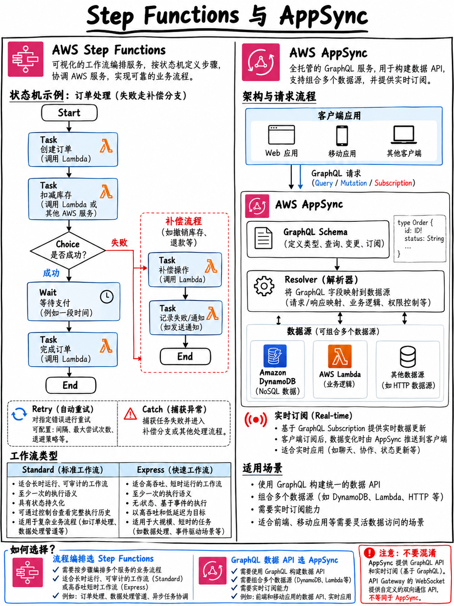

# 2.7 业务工作流与实时交互：Step Functions 与 AppSync (Step Functions and AppSync)



**Tier B 进阶考点。** 尽管考核频次略低于 Lambda 与 DynamoDB，但这两项服务均明确列在官方考试指南的核心知识点中 [1]，并且在 AWS 官方公布的样题中扮演了决定性的核心正确选项，解决许多其他常规服务无法胜任的特殊业务交互场景。

## 2.7.1 AWS Step Functions：状态机与工作流集中编排

集中式状态机编排（Orchestration）：基于 **Amazon States Language (ASL)**（一种直观严谨的 JSON 声明式规范）定义分布式状态机，按既定业务逻辑顺序编排协调微服务与云服务，原生自带单步自动重试、异常兜底分支与上下文状态传递。

### 标准工作流 vs 快速工作流 (Standard vs Express)

| 核心特性 | **标准工作流 (Standard Workflows)** | **快速工作流 (Express Workflows)** |
|---|---|---|
| **最长执行耗时** | 最长可运行长达 **1 年 (1 Year)** | 最长支持运行 **5 分钟** |
| **执行语义保证** | **严格恰好一次执行 (Exactly-Once)** | 异步为至少一次 (At-Least-Once)；同步为最多一次 |
| **启动速率上限** | 约 2,000 次启动/秒 | 支持 **100,000+** 次极高频启动/秒 |
| **执行历史留痕** | 在控制台提供全链路精细可视化执行追踪树 | 仅输出精简指标至 CloudWatch Logs |
| **计费定价模型** | 严格按照**状态转换次数 (State Transitions)** 计费 | 按照执行次数、执行时长与内存消耗计费 |
| **最佳业务场景** | 长周期业务流、跨部门人工审批、对审计一致性要求极高的场景 | 高吞吐量、短耗时、突发海量的事件清洗与数据流转换 |

### 核心状态类型速查清单

| 状态类型 (State) | 核心功能与执行逻辑 |
|---|---|
| **Task (任务状态)** | 真正执行业务计算的核心节点——触发 Lambda 函数、调用 AWS SDK 接口、运行 ECS 容器任务 |
| **Choice (分支状态)** | 类似 `switch/case`，基于输入的上下文变量值进行多分支条件路由 |
| **Parallel (并行状态)** | 静态分发并发执行多条独立的业务工作流分支 |
| **Map (动态迭代状态)** | 针对传入的数组动态遍历并发处理；其升级版 **Distributed Map** 支持以海量并发吞吐处理极端庞大的数据集（如批量并发处理 S3 中数百万个大文件） |
| **Wait (等待状态)** | 暂停工作流执行指定秒数，或阻塞休眠等待直到特定的绝对时间戳到来 |
| **Succeed / Fail** | 显式标记当前执行为成功终态，或以特定错误码与失败原因标记终止 |
| **Pass (直通状态)** | 不做业务外部调用，直接透传输入数据，常配合参数映射过滤清洗修改上下文 JSON 结构 |

### 容错设计与异常拦截（Step Functions 核心价值）

```json
"ProcessOrder": {
  "Type": "Task",
  "Resource": "arn:aws:lambda:...:function:ProcessOrder",
  "Retry": [
    { 
      "ErrorEquals": ["Lambda.ServiceException", "States.Timeout"],
      "IntervalSeconds": 2, 
      "MaxAttempts": 3, 
      "BackoffRate": 2.0 
    }
  ],
  "Catch": [
    { 
      "ErrorEquals": ["States.ALL"], 
      "Next": "HandleFailure" 
    }
  ],
  "Next": "ShipOrder"
}
```

**`Retry` 配合 `BackoffRate` 赋予你完全零编码实现指数退避重试的能力**——这正是官方考试指南反复强调的“容错设计模式 (Fault-tolerant design patterns)”的标准云原生解法 [1]。而 `Catch` 则提供了将特定或全部未捕获异常精准定向路由至兜底补偿节点（如发送报警通知、回滚库存）的能力。

### 服务集成模式 (Integration Patterns)

- **请求/响应模式 (Request-Response，默认)** —— 异步下发调用后，状态机立即推进至下一节点。
- **运行并等待完成模式 (`.sync`)** —— 下发指令后，状态机自动进入暂停等待状态，**直至底层任务彻底运行结束并拿到最终退出码**（例如等待一个长达数十分钟的 ECS Fargate 批处理任务或 AWS Glue ETL 任务跑完）。
- **等待外部令牌回调模式 (`.waitForTaskToken`)** —— 状态机生成一个唯一的 Task Token 并陷入长期挂起暂停状态，直到外部系统或人工处理完毕通过 API 显式调用 `SendTaskSuccess` 回传此 Token。**这是实现“需要经理在邮件中点击批准才能继续流转”等人工审批工作流的标准唯一架构方案**。

:::{tip}
**Step Functions 考场核心题眼触发词：**
“业务工作流 (Workflow)”、“多步骤严格顺序执行 (Sequence of steps)”、“支持针对特定单步独立重试 (Retry individual steps)”、“根据前置步骤输出进行动态分支”、“挂起等待人工审批授权”、“可视化流转界面”、“协调多个微服务/Lambda 函数”。
如果在题目中看到**多个 Lambda 函数通过在代码中硬编码互相串联调用（Chained Lambdas）**，官方标准重构方案永远是**引入 AWS Step Functions**——它将脆弱的分散在业务代码里的重试逻辑、异常处理和状态传递全部剥离下沉至基础设施层。

**对比核心：编排 (Orchestration) vs 协同 (Choreography)：**
Step Functions 代表**集中编排 (Orchestration)**（一个拥有上帝视角的中心调度器掌控全局流程流转）；
EventBridge 代表**事件协同 (Choreography)**（各服务互不相识，仅被动监听关注的事件并做出动作）。两者均在考试大纲中被明确点名 [1]。
:::

## 2.7.2 AWS AppSync：全托管 GraphQL 与实时数据推送

企业级托管 **GraphQL** 接口服务（目前已进一步扩展支持 Event API）。统一收敛数据入口，前端客户端可在单次网络请求中声明式按需索取业务真正需要的字段集合；由 AppSync 底层负责将各字段映射解析至异构数据存储中。

| 核心组件与维度 | 技术机制与考点特征 |
|---|---|
| **数据源支持 (Data Sources)**| 原生无缝直连 DynamoDB、Lambda、RDS (Aurora Serverless Data API)、OpenSearch、HTTP 端点以及 EventBridge |
| **解析器 (Resolvers)** | 负责将 GraphQL Schema 字段映射并翻译为数据源查询语句——支持 JavaScript 解析器或传统 VTL 模板 |
| **多重身份认证体系** | 原生支持 **API Key** · **AWS IAM** · **Cognito 用户池** · **三方 OIDC** · **自定义 Lambda 授权方**；允许在单套 API 上同时并存多种认证模式 |
| **实时双向通讯** | 基于底层长连接 WebSocket 协议提供 **GraphQL 订阅 (Subscriptions)** ——当服务端发生数据变更时，主动将事件推送到海量已订阅的客户端 |
| **离线存储与同步** | 深度整合 Amplify DataStore 实现移动端弱网离线读写与自动冲突仲裁 |
| **全托管缓存** | 支持在 API 整体级别或针对特定 Resolver 开启全托管服务器端缓存 |

::::{important}
**AWS 官方公布样题第 2 题直接精准命中此服务** [18]：考题要求设计一个移动 Web 应用，允许用户在平台上“发布评论并**准实时 (in near real time)** 接收最新反馈信息”，官方标准答案**同时多选判定以下两项为满分正确选项**：

> “创建 **AWS AppSync** 架构与对应的 API 端点。采用 Amazon DynamoDB 作为底层持久化数据存储。”
> “在 Amazon API Gateway 中创建 **WebSocket API**。使用 AWS Lambda 函数作为后端处理程序，使用 Amazon DynamoDB 表作为数据存储。”

官方权威试题解析写道：AppSync 是一款“基于 GraphQL 的托管服务，专为构建需要**实时更新 (Real-Time Updates)** 的高弹性应用而生”，而 WebSocket API 相比传统 REST API 则“天生支持双向全双工通讯” [18]。

**必考黄金法则：“准实时推送 (Near Real-Time Push to Clients)”在 DVA-C02 考试中仅有两个唯一合法的正确解——AppSync GraphQL 订阅，或者 API Gateway WebSocket API。** 任何试图在传统 REST API 或所谓“API Gateway 上的 GraphQL 端点”（根本不存在该功能）做轮询的选项，均属于标准错误干扰项。
::::

**AppSync vs API Gateway 技术选型速查表：**

| 优先选择 **AWS AppSync** | 优先选择 **Amazon API Gateway** |
|---|---|
| 采用 GraphQL 契约；客户端需要精细按需索取特定字段 | 采用传统的标准 RESTful 接口或 WebSocket 协议 |
| 单次请求需要聚合汇总来自多个不同异构数据源的数据 | 单个路由资源路径对应单一明确的后端服务 |
| 依赖 **GraphQL Subscriptions 订阅** 实现实时主动推流 | 依赖原生 WebSocket API 实现轻量双向长连接 |
| 移动端与 Web 端需要强大的离线数据缓存与本地同步 | 构建通用型企业级 HTTP 微服务入口网关 |

## 2.7.3 极速复习备忘 (Fast Revision)

- **Step Functions = 集中工作流编排 (Orchestration)。** 基于 ASL JSON 规范定义；常用状态包括 Task、Choice、Parallel、Map、Wait。内置的 **`Retry` (含 `BackoffRate`)** 与 **`Catch`** 是云原生容错设计模式的最佳实践。
- **标准工作流 (Standard)** 最长运行 1 年，保障恰好一次执行，按状态转换计费；**快速工作流 (Express)** 最长 5 分钟，专攻超高吞吐事件流。
- **`.waitForTaskToken`** 是实现人工介入审批与外部长耗时异步回调的标准模式。
- 业务代码中出现 Lambda 链式调用堆叠重试 → 立即重构为 Step Functions 状态机。
- **AppSync = 全托管 GraphQL 引擎**，凭借 **Subscriptions 实时订阅** 实现服务端主动推送，支持混合多重认证模式，原生打通 DynamoDB/Lambda。
- **“准实时服务端双向推送”** 官方考核正解唯二：**AppSync Subscriptions 订阅** 或 **API Gateway WebSocket API** [18]。
