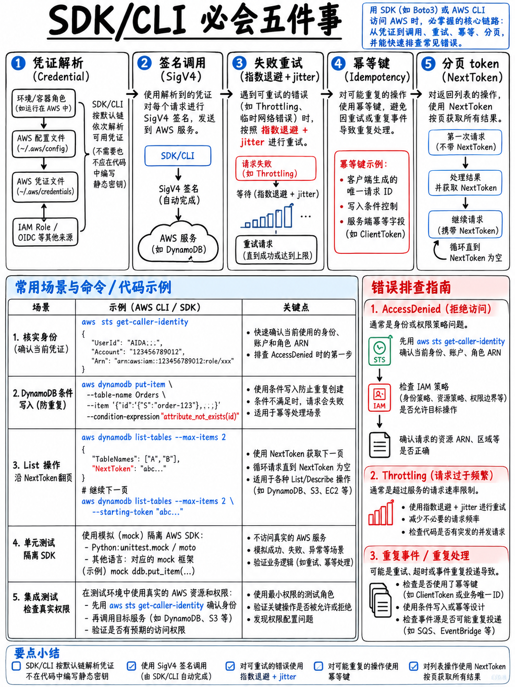

# 2.8 AWS SDK、CLI 与核心架构开发模式 (SDKs, CLI, and Architectural Patterns)



官方考试指南在域 1 任务 1 中明确要求：“编写代码通过 API 和 AWS SDK 与 AWS 服务交互”，并将幂等性（Idempotency）、带抖动的指数退避重试（Retries with exponential backoff and jitter）以及死信队列（Dead-letter queues）列为核心知识范畴 [1]。本章梳理的代码级最佳实践与架构模式，是贯穿本模块其他所有知识点的底层底座。

## 2.8.1 凭据解析链：SDK 与 CLI 身份寻址顺序

所有主流语言的官方 AWS SDK 与 AWS CLI 在初始化时，均按照以下优先级链条自顶向下依次搜寻可用的认证凭据（一旦在靠前步骤找到合法凭证即终止）：

```
 1. 在代码中显式硬编码传入的凭证                   ← 生产与合规的绝对红线，严禁使用
 2. 操作系统环境变量 (Environment Variables)
      AWS_ACCESS_KEY_ID / AWS_SECRET_ACCESS_KEY / AWS_SESSION_TOKEN
 3. 共享凭据配置文件  ~/.aws/credentials           (本地配置的多 Profile 档案)
 4. 共享配置主文件    ~/.aws/config                 (设置 region, role_arn, sso)
 5. 容器环境元数据凭证 (Container Credentials)     ECS 任务角色 Task Role / Fargate
 6. 实例元数据服务 (Instance Metadata Service, IMDS) EC2 实例配置文件 Instance Profile
 7. Lambda 执行角色凭证 (Execution Role)           (由 Lambda 服务底层自动注入的环境变量)
```

::::{danger}
**在 DVA 考试中，涉及凭证权限的正解永远是「分配角色 (Role)」！**
EC2 实例 → 绑定 **实例配置文件 (Instance Profile)**。
ECS 容器任务 → 绑定 **任务角色 (Task Role)**。
Lambda 函数 → 绑定 **执行角色 (Execution Role)**。
CodeBuild 构建环境 → 绑定 **服务角色 (Service Role)**。
本地机房混合云应用 → 借助 **IAM Roles Anywhere**（或次选具备严格轮换机制的独立 IAM 用户密钥）。

考场上任何试图将永久访问密钥（Access Keys）明文存放在业务源码、操作系统环境变量、本地配置文件或打包进 AMI 镜像的选项，均属于绝对违背最小权限与安全合规的错误陷阱。这是域 2 安全部分最稳定的秒杀规律，AWS 官方样题第 5 题正是依托此原理命制 [18]。
::::

## 2.8.2 重试机制、指数退避与随机抖动 (Jitter)

官方 AWS SDK 原生内置了针对 API 限流（Throttling）与网络瞬时波动的自动重试机制，底层采用指数退避算法。开发者可在代码或环境中精细配置重试模式：

| 重试模式 (Mode) | 运行行为与机制 |
|---|---|
| `legacy` | 早期老旧默认行为，各语言 SDK 实现略有差异 |
| **`standard`** | 现代标准化行为；在全部 SDK 间统一规范，智能识别限流并执行指数退避重试 |
| **`adaptive`** | **自适应模式**：在 standard 基础上引入**客户端速率限制器 (Client-Side Rate Limiter)**，在感知到服务端频繁限流时主动在客户端降低发包速率 |

```bash
# 通过环境变量配置 CLI 或全局 SDK 重试策略
export AWS_RETRY_MODE=adaptive
export AWS_MAX_ATTEMPTS=5
```

```python
# Python (boto3) 官方客户端配置示例
import boto3
from botocore.config import Config

# 配置自适应重试策略与最大重试次数
cfg = Config(retries={"max_attempts": 5, "mode": "adaptive"})
client = boto3.client("dynamodb", config=cfg)
```

:::{tip}
**“应用程序遭遇下游服务频繁限流报错 (Throttling) —— 开发者首选该怎么做？”**
官方考核的标准化解决优先级路径为：
第一步：**实施带有随机抖动的指数退避重试 (Retry with exponential backoff and jitter)**（通常只需确认或配置 SDK 内置重试）；
第二步：**优化调用模式，降低发包频率或合并批处理 (Batch)**；
第三步：**治理根因架构瓶颈**（如消除 DynamoDB 热点分区、在上游引入 ElastiCache/DAX 缓存）；
第四步：若确实因业务正常膨胀超出物理阈值，**最后一步才是申请提高服务配额 (Request a quota increase)**。
在绝大多数题目中，第一反应就去提工单申请提升配额往往是粗心选手的失分陷阱。
:::

**随机抖动 (Jitter) 的核心价值：** 如果成千上万个分布式客户端在同一秒遭遇限流并同时按照严格固定的 100ms、200ms、400ms 间隔进行重试，这些客户端会在后续的每个重试周期再次统一步调集体冲击服务端，引发二次雪崩。抖动算法在退避间隔中人为加入随机噪声，使各客户端的重试时间均匀分散。考试指南明确点名考查“带有指数退避**及抖动**的重试” [1]。

## 2.8.3 幂等性设计落地实战

考试指南明确考核的核心概念 [1]。在分布式与异步架构中，确保重复调用的安全性主要依托三大工程实践：

**1. 基于唯一去重主键进行条件写入 (DynamoDB 条件更新)：**

```python
# 借助条件表达式实现原子的“若已存在则放弃”去重写入
try:
    table.put_item(
        Item={"pk": message_id, "processedAt": now, "status": "COMPLETED"},
        ConditionExpression="attribute_not_exists(pk)",
    )
except client.exceptions.ConditionalCheckFailedException:
    # 捕获条件检查失败异常：说明该消息先前已处理完毕，直接安全跳过
    logger.info("Message %s already processed, skipping.", message_id)
```

**2. 客户端请求令牌 (Client / Request Token)：** 大量 AWS 核心控制面与数据面 API 原生接受传入 `ClientRequestToken` 或 `ClientToken` 参数。在发生网络超时导致调用者发起重试时，AWS 服务端会识别出相同的 Token，直接幂等返回首次执行的结果，避免重复创建底层资源。

**3. FIFO 消息队列去重 (FIFO Deduplication)：** SQS FIFO 队列通过识别 **Message Deduplication ID**，在 5 分钟的滑动去重窗口内自动识别并静默过滤掉重复投递的消息。

## 2.8.4 分页机制 (Pagination) 与游标管理

AWS 云端几乎所有 List 与 Query 类只读 API 均遵循分页返回机制。在代码中忽略游标处理是导致“系统只能拉出前几十条记录、后续海量存量数据莫名丢失”的根本原因。

```python
# Python boto3 官方 Paginator 优雅封装 —— 自动接管底层的 Token 循环迭代
paginator = s3.get_paginator("list_objects_v2")
for page in paginator.paginate(Bucket="my-bucket", Prefix="logs/"):
    for obj in page.get("Contents", []):
        process_object(obj)
```

| 服务类型 | 核心分页游标标记参数 (Continuation Marker) |
|---|---|
| **DynamoDB Query / Scan** | 响应中读取 `LastEvaluatedKey` → 下次请求传入 `ExclusiveStartKey` |
| **S3 ListObjectsV2** | 响应中读取 `NextContinuationToken` → 下次请求传入 `ContinuationToken` |
| **绝大多数其他 AWS 统一服务** | 响应中读取 `NextToken` → 下次请求传入 `NextToken` |

## 2.8.5 高频核心 AWS CLI 诊断与操作指令

```bash
# 身份探查：“我现在到底以何种身份在运行？” —— 权限排错第一优先指令
aws sts get-caller-identity

# 代入特定 IAM 角色并获取临时安全访问凭据 (STS Temporary Credentials)
aws sts assume-role --role-arn arn:aws:iam::111122223333:role/MyRole \
    --role-session-name demo

# Lambda 运维与部署核心命令
aws lambda invoke --function-name MyFn --payload file://event.json out.json
aws lambda update-function-code --function-name MyFn --zip-file fileb://fn.zip
aws lambda publish-version --function-name MyFn
aws lambda update-alias --function-name MyFn --name prod --function-version 7

# DynamoDB 基于条件表达式安全写入
aws dynamodb put-item --table-name Orders --item file://item.json \
    --condition-expression "attribute_not_exists(orderId)"

# 快速为 S3 对象生成临时预签名下载 URL
aws s3 presign s3://my-bucket/report.pdf --expires-in 3600

# CloudWatch Logs 实时追踪函数日志流
aws logs tail /aws/lambda/MyFn --follow

# 认证拉取 ECR 私有镜像仓库凭据并登录 Docker
aws ecr get-login-password --region eu-west-1 \
  | docker login --username AWS --password-stdin 111122223333.dkr.ecr.eu-west-1.amazonaws.com
```

**必考全局通用参数：**
`--query`（基于 JMESPath 语法在客户端本地对返回的 JSON 结果执行强大的筛选过滤）；
`--output json|text|table`（格式化输出形态）；
`--profile`（指定使用特定本地身份凭证档案）；
`--dry-run`（验证调用权限而不实际触发底层操作）。

```bash
# 利用 JMESPath 提取正在运行状态的所有 EC2 实例 ID 列表
aws ec2 describe-instances \
  --query "Reservations[].Instances[?State.Name=='running'].InstanceId" \
  --output text
```

**AWS CloudShell** —— 在 AWS Web 控制台内部一键调出的免安装浏览器端 Linux Shell，预装了最新的 AWS CLI、主流开发语言环境及 Git，自动继承当前控制台登录用户的全部凭证权限。考试指南将其列为考核内容 [1]，专门用于在无需在本地配置开发环境的情况下快速执行临时的 CLI 运维脚本。

## 2.8.6 考试指南明确点名的核心架构设计模式

| 核心架构模式 | 架构内涵与工程特征 | 经典 AWS 原生落地选型 |
|---|---|---|
| **事件驱动 (Event-driven)** | 服务组件之间不直接依赖，仅对产生的事件被动响应 | S3 上传触发 Lambda、EventBridge 业务事件路由 |
| **微服务 (Microservices)** | 独立解耦、围绕业务能力建模并支持独立部署发布 | API Gateway + 多个 Lambda 微服务、ECS 容器群 |
| **单体应用 (Monolithic)** | 业务代码统一打包为单一大工件交付运行 | Elastic Beanstalk 托管单体 Web、单体 Docker 容器 |
| **事件协同 (Choreography)** | 各组件独立监听事件总线自行决策，无上帝视角调度中心 | **Amazon EventBridge** |
| **集中编排 (Orchestration)** | 由中心状态机强力驱动各步骤流转，掌控全局上下文 | **AWS Step Functions** |
| **扇出模式 (Fanout)** | 生产者单次发布消息，并行广播给海量异构下游独立消费 | **Amazon SNS → 挂载多个 SQS 队列** |

**核心容错设计模式全景** [1]：**带有随机抖动的指数退避重试**、**死信队列 (DLQ)** 隔离兜底、客户端熔断机制（Circuit Breaker）与显式超时配置。

## 2.8.7 单元测试与集成测试考点

官方考试指南明确考查：“在开发环境中编写并运行单元测试（例如使用 AWS Serverless Application Model [AWS SAM]）”以及“使用模拟端点开展集成测试” [1]。

- **单元测试 (Unit Tests)**：通过本地 Mock 框架隔离 AWS SDK 底层网络依赖（例如 Python 生态的 `moto`、Node.js 生态的 `aws-sdk-client-mock`），将业务处理函数（Handler）作为纯粹的函数进行轻量快速测验。
- **本地拟真运行 (Local Testing)**：熟练运用 `sam local invoke`（本地容器模拟触发单次执行）、`sam local start-api`（本地模拟全套 API Gateway 路由）以及 `sam local generate-event`（一键生成符合官方标准的各种模拟 JSON 事件报文）（参见 {doc}`02-lambda-deep-dive` §2.2.11）。
- **Mock 模拟集成 (Mock Endpoints)**：在 API Gateway 资源方法中配置 **`MOCK` 集成类型**，网关在无需依赖任何后端 Lambda 或 HTTP 服务的前提下，直接就地返回预设的标准响应报文——这是考题中考查“Mock 集成”的标准正解（参见 {doc}`03-api-gateway` §2.3.2）。
- **多阶段隔离集成测试 (Integration Testing)**：基于 SAM 或 CloudFormation 模板将应用堆栈一键部署至独立的临时 Staging 环境或特定 API Stage，随后使用测试脚本向该独立环境的公共 URL 发起全链路自动化端到端测试。考试指南将其列为“将应用程序堆栈更新部署到现有环境”的核心考点 [1]。

## 2.8.8 极速复习备忘 (Fast Revision)

- **云端应用安全凭证：永远选 Role！** 坚决抵制在源码、环境变量或配置文件中硬编码永久 Access Key。
- `aws sts get-caller-identity` 是定位“当前我是谁、为什么报错 403 Access Denied”的第一命令。
- 重试机制**原生内置于 SDK** 中；支持 `standard` 与智能限流的 `adaptive` 模式；**随机抖动 (Jitter)** 彻底解决羊群并发重试雪崩。
- 遭遇限流报错 → 指数退避重试/合并批次/治理热点瓶颈优先，最后一步才是申请提高配额。
- 幂等性三大解法：DynamoDB 条件写入（`attribute_not_exists`）、`ClientRequestToken`、SQS FIFO 消息去重 ID。
- **牢记对所有 List/Query 接口做分页遍历**；识别 `LastEvaluatedKey`、`NextToken`、`NextContinuationToken`。
- 事件协同选 EventBridge；集中工作流编排选 Step Functions；消息多路广播选 SNS → SQS 扇出架构。
- 测试利器：`sam local` 全家桶、本地 SDK Mock 库、以及 API Gateway 原生 **`MOCK`** 集成端点。
