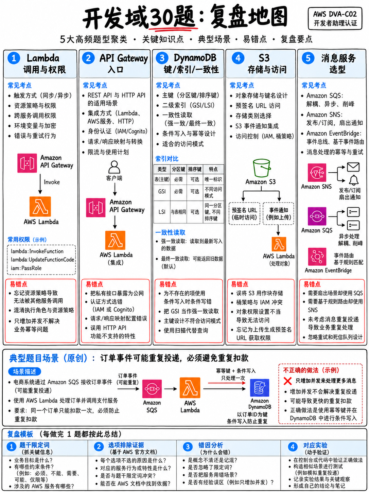

# 2.9 域 1 实战演练题库与深度解析 30 题 (Development Practice Set — 30 Items)

本套全真演练题库共 30 道精选试题，严格紧扣官方考试指南中域 1（基于 AWS 服务的应用开发）的核心任务陈述命制 [1]。**本试卷绝非考试真题机经盗录**——任何培训机构和个人能合法公开展示的唯一真题，只有 AWS 官方发布的 10 道官方样题，我们在 {doc}`../70-practice/02-official-sample-questions-walkthrough` 中进行了逐题逐字深度拆解。

:::{tip}
**全真模考建议：** 请严格限时闭卷演练：**在 50 分钟内完成全部 30 道题**。完成之后对照答案自评打分，并务必通读每一道题目的官方逻辑解析——尤其是那些碰巧猜对的题目。
:::

## 2.9.1 实战演练试题

**1.** 某业务系统需要在一个对象被上传至 Amazon S3 存储桶时触发 AWS Lambda 函数进行异步处理。该函数偶发运行失败，开发团队需要将调用失败的事件连同具体的错误上下文与堆栈信息完整捕获，以供后续离线分析。开发者应当为该函数配置下列哪项机制？  
A. 配置 Lambda 失败目标 (On-failure Destination)。  
B. 在函数上配置 Amazon SQS 死信队列 (DLQ)。  
C. 调大函数的超时时间 (Timeout)。  
D. 为该函数配置保留并发 (Reserved Concurrency)。  

**2.** 某开发者需要暂存一段体积为 8 MB 的业务载荷数据，并将其传递给一个通过异步方式调用的 AWS Lambda 函数。开发者应当采取下列哪项方案？  
A. 提工单申请提高 Lambda 调用的 Payload 配额。  
B. 将该数据存入 Amazon S3，并在异步事件中仅传递该 S3 对象的 Key。  
C. 使用压缩算法将载荷压缩至 256 KB 以下。  
D. 将调用方式直接改用同步调用 (Synchronous Invocation)。  

**3.** 某应用程序以每秒 20 次的频率向 Amazon DynamoDB 表写入单条体积为 5 KB 的数据项。该表总共需要配置多少个写入容量单位 (WCU)？  
A. 20。  
B. 40。  
C. 100。  
D. 120。  

**4.** 业务团队需要对一张现有的 Amazon DynamoDB 表支持一种全新的查询检索模式，要求能够根据一个并非主键的普通业务属性进行过滤查询。团队应当在表中创建下列哪项组件？  
A. 本地二级索引 (Local Secondary Index, LSI)。  
B. 一张全新的表，并将该属性指定为分区键。  
C. 全局二级索引 (Global Secondary Index, GSI)。  
D. 在现有的 Scan 操作上追加 FilterExpression 过滤表达式。  

**5.** 某 Amazon DynamoDB 数据表频繁发生写入限流报错（Throttling），但 CloudWatch 监控指标显示该表已消耗的写容量（Consumed Write Capacity）远低于其预置的供给容量。造成此现象的最可能原因是什么？  
A. 该表必须立即切换为按需容量模式 (On-Demand)。  
B. 分区键的基数较低（Low-cardinality），导致写入流量集中倾斜在少数几个热点分区上。  
C. 业务端正在使用最终一致性读取。  
D. 单条写入的数据项体积超过了 400 KB。  

**6.** 开发者必须确保从 Amazon SQS 标准队列中拉取的消息绝不会被业务逻辑重复处理执行两次，即使 SQS 标准队列底层可能会将同一条消息多次投递。最恰当的工程设计方案是什么？  
A. 确保消费端具备幂等性（Idempotency），例如在写入数据库时基于去重主键实施条件写入 (Conditional Write)。  
B. 将队列拉取模式切换为短轮询 (Short Polling)。  
C. 调大队列的消息保留周期 (Message Retention Period)。  
D. 缩短队列的可见性超时 (Visibility Timeout)。  

**7.** 某消费 Amazon SQS 队列消息的 Lambda 函数平均执行耗时为 45 秒，但运维发现队列中的消息频繁被重复执行多次。排查发现该队列当前的可见性超时（Visibility Timeout）设置为 30 秒。开发者应当采取什么措施？  
A. 将队列的可见性超时时间调大至函数超时时间的至少 6 倍。  
B. 将 Lambda 函数的超时时间强行压制减少至 30 秒。  
C. 在 SQS 队列上启用长轮询 (Long Polling)。  
D. 将该队列无缝转换为 FIFO 队列。  

**8.** 应用程序产生的一笔核心业务事件必须广播分发给下游三个完全独立的微服务系统。这三个微服务的消费吞吐速率各不相同，且各自需要具备独立的异常重试生命周期。下列哪种架构设计最为合适？  
A. 创建一个单一的 SQS 队列，由三个微服务并发争抢拉取。  
B. 创建三个独立的 Lambda 函数，全部直接订阅至同一个 Amazon SNS 主题。  
C. 创建一个 Amazon SNS 主题，并为其挂载订阅三个专属的 Amazon SQS 队列，每个下游服务各自监听自己的专属队列。  
D. 创建一个拥有 3 个分片 (Shards) 的 Amazon Kinesis 数据流。  

**9.** 某开发者需要按照终端客户维度严格保证数据记录的消费顺序，同时需要支持两个完全独立的分析应用程序并发读取完全相同的这批数据流，并且要求系统能够对过去 48 小时内的历史数据进行回溯重放。应当选用下列哪项服务？  
A. Amazon SQS FIFO 队列。  
B. Amazon SNS 主题。  
C. Amazon EventBridge 事件总线。  
D. Amazon Kinesis Data Streams 数据流。  

**10.** 某 Lambda 函数在关联了 VPC 以便连接私有 RDS 数据库之后，突然无法再调用 Amazon Secrets Manager 获取数据库密码，且所有请求均报超时错误（Timeout）。最恰当的解决方案是什么？  
A. 将 Internet 网关 (IGW) 直接挂载到该私有子网。  
B. 调大 Lambda 函数的单次运行超时时间。  
C. 在 VPC 内部为 Secrets Manager 创建一个 VPC 接口终端节点 (Interface Endpoint)。  
D. 彻底移除该 Lambda 函数的 VPC 网络配置。  

**11.** 某 Lambda 函数的代码部署包解压后体积超过了 250 MB 的硬性配额上限，分析发现其依赖的大量大型共享公共类库同时也被其他 4 个函数重复使用。开发者应当如何优化？  
A. 将代码压缩包先上传至 Amazon S3，再通过 S3 导入 Lambda。  
B. 调大该函数的 `/tmp` 临时存储空间。  
C. 将这些通用的共享类库打包抽离至一个 **Lambda 层 (Layer)**，并挂载附加至各个函数上。  
D. 将该函数直接水平拆分为 5 个独立的细分函数。  

**12.** 开发者希望利用同一个 API Gateway REST API 统一对外暴露接口，但在测试环境（Test）与生产环境（Prod）中，该 API 必须分别触发执行不同配置参数的 Lambda 逻辑。何种方案的维护配置量最少（LEAST amount of configuration）？  
A. 部署两个完全独立的 Lambda 函数，并创建两个独立的 REST API。  
B. 仅维护一个 Lambda 函数并为其发布两个不同的**别名 (Aliases)**，在 API Gateway 中使用**阶段变量 (Stage Variable)** 动态路由到指定别名。  
C. 在函数业务源码内部硬编码环境判断分支逻辑，根据请求入参做 `if/else` 判断。  
D. 为每个独立环境分别创建一个专属的 Lambda Layer。  

**13.** 某客户端通过 API Gateway REST API 触发后端的 Lambda 函数（采用 Lambda 代理集成 `AWS_PROXY` 模式），客户端收到 HTTP 502 Bad Gateway 报错；但 CloudWatch Logs 检查证实后端 Lambda 函数实际上已成功执行完毕且未抛出任何未捕获异常。最可能的原因是什么？  
A. Lambda 函数的执行角色（Execution Role）缺少相应权限。  
B. 修改了 API 配置后尚未重新将变更部署到 Stage 阶段。  
C. API Gateway 的集成超时时间设置过短。  
D. Lambda 函数返回的字典对象格式不符合网关代理集成规范（例如 `body` 字段未返回纯字符串格式）。  

**14.** 某 REST API 必须在后端业务 Lambda 函数被触发调用之前，直接在网关层就地拦截并拒绝那些 JSON Body 格式畸形或缺少必填字段的非法请求。开发者应当配置下列哪项功能？  
A. 自定义 Lambda 授权方 (Lambda Authorizer)。  
B. 配置带有流控限制的使用计划 (Usage Plan)。  
C. 编写 VTL 请求映射模板 (Mapping Template)。  
D. 在 API 方法上配置基于 JSON Schema 模型定义的请求验证 (Request Validation)。  

**15.** 某协同办公系统的客户端必须在其他用户发布新消息的第一时间，准实时接收到由服务器主动推送（Server-Push）的数据更新。下列哪两项方案能够满足该架构诉求？（选择两项。）  
A. 创建一个配置了极短 TTL 的 API Gateway HTTP API。  
B. 配置 Amazon CloudFront CDN 并挂载 Lambda@Edge 函数。  
C. 创建一个开启了网关响应缓存的 API Gateway REST API。  
D. 创建一个以 Lambda 为后端的 Amazon API Gateway WebSocket API。  
E. 创建一个支持 GraphQL 订阅 (Subscriptions) 的 AWS AppSync API。  

**16.** 前端 Web 浏览器用户需要将体积高达 2 GB 的大型视频文件直接上传至 Amazon S3 存储桶，业务要求不得向浏览器暴露分发任何 AWS 访问凭证，且大文件严禁流经应用业务服务器中转。开发者应当如何实现？  
A. 将目标 S3 存储桶策略设置为完全公开可写（Publicly Writable）。  
B. 将具备 S3 权限的 IAM Access Key 永久明文硬编码在前端 JavaScript 代码中。  
C. 将上传流通过 API Gateway REST API 发起流式代理中转。  
D. 由后端应用服务器动态生成一个 **S3 预签名 URL (Presigned URL)** 并返回给浏览器，浏览器直接向 S3 执行直传。  

**17.** 某系统在关系型数据库前端架设了缓存层。业务数据的写入频次极低、但读取频次极高，系统架构要求只有在某条数据首次被用户请求检索时才去加载填充缓存。这属于下列哪种缓存设计模式？  
A. 写穿模式 (Write-Through)。  
B. 写回模式 (Write-Behind)。  
C. 只读副本 (Read Replica)。  
D. 惰性加载模式 (Lazy Loading / Cache-Aside)。  

**18.** 某 Web 应用程序在 Amazon DynamoDB 中存储用户登录会话（Session）。系统要求会话数据在生成 24 小时后必须被自动清理删除，且该删除清理操作绝对不能消耗任何宝贵的预置写容量 (WCU)。开发者应当选用哪项功能？  
A. 编写一个定时触发的 Lambda 函数，定期执行全表 Scan 扫描并调用 BatchWrite 批量删除。  
B. 在 DynamoDB 数据表上配置存储生命周期管理策略。  
C. 配置 DynamoDB Streams 并在检测到老旧数据时触发删除。  
D. 启用 DynamoDB 生存时间 (TTL) 特性，并配置一个存储 Unix Epoch 秒级时间戳的属性字段。  

**19.** 运维团队需要在 Amazon DynamoDB 表中的数据项发生任何修改变更时接收实时通知，且该通知消息必须同时包含修改前的旧数据全貌与修改后的最新数据全貌以供审计比对。应当如何配置？  
A. 开启 DynamoDB Streams，并将 `StreamViewType` 配置为 `NEW_IMAGE`。  
B. 开启 DynamoDB Streams，并将 `StreamViewType` 配置为 `NEW_AND_OLD_IMAGES`。  
C. 在该数据表上启用 AWS CloudTrail 数据事件记录。  
D. 在该表的写入容量指标上配置 CloudWatch 告警。  

**20.** 开发者必须确保两条关联的 DynamoDB 数据记录要么同时更新成功，要么在任一记录失败时全部放弃回滚（保持原子一致性）。开发者应当调用下列哪个 API？  
A. `TransactWriteItems`。  
B. `BatchWriteItem`。  
C. 分别对两条记录调用 `UpdateItem`，并各自附加条件表达式。  
D. 在单一 Lambda 函数代码中连续同步调用两次 `PutItem`。  

**21.** 某消费 Amazon Kinesis Data Streams 数据流的消费者程序偶发中断并抛出 `ExpiredIteratorException` 异常。导致该报错的最可能原因是什么？  
A. Kinesis 数据流配置的数据保留周期（Retention Period）过短。  
B. 数据流的分区键基数离散度过低。  
C. 消费者获取的分片迭代器 (Shard Iterator) 超过了其最大有效生命周期（5 分钟）未被使用，必须重新申请获取。  
D. 消费者的 IAM 权限缺少 `kinesis:GetRecords` 授权。  

**22.** 某分布式核心应用需要按严格顺序串联执行 5 个独立的 Lambda 函数，且要求能够在特定单步失败时利用带抖动的指数退避进行重试，并在最终失败时路由至异常补偿分支。开发者应当使用哪项技术？  
A. 链式调用：让每个 Lambda 函数在代码末尾直接显式同步调用下一个函数。  
B. 创建一个包含 `Retry` 重试配置与 `Catch` 捕获分支的 AWS Step Functions 状态机。  
C. 在每两个相邻的 Lambda 函数之间各插入一个 SQS 消息队列解耦。  
D. 为每个函数分别配置一条独立的 Amazon EventBridge 监听规则。  

**23.** 某通过事件源映射消费 Kinesis 数据流的 Lambda 函数因单条畸形损坏的毒丸记录（Poison-Pill Record）持续报错抛出未捕获异常，导致该分片的全部后续消费被完全卡死阻塞。下列哪项组合措施能够彻底解除该故障阻塞？（选择两项。）  
A. 为事件源映射配置失败目标 (On-failure Destination)。  
B. 在事件源映射上开启 `BisectBatchOnFunctionError`（出错时自动对半拆分批次）。  
C. 将该数据流一键转换为 Amazon SQS 标准队列。  
D. 调大该 Lambda 函数的运行内存大小。  
E. 延长该 Kinesis 数据流的数据保留时间。  

**24.** 关于 Amazon DynamoDB 全局二级索引 (GSI)，下列哪项表述是绝对正确的？  
A. 若 GSI 上的预置写入容量（WCU）配置不足引发限流，会反向直接导致对基表的正常写入同样被限流拒绝。  
B. GSI 只能在创建基表的初始化阶段一同定义，建表后无法追加。  
C. GSI 完全共享基表的预置读写容量池。  
D. GSI 原生支持强一致性读取操作 (Strongly Consistent Read)。  

**25.** 某开发者需要在 AWS Lambda 中下载并解压处理一个体积高达 10 GB 的大型归档数据文件，且要求该文件在同一执行环境的后续连续调用中能够被直接本地读取复用。开发者应当使用哪种本地存储空间？  
A. Lambda 层 (Layers)。  
B. 函数环境变量 (Environment Variables)。  
C. 函数自带的 `/tmp` 临时存储空间，将其配置调高至 10,240 MB。  
D. 将文件直接打包进函数的代码部署 Zip 包中。  

**26.** 某面向最终用户的在线 API 需要调用一个响应耗时极不稳定（有时长达数分钟）的三方外部 HTTP 接口，系统设计要求绝不能让前端用户的 HTTP 连接持续阻塞挂起。最合理的架构治理方案是什么？  
A. 将 API Gateway 的单次集成超时时间调高至 29 秒以上。  
B. 将后端 Lambda 函数的超时时间调高至 15 分钟。  
C. 在 API Gateway 阶段上开启全量响应缓存。  
D. API 网关接收到请求后立即向客户端返回 HTTP 202 Accepted，并将繁重调用任务丢入 SQS 队列由后台异步消化。  

**27.** 某开发者希望为 S3 的 `PUT` 对象创建事件生成一份格式完全符合官方规范的高度拟真测试 JSON 报文，以便在本地针对函数进行单元测试。开发者应当执行下列哪条 CLI 指令？  
A. `sam local start-api`。  
B. `sam local generate-event s3 put`。  
C. `aws lambda invoke --payload file://event.json`。  
D. `sam build`。  

**28.** 某 Amazon SNS 主题拥有 8 个下游订阅者，但每个订阅者实际上仅关注其中特定业务类型的子集消息，目前各个订阅者系统都在被迫接收全量广播并在本地拉取后自行执行冗余的 `if/else` 丢弃。开发者应当如何优化架构？  
A. 将这 1 个 SNS 主题拆分为 8 个独立的 SNS 主题。  
B. 在各个下游订阅端配置基于消息属性的**订阅过滤策略 (Subscription Filter Policies)**。  
C. 在 SNS 主题前端串联插入一个 SQS 缓冲队列。  
D. 编写一个专属的 Lambda 路由器函数负责消息中继。  

**29.** 某针对 DynamoDB 表执行的 `Query` API 查询操作返回的数据条数远少于预期，且返回的 JSON 响应体中包含了非空的 `LastEvaluatedKey` 属性。开发者应当如何修复业务代码？  
A. 编写循环分页逻辑，将返回的 `LastEvaluatedKey` 作为 `ExclusiveStartKey` 参数传入发起下一次查询，直至该属性不再返回。  
B. 调大该表的预置读取容量单位 (RCU)。  
C. 将代码中的 Query 操作全量替换为 Scan 扫描。  
D. 在查询参数中添加 FilterExpression 过滤表达式。  

**30.** 某核心金融系统必须严格保证针对“同一个终端客户 (Customer ID)”的所有交易流水消息具备绝对严格的顺序消费，但同时要求“不同客户之间”的消息能够被海量并发消费者并行吞吐处理。应当选用下列哪种架构配置？  
A. 使用 Amazon SQS FIFO 队列，并将 Customer ID 作为消息的 **Message Group ID**。  
B. 使用 Amazon SQS 标准队列。  
C. 使用带有订阅属性过滤策略的 Amazon SNS 主题。  
D. 使用配置为单一全局 Message Group 的 Amazon SQS FIFO 队列。  

---

## 2.9.2 答案与深度解析

**1 —— A 正确。** **Lambda 失败目标 (On-failure Destination)** 在异步调用失败时，不仅会保留原始的调用事件，更能够将调用失败的完整上下文堆栈、异常抛出原因与错误信息一并完整记录并投递至 SQS、SNS、Lambda 或 EventBridge 中。相比之下，传统的死信队列（DLQ）仅能保存原始事件 payload，完全不包含任何报错上下文信息。C（调大超时）无法解决业务层代码报错引发的异常捕获；D（保留并发）只负责限制实例并发上限。（参见 {doc}`02-lambda-deep-dive` §2.2.4）

**2 —— B 正确。** AWS Lambda 异步调用的事件载荷（Payload）存在 **256 KB** 的硬性不可调配额（同步调用为 6 MB）。当传输超过该限制的大体量数据时，官方标准范式是将数据主体保存至 Amazon S3 存储桶，并在异步调用事件中仅传递该 S3 对象的 Bucket 与 Key 字符串。A 错误，该配额为系统硬限制无法提工单上调；C 错误，8 MB 生产真实数据绝难被压缩到 256 KB 以下；D 错误，同步调用上限同样仅为 6 MB，依然无法容纳 8 MB。

**3 —— C 正确。** 1 个 WCU 覆盖不超过 1 KB 的数据项单次写入。对于 5 KB 的数据项，写入单条需要消耗 **5 个 WCU**。每秒写入 20 次，总计需要：5 WCU × 20 次/秒 = **100 WCU**。

**4 —— C 正确。** 本地二级索引（LSI）强制必须在建表初始化阶段一次性创建，已有现网数据表绝无法后置补建；因此为已有现网表支持全新非主键维度查询的唯一方案是创建 **全局二级索引 (GSI)**。B 选项会导致数据冗余复制并引入复杂的双写一致性难题；D 选项中的 FilterExpression 属于读出全量数据后的内存过滤，根本无法降低 Scan 的读容量开销。（参见 {doc}`04-dynamodb` §2.4.2）

**5 —— B 正确。** 整体已消耗容量远低于预置容量却频繁报限流，是典型的由于**低基数分区键引发的热点分区 (Hot Partition)** 缺陷——海量并发全量挤压在个别物理分区上击穿了单分区的物理阈值。按需模式（A）虽然能被动提高上限但单价昂贵且无法解决设计层面的热点；C 和 D 与写限流无直接因果关联。

**6 —— A 正确。** SQS 标准队列采用**至少一次投递 (At-least-once)** 机制，网络抖动或超时重发必然会导致重复消息进入消费端；因此业务必须在应用层实现**幂等性 (Idempotency)**，例如在 DynamoDB 中基于业务去重主键执行 `attribute_not_exists(pk)` 条件写入，重复消息二次写入时直接幂等忽略。轮询方式、保留时间和可见性超时均无法消除网络级重复投递。

**7 —— A 正确。** 消费端单次处理需要 45 秒，而队列的可见性超时仅为 30 秒，意味着在当前 Lambda 仍在处理中的第 31 秒，该消息就会在队列中提前重新变为“可见状态”，从而被另一个并发的 Lambda 实例拉走进行重复并发处理。AWS 官方最佳实践强烈建议将可见性超时设置为**函数超时的至少 6 倍**。B 强压函数超时会导致业务执行被强行中断；长轮询（C）解决的是空拉取账单，无法解决重复消费。

**8 —— C 正确。** 经典的**发布/订阅扇出架构 (Fan-Out Pattern)**：SNS 主题负责单点消息发布广播，下游为每个微服务系统各自分配一个专属的 SQS 队列。各队列独立缓冲削峰，慢消费者的堆积重试绝不影响其他消费者。A 选项中多个消费者争抢同一个队列会导致单条消息仅被一个消费者抢到；B 选项缺失队列缓冲区，下游函数挂掉后缺乏重试隔离缓冲；D 选项中分片是吞吐单位而非逻辑消费者。

**9 —— D 正确。** 题干明确给出了三大特征：基于用户分区保序、支持多个独立消费者系统并发读取相同数据流、支持过去 48 小时历史回溯重放——这完全精准契合 **Amazon Kinesis Data Streams** 的核心特性。SQS 消息被消费后立即被删除，完全不具备历史重放能力。

**10 —— C 正确。** 关联了 VPC 的 Lambda 函数立即失去默认公网出网路由。为 Secrets Manager 创建一个 **VPC 接口终端节点 (Interface Endpoint)**，能够让 Lambda 的网络流量完全封闭在 AWS 内部私网骨干网络直达目标服务，既无需穿越公网又保持了对 RDS 的私有访问。私有子网挂载 IGW 无法出网；移除 VPC 会直接中断 RDS 数据库访问。

**11 —— C 正确。** **Lambda 层 (Layers)** 专为抽离跨函数的通用依赖共享而设计，同时能够有效瘦身部署包以规避解压后 250 MB 的配额上限。通过 S3 上传（A）仅能规避控制台 50 MB 压缩包上传限制，无法突破解压后 250 MB 的硬性死线。Ephemeral 临时存储（B）是运行时的磁盘暂存空间，不是代码加载区。AWS 官方样题第 10 题直接以此为原型考查 [18]。

**12 —— B 正确。** 仅维护单一函数主体，通过发布固定版本并绑定别名（Aliases），在 API Gateway 的 Stage 中利用 **阶段变量 (Stage Variable)** 动态路由指定别名——这是官方样题第 8 题的标准满分正确解 [18]，被官方判定为“配置维护量最少”的黄金范式。A 极度冗余；C 污染代码逻辑；D 滥用了层的设计定位。

**13 —— D 正确。** 在 Lambda 代理集成（`AWS_PROXY`）模式下，Lambda 函数必须严格向网关返回包含 `statusCode`（整型）与 `body`（**序列化字符串**）的标准格式；若函数成功执行却直接返回了原生的字典/对象或缺失字段，API Gateway 无法解析，会自动向客户端抛出 **HTTP 502 Bad Gateway**。权限缺失（A）在日志中会有显式报错；未部署（B）会沿用老版本；超时（C）会返回 **504**。

**14 —— D 正确。** 在 API Gateway 方法上开启 **请求验证 (Request Validation)** 并绑定基于 JSON Schema 的 Model 数据模型，能够在最外层网关拦截非法入参并立即向前端返回 **HTTP 400 Bad Request**，**请求根本不会触发后端的 Lambda 函数**，完美阻断无效计算计费。授权方（A）仅鉴权不校验数据体；使用计划（B）用于流控；映射模板（C）用于数据转换。

**15 —— D 和 E 正确。** 题目要求“服务端准实时主动向客户端推送 (Server-Push)”。官方唯二正解为：带有 Lambda 后端的 **API Gateway WebSocket API**（全双工双向长连接）以及 **AWS AppSync API 的 GraphQL 订阅机制 (Subscriptions)**。此题完全镜像了 AWS 官方样题第 2 题 [18]。HTTP API、REST API 以及 CloudFront 均属于客户端被动拉取（Pull-based）模型。

**16 —— D 正确。** **S3 预签名 URL (Presigned URL)** 允许服务端临时签发一段携带合法 IAM 凭证签名的上传链接，前端浏览器可直接使用标准 HTTP PUT 将 2 GB 大文件直传至 S3，既不需要持有任何 AWS 访问密钥，又彻底解放了应用服务器的带宽与内存。公开桶（A）造成灾难性安全漏洞；前端硬编码密钥（B）属于严重合规事故；网关流式代理（C）会被 API Gateway 的 10 MB 载荷上限截断。

**17 —— D 正确。** **惰性加载 (Lazy Loading / Cache-Aside)** 模式：应用程序优先查询缓存；若命中（Cache Hit）则直接返回，若未命中（Cache Miss）则回源读取数据库，并将结果回填写入缓存以便后续复用。AWS 官方样题第 7 题专门考查了此模式的代码实现 [18]。写穿模式（A）是在数据写入时同步更新缓存。

**18 —— D 正确。** **DynamoDB 生存时间 (TTL)** 允许指定一个包含 Unix Epoch 秒级时间戳的属性字段；DynamoDB 会在后台自动扫描并静默物理删除过期记录，**且该清理删除操作完全免费、不消耗任何预置写入容量 (WCU)**。编写脚本定时扫描删除（A）会剧烈消耗读写容量；S3 生命周期（B）不适用于 DynamoDB。

**19 —— B 正确。** 必须在 DynamoDB Streams 中将视图类型设置为 **`NEW_AND_OLD_IMAGES`**，流事件中才会同时携带变更前的旧数据镜像与变更后的新数据镜像供业务比对。`NEW_IMAGE`（A）仅包含最新数据，无法比对被修改的历史字段。CloudTrail 数据事件（C）记录的是 API 调用审计，不记录数据行级别的字段差异。

**20 —— A 正确。** **`TransactWriteItems`** 是 DynamoDB 提供的跨表/跨行原子 ACID 事务写入 API，确保多项更新要么全成功要么全回滚。`BatchWriteItem`（B）明确不具备事务性，属于松散批处理且允许部分失败；分离调用（C 和 D）在发生网络中断时必然导致数据处于部分更新的不一致脏状态。

**21 —— C 正确。** Kinesis 分片迭代器（Shard Iterator）自获取起拥有 **5 分钟** 的固定生命周期；若消费者在 5 分钟内未发起拉取读取请求，该游标自动过期失效，客户端捕获该异常后必须重新调用接口获取新的有效 Iterator。数据保留期（A）控制的是流内数据记录的留存时长，而非游标寿命。

**22 —— B 正确。** **AWS Step Functions** 专为多步骤复杂业务编排而生，状态机内置的 **`Retry`（支持配置 `BackoffRate` 指数退避）** 与 **`Catch`（异常兜底路由）** 能够在基础设施层完全接管容错与分支流转。函数链式调用（A）属于硬编码反模式；队列（C）仅能解耦无法编排全局上下文；EventBridge（D）属于协同而非集中状态机。

**23 —— A 和 B 正确。** 针对流式事件源映射中的毒丸记录死锁问题：开启 **`BisectBatchOnFunctionError`** 能在出错时将该批次持续对半细分，精准隔离出那条唯一的异常损坏记录；配合 **失败目标 (On-failure Destination)**，在达到最大重试次数后将该毒丸记录自动剥离丢弃至目标队列中，从而让整个分片的后续健康数据得以继续流动。调整内存或延长时间无法解决数据本身的解析崩溃。（参见 {doc}`02-lambda-deep-dive` §2.2.5）

**24 —— A 正确。** GSI 拥有自身专属的独立容量池。**若 GSI 的写入容量配额（WCU）不足触发限流，DynamoDB 会为了保证索引与主表的一致性，反向对主表的正常写入请求实施限流拒绝！** B 属于 LSI 的特性；C 属于 LSI 的特性；D 错误——GSI 仅支持最终一致性读取。

**25 —— C 正确。** AWS Lambda 的本地临时暂存盘 **`/tmp`** 允许最高配置扩容至 **10,240 MB (10 GB)**，并且在同一个执行环境（Warm Environment）被后续请求连续复用时，保存在 `/tmp` 中的数据依然持久留存可用。代码包与 Layer 均受解压后 250 MB 配额限制且为只读挂载；环境变量仅限 4 KB。

**26 —— D 正确。** **API Gateway 的单次集成硬性超时上限为 29 秒**且无法申请提升。面对下游耗时长达数分钟的不稳定三方调用，唯一合法的架构设计是重构为**异步化**：API Gateway 在接收请求后立即向客户端返回 **HTTP 202 Accepted**，将耗时任务丢入 SQS 队列交由后台 Worker 异步消费消化。试图在网关上调大超时（A）在物理上行不通。

**27 —— B 正确。** **`sam local generate-event s3 put`** 是 AWS SAM CLI 原生内置的专用指令，专门用于生成高度符合 AWS 各类事件源真实格式的模拟 JSON Payload。`start-api`（A）用于本地启动 HTTP 路由服务；`aws lambda invoke`（C）是远端调用命令。

**28 —— B 正确。** 通过在各个下游订阅者上配置 **订阅过滤策略 (Subscription Filter Policies)**，过滤计算直接下沉至 SNS 服务内部完成，各个消费者仅接收与自身完全匹配的目标消息，彻底免除下游无效算力浪费。这是考试指南明确点名考查的性能优化技能 [1]。拆分 8 个主题（A）会导致生产者发布链路复杂度激增。

**29 —— A 正确。** DynamoDB 单次 Query/Scan 操作存在 **1 MB** 的响应载荷物理上限。当检索数据命中量较大时，单次响应只能返回部分数据并附带 `LastEvaluatedKey`；客户端代码必须编写分页迭代逻辑，将其作为 `ExclusiveStartKey` 传入发起后续查询，直至不再返回该键。调整 RCU 或添加 Filter 无法消除 1 MB 分页限制。

**30 —— A 正确。** **Amazon SQS FIFO 队列** 原生支持基于 **Message Group ID** 的分组严格保序消费：同一个 Message Group ID（如 Customer ID）内的消息严格先进先出有序消费，而不同 Group ID 之间的消息则天然支持被多个分布式并发消费者并发并行消费吞吐。若使用单一全局 Group ID（D）会导致整个系统彻底退化为单线程串行处理。

## 2.9.3 模考成绩诊断与提升路线

| 模拟得分区间 | 备考水平诊断与后续行动建议 |
|---|---|
| **26–30 题 (优秀)** | 域 1 核心功底扎实稳固，完全达到实战要求。立即推进至 {doc}`../30-security/01-domain-overview` 展开域 2 攻坚。 |
| **21–25 题 (良好)** | 达到常规第一轮复习基准线。重点对照上方错题解析，回溯精读错题对应的专题章节。 |
| **15–20 题 (及格边缘)** | 核心概念存在明显盲区。务必从头至尾彻底通读精读 {doc}`02-lambda-deep-dive` 与 {doc}`04-dynamodb` 两大核心文件，随后重新计时模考。 |
| **15 题以下 (薄弱)** | 强烈建议暂停纯理论阅读，严格按照 {doc}`../80-toolkit/01-hands-on-lab-plan` 中的指引亲自动手完成控制台与 SAM 实验。域 1 高度偏重真实工程实操，缺乏动手感知很难单纯依靠死记硬背通关。 |
