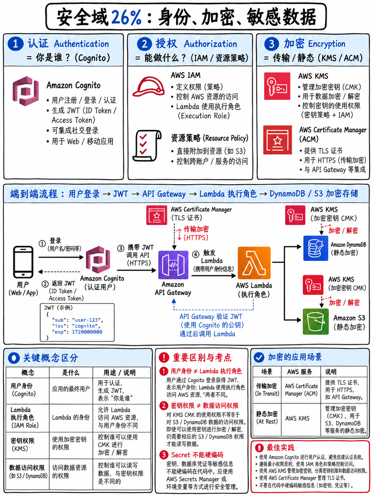

# 3.1 安全领域概览 Domain 2 — Security (26%)



## 3.1.1 本领域的考查结构 (The shape of the domain)

| 维度 | 指标与说明 |
|---|---|
| 考试占比 | 计分内容的 **26%** [1] |
| 约合计分考题数 | 50 题中约占 **~13 题** |
| 任务陈述 (Tasks) | 3 项 |

AWS 官方考试指南中的三项任务陈述 [1]：

1. **为应用程序和 AWS 服务实施身份认证与授权 (Implement authentication and/or authorization for applications and AWS services)**
2. **利用 AWS 服务实施数据加密 (Implement encryption by using AWS services)**
3. **在应用程序代码中安全管理敏感数据 (Manage sensitive data in application code)**

## 3.1.2 各项任务具体考查内容 (What each task covers)

### 任务 1 — 身份认证与授权 (Authentication and authorization)

**核心知识点 (Knowledge of)** [1]：联合身份认证（**SAML、OIDC、Amazon Cognito**）· 承载令牌（**JWT、OAuth、AWS STS**）· **Amazon Cognito 中用户池 (User Pools) 与身份池 (Identity Pools) 的对比** · **基于资源的策略 (Resource-based policies)、服务策略 (Service policies) 与主体策略 (Principal policies)** · **基于角色的访问控制 (RBAC)** · 使用 ACL 进行应用授权 · **最小特权原则 (The principle of least privilege)** · AWS 托管策略与客户托管策略的区别 · 身份与访问管理 (IAM)。

**核心技能要求 (Skills in)** [1]：使用身份提供商 (IdP) 实现联合访问 · 使用承载令牌 (Bearer tokens) 保障应用安全 · 配置编程式访问 (Programmatic access) · 发起经身份认证的 API 调用 · **扮演 IAM 角色 (Assuming an IAM role)** · 为各类主体定义精细化权限策略。

→ 对应章节：{doc}`02-iam-policies-and-roles`，{doc}`03-cognito-and-federation`

### 任务 2 — 数据加密 (Encryption)

**核心知识点 (Knowledge of)** [1]：**静态加密与传输中加密 (Encryption at rest and in transit)** · 证书管理（**AWS 私有证书颁发机构 AWS Private CA**）· 密钥保护与生命周期（**密钥轮换 Key rotation**）· **客户端加密 vs 服务端加密 (Client-side vs Server-side encryption)** · **AWS 托管的 KMS 密钥 vs 客户托管的 KMS 密钥 (AWS managed vs Customer managed KMS keys)**。

**核心技能要求 (Skills in)** [1]：使用 KMS 密钥进行加密与解密 · 为开发环境生成 SSL/TLS 证书及 SSH 密钥 · **跨越 AWS 账号边界使用加密 (Using encryption across account boundaries)** · 启用和禁用 KMS 密钥轮换。

→ 对应章节：{doc}`04-kms-and-encryption`

### 任务 3 — 应用代码中的敏感数据管理 (Sensitive data in application code)

**核心知识点 (Knowledge of)** [1]：数据分类分级（**个人身份信息 PII、受保护健康信息 PHI**）· 环境变量的安全实践 · 机密与凭证管理（**AWS Secrets Manager、AWS Systems Manager Parameter Store**）· 凭证的安全处理规范。

**核心技能要求 (Skills in)** [1]：**对包含敏感数据的环境变量进行加密** · 熟练运用机密管理服务 · **净化与脱敏敏感数据 (Sanitizing sensitive data，防止泄露到日志中)**。

→ 对应章节：{doc}`05-secrets-and-config`

## 3.1.3 破解本领域绝大多数考题的核心准则 (The single heuristic)

::::{important}
**核心法则：务必使用 IAM 角色 (Role)，绝对不要使用长期凭证 (Long-lived credentials)。**

| 计算服务 | 推荐的身份接入机制 |
|---|---|
| **Lambda** | **执行角色 (Execution role)** |
| **EC2** | **实例配置文件 (Instance profile)** |
| **ECS / Fargate** | **任务角色 (Task role)**（以及拉取镜像和写入日志所必需的独立**任务执行角色 Task execution role**） |
| **CodeBuild** | **服务角色 (Service role)** |
| **EKS Pod** | ServiceAccount 关联 IAM 角色 (**IRSA**) / EKS Pod Identity |
| **本地机房或其他公有云** | **IAM Roles Anywhere**，或外部联合身份认证 — 绝不可静态存储长期密钥 |
| **浏览器或移动端 App 用户** | **Cognito 身份池 (Identity pool)** → 通过 STS 获取临时安全凭证 |

在任何选项中，凡是出现把 Access Key 长期访问密钥硬编码在代码、存储在环境变量、保存在配置文件、烧录进 AMI 镜像或打包在容器镜像中的方案，**直接一票否决**。AWS 官方样题第 5 题就是完全基于此考点设计的 [18]，这一考点贯穿全场考试。
::::

第二个几乎同样可靠的核心法则：**最小特权原则 (Least privilege)**。在两个功能均能跑通的选项之间，凡是授予更精细、更狭窄权限的选项——例如指定具体的资源 ARN 而非通配符 `*`、附加条件键 (Condition keys)、使用降权收窄的会话策略 (Scoped-down session policy)——就是标准答案。官方考试指南明确将“最小特权原则”列为核心考查知识点 [1]。

## 3.1.4 考题中高频出现的三组核心辨析 (Three distinctions)

**1. 身份认证 vs 权限授权 (Authentication vs Authorization)**
*身份认证 (Authentication)* = “你是谁？”（Cognito 用户池、SAML、OIDC、JWT 令牌）。
*权限授权 (Authorization)* = “你能做什么？”（IAM 策略、Cognito 身份池角色、Lambda Authorizer 返回的 IAM 策略、基于资源的策略）。
题干如果问的是用户如何**登录注册 (Sign in / Sign up)**，其解题思路与询问用户**被允许访问什么云资源 (Permitted)** 截然不同。

**2. 基于身份的策略 vs 基于资源的策略 (Identity-based vs Resource-based policies)**

```
 基于身份的策略 (IDENTITY-BASED)      附加至用户 (User)、用户组 (Group) 或角色 (ROLE)
   "该主体 (Principal) 可以对资源 Y 执行操作 X"

 基于资源的策略 (RESOURCE-BASED)      附加至具体资源本身 (S3 存储桶、SQS 队列、
   "主体 P 可以对我执行操作 X"            SNS 主题、KMS 密钥、Lambda 函数、
                                         Secrets Manager 机密)

 跨账号访问 (Cross-account access) 通常需要双方同时授权：
   资源自身的基于资源的策略必须显式允许外部主体，并且
   外部主体自身附加的身份策略也必须显式允许执行该操作。
```

**3. 静态加密 vs 传输中加密 (Encryption at rest vs In transit)**
- **静态加密 (At rest)**：AWS KMS、S3 服务端加密模式（SSE-S3 / SSE-KMS / SSE-C）、客户端加密 SDK、EBS/RDS/DynamoDB 加密。
- **传输中加密 (In transit)**：TLS、ACM 托管证书、IAM 策略中的 `aws:SecureTransport: "true"` 条件键。
这两者都在考试大纲中明确列出 [1]，当题干要求“端到端全链路加密 (End-to-end)”时，两者缺一不可。

## 3.1.5 本模块的章节安排 (How the domain is covered here)

| 章节文件 | 核心考查内容与定位 |
|---|---|
| {doc}`02-iam-policies-and-roles` | IAM 策略语法结构与评估逻辑、角色扮演、STS、跨账号访问 —— **Tier S 绝对核心** |
| {doc}`03-cognito-and-federation` | 用户池 (User Pools) vs 身份池 (Identity Pools)、JWT 令牌体系、SAML/OIDC 联合身份 |
| {doc}`04-kms-and-encryption` | KMS 密钥类型、信封加密 (Envelope Encryption)、密钥轮换、跨账号解密、ACM |
| {doc}`05-secrets-and-config` | Secrets Manager vs Parameter Store vs AppConfig 选型、环境变量加密、日志脱敏 |
| {doc}`06-security-practice-set` | 24 道精选全真模拟题与深度逐题解析 |

## 3.1.6 本领域不考查的内容边界 (What is NOT in this domain)

官方考试指南明确将“管理企业级 IAM 用户与用户组 (Administer IAM users and groups)”列为超出目标考生范围的非考查内容 [1]。你不必在本次考试中为大型跨国集团设计多账号身份治理架构、配置 AWS Organizations SCP 服务控制策略，也不需要运维 GuardDuty 入侵检测系统——那些属于安全专项认证 SCS-C02 的考查领域（详见 {doc}`../10-other-exams/04-specialty-scs-c02-ans-c01`）。

**DVA 考查的核心聚焦于：你的应用程序如何安全认证、代码被授予了何种精确权限、应用产生与处理的数据如何加密、以及应用机密凭证保存在何处。** 牢牢锁定这一开发者视角，本模块的学习范畴就会变得非常清晰且聚焦。
