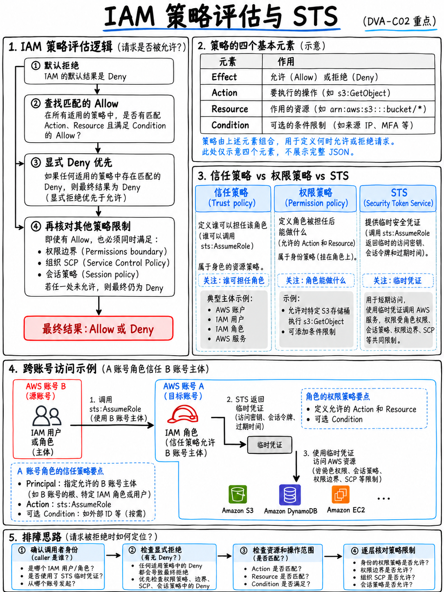

# 3.2 IAM 策略与角色深度解析：策略剖析、角色扮演与跨账号访问 (IAM Policies, Roles, and STS)



**Tier S 绝对核心考点。** IAM 是贯穿 AWS 整个认证与日常开发的基石。考试大纲明确指出了基于资源的策略、服务策略与主体策略、RBAC（基于角色的访问控制）、最小特权原则、AWS 托管策略与客户托管策略的区别，以及“扮演 IAM 角色 (Assuming an IAM role)”等高频考点 [1]。

## 3.2.1 IAM 策略语法剖析 (Policy anatomy)

```json
{
  "Version": "2012-10-17",
  "Statement": [
    {
      "Sid": "AllowReadOneBucket",
      "Effect": "Allow",
      "Action": ["s3:GetObject", "s3:ListBucket"],
      "Resource": [
        "arn:aws:s3:::my-bucket",
        "arn:aws:s3:::my-bucket/*"
      ],
      "Condition": {
        "StringEquals": { "aws:PrincipalTag/team": "payments" },
        "Bool": { "aws:SecureTransport": "true" }
      }
    }
  ]
}
```

- **`Version` 必须固定为 `"2012-10-17"`。** 旧版本 `"2008-10-17"` 无法正确支持策略变量 (Policy Variables) 或复杂条件键。
- **S3 的 `Resource` 需要同时声明两种 ARN 格式**：存储桶本身 `arn:aws:s3:::my-bucket`（用于 `ListBucket` 等桶级操作）以及通配路径 `arn:aws:s3:::my-bucket/*`（用于 `GetObject` / `PutObject` 等对象级操作）。漏掉其中任何一个，都是策略排错题中的经典陷阱。
- **`Principal` 元素**：**仅出现在基于资源的策略 (Resource-based policy)** 以及角色的**信赖策略 (Trust policy)** 中。基于身份的策略中绝不能包含 `Principal`，这是判断策略类型的最直观特征。
- **`NotAction`、`NotResource`、`NotPrincipal`**：虽然语法上支持反向匹配，但在真实考试中极少是正确答案。

## 3.2.2 策略评估逻辑 —— 决定考题答案的核心决策树 (Policy evaluation)

```
          ┌──────────────────────────────────┐
          │ 1. 是否存在显式拒绝 (Explicit DENY)?│──► 是 ──► 最终判定：拒绝 (DENIED，立即终止)
          └────────────────┬─────────────────┘
                           │ 否
          ┌────────────────▼─────────────────┐
          │ 2. 是否存在显式允许 (Explicit ALLOW)?│──► 否 ──► 最终判定：拒绝 (隐式拒绝 Implicit Deny)
          └────────────────┬─────────────────┘
                           │ 是
                        最终判定：允许 (ALLOWED)
```

**显式拒绝 (Explicit Deny) 拥有一票否决权**。无论显式拒绝出现在哪里——身份策略、基于资源的策略、权限边界、SCP 还是会话策略——只要存在一条 Deny，请求就会被无条件拒绝。在没有显式拒绝的前提下，所有请求**默认均为隐式拒绝**，直到被某一条显式允许规则命中。

对于**跨账号访问 (Cross-account)**，判定机制更为严苛：必须**同时**满足**目标账号中基于资源的策略允许**以及**调用方账号中身份策略允许**（双向授权），请求才能通行。

| 策略类型 | 挂载位置 | 作用与特点 |
|---|---|---|
| **基于身份的策略 (Identity-based)** | 用户、用户组、角色 | 直接向该主体授予具体操作权限 |
| **基于资源的策略 (Resource-based)** | S3 存储桶、SQS 队列、SNS 主题、KMS 密钥、Lambda 函数、Secrets Manager 机密 | **必须指明 Principal 主体**；可实现跨账号直接授权而无需切换/扮演角色 |
| **权限边界 (Permission boundary)** | 附加至用户或角色 | 设定权限**最大上限 (Ceiling)**；实际生效权限为主体策略与边界的**交集**；本身不授予任何权限 |
| **服务控制策略 (SCP)** | AWS Organizations 组织单元 (OU) 或账号 | 组织维度的权限上限 (Ceiling)；本身不授予任何权限 |
| **会话策略 (Session policy)** | 在执行 `AssumeRole` 时传入 | 进一步收窄临时会话在此次调用中的权限边界 |

## 3.2.3 IAM 角色与 STS 临时凭证服务 (Roles and STS)

**IAM 角色 (Role)** 是一种拥有特定权限、但**不具备任何长期密码或静态密钥**的虚拟身份。某个主体通过*扮演 (Assume)* 该角色，由 **AWS STS (Security Token Service)** 动态颁发**临时安全凭证**：包含 Access Key ID、Secret Access Key 以及一个 **Session Token**。

```
 ┌──────────────┐  sts:AssumeRole   ┌────────────────────────┐
 │  调用方主体   │ ────────────────► │  IAM 角色 (Role)       │
 │ (用户/Lambda/ │                   │  ├ 信赖策略 (TRUST)    │
 │  EC2/跨账号)  │ ◄──────────────── │  │  "谁可以扮演我"     │
 └──────────────┘  返回临时安全凭证   │  └ 权限策略 (PERM)     │
                  (有效 15分 – 12小时)│     "我可以操作什么"   │
                                     └────────────────────────┘
```

**每个角色都由两组策略共同定义**，混淆这两者是高频考点陷阱：

| 对比维度 | 信赖策略 (Trust policy) | 权限策略 (Permissions policy) |
|---|---|---|
| 核心回答 | *谁有资格扮演这个角色？(Who may assume?)* | *扮演成功后这个角色能做什么？(What may do?)* |
| 核心要素 | `Principal` + 操作 `sts:AssumeRole` | `Action` + `Resource` 权限清单 |
| 缺失导致的报错 | 调用 **AssumeRole 时触发 `AccessDenied`** | 扮演成功后发起 **AWS API 调用时触发 `AccessDenied`** |

**会话持续时间 (Session duration)**：默认为 1 小时，最高可配置至角色上限（12 小时）。如果执行角色链式扮演 (Role chaining)，会话时长被强制限制为最多 1 小时。

**必须熟练识别的 STS API 核心调用**：
- `AssumeRole`：跨账号访问、同账号临时提权。
- `AssumeRoleWithWebIdentity`：基于 OIDC 的 Web 身份联合（Cognito 身份池、Google、Facebook、Apple 等）。
- `AssumeRoleWithSAML`：对接企业级企业 IdP（如 Active Directory、Okta）。
- `GetSessionToken`：获取用于 MFA 保护操作的临时凭证。
- `GetCallerIdentity`：获取当前调用者的 ARN、账号与身份信息 —— **排查权限故障时的第一条必用命令**。

:::{tip}
**跨账号访问经典考法**：“账号 A 中的应用程序需要读取账号 B 中的 S3 存储桶 / 调用账号 B 中的 Lambda 函数 / 读取账号 B 中的 SQS 队列。”

通常存在两种合法解法，题干往往会给出明确线索：
1. **在账号 B 中配置基于资源的策略 (Resource-based policy)**，将账号 A 的主体列为 `Principal`。这是最轻量、最推荐的方案；适用于 S3、SQS、SNS、Lambda、KMS、Secrets Manager。
2. **在账号 B 中创建 IAM 角色**，配置信赖策略允许账号 A 扮演；账号 A 的主体执行 `sts:AssumeRole` 获取临时凭证。

如果目标服务**不支持基于资源的策略**（例如 DynamoDB 数据表），**扮演 IAM 角色是唯一的标准答案**。
:::

## 3.2.4 托管策略 vs 内联策略 vs 客户托管策略 (Managed vs Inline)

| 策略类别 | 特点描述 | 适用场景与选型建议 |
|---|---|---|
| **AWS 托管策略 (AWS managed)** | 由 AWS 官方创建并维护，例如 `AWSLambdaBasicExecutionRole` | 开箱即用，快速入门；但权限通常偏宽，难以满足最严格的最小特权要求 |
| **客户托管策略 (Customer managed)** | 由用户自行编写和维护，可在多个主体间复用，具备版本回滚能力 | **企业级生产环境的标准首选推荐** |
| **内联策略 (Inline policy)** | 直接嵌入到特定主体内部，随该主体的删除而一并销毁 | 仅适用于主体与权限绝对一对一强绑定的边缘场景 |

官方考试大纲要求掌握“AWS 托管策略与客户托管策略的区别” [1]。出题潜规则是：**AWS 托管策略固然使用便捷，但几乎从来都不是最小特权**。因此，当题干强调“以最小特权原则 (Least privilege)”为核心约束时，答案必然是针对具体资源 ARN 精确授权的客户托管策略。

## 3.2.5 考试高频出现的条件键 (Condition keys)

| 条件键 (Condition Key) | 核心应用场景 |
|---|---|
| `aws:SourceIp` | 将 API 调用的发起来源限制在指定的 CIDR IP 地址段 |
| `aws:SecureTransport` | 强制使用 TLS/HTTPS 加密传输 — 当其值为 `"false"` 时执行显式拒绝 |
| `aws:PrincipalTag` / `aws:ResourceTag` | **基于属性的访问控制 (ABAC)**，动态匹配主体标签与资源标签 |
| `aws:RequestedRegion` | 限制 API 请求只能在特定的 AWS Region 区域内执行 |
| `aws:SourceArn` / `aws:SourceAccount` | 在基于资源的策略中防止**混淆代理人问题 (Confused-deputy protection)** |
| `s3:x-amz-server-side-encryption` | 强制要求 S3 对象的上传请求必须附带服务端加密头 |
| `dynamodb:LeadingKeys` | **行级权限隔离：限制客户端用户只能读写其分区键 (Partition key) 等于自身用户 ID 的条目** |
| `sts:ExternalId` | 第三方 SaaS 供应商跨账号扮演角色时用于防范混淆代理人攻击的共享密钥 |

:::{important}
**`dynamodb:LeadingKeys` 是“用户只能访问/修改自己数据行”的标准考点答案**。它通常与 Cognito 身份池结合使用，移动或 Web 端用户通过验证后获取包含其身份标识的临时凭证，策略利用 `dynamodb:LeadingKeys` 限制仅能操作对应分区键的数据。这在细粒度权限考题中频繁亮相。
:::

## 3.2.6 访问拒绝故障排查决策流程 (Debugging Access Denied)

```
 AccessDenied (访问被拒绝)
   │
   ├─ 1. 我当前到底是谁？        运行：aws sts get-caller-identity
   ├─ 2. 是否存在显式拒绝？      检查所有层级：身份策略、资源策略、权限边界、SCP
   ├─ 3. 是否存在显式允许？      无显式允许则自动命中隐式拒绝 (Implicit Deny)
   ├─ 4. 是否涉及跨账号访问？    必须检查两端：源账号身份策略 + 目标账号资源策略均需显式允许
   ├─ 5. 资源 ARN 是否完全匹配？  S3 需要同时具备存储桶 ARN 与 bucket/* 通配 ARN
   ├─ 6. 条件键是否完全满足？    检查 IP 限制、TLS 要求、标签匹配、区域限制
   └─ 7. 是否涉及 KMS 加密？     KMS 密钥自身的 Key Policy 策略也必须显式允许该主体
```

**第 7 步是开发者最常踩中的实战考题陷阱。** 仅获得 `s3:GetObject` 权限不足以读取采用了 SSE-KMS 加密的对象：你必须**同时**具备对底层 KMS 密钥的 `kms:Decrypt` 权限，**并且** KMS 密钥自身的资源策略 (Key Policy) 也必须显式允许你的身份进行解密操作。详见 {doc}`04-kms-and-encryption`。

**常用排错工具**：
- **IAM Policy Simulator（策略模拟器）** 与 CLI 命令 **`aws iam simulate-principal-policy`**：在不真实发起云资源操作的前提下，快速测试评估策略是否放行。
- **IAM Access Analyzer（访问分析器）**：自动检测对外公开或共享给外部账号的资源，并可基于 CloudTrail 真实历史访问日志自动逆向生成最小特权策略。

## 3.2.7 核心考点速记清单 (Fast revision)

- **显式拒绝 (Explicit Deny) > 显式允许 (Explicit Allow) > 默认隐式拒绝 (Implicit Deny)**。
- 策略中的 `Principal` 字段**仅**出现在基于资源的策略和角色信赖策略中。
- 每一个 IAM 角色都包含**两组**独立策略：**信赖策略 (Trust Policy，谁能扮演)** 与 **权限策略 (Permissions Policy，能做什么)**。
- STS 签发**临时**安全凭证：Access Key ID、Secret Access Key **以及 Session Token**。
- 跨账号授权：基于资源的策略与身份策略双向放行；若对应服务不支持基于资源的策略，则必须使用 **`AssumeRole` 扮演角色**。
- 权限边界 (Permission Boundaries) 和组织 SCP 是**权限天花板 (Ceilings)**，它们负责圈定最大范围，本身绝不授予任何新权限。
- S3 权限策略必须区分桶级别 ARN (`my-bucket`) 与对象级别通配 ARN (`my-bucket/*`)。
- `dynamodb:LeadingKeys` = DynamoDB 基于用户 ID 的数据行级别细粒度隔离。
- 排查 AccessDenied 黄金定律：首先运行 `sts:GetCallerIdentity` 确认当前身份，随后排查显式拒绝，若读取加密资源务必核查 KMS 密钥策略。
