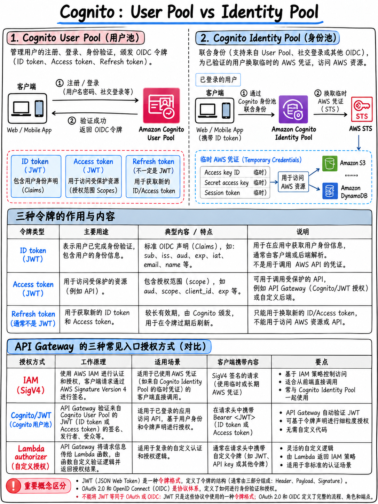

# 3.3 Amazon Cognito 与联合身份认证：用户池与身份池深度对比 (Cognito and Federation)



官方考试大纲明确将“Amazon Cognito 中用户池 (User Pools) 与身份池 (Identity Pools) 的对比”列为核心知识项 [1] —— AWS 直接提醒考生，两者的本质区别是必考内容。

## 3.3.1 用户池 vs 身份池 —— 核心本质与选型决策 (User pools vs Identity pools)

```
 ┌──────────────────────────────────────────────────────────────────┐
 │  用户池 (USER POOL)      =  身份认证 (AUTHENTICATION) "你是谁？" │
 │  用户目录与认证中心：注册、登录、MFA 多因素认证、密码强度策略、    │
 │  托管 UI (Hosted UI)、社交账号登录及 SAML/OIDC 联合身份认证       │
 │  输出产物：JWT 令牌三件套  →  ID 令牌 · 访问令牌 · 刷新令牌       │
 │  典型用途：App 用户登录；保护 API Gateway 后端接口                │
 └──────────────────────────────────────────────────────────────────┘
                              │
                              │  (可选) 使用用户池返回的 Token 进行兑换
                              ▼
 ┌──────────────────────────────────────────────────────────────────┐
 │  身份池 (IDENTITY POOL)  =  AWS 资源授权 (AUTHORIZATION) "能碰啥"│
 │  (联合身份 Federated Identities)                                 │
 │  将各类令牌 (Cognito 用户池、Google、Facebook、Apple、SAML、     │
 │  OIDC 甚至匿名访客 Guest) 通过 AWS STS 兑换为【临时 AWS 访问凭证】│
 │  输出产物：Access Key ID + Secret Key + Session Token 临时凭据    │
 │  典型用途：允许移动端/前端直接安全调用 S3 上传、读取 DynamoDB 表格│
 └──────────────────────────────────────────────────────────────────┘
```

| 题干常见描述场景 | 标准答案 |
|---|---|
| “需要让终端用户注册账号并登录系统 (Sign up & Sign in)” | **Cognito 用户池 (User pool)** |
| “使用用户登录后的 Token 保护 API Gateway 的 REST API” | **Cognito 用户池** 授权方 (`COGNITO_USER_POOLS`) |
| “移动端或 Web 前端应用需要直接上传文件至 S3 或直接查询 DynamoDB” | **Cognito 身份池 (Identity pool)** → 获取临时 AWS 凭据 |
| “未经身份认证的匿名访客 (Guest) 需要受限访问部分云资源” | **Cognito 身份池**，配置未认证角色 (Unauthenticated role) |
| “用户希望使用第三方社交账号（Google、Facebook、Apple）登录” | 两者均可：用户池配置社交联合登录，或直接在身份池配置第三方 IdP |
| “企业内部员工需要使用现有的公司 SAML 身份提供商单点登录” | 用户池配置 **SAML** 身份提供商，或身份池直接对接 SAML IdP |
| “每个已登录用户仅被允许读取或修改 DynamoDB 中属于自己的数据项” | **Cognito 身份池** + IAM 策略中使用 `dynamodb:LeadingKeys` 条件键 |

## 3.3.2 用户池签发的三个核心 JWT 令牌 (The three tokens)

当用户在用户池中成功完成身份认证后，Cognito 将返回三组 JSON Web Token (JWT)：

| 令牌类型 | 核心承载内容 (Payload) | 核心应用场景 | 默认有效期 |
|---|---|---|---|
| **ID 令牌 (ID Token)** | 用户的身份声明 (Claims)：如 `sub`、`email`、`name`、`cognito:groups` 等 | **用于证明用户的真实身份**。API Gateway 默认的 Cognito 授权方所校验的正是 ID 令牌 | 1 小时 |
| **访问令牌 (Access Token)** | 授权范围 (Scopes) 及 `cognito:groups` 组信息 | 用于直接调用用户池本身的专属 API（如 `GetUser`）或具有 OAuth 作用域的受保护资源服务器 | 1 小时 |
| **刷新令牌 (Refresh Token)** | 不透明字符串（非标准 JWT 结构） | 用于在无需用户重新输入账密的前提下，静默换取全新的 ID 令牌与访问令牌 | 默认为 **30 天**（可配置为 60 分钟至 10 年） |

:::{tip}
**对于 API Gateway 的 `COGNITO_USER_POOLS` 授权方，客户端默认必须在请求的 `Authorization` 请求头中传递 ID 令牌**。如果考题选项中提到将“访问令牌 (Access token)”传递给 Cognito 默认授权方，请务必高度警惕 —— AWS 官方样题第 4 题就是故意拿 access token 作为强干扰项来考查考生的 [18]。
:::

## 3.3.3 用户池高频考查功能点 (User pool features)

- **托管 UI (Hosted UI)**：AWS 官方托管的开箱即用型登录/注册网页，原生支持 OAuth 2.0 流程；是无需手写前端 UI 即可快速集成认证的最快方案。
- **应用程序客户端 (App clients)**：针对不同端（iOS、Android、Web 前端、后端服务端）的独立配置；可区分为私密客户端（带有 Client Secret）和公开客户端（无 Secret，移动端与单页 SPA 必备）。
- **用户组 (Groups)**：可映射到 IAM 角色以在身份池中分配不同权限；在 ID/Access Token 中以 `cognito:groups` 声明呈现，用于前端应用层实现 RBAC 权限控制。
- **MFA 多因素认证**：支持短信 SMS 或基于时间的一次性密码 TOTP（如 Authenticator App），可配置为关闭、可选或强制开启。
- **Lambda 触发器 (Lambda triggers)**：Cognito 的核心扩展能力，也是**全真试题中出题率极高**的功能：

| 触发器类型 | 触发时机 | 典型业务实战场景 |
|---|---|---|
| **注册前触发器 (Pre sign-up)** | 用户提交注册表单、创建用户之前 | 自动验证邮箱、企业域名白名单过滤校验 |
| **确认后触发器 (Post confirmation)** | 用户完成邮箱/手机号确认验证之后 | 在 DynamoDB 中初始化用户 Profile 档案行、发送欢迎邮件 |
| **认证前触发器 (Pre authentication)** | 用户发起登录请求、凭据校验之前 | 基于用户登录 IP、设备指纹执行风控阻断 |
| **认证后触发器 (Post authentication)** | **用户成功通过登录认证之后** | **调用外部数据分析系统 API 记录登录审计日志** |
| **令牌生成前触发器 (Pre token generation)** | 签发 JWT 令牌之前 | 向即将下发的 Token 中动态注入或修改自定义 Claims 属性 |
| **自定义消息触发器 (Custom message)** | 发送验证码或临时密码短信/邮件之前 | 定制具有企业品牌视觉的验证码邮件模板 |
| **迁移用户触发器 (Migrate user)** | 未知用户发起登录时触发 | 从旧版自建数据库（如旧 MySQL 用户表）无缝平滑迁移用户 |

::::{important}
**AWS 官方样题第 3 题 [18] 实战剖析**：
题干要求：系统需新增用户注册与登录功能，**并且**在每次用户登录成功时，必须调用自建的第三方外部数据分析系统 API 记录用户登录事件。

该题的两项正确答案：
> “使用 **Amazon Cognito** 提供用户注册与登录功能。”
> “当用户通过身份验证时，调用 **AWS Lambda 函数** 发起外部 API 请求。”

官方解析明确写明了底层驱动机制：“你可以创建一个 AWS Lambda 函数向自定义数据分析系统发送 API 调用，并通过 Amazon Cognito 的**认证后触发器 (Post authentication trigger)** 来触发该 Lambda 函数” [18]。

**“Cognito 触发器 + AWS Lambda”是考题中“在用户生命周期各阶段执行额外业务逻辑/外部集成”的标准化终极答案。**
::::

## 3.3.4 联合身份认证深度拆解：SAML、OIDC、OAuth 与 JWT (Federation)

官方考试指南中均有明确提及 [1]：

| 协议 / 概念 | 核心定位与技术特征 |
|---|---|
| **SAML 2.0** | 基于 XML 格式的企业级联合身份认证标准。常用于企业现有 IdP（如微软 Active Directory 联合身份验证服务 ADFS、Okta、Microsoft Entra ID） |
| **OIDC (OpenID Connect)** | 构建于 OAuth 2.0 之上的身份认证层；核心特征是签发包含用户身份信息的 **ID 令牌 (ID Token，标准 JWT 格式)**。常见于 Google、Apple、Auth0 等平台 |
| **OAuth 2.0** | 纯粹的**授权 (Authorization)** 框架，通过向第三方应用发放具有特定 Scopes（作用域）的访问令牌来实现委派授权。其本身**不属于**身份认证协议 |
| **JWT (JSON Web Token)** | 令牌的工业标准承载格式：由 Header（头部）、Payload（负载）、Signature（签名）三部分组成，采用 Base64URL 编码并通过点号 `.` 拼接。**核心考点：JWT 是经过数字签名的，但默认绝非加密的** —— 任何拿到该 Token 的人都可以对其进行 Base64 解码并阅读 Payload 中的所有属性声明 |
| **承载令牌 (Bearer token)** | 任何“谁持有该令牌谁就拥有对应权限”的凭证。必须强制在 TLS/HTTPS 加密信道中传输，且**严禁在日志中打印输出** |

:::{warning}
**由于 JWT 的 Payload 是明文可见的**，绝对不能将密码、API 私钥或敏感情感数据放入自定义 Claims 中；并且严禁在后端业务日志中完整打印 Bearer 令牌 —— 这直接呼应了考试大纲中“脱敏敏感数据 (Sanitizing sensitive data)”这一核心技能要求 [1] 以及 {doc}`05-secrets-and-config` 第 3.5.6 节。
:::

**直接联合登录至 AWS 控制台或 AWS API 的机制**（与登录自建应用区分开）：

```
 企业 IdP ────SAML 2.0───► IAM SAML 身份提供商 ────► sts:AssumeRoleWithSAML
 Web/移动端 IdP ──OIDC───► IAM OIDC 提供商 / 身份池 ──► sts:AssumeRoleWithWebIdentity
```

## 3.3.5 API Gateway 授权机制选型对照表 (API Gateway authorizers)

| 客户端调用方背景 | 最佳授权方 (Authorizer) 选型 |
|---|---|
| 调用方为 AWS 内部主体（其他 AWS 账号、EC2 实例、Lambda 函数） | **IAM 授权 (`AWS_IAM`)**，请求使用 SigV4 算法进行数字签名 |
| 应用已采用 Cognito 用户池作为用户体系 | **`COGNITO_USER_POOLS` 授权方**（原生自动校验 ID Token） |
| 使用第三方 OAuth/OIDC 签发的 JWT、需校验复杂自定义 Claims 或需要查询外部缓存数据库判定权限 | **Lambda 授权方 (Lambda authorizer)**（支持 TOKEN 模式或包含请求上下文的 REQUEST 模式） |
| 需严格限制仅允许特定 AWS 账号、指定 VPC 终端节点 (vpce) 或特定公网 IP 段调用 | **基于资源的策略 (Resource Policy)**（API Gateway 层面） |
| 针对不同商业客户或租户统计 API 调用量、实施配额限流与流量计费 | **API Key + 使用计划 (Usage Plan)**（注意：此机制用于配额管理，不属于安全身份认证） |

## 3.3.6 核心考点速记清单 (Fast revision)

- **用户池 = 身份认证 (签发 JWT 令牌)。身份池 = AWS 资源授权 (获取 STS 临时安全凭据)。**
- JWT 三剑客：**ID 令牌**（你是谁，供 Cognito 授权方校验）、**访问令牌**（授权范围 Scopes）、**刷新令牌**（静默续期，默认 30 天）。
- **认证后触发器 (Post authentication trigger)** = 用户登录成功后自动执行 Lambda 函数（常用于分析审计日志）[18]。
- 令牌生成前触发器可动态注入自定义 Claims；迁移用户触发器可实现老系统存量用户的平滑导入。
- **JWT 默认仅签名、未加密** —— 切勿将机密写入 Claims，严禁在日志中记录 Bearer Token。
- 前端 Web 或移动客户端直接操作 S3/DynamoDB → 必须使用 **Cognito 身份池**，严禁硬编码静态凭证。
- 单表多租户/用户数据行隔离 → Cognito 身份池 + IAM 策略条件键 **`dynamodb:LeadingKeys`**。
