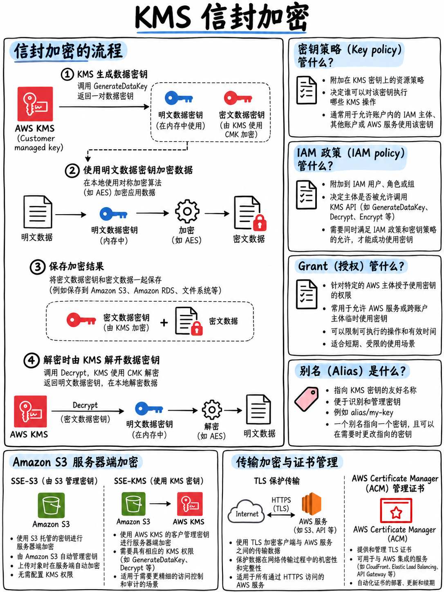

# 3.4 AWS KMS 与数据加密：密钥类型、信封加密与跨账号访问 (KMS and Encryption)



官方考试大纲明确将静态加密与传输中加密、证书管理、密钥保护与生命周期（密钥轮换）、客户端加密与服务端加密对比、AWS 托管 KMS 密钥与客户托管 KMS 密钥对比，以及“跨越 AWS 账号边界使用加密 (Using encryption across account boundaries)”列为核心考查内容 [1]。

## 3.4.1 KMS 密钥类型全景对比 (Key types)

| 密钥类别 | 控制权归属 | 密钥轮换 (Rotation) | 费用机制 | 账号内是否可见 |
|---|---|---|---|---|
| **AWS 拥有的密钥 (AWS owned key)** | AWS 官方全局控制，跨租户共享 | AWS 自动维护 | 完全免费 | 控制台中不可见，无 ARN |
| **AWS 托管的密钥 (AWS managed key)** (`aws/s3`, `aws/lambda`) | AWS 在你的账号内自动创建和管理 | **每年自动轮换，不可更改** | 完全免费 | 控制台可见，其 Key Policy 只读不可修改 |
| **客户托管密钥 (Customer managed key, CMK)** | **用户自主掌控** | **可选启用自动轮换**（默认每年一次，可自定义周期） | 基础月租 + API 请求费 | 完全可见，拥有绝对控制权与策略修改权 |

:::{important}
**考试在什么场景下要求选择客户托管密钥 (Customer managed key)？**
只要题干中出现以下任意关键词：**要求自定义密钥策略 (Key Policy)**、**在 CloudTrail 中独立审计密钥的使用日志**、**自主启用/禁用密钥轮换**、**临时禁用或彻底删除密钥**、**实现跨 AWS 账号共享加密密钥**，或是**使用用户自主导入的外部密钥材料 (Imported key material)**。以上所有高级控制功能，AWS 托管密钥一律不支持。

如果题干仅轻描淡写地要求“对数据进行静态加密”，且没有其他任何附加管理或合规要求，直接选择系统默认的 AWS 托管密钥即可，成本最低且配置最省心。
:::

## 3.4.2 信封加密 —— KMS 为何强制推行此机制 (Envelope encryption)

**KMS 的直接加密 API `kms:Encrypt` 最大仅支持 4 KB 的数据量。** 这并非 AWS 的架构缺陷，而是刻意设计的底层保护机制，旨在强制开发者采用**信封加密 (Envelope Encryption)** 架构。

```
 1. 应用程序调用 GenerateDataKey ──► KMS 返回两样东西：
        ├─ 明文数据密钥 (Plaintext Data Key)  ── 用于本地加密数据，使用后立即从内存擦除！
        └─ 密文数据密钥 (Encrypted Data Key)  ── 由你的 KMS 主密钥加密后的密文副本

 2. 应用程序在本地使用【明文数据密钥】对海量数据进行对称加密 (如 AES-256-GCM)

 3. 将【密文数据密钥】与数据密文并排保存在一起（例如存入数据库或对象存储）
    ──────────────────────────────────────────────────────────────────────────
 4. 解密流程：将【密文数据密钥】发送给 KMS 的 kms:Decrypt API，
    换取【明文数据密钥】返回内存，在本地完成最终业务数据的解密
```

::::{tip}
**AWS 官方样题第 6 题深度拆解** [18]：
题干要求：开发者需要使用 AWS KMS 配合信封加密机制，对保存在数据库中的机密敏感数据进行安全加密：

> 正确答案：**D) 使用生成的数据密钥 (Data key) 对数据进行加密。将加密后的数据密文以及【加密后的数据密钥 (Encrypted data key)】一同保存在数据库中。**

AWS 官方解析明确指出：“信封加密是指使用数据密钥加密明文数据，然后再使用另一把主密钥对该数据密钥进行加密的实践。**你必须持久化保存数据密钥的加密形态 (Encrypted form)**，以便未来可以使用它向 KMS 换取明文数据密钥来解密数据库中的业务数据” [18]。

干扰项极具典型教学价值：直接调用 KMS 密钥加密大数据（超过 4 KB 直接报错）；只在数据库中存储数据密钥的 Key ID 而不存密文密钥（解密时无法还原数据密钥）；完全不保存数据密钥。**请务必牢记这一核心黄金准则：“将加密后的数据密钥与密文数据存储在一起”。**
::::

**`GenerateDataKeyWithoutPlaintext`** API 仅返回加密后的数据密钥，不返回明文 —— 适用于提前批量生成密钥物料并在将来特定批处理作业中按需加载解密的场景。

## 3.4.3 密钥策略、授权与别名 (Key policies, grants, and aliases)

**每一个 KMS 密钥都必须附带基于资源的密钥策略 (Key Policy)**。与其他大多数 AWS 服务不同，**仅在 IAM 角色上配置权限是远远不够的** —— KMS 密钥本身的 Key Policy 也必须显式允许该主体访问（或者 Key Policy 包含了将控制权委托给根账号 IAM 的标准声明）。

```
 调用方主体 P 是否可以使用 KMS 密钥 K？
   ├─ 检查 1：密钥 K 的 Key Policy 是否显式允许主体 P（或通过账号 IAM 委托放行）？── 必须满足
   ├─ 检查 2：主体 P 自身的 IAM 策略中是否显式声明了对应的 kms: 操作权限？         ── 必须满足
   └─ 替代路径：是否存在针对主体 P 签发的 Grants（授权物）？                         ── 可作为替代
```

:::{danger}
**DVA 考题中最隐蔽也是最常见的 KMS 故障陷阱：**
Lambda 函数能够正常获取 S3 对象的 Metadata 元数据，但在读取对象真实主体内容时却触发 `AccessDenied`；或者 IAM 角色已经显式被授予了 `s3:GetObject` 权限，但下载对象依然报错。

根本原因：该 S3 对象使用了 **SSE-KMS 服务端加密**，而调用方的 IAM 角色**缺少 `kms:Decrypt` 权限**，或者底层 **KMS 密钥自身的 Key Policy 没有授权给该角色**。

**对于 SSE-KMS 加密的对象，仅有 `s3:GetObject` 权限是无法完成读取的。** 两端都必须显式具备 `kms:Decrypt` 权限。
:::

- **授权 (Grants)**：一种通过代码动态签发的轻量级临时授权机制，常用于 AWS 内部服务代表你使用 KMS 密钥，支持精细撤销。
- **别名 (Aliases)**（例如 `alias/my-app-key`）：给难记的密钥 UUID 绑定的语义化友好名称。在密钥轮换或重构时，只需将别名重新指向新密钥，**完全无需修改任何应用程序业务代码**。

## 3.4.4 KMS 密钥轮换机制 (Key rotation)

| 对比维度 | 核心规则与特征 |
|---|---|
| **AWS 托管的密钥** | 由 AWS 官方**每年强制自动轮换**，用户无法干预或修改轮换周期 |
| **客户托管密钥 (CMK)** | **自动轮换为可配置的可选项** —— 必须由用户手动开启。默认轮换周期为 1 年（现也支持自定义周期） |
| **密钥轮换的底层物理本质** | 轮换仅生成**全新的底层密钥材料 (Key material)**；**密钥的 Key ID、ARN、别名和权限策略保持完全不变**。系统会永久保留历史旧密钥材料，因此历史加密的旧密文仍然可以被无缝透明解密 |
| **用户自主导入的密钥材料 (Imported key material)** | **完全不支持自动轮换** —— 用户必须手动轮换（即创建一把新 Key 并重新导入外部密钥材料） |
| **手动密钥轮换的最佳实践** | 创建一把全新的 KMS 密钥，然后将应用程序正在使用的**别名 (Alias) 指针重新挂载到新密钥上** |

官方考试大纲明确将“启用和禁用密钥轮换 (Enabling and disabling key rotation)”列为考查技能 [1]，请准确区分“AWS 替你自动轮换”与“必须由你手动开启”的边界。

## 3.4.5 跨 AWS 账号边界使用加密密钥 (Cross-account KMS)

大纲核心考查技能 [1]。为了让账号 B 中的主体使用账号 A 中的 KMS 密钥解密数据：

1. **账号 A 的 KMS 密钥策略 (Key Policy)** 必须显式将账号 B（或账号 B 中的特定角色）列为被允许的主体。
2. **账号 B 的 IAM 策略** 必须授予该角色针对账号 A 中该密钥 ARN 的 `kms:Decrypt` 等操作权限。
3. 业务数据本体（例如 S3 对象）也必须通过其自身的资源策略（如 Bucket Policy）实现跨账号共享。

**多区域密钥 (Multi-Region keys)**：在多个不同的 AWS Region 之间复制并共享同一套底层密钥材料。这使得在一个区域加密生成的密文，可以直接在灾备区域本地利用对应的副本密钥完成解密，是“在跨区域灾备场景下避免跨 Region 跨网解密网络延迟与依赖”的标准考点答案。

## 3.4.6 传输中加密与 ACM 证书服务 (Encryption in transit, and ACM)

- **全链路强制 TLS/HTTPS**：在 S3 存储桶策略或 IAM 策略中添加显式拒绝规则：条件为 `"Bool": {"aws:SecureTransport": "false"}` 且 `"Effect": "Deny"`。
- **AWS Certificate Manager (ACM)**：签发**完全免费的公网 SSL/TLS 证书**并提供全自动到期续订。ACM 证书可以直接无缝集成到 **CloudFront 分发、Application Load Balancer (ALB)、API Gateway** —— 但**绝对不能导出私钥直接安装在 EC2 实例的 Web 服务器（如 Nginx）上**。
- **CloudFront 专属约束**：为 CloudFront 分发配置自定义域名的 ACM 证书，**必须且只能在 `us-east-1` (弗吉尼亚北部) 区域请求签发**。
- **AWS Private Certificate Authority (Private CA)**：考试大纲明确提及 [1]，专用于为企业内部微服务通信、双向双认证 mTLS 以及 IoT 物联网设备签发内部私有 CA 证书。
- **开发用途的 SSH 密钥与证书生成**：考纲考查技能 [1] —— 实际考察利用 `ssh-keygen`、EC2 Key Pairs 密钥对以及通过 ACM 生成安全连接凭据。

## 3.4.7 核心云服务的默认静态加密机制速查 (Service encryption defaults)

| 云服务 | 静态加密 (Encryption at Rest) 机制与考点 |
|---|---|
| **Amazon S3** | **所有新上传对象默认强制开启 SSE-S3 加密**；可选 SSE-KMS、双层加密 DSSE-KMS、SSE-C 或客户端加密 |
| **Amazon DynamoDB** | **全天候默认强制加密**；默认使用 AWS 拥有的密钥（零成本），可选 AWS 托管密钥或客户托管密钥 |
| **Lambda 环境变量** | **静态存储默认始终加密**；支持关联客户托管密钥，控制台提供加解密助手 (Encryption helpers) 支持传输过程加密 |
| **Amazon EBS 卷** | 可选加密；支持在账号区域级别开启“默认对所有新建 EBS 卷强制加密” |
| **Amazon RDS / Aurora** | 可选加密；**必须在创建数据库实例时决定** —— 无法直接就地修改未加密实例；如需加密已有数据库，必须先创建未加密快照，拷贝并加密该快照，最后从加密快照还原新实例 |
| **Amazon SQS / SNS** | 支持基于 KMS 的服务端加密 (SSE) |
| **CloudWatch Logs** | 支持针对特定日志组 (Log Group) 绑定关联 KMS 密钥进行深度加密 |
| **Secrets Manager** | **全天候默认强制使用 KMS 进行加密存储** |

## 3.4.8 核心考点速记清单 (Fast revision)

- **AWS 托管密钥** = 免费、每年自动轮换、不可配置。**客户托管密钥 (CMK)** = 细粒度控制、CloudTrail 审计、支持开关轮换、跨账号共享、支持外部导入材料、产生费用。
- **KMS Encrypt 最大限制 4 KB → 超过必须使用信封加密**。`GenerateDataKey` 返回**明文数据密钥 + 密文数据密钥**；本地加密后立即销毁内存明文，**将密文数据密钥与数据密文保存在一起** [18]。
- **密钥策略 (Key Policy) 与 IAM 策略两端必须同时放行**。仅有 `s3:GetObject` 无法读取 SSE-KMS 加密文件 —— 必须同时具备 **`kms:Decrypt`**。
- 密钥轮换更新的是**底层密钥材料 (Key material)**，Key ID 与 ARN 恒定不变。导入的外部密钥材料无法自动轮换。
- **ACM 公网证书完全免费**且全自动轮换，支持 CloudFront/ELB/API Gateway，**不可安装在 EC2 上**；CloudFront 证书必须位于 **`us-east-1`**。
- 传输加密守门员：`aws:SecureTransport: "false"` 配合显式拒绝。
- DynamoDB、Secrets Manager 及 Lambda 环境变量**出厂默认强制静态加密**；RDS 静态加密**必须在创建之初选择**。
