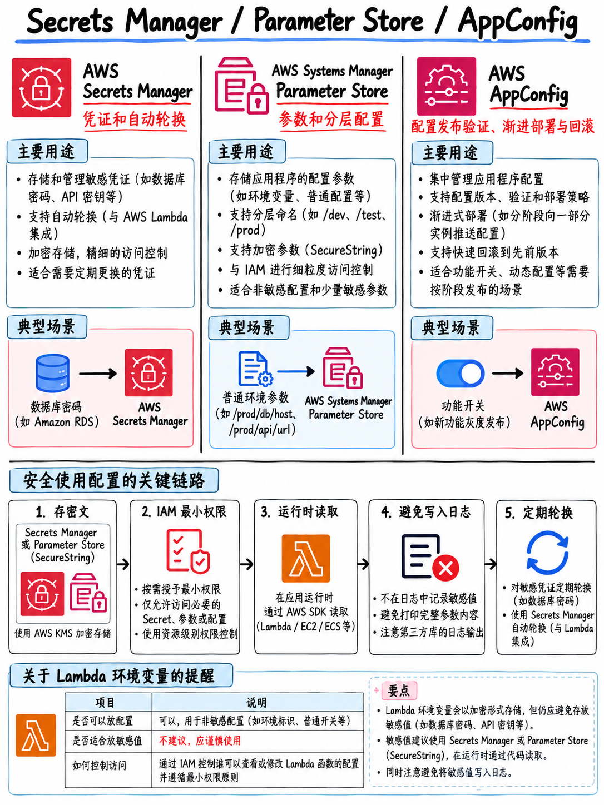

# 3.5 敏感数据与配置管理：Secrets Manager、Parameter Store 与 AppConfig (Secrets, Parameters, and Config)



领域 2 任务 3 ——“在应用程序代码中安全管理敏感数据”——明确列出了 Secrets Manager、Systems Manager Parameter Store、环境变量最佳实践、数据分类分级（个人身份信息 PII、受保护健康信息 PHI）、环境变量加密以及**敏感数据脱敏与净化 (Sanitizing sensitive data)** [1]。领域 3 进一步引入了 **AWS AppConfig** [1]。

## 3.5.1 三大机密与配置管理服务选型矩阵 (The three services)

| 维度对比 | **AWS Secrets Manager** | **SSM Parameter Store** | **AWS AppConfig** |
|---|---|---|---|
| **核心定位** | 数据库账密、第三方 API Key、OAuth Token 等高危机密 | 应用程序配置参数、环境变量，以及通过 `SecureString` 存储机密 | **动态应用业务配置与特性开关 (Feature Flags)** |
| **自动轮换 (Automatic rotation)** | **原生内置支持**；针对 RDS、Redshift、DocumentDB 开箱即用托管轮换，亦支持自定义 Lambda 轮换 | **完全不支持自动轮换** | 不适用 (n/a) |
| **计费规则** | **按机密数量按月收费 + 按 API 调用次数计费** | **标准层 (Standard) 完全免费**；高级层 (Advanced) 按量收费 | 按配置接收请求量计费 |
| **容量限制** | 单个机密最大 64 KB | 标准层 **4 KB**，高级层 **8 KB** | 支持更大体积的完整配置文件 |
| **底层加密** | **强制全天候** KMS 加密 | 可选（`SecureString` 模式强制使用 KMS 加密） | 视底层配置存储介质而定 |
| **跨账号共享** | **原生支持**（通过机密自身的基于资源的策略） | 仅在高级层 (Advanced) 支持 | — |
| **版本管理机制** | 支持，带版本暂存标签（如 `AWSCURRENT`、`AWSPREVIOUS`） | 支持版本递增 | 支持版本追踪与部署回滚 |
| **格式校验与渐进式灰度** | 不支持 | 不支持 | **原生支持 —— 支持 JSON Schema / Lambda 校验器、灰度发布策略及告警自动回滚** |

::::{important}
**考试在选型时遵循的绝对准则 (Decision Rules)：**

- 题干出现 **“自动轮换 (Automatically rotate / Rotation)”** → **毫不犹豫选择 Secrets Manager**。这几乎是考场上的铁律。AWS 官方样题第 1 题完全命中此考点：应用代码硬编码数据库账密迁移至 RDS，要求“安全存储并**自动轮换**数据库凭证” → 正确答案：“将数据库凭证保存在 **AWS Secrets Manager** 中，并配置 Secrets Manager 自动轮换凭据” [18]。选项中拿 Parameter Store 作为干扰项，直接因“Parameter Store 不具备自动轮换能力”而被一票否决。
- 题干强调 **“最低成本 (Lowest cost)”** 或 **“完全免费 (Free)”**，用于存储无需轮换的静态机密或普通配置 → 选择 **Parameter Store 的 `SecureString`**。
- 题干提及 **特性开关 (Feature flags)**、**配置生效前进行语法/语义校验 (Validation)**、**金丝雀渐进式灰度发布**，或 **在触发 CloudWatch 告警时自动回滚配置** → 选择 **AWS AppConfig**。
::::

## 3.5.2 Secrets Manager 关键技术细节 (Secrets Manager details)

- **轮换机制 (Rotation)**：底层由专用的 AWS Lambda 函数驱动；针对主流托管数据库，AWS 提供官方现成的轮换 Lambda 模板。轮换策略支持：
  - **单用户策略 (Single user)**：直接原地轮换该用户的密码（轮换瞬间可能存在毫秒级短暂不可用）。
  - **交替双用户策略 (Alternating users)**：在数据库中预留两个同权用户交替轮替更新，实现真正零中断的平滑无缝轮换。
- **暂存版本标签 (Staging labels)**：系统利用标签管理版本生命周期。应用程序始终读取指向当前有效版本的 `AWSCURRENT` 标签，而后台轮换过程中正在生成并验证的新版本则挂载 `AWSPENDING` 标签。
- **基于资源的策略 (Resource-based policy)**：机密本身支持挂载基于资源的策略，外部 AWS 账号的主体无需扮演角色即可被直接授权读取该机密。
- **删除安全窗口**：执行删除操作时，默认具备 **7 至 30 天的安全恢复等待期 (Recovery window)**，防止意外误删；如需立即物理销毁，必须在 CLI 中显式追加 `--force-delete-without-recovery`。

```bash
aws secretsmanager get-secret-value --secret-id prod/db/credentials \
    --query SecretString --output text
```

:::{tip}
**经典高频考点：“Lambda 函数在高并发调用下频繁调用 Secrets Manager 读取机密，导致延迟飙升、账单高昂且遭遇 API 限流 (Throttling)。”**
标准官方解法：在 Lambda 函数中集成 **AWS Parameters and Secrets Lambda Extension（参数与机密扩展层）**，该扩展层会在 Lambda 执行环境本地内存中自动缓存机密并处理 TTL 过期更新。次选解法：在 Lambda 代码的 Handler 函数外部全局作用域中定义变量进行内存缓存（详见 {doc}`../20-development/02-lambda-deep-dive` 第 2.2.1 节）。
:::

## 3.5.3 Parameter Store 关键技术细节 (Parameter Store details)

- **路径层级命名规范 (Hierarchical names)**：支持以斜杠划分层级，例如 `/myapp/prod/db/host`。利用 API `GetParametersByPath` 可以通过一条请求递归获取指定路径分支下的所有配置项 —— 这是微服务在启动时拉取对应环境全部配置的标准姿势。
- **参数数据类型**：`String`、`StringList`（逗号分隔的数组）、**`SecureString`**（经由 KMS 加密的敏感加密字符串）。
- **层级区分 (Tiers)**：
  - **标准层 (Standard tier)**：**完全免费**，每个 AWS 账号每个区域最多存储 10,000 个参数，单个参数体积最大 4 KB。
  - **高级层 (Advanced tier)**：按存储量收费，单个参数最大 8 KB，支持参数生命周期策略（参数自动过期失效通知）以及跨账号策略共享。
- **透明引用机制**：Parameter Store 内部支持通过特殊路径语法（`/aws/reference/secretsmanager/...`）直接代理引用 Secrets Manager 中的机密，实现前端统一只调 Parameter Store API 读取。
- **CloudFormation 原生动态解析**：在基础设施模板中可直接通过 `{{resolve:ssm:/path:version}}` 动态注入普通参数，或通过 `{{resolve:secretsmanager:...}}` 动态注入机密。

## 3.5.4 AWS AppConfig 深度解析 (AppConfig)

AppConfig 是 AWS Systems Manager 的重要子组件，在领域 2（安全性）与领域 3（部署）中双重划定在考纲之内 [1]。它完美解决了其他两款服务无法优雅处理的核心痛点：**在系统运行时以极高的安全防护网动态热更新业务配置**。

- **验证器 (Validators)**：支持配置 JSON Schema 格式规范或挂载一个独立的 AWS Lambda 函数。在配置正式下发部署*之前*，提前拦截任何格式错误或业务数值非法的坏配置。
- **部署策略 (Deployment strategies)**：支持线性阶梯式 (Linear) 或指数级 (Exponential) 灰度推送，并定义部署后观察窗口（Bake time，烘焙时间）。
- **告警自动联动回滚 (Automatic rollback)**：如果在灰度生效或烘焙观察期内触发了关联的 **CloudWatch Alarm 告警**（如应用报错率飙升），AppConfig 会立刻自动秒级回滚到上一版健康配置。
- **特性开关 (Feature flags)**：原生一等公民支持，专用于生产环境无需重新发布代码即可安全启停特定业务功能。

**典型试题特征**：“开发团队需要能够在不重新打包构建、不重新部署应用程序的前提下随时开关某项新功能，并且必须确保一旦配置数值有误，生产环境绝不能发生服务雪崩。” → **果断选择 AWS AppConfig**；绝不能选择修改环境变量（需要重新发布 Lambda 版本），也不能选择普通 Parameter Store（缺乏前置校验与告警自动回滚机制）。

## 3.5.5 环境变量安全规范 (Environment variables)

- **容量上限**：每个 Lambda 函数全部环境变量键值对总和最大为 **4 KB**。
- **静态加密机制**：**静态存储默认强制加密**；默认采用系统提供的 AWS 托管密钥，也可以在控制台选择用户自己的**客户托管密钥 (Customer managed key)** 进行深度加密。
- **加解密助手 (Encryption helpers)**：AWS 控制台提供的辅助能力，用于在客户端将敏感变量明文加密后存入环境变量，实现**传输过程加密**。应用程序启动时在代码中调用 `kms:Decrypt` 完成还原 —— 这专门用于解决“即使是拥有 AWS 控制台查看权限的普通运维人员，也绝对不能在网页上看到明文数值”的高安全考题。
- **版本强绑定属性**：环境变量是 Lambda **已发布版本不可分割的静态快照**。修改任何环境变量都会生成全新的版本 —— 这正是为何多环境（Dev/Test/Prod）动态差异化配置应当存入 Parameter Store 或 AppConfig，而非直接焊死在 Lambda 环境变量中的核心原因。

:::{danger}
**绝对不要将任何明文密码或外部 API 令牌直接裸露在环境变量中**，更绝对不要将 AWS 的 IAM Access Key 存放在环境变量里！访问 AWS 资源必须使用 IAM 角色；访问第三方外部系统凭证必须使用机密管理服务。这两点在 AWS 官方样题中作为经典高频反面干扰项反复出现 [18]。
:::

## 3.5.6 敏感数据脱敏与净化 (Sanitizing sensitive data)

考试指南明确将“脱敏敏感数据 (Sanitizing sensitive data)”列为必备实战技能 [1]，考点精炼且出题针对性极强：

| 正确规范做法 (Do) | 绝对禁止的反面做法 (Do not) |
|---|---|
| 在写入日志之前，主动对 PII/PHI 数据进行掩码或脱敏过滤 | 直接将未经清洗的 HTTP Request/Response Body 全文打印到日志 |
| 日志中仅打印业务资源 ID（如 `order_id`、`user_id`），隐去核心敏感值 | 在日志中完整输出 Bearer Token、JWT 字符串、登录密码、信用卡号 |
| 采用**结构化日志 (Structured logging，如 JSON)**，便于日志解析与敏感字段剔除 | 在 Python 代码中直接随手调用 `print(event)` 打印整个原始事件对象 |
| 显式为 CloudWatch Log Group 设置**日志留存期 (Retention)**（如 30 天） | 长期保持默认的“永不过期 (Never expire)”，导致合规风险与存储开销累积 |
| 对合规要求极高的日志组启用 KMS 专属密钥加密存储 | 盲目假设“既然 AWS 账号是私有的，日志存放在里面就绝对安全” |
| 在应用程序业务代码层面完成数据掩码脱敏后再输出 | 将安全责任完全推卸给下游日志收集管道的被动脱敏 |

**核心数据分类概念**（大纲明确提及 [1]）：
- **PII (个人身份信息，Personally Identifiable Information)**：姓名、身份证件号、私人家庭住址、个人邮箱、联系电话。
- **PHI (受保护健康信息，Protected Health Information)**：受 HIPAA 法案严格监管的医疗健康与病历数据。
考题一旦出现 PII 或 PHI，就是在强烈暗示你：该项数据必须使用 KMS 密钥加密、严格限制访问 IAM 策略，并且**绝对严禁明文打印在 CloudWatch 日志中**。

:::{note}
**CloudWatch Logs 数据保护功能 (Data Protection)**：CloudWatch 原生内置的一项托管安全能力，能够利用机器学习模式匹配自动检测并动态掩码日志流中出现的敏感 PII 数据（如信用卡号、社保号等）。当题目约束“在不修改现有应用程序源代码的前提下，阻止 PII 数据在日志监控中明文泄露”时，这是最佳托管答案。而当题目允许修改应用代码时，应用内主动脱敏过滤始终是最高优先级的标准做法。
:::

## 3.5.7 终极配置选型决策树 (Putting it together)

```
 机密与配置数据应当存放在哪里？

 需要自动轮换的数据库密码 ────────────────────────► AWS Secrets Manager
 需要自动轮换的第三方 API Key ─────────────────────► AWS Secrets Manager
 静态不需要轮换的第三方 Token，且极度注重成本 ─────► Parameter Store (SecureString)
 服务终端节点 URL、DynamoDB 表名、Region 区域代码 ──► Parameter Store (String)
 业务特性开关、需渐进式灰度发布且遇告警秒级回滚 ──► AWS AppConfig
 绝对固定、永不随环境变更的非机密业务常量 ────────► Lambda 环境变量
 AWS 云内自身的访问凭据 (Access Key) ─────────────► 哪里都不要存！必须使用 IAM Role！
```

## 3.5.8 核心考点速记清单 (Fast revision)

- **“自动轮换 (Automatically rotate)” → 闭眼选 Secrets Manager**。
- **Parameter Store 标准层完全免费**；单个参数 4 KB；机密使用 `SecureString`；`GetParametersByPath` 一次性拉取整条路径分支。
- **AppConfig** = 特性开关 (Feature Flags)、输入验证器、灰度发布、**CloudWatch 告警触发自动秒级回滚**。
- Lambda 环境变量：总大小 **4 KB**，静态默认加密，紧密绑定于函数**版本**。
- Lambda 高频读取 Secrets Manager 引发限流 → 部署 **AWS Parameters and Secrets Lambda Extension（内存缓存）**。
- **严禁**将长期 AWS Access Key 存储在任何代码、配置或环境变量中，一律使用 IAM 角色。
- 日志脱敏合规：严防 PII/PHI 泄露，严禁打印 Bearer 令牌与账密，主动规划 CloudWatch 日志留存周期。
