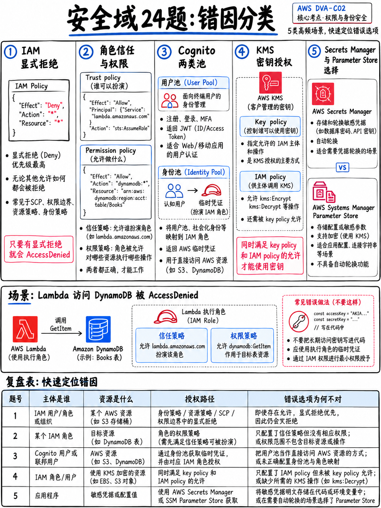

# 3.6 安全领域实战练习题：24 道高频全真模拟题及逐题详解 (Security Practice Set)

本练习集包含 24 道严格对照 DVA-C02 考试大纲“领域 2：安全性”各项任务陈述精心编写的实战模拟题 [1]。非考场真题回忆，旨在精准夯实高频考点。

:::{tip}
**建议测试时间：40 分钟。** 请先独立作答并记录选项，随后逐题对照官方解析，复盘错因与认知漏洞。
:::

## 3.6.1 模拟试题 (Questions)

**1.** 部署在 Amazon EC2 实例上的应用程序需要读取 Amazon S3 存储桶中的对象。提供访问权限的最安全方式是什么？
A. 将 IAM Access Key 访问密钥存储在实例的环境变量中。
B. 通过实例配置文件 (Instance Profile) 为 EC2 实例挂载 IAM 角色 (IAM Role)。
C. 将静态 AWS 访问凭证直接打包烘焙到自定义 AMI 镜像中。
D. 将该 S3 存储桶配置为完全公开访问 (Public)。

**2.** 某企业需要安全存储数据库凭证，并要求每隔 30 天对账密执行一次全自动轮换。应该选用哪项 AWS 服务？
A. AWS Systems Manager Parameter Store。
B. AWS Secrets Manager。
C. AWS Lambda 环境变量。
D. 开启了 SSE-KMS 服务端加密的 Amazon S3。

**3.** 开发者需要使用 AWS KMS 对一个大小为 50 MB 的大文件进行安全加密。应该采取什么技术方案？
A. 采用信封加密 (Envelope Encryption)：调用 `GenerateDataKey` 获取数据密钥，在本地完成文件加密，并将加密后的数据密钥与密文并排存储。
B. 直接将文件二进制内容作为参数传入 `kms:Encrypt` API 进行加密。
C. 将该 50 MB 文件拆分为多个 4 KB 大小的微型数据分片，对每个分片分别循环调用 `kms:Encrypt`。
D. 将生成的明文数据密钥连同密文数据一并持久化保存在数据库中。

**4.** 一个具备 `s3:GetObject` 权限的 AWS Lambda 函数在尝试读取使用客户托管 KMS 密钥 (CMK) 加密的 S3 对象时收到 `AccessDenied` 报错。缺少了什么关键配置？
A. 存储桶层面的 `s3:ListBucket` 权限。
B. 函数执行角色缺少 `kms:Decrypt` 权限，或者 KMS 密钥策略 (Key Policy) 中未显式允许该角色。
C. 针对 S3 服务的专用 VPC 终端节点 (VPC Endpoint)。
D. S3 存储桶策略中未显式放行该 Lambda 函数的角色。

**5.** 某移动端应用程序需要允许已登录用户将照片直接上传至 Amazon S3。用户使用 Cognito 用户池完成登录认证。由哪项服务或组件为移动端提供直接访问 S3 的 AWS 凭证？
A. Amazon Cognito 身份池 (Identity Pool)，将用户池返回的 Token 通过 STS 兑换为临时 AWS 安全凭据。
B. 后端自动化为每一位注册 App 的终端用户在 IAM 中创建一个独立的 IAM User。
C. 将 Cognito 用户池下发的 Access Token 直接作为调用 AWS API 的安全凭据。
D. 将管理员的 IAM 访问密钥直接硬编码写入移动客户端代码中。

**6.** API Gateway 的 `COGNITO_USER_POOLS` 原生授权方在默认情况下校验的是 Cognito 签发的哪一个令牌？
A. 刷新令牌 (Refresh token)。
B. 访问令牌 (Access token)。
C. ID 令牌 (ID token)。
D. 基于 SigV4 算法生成的数字签名。

**7.** 某公司需要在每次用户成功完成身份认证登录后，立即自动触发一段自定义代码逻辑，将登录审计事件上报给外部自建的数据分析系统。应该使用什么技术架构？
A. Amazon Cognito 注册前触发器 (Pre sign-up trigger)。
B. CloudTrail 事件规则联动 EventBridge。
C. API Gateway 自定义 Lambda 授权方。
D. Amazon Cognito 认证后触发器 (Post authentication trigger) 自动调用关联的 AWS Lambda 函数。

**8.** 关于 IAM 策略评估逻辑，下列哪项陈述是完全正确的？
A. 显式允许 (Explicit allow) 的优先级高于显式拒绝 (Explicit deny)。
B. 基于资源的策略 (Resource-based policy) 始终无条件覆盖基于身份的策略 (Identity-based policy)。
C. 权限边界 (Permission boundary) 会直接向主体授予具体操作权限。
D. 显式拒绝 (Explicit deny) 拥有一票否决权，可以覆盖任何显式允许规则。

**9.** 位于应用程序账号 (App Account) 中的应用需要读取数据账号 (Data Account) 中的 DynamoDB 数据表。DynamoDB 本身不支持基于资源的策略。应该如何配置跨账号安全访问？
A. 在数据账号中配置 S3 存储桶策略。
B. 在数据账号中创建一个长期 IAM 用户，并将其 Access Key 密钥共享给应用程序账号。
C. 在两个账号的 VPC 之间建立 VPC 对等连接 (VPC Peering)。
D. 在数据账号中创建一个 IAM 角色，并配置信赖策略允许应用程序账号的主体通过 STS `AssumeRole` 扮演该角色。

**10.** 开发者需要实现行级数据隔离：限制已登录终端用户只能读取 DynamoDB 中分区键 (Partition Key) 等于其自身用户唯一标识符的数据项。应该使用什么机制？
A. 在用户唯一标识符字段上建立全局二级索引 (GSI)。
B. 在后端应用程序代码中使用 FilterExpression 过滤返回结果。
C. 为每个注册用户在云端独立创建一张专属的 DynamoDB 表。
D. 在 IAM 策略条件块中使用 `dynamodb:LeadingKeys` 条件键，并与 Cognito 联合身份凭证绑定。

**11.** 每一个 IAM 角色 (IAM Role) 都必须由哪两组核心策略共同构成？
A. 信赖策略 (Trust policy) 与 权限策略 (Permissions policy)。
B. 存储桶策略 (Bucket policy) 与 密钥策略 (Key policy)。
C. 会话策略 (Session policy) 与 边界策略 (Boundary policy)。
D. 内联策略 (Inline policy) 与 托管策略 (Managed policy)。

**12.** 当一个合法主体通过 AWS STS 成功扮演某个 IAM 角色时，STS 会返回什么凭证？
A. 包含 Access Key ID、Secret Access Key 和 Session Token 的临时凭据，在限定时间段内有效。
B. 永久有效的长期 Access Key 与 Secret Key。
C. 一个经过数字签名的 X.509 客户端 SSL 证书。
D. 一个标准的 OpenID Connect JSON Web Token (JWT)。

**13.** 安全合规审查要求所有针对某 S3 存储桶的 API 请求必须使用 TLS/HTTPS 加密传输。应该在存储桶策略中添加什么规则？
A. 添加一条显式允许 (Allow) 语句，条件为 `aws:SecureTransport` 等于 `true`。
B. 添加一条针对 `aws:SourceIp` 的白名单限制条件。
C. 添加一条显式拒绝 (Deny) 语句，条件为 `aws:SecureTransport` 等于 `false`。
D. 在 S3 存储桶上开启阻止公网访问 (Block Public Access) 功能。

**14.** 哪种 KMS 密钥类型允许用户完全掌控密钥策略、自主开启或禁用自动轮换，并支持跨 AWS 账号共享使用？
A. AWS 拥有的密钥 (AWS owned key)。
B. AWS 托管的密钥 (AWS managed key)。
C. 客户托管密钥 (Customer managed key, CMK)。
D. 数据密钥 (Data key)。

**15.** 开发者需要为 Amazon CloudFront 自定义分发配置 SSL/TLS 证书。必须在 AWS Certificate Manager (ACM) 的哪一个区域发起证书申请？
A. `us-east-1` (弗吉尼亚北部)。
B. 物理距离终端用户最近的 AWS 区域。
C. 任意 AWS 区域均可，全球全局通用。
D. 直接在 EC2 源站服务器所在的区域申请。

**16.** 某 Lambda 函数的环境变量中包含第三方支付 API 私钥。哪种配置可以确保即使拥有 AWS 控制台查看权限的普通运维人员也无法在网页上直接窥探到该私钥的明文？
A. 仅依赖 Lambda 环境变量默认提供的静态加密能力。
B. 使用基于客户托管 KMS 密钥的控制台加解密助手 (Encryption helpers) 对数值进行客户端预加密，在函数启动时由代码显式调用 `kms:Decrypt` 解密。
C. 将敏感私钥直接以代码文本形式打包进 Lambda 的 zip 部署代码包中。
D. 将该函数的预留并发度 (Reserved concurrency) 设置为零。

**17.** 某微服务应用需要动态调整业务配置：配置要求支持运行时热更新、生效前经校验器验证、支持阶梯式灰度发布，且一旦触发 CloudWatch 告警能够自动秒级回滚。哪项服务能满足全部要求？
A. AWS Secrets Manager。
B. AWS AppConfig。
C. Lambda 环境变量。
D. Amazon S3 对象元数据。

**18.** 哪两项措施能够最有效地降低敏感数据（如 PII/Token）在云端系统日志中意外泄露的风险？（选择两项。）
A. 完整打印整个原始 event 事件对象，以便排查故障。
B. 在应用程序将日志写入标准输出之前，主动脱敏并遮盖 PII 敏感信息。
C. 直接彻底禁用该 Lambda 函数的 CloudWatch Logs 日志收集。
D. 将 CloudWatch Logs 日志组的保留期限从 30 天延长至“永不过期”。
E. 开启 CloudWatch Logs 的数据保护 (Data Protection) 功能，对日志中的敏感模式自动掩码。

**19.** 某 API Gateway REST API 必须严格限制仅允许另一个 AWS 账号中的特定 IAM 主体调用。需要完成哪两项核心配置？（选择两项。）
A. 在 API Gateway 层面创建基于资源的策略 (Resource Policy)，显式允许目标外部账号的 IAM 主体 ARN。
B. 将 API 方法的授权类型配置为 `AWS_IAM`，并要求调用方在发起 HTTP 请求时使用 SigV4 算法进行签名。
C. 创建一个包含所有外部 IAM 用户的 Cognito 用户池。
D. 将 API 改造为 Private 私有 API，并在客户端 VPC 中创建 VPC 终端节点。
E. 生成一个 API Key 并将其文本私下分发给外部账号团队。

**20.** AWS KMS 的底层加密 API `kms:Encrypt` 单次能够直接加密的最大数据量上限是多少？
A. 4 KB。
B. 64 KB。
C. 256 KB。
D. 1 MB。

**21.** 关于 AWS 托管的 KMS 密钥 (AWS managed keys)，下列哪项说法是完全正确的？
A. 用户可以根据企业合规要求任意编辑其密钥策略 (Key Policy)。
B. 支持跨 AWS 账号共享给外部租户使用。
C. 每年由 AWS 官方自动执行密钥轮换，用户无法干预或禁用该轮换。
D. 支持用户从本地自主导入外部密钥材料 (Imported key material)。

**22.** 某高并发 Lambda 函数在每次处理事件请求时都会同步调用 Secrets Manager 读取数据库凭据，导致函数执行延迟显著飙升且触发了 Secrets Manager 的 API 限流告警。最佳优化方案是什么？
A. 将 Lambda 函数的内存分配从 512 MB 提高至 3008 MB。
B. 将机密凭证改为明文直接硬编码保存在 Lambda 环境变量中。
C. 向 AWS 提工单申请大幅上调 Secrets Manager 的默认 API 调用配额。
D. 在函数中引入 AWS Parameters and Secrets Lambda Extension，在执行环境本地内存中透明缓存机密。

**23.** 下列哪项属于基于资源的策略 (Resource-based policy) 的典型示例？
A. 附加至 IAM 角色的客户托管权限策略。
B. 挂载在 IAM 用户身上的权限边界 (Permission Boundary)。
C. 附加在 Amazon S3 存储桶上、且在 Principal 字段中显式指明外部账号主体的存储桶策略。
D. 在 AWS Organizations 组织单元上配置的服务控制策略 (SCP)。

**24.** 开发者需要临时向第三方独立审计团队开放对 S3 存储桶下特定前缀目录中指定报表文件的受限只读访问，且绝对不为其在 AWS 中创建新的 IAM 用户。最合理的解决方案是什么？
A. 将 AWS 账号根用户的账号密码临时共享给审计团队。
B. 针对目标对象生成具有短暂有效期的 S3 预签名 URL (Presigned URLs)。
C. 将该前缀目录的 ACL 权限修改为 Public Read 公网所有人可读。
D. 将整个目录下载打包并通过未加密的企业电子邮件附件发送给对方。

---

## 3.6.2 答案与逐题深度解析 (Answers and reasoning)

**1 — 答案：B。**
**解析**：EC2 实例配置文件 (Instance Profile) 能够安全地向运行在实例上的操作系统和应用无感下发自动轮换的临时安全凭证。将长期 Access Key 存入环境变量 (A) 或烘焙进 AMI 镜像 (C) 会带来不可逆的凭证泄露风险；将存储桶设为公开 (D) 属于灾难级安全配置违规。

**2 — 答案：B。**
**解析**：**“自动轮换 (Automatically rotate)”是选择 AWS Secrets Manager 的标志性题眼**，这与 AWS 官方样题第 1 题的考查思路完全一致 [18]。Parameter Store 虽然能通过 `SecureString` 安全存机密，但其本身完全不支持自动轮换功能。

**3 — 答案：A。**
**解析**：`kms:Encrypt` API 的直接加密单次上限严格锁死在 **4 KB**，因此面对 50 MB 的大文件必须采用**信封加密 (Envelope Encryption)**：调用 `GenerateDataKey` 获取数据密钥，在本地完成加密，并**必须将密文数据密钥与密文数据一同持久化存储** [18]。若存储明文数据密钥 (D) 则彻底摧毁了加密的保护意义；按 4 KB 拆分循环调用 KMS (C) 在成本、延迟与系统开销上属于荒谬设计。

**4 — 答案：B。**
**解析**：拥有 `s3:GetObject` 权限只能允许客户端下载对象数据流，如果对象采用了客户托管的 KMS 密钥进行加密，客户端必须同时具备针对该密钥的 **`kms:Decrypt`** 操作权限，**并且** KMS 密钥本身的 Key Policy 也必须显式允许该 Lambda 执行角色。这是日常实战与考试中最典型的 KMS 报错场景。

**5 — 答案：A。**
**解析**：**Cognito 身份池 (Identity Pool)** 的核心职责就是将用户认证完成后的身份（如 Cognito 用户池 JWT、第三方社交 Token）通过 AWS STS 兑换为具备实际 IAM 权限的临时 AWS 访问凭据。用户池的 Token 本身不能直接用来调用 AWS 底层 API；为海量终端用户逐一创建 IAM 用户 (B) 严重受限于账号配额且违背架构最佳实践；客户端硬编码静态密钥 (D) 必须直接一票否决。

**6 — 答案：C。**
**解析**：API Gateway 的 Cognito 原生授权方默认校验的是 **ID 令牌 (ID token)**，该令牌承载了用户的身份 Claims。Refresh Token 仅用于长效续期换新 Token；Access Token 主要承载 OAuth 授权范围 Scopes；SigV4 属于 `AWS_IAM` 授权体系。

**7 — 答案：D。**
**解析**：**Cognito 认证后触发器 (Post authentication trigger)** 联动 Lambda 是 AWS 官方样题第 3 题给出的标准化标准答案 [18]。注册前触发器 (A) 在用户刚刚发起注册阶段触发；CloudTrail (B) 记录的是 AWS 控制台与 API 审计日志，而非业务应用终端用户的登录动作；API Gateway 授权方 (C) 是针对每一次 API 访问执行拦截校验，而非在登录成功时仅执行一次。

**8 — 答案：D。**
**解析**：**显式拒绝 (Explicit Deny) 拥有一票否决权**，只要评估链条中任意策略出现一条匹配的 Deny，判定立即终止为拒绝。基于资源的策略不会强行覆盖身份策略（跨账号访问需要两者同时允许）；权限边界与 SCP 只是权限天花板 (Ceilings)，本身绝不授予任何新权限。

**9 — 答案：D。**
**解析**：当目标服务（如 DynamoDB）不支持基于资源的策略时，跨账号授权的唯一标准方案是**在目标数据账号中创建 IAM 角色，由源应用账号的主体通过 STS `AssumeRole` 跨账号扮演**。S3 Bucket 策略与本题无关；共享静态密钥违反安全红线；VPC Peering 仅解决底层网络联通，不提供任何 IAM 身份授权。

**10 — 答案：D。**
**解析**：**`dynamodb:LeadingKeys`** 是 IAM 针对 DynamoDB 专门提供的细粒度行级访问控制条件键。通过将该条件键与 Cognito 联合身份中注入的用户身份 ID (`${cognito-identity.amazonaws.com:sub}`) 进行强绑定，能够从底层权限上限制已登录用户仅能读写分区键等于自身 ID 的特定数据行。建立 GSI (A) 仅改变查询索引；代码级 FilterExpression (B) 只能做服务端返回后的客户端过滤，不能阻止数据读取越权。

**11 — 答案：A。**
**解析**：每个 IAM 角色都由两组策略不可分割地组合而成：**信赖策略 (Trust Policy)**（定义谁有资格扮演该角色）以及**权限策略 (Permissions Policy)**（定义扮演成功后具备哪些操作权限）。缺少信赖策略会导致调用 `AssumeRole` 时报 403 权限不足；缺少权限策略会导致扮演成功后调用目标云资源 API 时报 403。

**12 — 答案：A。**
**解析**：AWS STS 签发的一律为**临时安全凭据**：包含 Access Key ID、Secret Access Key **以及一个 Session Token**，其有效期从 15 分钟到最长 12 小时不等。

**13 — 答案：C。**
**解析**：强制启用 TLS 的行业黄金实践是在策略中配置显式拒绝：**当 `"aws:SecureTransport": "false"` 时执行 `"Effect": "Deny"`**。如果仅写一条 Allow 语句，由于未命中时不属于显式拒绝，其它可能存在的宽泛 Allow 策略依然会导致明文 HTTP 流量被意外放行。

**14 — 答案：C。**
**解析**：只有**客户托管密钥 (Customer managed key, CMK)** 才能赋予用户对密钥策略的完全修改权、自主开关密钥轮换、跨账号共享授权以及从外部导入自有密钥材料的能力。

**15 — 答案：A。**
**解析**：由 Amazon CloudFront 全球边缘节点挂载的自定义域名 SSL/TLS 证书，**必须且只能在 `us-east-1` (弗吉尼亚北部) 区域的 ACM 中申请签发**，这是该服务的底层刚性架构约束。

**16 — 答案：B。**
**解析**：Lambda 默认的静态加密仅能在物理存储介质层面保障机密安全，但任何拥有控制台查看权限的 IAM 用户只要打开该函数配置页面，就能在浏览器中直视明文环境变量。使用控制台提供的**加解密助手 (Encryption helpers)**，配合客户托管 KMS 密钥在本地先将私钥加密为密文后再存入环境变量，并在函数代码初始化阶段显式调用 `kms:Decrypt` 进行解密，能够彻底杜绝控制台明文暴露。

**17 — 答案：B。**
**解析**：配置动态热加载、部署前通过 JSON Schema/Lambda 进行格式验证、支持渐进式灰度下发、以及在关联 **CloudWatch Alarm 告警触发时秒级自动回滚**，全部是 **AWS AppConfig** 的核心看家本领。Secrets Manager 专攻机密安全存储与自动轮换，不具备配置验证与灰度发布能力；修改环境变量则必须重新构建发布 Lambda 新版本。

**18 — 答案：B 和 E。**
**解析**：降低敏感数据日志泄露风险的标准做法：在应用代码输出日志前主动脱敏清洗 (B)，以及启用 **CloudWatch Logs 数据保护 (Data Protection)** 自动对日志流中的敏感数据特征进行动态掩码屏蔽 (E)。打印整个 event 对象恰恰是造成泄漏的罪魁祸首；直接禁用日志会彻底丧失系统的可观测性；延长日志保留周期会进一步放大合规审计风险。

**19 — 答案：A 和 B。**
**解析**：跨账号受限调用 API Gateway REST API 的标准解法（完全对应 AWS 官方样题第 4 题 [18]）：在 API Gateway 方法上启用 **`AWS_IAM` 授权并要求外部调用方使用 SigV4 算法进行请求签名 (B)**，同时在 API Gateway 挂载**基于资源的策略 (Resource Policy)** 显式放行目标外部账号的主体 ARN (A)。Cognito 无法纳管 IAM 用户；API Key 仅用于流量配额计量与计费，不提供安全认证保证。

**20 — 答案：A。**
**解析**：**4 KB**。这是 KMS `Encrypt` API 的绝对物理硬限制，也是推动云上广泛采用信封加密模式的底层技术动因。

**21 — 答案：C。**
**解析**：AWS 托管的 KMS 密钥由系统**每年强制自动执行密钥轮换**，用户无法将其关闭，也无法自定义轮换周期。用户对其密钥策略只读不可修改，无法用于跨账号共享，亦不支持导入外部密钥材料。

**22 — 答案：D。**
**解析**：在 Lambda 执行环境中部署官方提供的 **AWS Parameters and Secrets Lambda Extension**，扩展层能够透明拦截并在内存中缓存读取到的机密，大幅削减底层网络调用开销、降低函数响应延迟，并彻底化解高并发下的 API 限流风险。调大内存无法解决外部网络 I/O 与 API 配额瓶颈；放环境变量明文违背基本安全准则；申请提额属于治标不治本的错误应对。

**23 — 答案：C。**
**解析**：**基于资源的策略 (Resource-based policy)** 直接附加在具体的 AWS 资源本体上（如 S3 存储桶、SQS 队列、KMS 密钥），且策略内部**必须显式包含 `Principal` 字段**。挂载在 IAM 角色上的策略属于基于身份的策略；权限边界与 SCP 属于权限天花板。

**24 — 答案：B。**
**解析**：**S3 预签名 URL (Presigned URLs)** 允许所有者利用自身的有效权限为特定对象生成具有短暂过期时间的下载/上传凭证，无需为接收方创建任何 IAM 用户或共享长期密钥。共享根用户账号属于毁灭性安全违规；开放公开读会将企业私有资产暴露给全公网；明文邮件传输大文件缺乏访问审计且不可撤销。

## 3.6.3 诊断与备考建议 (Diagnosis)

| 得分区间 | 考力诊断与行动指南 |
|---|---|
| **21–24 题** | **领域 2 掌握极为扎实。** 安全核心概念与评估逻辑已完全吃透，可直接进入下一模块学习。 |
| **17–20 题** | **基础良好，存在个别概念死角。** 重点精读 {doc}`02-iam-policies-and-roles` 第 3.2.2 节策略评估逻辑以及 {doc}`04-kms-and-encryption` 第 3.4.2 节信封加密机制。 |
| **12–16 题** | **存在认知模糊区。** 建议通篇精读本模块全部 5 个知识章节并重新刷题。此分数段通常是因为混淆了“IAM 角色 vs 长期密钥”以及遗漏了“KMS 密钥策略必须与 IAM 策略双向授权”的底层规则。 |
| **低于 12 题** | **权限安全基础薄弱。** 请务必先前往 {doc}`../80-toolkit/01-hands-on-lab-plan` 动手完成实验 4 与实验 6 —— 在 AWS 实际环境中亲手排查并解决几次 `AccessDenied`，是掌握 IAM 与 KMS 权限体系最高效的途径。 |
