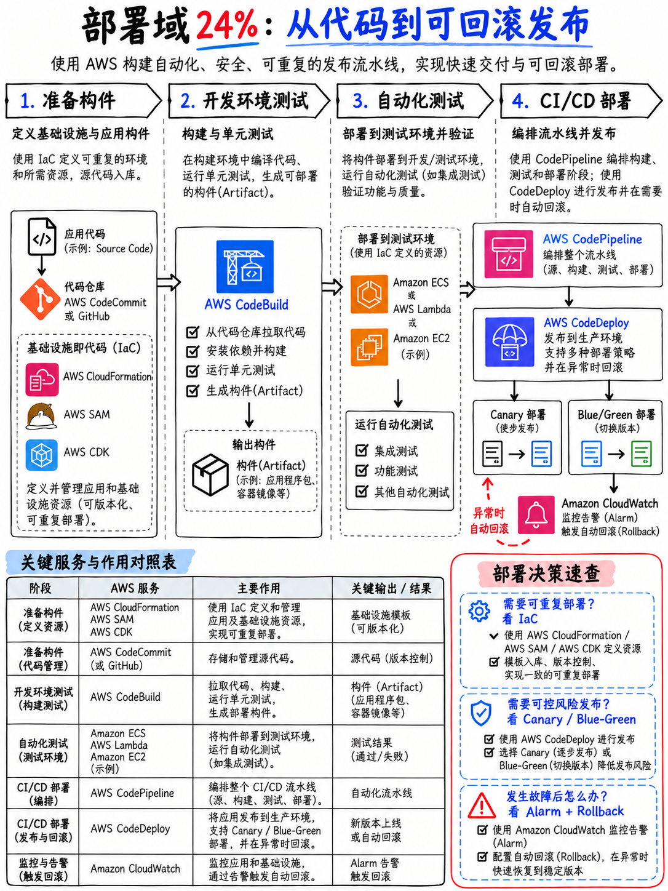

# 4.1 部署与 CI/CD 领域概览 Domain 3 — Deployment (24%)



:::{important}
本套课程体系特别将**部署与 CI/CD (deployment and CI/CD)** 设立为核心重点。
本模块与 {doc}`../50-troubleshooting/01-domain-overview` 构成了其核心支柱，
同时这两个模块的绝大部分知识点均可无缝迁移至 **DOP-C02**（DevOps 工程师专业认证，参见 {doc}`../10-other-exams/03-professional-sap-c02-dop-c02-aip-c01` §1.3.1）。
:::

## 4.1.1 本领域的考查结构 (The shape of the domain)

| 维度 | 指标与说明 |
|---|---|
| 考试占比 | 计分内容的 **24%** [1] |
| 约合计分考题数 | 50 题中约占 **~12 题** |
| 任务陈述 (Tasks) | 4 项 —— 超越其他所有领域 |

AWS 官方考试指南中的四项任务陈述 [1]：

1. **准备待部署到 AWS 的应用程序构件/产物 (Prepare application artifacts to be deployed to AWS)**
2. **在开发环境中测试应用程序 (Test applications in development environments)**
3. **自动化部署测试 (Automate deployment testing)**
4. **使用 AWS CI/CD 服务部署代码 (Deploy code by using AWS CI/CD services)**

在 DVA-C03 中，该领域更名为 **Testing and Deployment（测试与部署）**，考试占比调整为 22% [5] —— 更名只是将任务 2 和任务 3 本就考查的测试属性更加显式化。

## 4.1.2 各项任务具体考查内容 (What each task covers)

### 任务 1 — 准备应用程序构件 (Prepare application artifacts)

**核心知识点 (Knowledge of)** [1]：获取应用程序配置数据的方式（**AWS AppConfig、Secrets Manager、Parameter Store**）· **Lambda 部署打包、层 (Layers) 及配置选项** · **基于 Git 的版本控制工具（例如 Git）** · **容器镜像 (Container images)**。

**核心技能要求 (Skills in)** [1]：在部署包内管理依赖项（环境变量、配置文件、容器镜像）· 组织文件与目录结构 · 在部署环境中使用代码仓库 · 应用资源配置规格（内存、CPU 核心）。

### 任务 2 — 在开发环境中测试应用程序 (Test applications in development environments)

**核心知识点 (Knowledge of)** [1]：执行应用程序部署的 AWS 服务功能 · **使用 Mock 模拟端点进行集成测试** · **Lambda 版本 (Versions) 与别名 (Aliases)**。

**核心技能要求 (Skills in)** [1]：使用 AWS 服务与工具测试已部署的代码 · 对 API 执行 **Mock 集成测试** · 使用开发端点进行测试（**在 Amazon API Gateway 中配置阶段 Stages**）· **将应用堆栈更新部署至现有环境（例如将 AWS SAM 模板部署到不同的预发布/过渡环境）**。

### 任务 3 — 自动化部署测试 (Automate deployment testing)

**核心知识点 (Knowledge of)** [1]：**API Gateway 阶段 (Stages)** · **CI/CD 工作流中的分支与操作 (Branches and actions)** · 自动化软件测试。

**核心技能要求 (Skills in)** [1]：创建应用程序测试事件（**用于测试 Lambda、API Gateway、AWS SAM 资源的 JSON 载荷**）· 将 API 资源部署至各类环境 · **创建使用受批准版本的应用环境以进行集成测试（Lambda 别名、容器镜像标签、AWS Amplify 分支、AWS Copilot 环境）** · **编写与部署 IaC 模板（AWS SAM 模板、AWS CloudFormation 模板）** · 管理各 AWS 服务中的独立环境。

### 任务 4 — 使用 AWS CI/CD 服务部署代码 (Deploy code by using AWS CI/CD services)

**核心知识点 (Knowledge of)** [1]：Git · **AWS CodePipeline 中的手动审批与自动审批** · 从 **AppConfig 和 Secrets Manager** 读取配置 · 基于 AWS 服务的 CI/CD 工作流 · **使用 CloudFormation、AWS CDK、AWS SAM、AWS CodeArtifact、AWS Copilot、Amplify、Lambda 进行应用程序部署** · Lambda 部署打包选项 · **API Gateway 阶段与自定义域名** · **部署策略（金丝雀 Canary、蓝绿 Blue/Green、滚动 Rolling）**。

**核心技能要求 (Skills in)** [1]：更新现有 IaC 模板 · 管理环境 · 使用指定部署策略发布新版本 · **将代码提交至代码仓库以触发构建、测试和部署操作** · 使用编排工作流 · **执行应用程序回滚 (Application rollbacks)** · 使用标签与分支进行版本与发布管理 · **利用现有运行时配置实现动态部署（例如在 Lambda 函数中使用 API Gateway 的阶段变量 Stage Variables）**。

## 4.1.3 帮你大幅节省备考时间的两大考纲解读 (Two readings of the guide that save you time)

::::{danger}
**1. CodeCommit 并不在考纲之中。** 考试指南中明确表述为“基于 Git 的版本控制工具（例如 **Git**）”——两次提及——并且在任何任务、技能或考查服务清单中，从未提及 CodeCommit [1]。通过对考试指南全文检索即可印证这一点。

牢牢掌握 **Git**，并清楚“**代码提交至仓库即可触发流水线 (commit triggers the pipeline)**”这一核心联动机制。切勿把大量时间耗费在 CodeCommit 控制台的琐碎操作上。
::::

::::{important}
**2. “设计和创建 CI/CD 流水线”被官方明确排除在考试范围之外** [1] —— 但*使用*流水线正是本领域的灵魂所在。实战分界线如下：

| 考查范围内 (In scope) | 考查范围外 (Out of scope) |
|---|---|
| 阅读与编辑 `buildspec.yml` | 设计跨账号的多账号流水线拓扑架构 |
| 熟知 `appspec.yml` 的生命周期钩子及其先后执行顺序 | 设计整套企业级发布管理策略 |
| 根据具体业务需求选型金丝雀 (Canary) vs 线性 (Linear) vs 一次性全部更新 (All-at-once) | 搭建基础设施底座级部署平台架构 |
| 添加手动审批操作 (Manual approval action) | 设计组织级审批治理制度 |
| 执行部署回滚 (Rollback) | 设计全局回滚策略合规框架 |
::::

## 4.1.4 贯穿全领域的思维模型 (The mental model for the whole domain)

```
  代码源 (SOURCE)       构建 (BUILD)         测试 (TEST)         部署 (DEPLOY)
  git push      ──►   CodeBuild     ──►   CodeBuild     ──►   CodeDeploy
  (代码提交            buildspec.yml       集成测试            appspec.yml
   触发流水线)                              Mock 模拟           部署策略
                            │                                      │
                            ▼                                      ▼
                      S3 中的构件产物                      EC2 / Lambda / ECS
                      ECR 中的容器镜像
                      CodeArtifact 中的软件包
  ─────────────────────────────────────────────────────────────────────────
  端到端全局编排：  CodePipeline（阶段 Stages、操作 Actions、手动审批 Approvals）
  基础设施声明式代码： CloudFormation / SAM / CDK
  运行时配置解耦：    AppConfig / Parameter Store / Secrets Manager
```

**DVA 考试中涉及部署的每一道题，都落在这条流水线的某个具体节点上。** 准确定位问题发生的*环节*，通常就能直接锁定正确答案。

## 4.1.5 本模块知识点组织架构 (How the domain is covered here)

| 章节 | 核心覆盖内容 |
|---|---|
| {doc}`02-cloudformation-sam-cdk` | IaC 基础设施即代码：模板结构、内部函数、更改集 (Change Sets)、SAM、CDK |
| {doc}`03-cicd-pipeline-services` | CodeBuild、CodeDeploy、CodePipeline、CodeArtifact、CodeGuru —— **绝对核心** |
| {doc}`04-deployment-strategies` | 金丝雀发布 (Canary)、线性平移 (Linear)、蓝绿部署 (Blue/Green)、滚动更新 (Rolling)、不可变部署 (Immutable) 与回滚机制 |
| {doc}`05-containers-ecs-ecr-eks` | ECR、ECS、任务定义 (Task Definitions)、Fargate、Copilot |
| {doc}`06-elastic-beanstalk-and-amplify` | Elastic Beanstalk 部署策略、`.ebextensions`、Amplify 分支管理 |
| {doc}`07-deployment-practice-set` | 26 道高频实战演练模拟题及深度解析 |

## 4.1.6 考前快速回顾 (Fast revision)

- 包含 4 项任务陈述，为所有领域之最，也是考试中考查形式最具体、最落地的一个领域。
- **认准通用的 Git，而不是绑定 CodeCommit。**
- “使用流水线”在考纲之内，“设计全新流水线”在考纲之外。
- 代码源 (Source) → 构建 (Build) → 测试 (Test) → 部署 (Deploy)，由 **CodePipeline** 全局编排，由 **CloudFormation / SAM / CDK** 声明式描述，由 **AppConfig / Parameter Store / Secrets Manager** 提供运行时解耦配置。
- **Lambda 版本与别名 (Versions & Aliases)**、**API Gateway 阶段与阶段变量 (Stages & Stage Variables)** 以及**容器镜像标签 (Container image tags)**，是官方考试指南中明确列出的三大环境隔离与流转机制 [1]。
