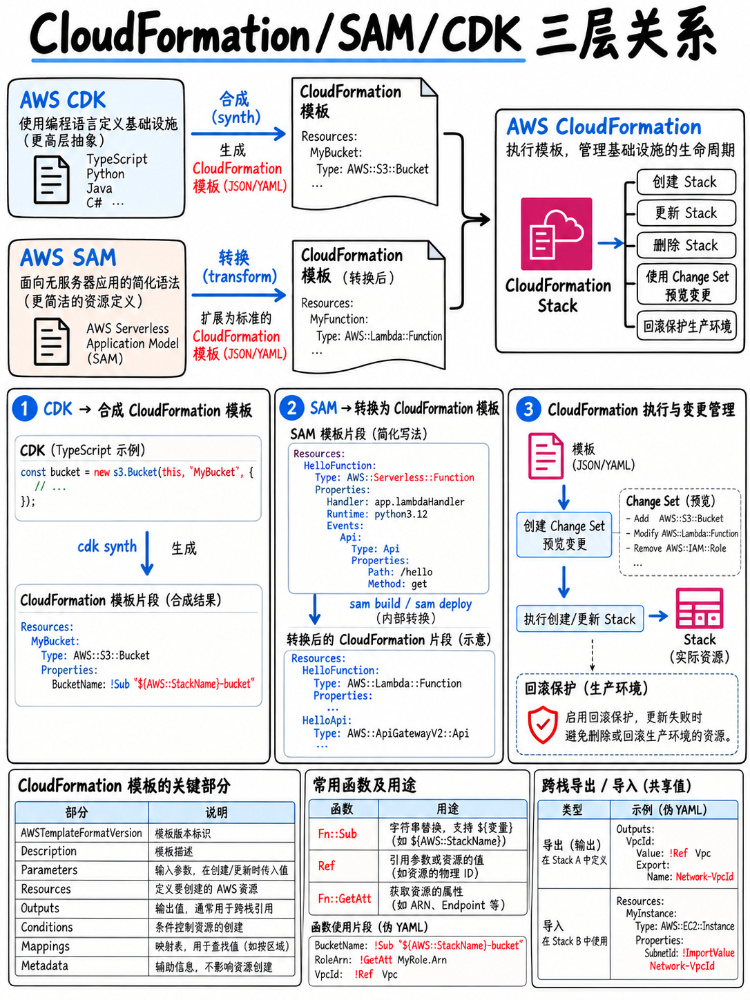

# 4.2 基础架构即代码：CloudFormation、SAM 与 CDK (CloudFormation, SAM, and the CDK)



“编写并部署基础架构即代码 (IaC) 模板（例如 AWS SAM 模板、AWS CloudFormation 模板）”以及“更新现有的 IaC 模板”是官方考试大纲中明确列出的核心技能要求 [1]。

## 4.2.1 三大核心工具关系对比 (The three tools)

```
        开发者编写的代码                      AWS 实际部署的内容
 CDK   ───  TypeScript/Python/Java/C#/Go ──┐
 SAM   ───  极度简化的 YAML 模板 ──────────┼──►  CLOUDFORMATION 模板  ──► 堆栈 (Stack)
 CFN   ───  原生的 JSON 或 YAML 模板 ──────┘
```

**AWS SAM 与 AWS CDK 最终都会编译/合成为原生的 CloudFormation 模板。** 理解这一底层事实可以直接破解多道考题：SAM 模板*本质上*就是一个带有特定 Transform 宏转换器的 CloudFormation 模板；而 `cdk synth` 命令也是为了输出 CloudFormation 模板。

## 4.2.2 CloudFormation 模板解剖结构 (CloudFormation template anatomy)

```yaml
AWSTemplateFormatVersion: '2010-09-09'
Transform: AWS::Serverless-2016-10-31      # 仅在 SAM 模板中必须声明

Parameters:                                 # 部署时传入的动态输入参数
  Stage:
    Type: String
    AllowedValues: [dev, prod]

Mappings:                                   # 静态键值查找表
  RegionMap:
    eu-west-1: { ami: ami-0abc }

Conditions:                                 # 与 !If 配合使用的布尔条件
  IsProd: !Equals [!Ref Stage, prod]

Resources:                                  # 模板中唯一必须包含的段落 (MANDATORY)
  MyBucket:
    Type: AWS::S3::Bucket
    DeletionPolicy: Retain
    Properties:
      BucketName: !Sub '${AWS::StackName}-data-${AWS::AccountId}'

Outputs:                                    # 暴露给控制台展示或供其他堆栈引用的输出值
  BucketName:
    Value: !Ref MyBucket
    Export:
      Name: !Sub '${AWS::StackName}-bucket'
```

**`Resources`（资源段）是 CloudFormation 模板中唯一必须的必填段落。** 这一考点在考试中曾以各种题型反复出现。

## 4.2.3 核心内部函数速查 (Intrinsic functions — know these by sight)

| 函数名 | 简写形式 | 作用与行为 |
|---|---|---|
| `Ref` | `!Ref Thing` | 返回资源的**物理 ID**（如果是参数 Parameter，则返回传入的具体值） |
| `Fn::GetAtt` | `!GetAtt Thing.Arn` | 返回资源的特定**属性 (Attribute)** |
| `Fn::Sub` | `!Sub 'x-${Thing}'` | 字符串变量替换，支持替换参数及伪参数 (Pseudo parameters) |
| `Fn::Join` | `!Join ['-', [a, b]]` | 使用指定分隔符拼接列表元素 |
| `Fn::Select` | `!Select [0, !GetAZs '']` | 根据索引从列表中提取某个元素 |
| `Fn::ImportValue` | `!ImportValue other-stack-bucket` | 导入**其他堆栈中声明导出的输出值 (Exported Output)** |
| `Fn::If` / `Fn::Equals` | `!If [IsProd, a, b]` | 条件求值判断 |
| `Fn::FindInMap` | `!FindInMap [RegionMap, !Ref 'AWS::Region', ami]` | 在 `Mappings` 映射表中查找对应键值 |
| `Fn::Base64` | `!Base64 ...` | Base64 编码，最常用于 EC2 的用户数据 (User Data) 脚本传递 |

CloudFormation 提供了始终可用的**伪参数 (Pseudo parameters)**：`AWS::Region`、`AWS::AccountId`、`AWS::StackName`、`AWS::StackId`、`AWS::Partition`、`AWS::NoValue`。

:::{tip}
**`!Ref` vs `!GetAtt` 是高频考题。** 对 S3 存储桶调用 `!Ref` 返回的是**存储桶名称**；调用 `!GetAtt MyBucket.Arn` 才会返回其 ARN。对 EC2 实例调用 `!Ref` 返回实例 ID；调用 `!GetAtt` 则可以获取其 `PublicIp`、`PrivateDnsName` 等属性。当选项中需要引用某个资源的 **ARN** 时，正确答案几乎一律使用 `!GetAtt`。
:::

## 4.2.4 跨堆栈引用与架构复用 (Cross-stack references)

```
 堆栈 A (Stack A)   Outputs: → Export: Name: shared-vpc-id
 堆栈 B (Stack B)   !ImportValue shared-vpc-id
```

- **只要有其他堆栈正在导入该导出值，被引用的源堆栈就无法删除或修改该导出项**。如果考题问“为什么该堆栈无法更新或删除？”，这往往就是标准答案。
- **嵌套堆栈 (Nested stacks)**（`AWS::CloudFormation::Stack`）是另一种资源模块化与复用机制，特别适合用于共享相同生命周期的多组资源。
- **堆栈集 (StackSets)** 允许使用单个模板跨多个 AWS 账号和多个 AWS 区域 (Regions) 自动化部署和管理堆栈。

## 4.2.5 更改集、策略与更新行为 (Change sets, policies, and update behaviour)

**更改集 (Change sets)** 允许在执行堆栈更新之前预览所有拟议变更的详细影响 —— 尤其是能够明确判断某项资源是否会被**替换 (Replaced)**。若题目问“团队如何在正式应用变更前评估其对现有基础设施的影响”，正确答案就是使用更改集。

| 资源更新行为 (Update behaviour) | 含义与业务影响 |
|---|---|
| **无中断更新 (No interruption)** | 就地更新属性，服务不受任何影响 |
| **存在短暂中断 (Some interruption)** | 资源短暂不可用（例如 EC2 实例重启生效） |
| **替换 (Replacement)** | **在底层创建全新的物理资源，并删除旧资源。** 存在极高的数据丢失风险 |

| 策略控制机制 | 核心作用与行为 |
|---|---|
| **`DeletionPolicy: Retain \| Snapshot \| Delete`** | 当资源从堆栈定义中移除或整个堆栈被删除时，决定该资源的命运（保留、创建快照或直接删除） |
| **`UpdateReplacePolicy`** | 当堆栈更新导致该资源必须被**物理替换 (Replacement)** 时，决定旧资源的处置策略 |
| **堆栈策略 (Stack policy)** | JSON 策略文档，用于在堆栈更新期间严格保护指定敏感资源免受意外修改或删除 |
| **终止保护 (Termination protection)** | 防止堆栈被意外触发删除操作 |

:::{warning}
**在有状态资源（如数据库 RDS、S3 存储桶、DynamoDB 表）上声明 `DeletionPolicy: Retain` 是考试中防止数据丢失的首选题。** 
此外，很多考生容易遗漏 `UpdateReplacePolicy`：如果没有配置它，一旦模板更新触发了数据库的**物理替换**，即便设置了 `DeletionPolicy: Retain`，旧数据库实例依然会被直接销毁！
:::

**回滚机制 (Rollback)**：堆栈首次创建失败时，默认会自动回滚并删除所有已创建资源（状态变为 `ROLLBACK_COMPLETE` —— 处于该状态的堆栈无法直接修复，必须先手动删除再重新创建）。堆栈更新失败时，系统会自动回滚至上一稳定版本配置；如果连回滚过程本身也发生错误，状态将停滞在 `UPDATE_ROLLBACK_FAILED`，此时必须**手动继续回滚 (Continue update rollback)**，并可选择跳过出错的个别资源。

**漂移检测 (Drift detection)**：用于识别和报告在 CloudFormation 模板管理范围之外通过控制台或 CLI 手动修改的资源差异。

**EC2 辅助脚本 (Helper scripts)**：
- `cfn-init`：读取并应用模板中 `AWS::CloudFormation::Init` 的元数据（安装软件包、写入配置文件、启动系统服务）。
- `cfn-signal`：向 CloudFormation 发送实例准备就绪的成功/失败信号，通常与 `CreationPolicy` 搭配使用以阻塞堆栈直到实例初始化完成。
- `cfn-hup`：常驻守护进程，监听元数据变更并自动应用更新。

**自定义资源 (Custom resources)**：通过关联 Lambda 函数或 SNS 主题，在堆栈创建、更新或删除时运行任意自定义代码逻辑 —— 这是考题中解决“CloudFormation 原生不支持某特定资源或第三方 API 操作”的标准答案。

## 4.2.6 AWS SAM 无服务器应用模型 (AWS SAM)

SAM 是一个将精简宏语法转换为标准 CloudFormation 的转换器宏（Transform），并附带强大的 CLI 工具。

```yaml
Transform: AWS::Serverless-2016-10-31

Globals:                          # 为模板中所有函数统一声明默认配置
  Function:
    Runtime: python3.12
    Timeout: 10
    MemorySize: 512
    Tracing: Active               # 全局开启 AWS X-Ray 跟踪

Resources:
  OrdersFunction:
    Type: AWS::Serverless::Function
    Properties:
      Handler: app.handler
      CodeUri: src/
      AutoPublishAlias: live                       # 自动发布新版本并绑定别名
      DeploymentPreference:
        Type: Canary10Percent5Minutes              # 基于 CodeDeploy 的流量平移策略
        Alarms:
          - !Ref ErrorAlarm                        # 触发此 CloudWatch 告警时自动回滚
        Hooks:
          PreTraffic: !Ref PreTrafficTestFunction  # 流量平移前的健全性测试钩子函数
          PostTraffic: !Ref PostTrafficTestFunction # 流量平移完成后的验证测试钩子函数
      Environment:
        Variables:
          TABLE_NAME: !Ref OrdersTable
      Events:
        Api:
          Type: Api
          Properties: { Path: /orders, Method: post }
      Policies:
        - DynamoDBCrudPolicy: { TableName: !Ref OrdersTable }

  OrdersTable:
    Type: AWS::Serverless::SimpleTable
```

**SAM 核心专属资源类型**：`AWS::Serverless::Function`、`::Api`、`::HttpApi`、`::SimpleTable`、`::StateMachine`、`::Application`、`::LayerVersion`。

**`AutoPublishAlias` 配合 `DeploymentPreference` 是 SAM 在考试中考查频率最高的功能** —— 它底层依托 **AWS CodeDeploy** 与 Lambda 的**加权别名 (Weighted Aliases)**，能够以声明式的方式为 Lambda 函数实现金丝雀（Canary）或线性（Linear）流量平移并支持自动回滚。详见 {doc}`04-deployment-strategies`。

**常用 SAM CLI 命令行工具：**

```bash
sam init                     # 脚手架初始化新项目
sam validate                 # 验证 SAM 模板语法是否合法
sam build                    # 将代码与依赖项打包构建至 .aws-sam/ 目录
sam local invoke Fn -e e.json        # 在本地 Docker 容器中直接执行指定函数
sam local start-api                   # 在本地启动模拟 API Gateway HTTP 端点
sam local start-lambda                # 在本地模拟 Lambda 端点以供外部 SDK 测试调用
sam local generate-event s3 put       # 快速生成各 AWS 服务的真实测试事件 Payload
sam deploy --guided                   # 交互式打包并借助 CloudFormation 部署到 AWS
sam sync --watch                      # 监听本地代码变更并快速热同步至开发环境
sam logs -n Fn --stack-name s --tail  # 实时拉取并追踪指定函数的 CloudWatch 日志
sam delete                            # 清理删除该堆栈及其所有资源
```

**`sam deploy` 本质上封装了 `aws cloudformation package` 与 `deploy` 两个命令** —— 它负责将本地构建产物自动上传至 S3 存储桶，并将模板中的 `CodeUri` 路径自动重写为 S3 对象地址。**`sam package`** 是用于单纯生成打包后模板的显式指令。

## 4.2.7 AWS CDK 云开发工具包 (AWS CDK)

CDK 允许开发者使用真正的面向对象编程语言编写 IaC，并在构建时将其合成（Synthesize）为标准的 CloudFormation 模板。

| 构件层级 (Construct levels) | 含义与特性 |
|---|---|
| **L1 构件 (`Cfn*`)** | 与底层 CloudFormation 资源的 1:1 严格直接映射，无任何抽象或默认值 |
| **L2 构件** | 官方封装的高级抽象，带有安全最佳实践的默认配置及辅助工具方法（如 `bucket.grantRead(fn)`） |
| **L3 构件 (Patterns 架构模式)** | 跨多服务的端到端业务架构模板（例如 `ApplicationLoadBalancedFargateService`） |

```bash
cdk bootstrap        # 每个账号/每个区域首次使用时仅需执行一次：自动部署 CDKToolkit 底座堆栈
cdk synth            # 将代码合成为 CloudFormation 模板并输出到终端或 cdk.out 目录
cdk diff             # 将本地合成模板与当前线上已部署的堆栈进行详细差异对比
cdk deploy           # 将 CDK 应用打包部署至 AWS 目标环境
cdk destroy          # 销毁清除已部署的 CDK 堆栈资源
```

**`cdk bootstrap` 在每个目标账号和区域中首次部署前必须执行一次** —— 考试中如果出现“首次部署 CDK 报错提示缺少 S3 资产存储桶”的问题，答案通常就是需要先执行 `cdk bootstrap`。

:::{tip}
**三大工具选型黄金法则：**
- **CloudFormation**：需要原始细粒度资源掌控，或团队运维人员不具备编程语言基础时使用。
- **AWS SAM**：**无服务器（Serverless）架构的首选**（代码精炼、内置本地 Docker 模拟调试运行、原生支持渐进式流量平移）。
- **AWS CDK**：希望使用真实编程语言的循环、条件分支、面向对象抽象、继承以及对基础设施代码编写**单元测试 (Unit Tests)** 时的首选。
三者最终都编译为 CloudFormation 堆栈，因此完全兼容互通 —— CDK 项目中可以直接嵌入 SAM 风格的无服务器组件以及原生的 L1 Cfn 资源。
:::

## 4.2.8 考前快速回顾 (Fast revision)

- SAM 与 CDK 最终都**输出编译为 CloudFormation 模板**。`Resources`（资源段）是模板中唯一必须的必填段落。
- **`!Ref` 返回资源的物理 ID；`!GetAtt` 返回指定属性（引用 ARN 时必用 `!GetAtt`）。**
- `!ImportValue` 用于导入其他堆栈显式导出的 Output，且被引用的导出项在外部依赖解除前严禁修改或删除。
- **更改集 (Change Sets)** 提前预览变更及物理替换影响。**`DeletionPolicy`** 与 **`UpdateReplacePolicy`** 是保护持久化数据的关键护栏。`ROLLBACK_COMPLETE` 状态必须删除后重建。
- `cfn-init` 负责实例内配置落地，`cfn-signal` 负责向堆栈回报就绪信号，**自定义资源 (Custom resources)** 负责扩展 CloudFormation 原生未支持的操作。
- SAM 核心杀手锏：**`AutoPublishAlias` + `DeploymentPreference` (+ `Alarms`, `Hooks`)** = 声明式实现 Lambda 的金丝雀/线性平移发布与故障自动回滚。
- 本地调试：`sam local invoke` / `start-api` / `generate-event`；一键部署：`sam deploy --guided`；快速迭代：`sam sync --watch`。
- **`cdk bootstrap` 每个账号/区域首次执行一次**；Construct 构件分为 L1/L2/L3 三级；`cdk synth` 输出合成后的 CloudFormation 模板。
