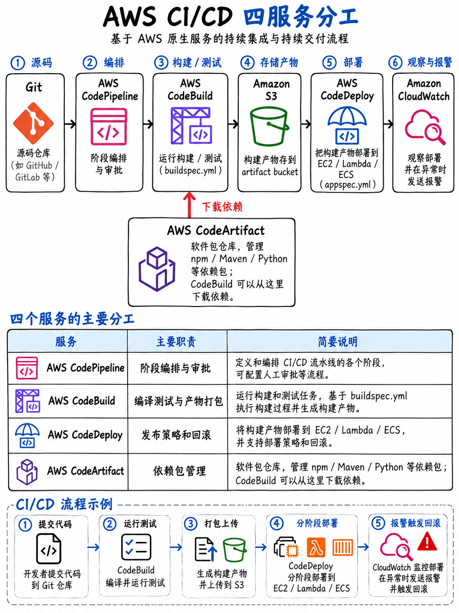

# 4.3 CI/CD 流水线服务：CodeBuild、CodeDeploy、CodePipeline 与 CodeArtifact (CI/CD Pipeline Services)



**本模块是领域 3（Deployment）的绝对核心。** 官方考试大纲将 CodeBuild、CodeDeploy、CodePipeline、CodeArtifact 以及 CodeGuru 全部列入考试范围，任务 4 更是明确命名为“使用 AWS CI/CD 服务部署代码” [1]。

:::{danger}
**AWS CodeCommit 并未出现在 DVA-C02 考试指南的任何地方** —— 无论是任务陈述、技能清单，还是服务考察列表 [1]。考纲官方原文明确写作“基于 Git 的版本控制工具（例如 **Git**）”。在实际生产中无论使用 GitHub、GitLab、Bitbucket 还是 CodeCommit，在备考角度上，只需牢记**代码仓库的提交 (Commit) 会自动触发流水线**即可，不必死磕 CodeCommit 控制台的琐碎细节。
:::

## 4.3.1 端到端 CI/CD 流水线架构全景 (The pipeline, end to end)

```
 ┌─────────┐   ┌──────────────┐   ┌──────────────┐   ┌───────────────┐
 │ 代码源  │──►│   构建阶段   │──►│   测试阶段   │──►│   部署阶段    │
 │ (SOURCE)│   │  (BUILD)     │   │   (TEST)     │   │   (DEPLOY)    │
 │ git     │   │ CodeBuild    │   │ CodeBuild    │   │ CodeDeploy    │
 │ push    │   │ buildspec.yml│   │ (集成/Mock)  │   │ appspec.yml   │
 └─────────┘   └──────┬───────┘   └──────────────┘   └───────┬───────┘
                      │ 构件产物 (artifacts)                 │
                      ▼                                      ▼
                 S3 产物存储桶                       EC2 / Lambda / ECS
                 ECR 容器镜像
                 CodeArtifact 私有软件包
 ─────────────────────────────────────────────────────────────────────────
      由 CODEPIPELINE 全局自动化编排：阶段 (Stages) → 操作 (Actions) → 转换 (Transitions)
```

**流水线中的每一个阶段都会通过 S3 构件存储桶 (Artifact bucket) 将产物传递给下一个阶段**，该存储桶由 CodePipeline 自动托管管理，且所有传递的构件产物均默认采用 AWS KMS 强加密保护。

## 4.3.2 AWS CodeBuild 构建服务深度剖析

完全托管的构建服务。无需预置和管理任何构建服务器，按实际构建运行分钟数精准计费。

### `buildspec.yml` 规范文件 —— 必考核心

```yaml
version: 0.2

env:
  variables:
    NODE_ENV: production
  parameter-store:
    API_HOST: /myapp/prod/api-host        # 从 SSM Parameter Store 中动态拉取
  secrets-manager:
    DB_PASSWORD: prod/db:password         # 从 Secrets Manager 中安全获取密码
  exported-variables:
    - IMAGE_TAG                            # 暴露为环境变量供流水线后续 Action 读取

phases:
  install:
    runtime-versions:
      nodejs: 20
    commands:
      - npm ci
  pre_build:
    commands:
      - echo Logging in to Amazon ECR...
      - aws ecr get-login-password | docker login --username AWS --password-stdin $REPO
      - IMAGE_TAG=$(echo $CODEBUILD_RESOLVED_SOURCE_VERSION | cut -c1-7)
  build:
    commands:
      - npm test
      - docker build -t $REPO:$IMAGE_TAG .
  post_build:
    commands:
      - docker push $REPO:$IMAGE_TAG

reports:
  unit-tests:
    files: ['junit.xml']
    file-format: JUNITXML

artifacts:
  files:
    - appspec.yml
    - taskdef.json
  discard-paths: no

cache:
  paths:
    - 'node_modules/**/*'
```

**四大构建生命周期阶段及其先后顺序：`install` → `pre_build` → `build` → `post_build`。**
阶段顺序是高频考点，并且需要特别牢记：**即使 `build` 阶段执行失败，`post_build` 阶段依然会照常执行**（这一特性常用于清理临时资源或强制上报测试报告）。

| 核心考点维度 | 细节说明与实战规则 |
|---|---|
| **文件名称与存放位置** | 默认在源码**根目录下命名为 `buildspec.yml`**，也可以在构建配置中自定义指定文件路径 |
| **执行权限机制** | 依托 **CodeBuild 服务角色 (Service Role)** 授权 —— 绝严禁硬编码 AK/SK 长期凭证 |
| **机密数据读取** | 通过 `env/parameter-store` 与 `env/secrets-manager` 声明式注入，**严禁硬编码在脚本中** |
| **构建依赖缓存 (Cache)** | 支持 S3 缓存或本地 Docker 缓存；考题中“每次构建重复拉取依赖导致极慢”的标准解法就是配置 `cache/paths` |
| **VPC 专有网络连通性** | CodeBuild 可以直接挂载运行在**私有 VPC 内部**，以访问私有数据库或内部内网服务 |
| **本地模拟测试** | 可使用 **CodeBuild 本地代理 (Local Agent)** 在开发者本地 Docker 环境中完整运行构建 |
| **报告生成 (Reports)** | 支持与 JUnit/Cucumber 等测试框架集成生成单元测试和代码覆盖率报告组 |
| **常用内置环境变量** | `CODEBUILD_RESOLVED_SOURCE_VERSION`（提交 Git Commit ID）、`CODEBUILD_BUILD_ID`、`CODEBUILD_SRC_DIR` |

## 4.3.3 AWS CodeDeploy 部署服务

CodeDeploy 支持将应用程序版本自动化发布到三大目标计算平台：**EC2 / 本地物理机 (On-premises)**、**Lambda** 以及 **ECS**。部署过程的具体执行行为通过 **`appspec.yml`**（用于 EC2/本地环境）或 `appspec.yaml`/JSON（用于 Lambda 与 ECS）进行定义。

### EC2 / 本地物理机的 `appspec.yml` 及其钩子顺序

```yaml
version: 0.0
os: linux
files:
  - source: /
    destination: /var/www/html
hooks:
  ApplicationStop:
    - location: scripts/stop_server.sh
      timeout: 300
      runas: root
  BeforeInstall:
    - location: scripts/install_dependencies.sh
  AfterInstall:
    - location: scripts/change_permissions.sh
  ApplicationStart:
    - location: scripts/start_server.sh
  ValidateService:
    - location: scripts/verify.sh
```

::::{important}
**EC2 部署生命周期钩子的执行顺序是 DVA 认证的经典必考题，务必死记硬背该序列：**

```
 ApplicationStop  →  DownloadBundle  →  BeforeInstall  →  Install
       →  AfterInstall  →  ApplicationStart  →  ValidateService
```

（其中 `DownloadBundle` 与 `Install` 为 CodeDeploy Agent 代理程序内部保留钩子 —— 开发者不可在此编写自定义脚本）。

**核心排错陷阱**：**`ApplicationStop` 运行的是【上一次成功部署的旧版本】中的脚本**，而不是当前新包里的脚本。因此，如果上一个版本的 `ApplicationStop` 脚本存在 Bug 执行失败，后续的所有新版本部署都将被永久阻塞 —— 这是故障排查场景中的高频考点。

对于 **EC2 蓝绿部署 (Blue/Green)**，生命周期还会额外扩展：在旧实例集群上执行 `BeforeBlockTraffic` → `BlockTraffic` → `AfterBlockTraffic`；在新实例集群上执行 `BeforeAllowTraffic` → `AllowTraffic` → `AfterAllowTraffic`。
::::

### Lambda 与 ECS 的 `appspec` 规范

```yaml
version: 0.0
Resources:
  - MyFunction:
    Type: AWS::Lambda::Function
    Properties:
      Name: MyFunction
      Alias: live
      CurrentVersion: 3
      TargetVersion: 4
Hooks:
  - BeforeAllowTraffic: LambdaValidationBeforeFunction
  - AfterAllowTraffic: LambdaValidationAfterFunction
```

**Lambda 与 ECS 在 CodeDeploy 中仅支持两个验证钩子：`BeforeAllowTraffic` 与 `AfterAllowTraffic`。**
这两个钩子分别触发运行独立的验证 Lambda 函数，验证函数必须在执行完毕后向 CodeDeploy 显式汇报成功（`status: Succeeded`）或失败（`status: Failed`）信号 —— 一旦验证失败，CodeDeploy 会立即触发全自动回滚。

### 部署配置类型 (Deployment configurations)

| 目标计算平台 | 原生内置部署配置 |
|---|---|
| **Lambda** | `AllAtOnce` · `Canary10Percent5Minutes` · `Canary10Percent10Minutes` · `Canary10Percent15Minutes` · `Canary10Percent30Minutes` · `Linear10PercentEvery1Minute` · `Linear10PercentEvery2Minutes` · `Linear10PercentEvery3Minutes` · `Linear10PercentEvery10Minutes` |
| **ECS** | 包含上述完全相同的 Canary 与 Linear 选项，外加 `AllAtOnce` |
| **EC2 / 本地机房** | `AllAtOnce` · `HalfAtATime` · `OneAtATime` · 自定义健康节点阈值（配置保持最小健康主机百分比或数量） |

**准确理解配置命名的含义是解题核心**：
- `Canary10Percent5Minutes`：先平移 **10%** 的流量到新版本，等待观察 **5 分钟**；如果期间无异常告警，则将其余 90% 流量在下一步一次性全部切换完成。
- `Linear10PercentEvery2Minutes`：**每隔 2 分钟**线性递增平移 **10%** 的流量，分 10 步均匀平移，直至 100% 切换完毕。

**全自动回滚机制 (Automatic Rollback)**：可配置当部署发生错误、或关联的 **CloudWatch 告警 (Alarms)** 触发时自动终止并回滚至上一稳定版本。题干凡是要求“新版本一旦导致错误率飙升必须自动回滚”时，首选 CodeDeploy 的 CloudWatch Alarm 触发机制。

## 4.3.4 AWS CodePipeline 全局流水线编排

全局编排引擎：由多个有序的**阶段 (Stages)** 组成，每个阶段内部包含一个或多个具体的**操作 (Actions)**。

| 操作类别 (Action type) | 常见提供商与目标示例 |
|---|---|
| **Source (源码源)** | S3 存储桶、ECR 镜像仓库、GitHub / GitLab / Bitbucket（通过 AWS CodeStar Connections 接入） |
| **Build (构建)** | AWS CodeBuild、自建 Jenkins |
| **Test (测试)** | AWS CodeBuild、第三方测试框架 |
| **Deploy (部署)** | AWS CodeDeploy、CloudFormation 堆栈、ECS、Elastic Beanstalk、S3 静态托管、Service Catalog |
| **Approval (审批)** | **手动审批 (Manual approval)** —— 挂起流水线，并通过 SNS 发送邮件/短信通知责任人 |
| **Invoke (触发调用)** | AWS Lambda 函数、AWS Step Functions 状态机 |

- 同一个 Stage 内的 Actions 默认**并行并发执行 (in parallel)**；如果需要明确前后依赖顺序，需指定 `runOrder` 字段控制。
- **手动审批操作 (Manual approval)** 是大纲考点之一 [1]：“AWS CodePipeline 中的手动与自动审批”。它会暂停流水线执行，直到拥有 `codepipeline:PutApprovalResult` 权限的审核人批准，且原生支持集成 **Amazon SNS 主题**发布审核通知。
- 可随时禁用阶段之间的**转换开关 (Transitions)**，以阻止代码变更流入后续生产环境。
- 流水线可通过**代码源变更**（基于 EventBridge 规则或 Webhook）、定时调度任务或手动触发启动。
- 阶段执行失败会立即终止流水线；通过阶段级回滚可恢复到上一次成功运行的上下文。

:::{tip}
**“在发布到生产环境之前需要人工介入审核签字”** 的考题，标准答案必定是 **CodePipeline 的 Manual Approval 操作配合 SNS 通知** —— 绝对不要选择维护两条独立流水线或依赖定时 Cron 脚本的方案。
:::

## 4.3.5 AWS CodeArtifact 托管软件包仓库

完全托管的**私有包存储与分发仓库**，支持 npm、pip、Maven、NuGet、Swift 及通用二进制包。大纲明确将其列入考查服务清单及任务 4 中 [1]。

- **域 (Domains)** 包含多个 **代码仓库 (Repositories)**；仓库之间可以配置**上游仓库 (Upstream repositories)**，甚至可以直接将公共开源镜像源（如 npmjs.org、PyPI）配置为外部上游。开发团队仅需从内部 CodeArtifact 仓库拉取，软件包被首次拉取后会自动在内部持久化缓存。
- 身份认证：通过 `aws codeartifact get-authorization-token` 获取**短期临时授权令牌**，通常由官方封装的 `aws codeartifact login` 工具直接配置本地环境。
- 考试解题关键字：“必须严格管控开发人员允许引入的第三方开源依赖包”、“搭建企业内网专用的私有 SDK 共享制品库”、“确保即便公网 npm 宕机内部 CI/CD 构建依然正常可用”。

```bash
aws codeartifact login --tool npm --domain mydomain --repository myrepo
```

## 4.3.6 Amazon CodeGuru 智能代码审查与性能调优

考纲涵盖由机器学习赋能的两个独立能力项 [1]：

- **CodeGuru Reviewer**：**代码审查**工具。自动监听 Git 代码仓库的 Pull Request，深度静态扫描代码中的逻辑缺陷、潜在并发 Bug、安全漏洞以及 AWS API 调用的反模式。考点对应：“在合并代码前全自动发现代码缺陷”。
- **CodeGuru Profiler**：**运行时性能剖析**工具。在生产环境中常驻收集 CPU 和内存执行调用栈，生成火焰图，精准定位耗时最长的热点方法并给出优化代码建议。考点对应：“找出生产环境中哪个函数方法消耗了最多的 CPU 时间” —— 这一能力完全契合官方大纲中“剖析应用程序性能 (Profiling application performance)”技能项 [1]。

## 4.3.7 生产级无服务器 CI/CD 流水线完整串联

必须能够完整在脑海中闭环跑通的生产级流水线流程：

```
 1. 开发者将代码 git push 提交到 Git 仓库的 main 主分支。
 2. CodePipeline 的 SOURCE 操作监听到 Commit 提交事件，打包源码并输出为 S3 Artifact。
 3. BUILD 操作触发 CodeBuild 并运行 buildspec.yml：
    安装依赖项，执行单元测试，运行 `sam build`，
    并通过 `sam package` 将编译代码上传至 S3，生成打包后的 CloudFormation 模板 Artifact。
 4. TEST 操作在预发布 Staging 环境中执行集成测试与 Mock 验证。
 5. APPROVAL 操作暂停流水线，向主管发布 SNS 审批通知并等待人工审核点击确认。
 6. DEPLOY 操作通过 CloudFormation 执行变更并部署至生产堆栈：
    借助 SAM 模板中的 DeploymentPreference 自动委托 CodeDeploy 执行：
    采用 Canary10Percent5Minutes 金丝雀渐进式平移，挂载 CloudWatch 错误率告警自动回滚，
    并通过 PreTraffic 和 PostTraffic 两个验证钩子函数实现全自动质量守门。
```

## 4.3.8 考前快速回顾 (Fast revision)

- **`buildspec.yml` 阶段顺序**：`install` → `pre_build` → `build` → `post_build`；包含 `artifacts`、`cache`、`reports`；环境变量通过 **`parameter-store`** 与 **`secrets-manager`** 动态读取；鉴权依托 **CodeBuild 服务角色**。
- **`appspec.yml` EC2 钩子顺序**：`ApplicationStop` → `BeforeInstall` → `AfterInstall` → `ApplicationStart` → `ValidateService`。**`ApplicationStop` 运行的是上一版本的脚本！**
- **Lambda 与 ECS 仅支持两个钩子：`BeforeAllowTraffic` 和 `AfterAllowTraffic`。**
- 流量转移配置速读：**`Canary10Percent5Minutes`** = 先转 10%，5 分钟后转其余 90%；**`Linear10PercentEvery2Minutes`** = 每 2 分钟恒定递增 10%。
- **关联 CloudWatch 告警触发全自动回滚**是保障生产可用性的标准设计。
- **CodePipeline 手动审批 (Manual approval)** + SNS = 生产发布的人工守门人。
- **CodeArtifact** = 支持公共上游缓存与访问控制的企业级私有包仓库。
- **CodeGuru Reviewer** = PR 静态代码审计；**CodeGuru Profiler** = 生产运行时 CPU 性能调优火焰图。
