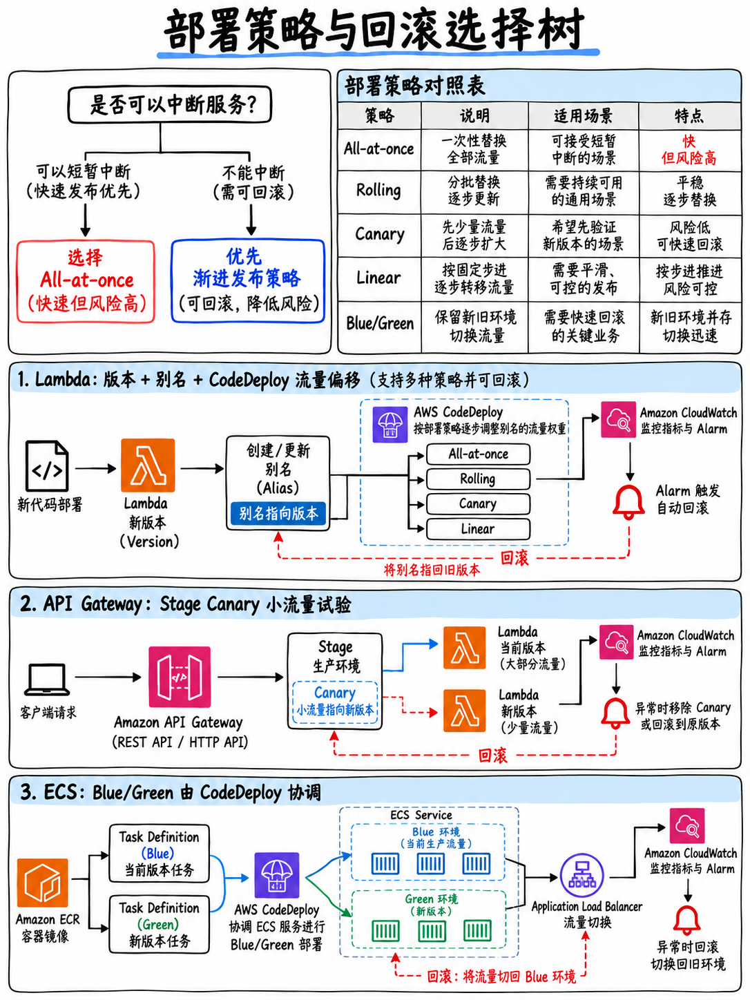

# 4.4 部署策略与流量平移：金丝雀、蓝绿、滚动与不可变部署 (Deployment Strategies)



官方考试大纲明确要求考生具备“部署策略（例如金丝雀 Canary、蓝绿 Blue/Green、滚动 Rolling）”的理论知识，并熟练掌握“使用部署策略发布应用程序版本”以及“使用现有部署策略执行应用程序回滚”的核心技能 [1]。

## 4.4.1 核心部署策略横向对比 (The strategies, compared)

| 部署策略 | 运作机制与原理 | 停机时间 (Downtime) | 资源与成本开销 | 回滚速度与难度 |
|---|---|---|---|---|
| **一次性部署 (All at once)** | 同时在所有实例上直接就地覆盖替换部署 | **存在停机时间** | 最低（无额外实例） | 慢（必须重新打包部署旧版本） |
| **滚动更新 (Rolling)** | 按固定批次依次在现有实例上就地更新 | 无停机，但**更新期间容量下降** | 低（无额外实例） | 较慢（必须分批依次反向滚动更新） |
| **分批滚动更新 (Rolling with additional batch)** | 部署前先额外创建一批新实例，再按批次滚动替换 | 无停机，**全程维持 100% 满载服务容量** | 略高（部署期间需临时增加一批实例成本） | 较慢（分批回滚） |
| **不可变部署 (Immutable)** | 在独立的全新 Auto Scaling 组中启动整套新实例，验证通过后接入流量 | 无停机 | 较高（部署阶段短暂占用双倍计算资源） | **快 —— 直接销毁终止新实例组即可** |
| **蓝绿部署 (Blue/green)** | 独立维护两套完整环境（蓝/绿），通过切换路由或负载均衡实现流量转移 | 无停机 | **最高**（切换期间并存双倍完整环境架构） | **极快 —— 瞬时切回旧环境路由即可** |
| **金丝雀发布 (Canary)** | 先引导极小比例（如 10%）的生产流量至新版本，观察稳定后再全量放行 | 无停机 | 低 | **极快 —— 立即将流量切回旧版本** |
| **线性平移发布 (Linear)** | 按照固定的时间间隔等步长递增平移流量（如每 2 分钟平移 10%）直至完成 | 无停机 | 低 | 极快（平移过程中随时终止并切回） |

```
 金丝雀发布 (CANARY)                   线性平移发布 (LINEAR)
 100% ─────────┐                     100% ──────────────────┐
               │                                     ┌──────┘
  10% ──┐      │                       ...    ┌──────┘
        │      │                        20% ┌─┘
        └──────┘  等待 5 分钟            10% ┘
        v2 承接 10%，稳定后 100%               每隔 N 分钟递增平移 10%
```

:::{tip}
**考试题干核心特征词与对应策略速查表：**

| 题干需求特征描述 | 对应标准部署策略 |
|---|---|
| “先引入极小比例的现网真实流量测试新版本验证稳定性” | **金丝雀发布 (Canary)** |
| “按恒定时间间隔平滑逐步递增新版本的流量比例” | **线性平移发布 (Linear)** |
| “要求零停机瞬间切换流量，并在发现问题时实现近乎瞬时回滚”、“并存两套同构环境” | **蓝绿部署 (Blue/green)** |
| “在部署更新期间，集群必须全程维持 100% 的满载处理能力” | **分批滚动更新 (Rolling with an additional batch)** 或不可变部署 |
| “成本最低，允许短暂停机维护窗口” | **一次性部署 (All at once)** |
| “安全性最高，完全隔离旧系统，防止在脏实例上就地覆盖引发隐患” | **不可变部署 (Immutable)** |
:::

## 4.4.2 Lambda 流量平移机制 —— DVA 专属核心考点

```
 别名 (Alias) "live"
    ├── 90% 流量  →  版本 3 (Version 3，当前稳定版本)
    └── 10% 流量  →  版本 4 (Version 4，新发布版本)    ← 加权别名 (WEIGHTED ALIAS)

 CodeDeploy 根据部署配置随着时间推移动态调节流量权重比例，
 一旦关联的 CloudWatch 告警被触发，则立即自动回滚权重。
```

在 AWS SAM 模板中以声明式极简语法配置：

```yaml
MyFunction:
  Type: AWS::Serverless::Function
  Properties:
    AutoPublishAlias: live
    DeploymentPreference:
      Type: Canary10Percent5Minutes
      Alarms:
        - !Ref ErrorRateAlarm
      Hooks:
        PreTraffic: !Ref PreTrafficHook
        PostTraffic: !Ref PostTrafficHook
```

| 声明配置项 | 核心功能与作用机制 |
|---|---|
| **`AutoPublishAlias`** | 每次执行部署时自动递增发布一个不可变的新**版本 (Version)**，并将该**别名 (Alias)** 动态指向它 |
| **`DeploymentPreference.Type`** | 底层委托的 CodeDeploy 流量调度配置 —— 如金丝雀、线性平移或 `AllAtOnce` |
| **`Alarms`** | 部署期间如果列出的任何 CloudWatch 告警进入 `ALARM` 状态，触发**全自动回滚 (Automatic Rollback)** |
| **`Hooks.PreTraffic`** | 在任何生产流量开始平移**之前**，先触发运行该验证 Lambda 函数执行健全性冒烟测试 |
| **`Hooks.PostTraffic`** | 在所有流量 100% 切换完毕**之后**，触发运行该验证 Lambda 函数执行最终验收测试 |

::::{important}
**这段 SAM 配置是整个领域 3 性价比最高的考点，没有之一。** 它在单个代码块中完美串联了四个高频问题：“如何安全部署 Lambda 函数”、“如何在用户流量介入前验证新版本” (PreTraffic hook)、“如何实现渐进式灰度放量” (Canary/Linear) 以及“如何实现故障自动回滚” (Alarms)。考试中极大概率会出现至少一道题，其文字描述完全就是在白话复述这个配置结构。
::::

**关键调用规范**：**外部调用方（如 API Gateway 或其他客户端）必须显式调用带有 Alias 后缀的 ARN**（如 `arn:...:function:my-func:live`），绝对不能调用 `$LATEST` 或固定的版本号 ARN —— 否则底层加权流量平移将彻底失效！

## 4.4.3 Amazon API Gateway 金丝雀发布

REST API 的每一个 **阶段 (Stage)** 都可以开启独立的 **Canary（金丝雀）** 设置：

- 将指定百分比的入站 API 请求路由至金丝雀环境。
- 金丝雀环境可定义**不同的阶段变量 (Stage Variables)**，从而能够将其流量精准指向不同的后端 Lambda 别名（例如 Canary 阶段变量指向 `live-canary` 别名）。
- 生成**独立的 CloudWatch 性能监控指标与日志流**，方便单独观测金丝雀版本的错误率与延迟。
- 验证通过后点击 **Promote Canary** 一键将金丝雀版本晋升为主部署；若出现故障，直接删除金丝雀配置即可瞬时回滚。

这构成了 API Gateway 接入层与后端 Lambda 加权别名协同金丝雀发布的双层闭环。

## 4.4.4 基于 CodeDeploy 的 Amazon ECS 蓝绿部署

```
 ALB (应用型负载均衡器)
  ├── 生产侦听器 (Production listener，如 443 端口) ──► 目标组 蓝 (Target Group BLUE，运行任务集 v1)
  └── 测试侦听器 (Test listener，如 8443 端口)       ──► 目标组 绿 (Target Group GREEN，运行任务集 v2)

 1. CodeDeploy 在第二个目标组（绿色）中拉起全新的任务集 (Task set v2)。
 2. BeforeAllowTraffic 钩子函数对测试侦听器发起端到端健康检查验证。
 3. 按照部署配置将生产侦听器的流量从蓝色平移切换到绿色。
 4. AfterAllowTraffic 钩子函数运行最终验收。
 5. 在配置的等待倒计时结束后，CodeDeploy 自动销毁旧的蓝色任务集 ——
    在等待倒计时期间，如果发生异常，回滚过程是瞬时的。
```

ECS 蓝绿部署通过 `appspec.yaml` 声明，其中明确定义了 **任务定义 (Task Definition)**、**容器名称与端口** 以及对应的生命周期验证钩子。

## 4.4.5 Elastic Beanstalk 部署策略速查

Beanstalk 拥有一套专属的部署策略术语体系，这也是考试常见考点（详见 {doc}`06-elastic-beanstalk-and-amplify`）：

| 部署策略 | 停机时间 | 部署期间容量 | 回滚机制与特性 |
|---|---|---|---|
| **一次性部署 (All at once)** | 有停机 | 100% 原有（中断） | 重新部署旧版本 |
| **滚动更新 (Rolling)** | 无停机 | **降低**（更新批次下线） | 回滚等同于再次发起一次反向滚动部署 |
| **分批滚动部署 (Rolling with additional batch)** | 无停机 | **维持 100% 满载** | 同上 |
| **不可变部署 (Immutable)** | 无停机 | 维持 100%（临时新实例组） | **直接终止销毁临时新实例，快速切回** |
| **流量分割 (Traffic splitting)** | 无停机 | 维持 100% | **平移切回原环境** —— 这就是 Beanstalk 的金丝雀模式 |

**Beanstalk 中的经典蓝绿发布实现**：在同一个应用下克隆启动一个全新的第二套环境，待新环境验证成功后，在控制台或 CLI 执行 **交换环境 CNAME (Swap Environment CNAMEs)** —— 这是考题中解决“在 Elastic Beanstalk 中实现零停机与瞬时回滚”的标准答案。

## 4.4.6 各服务全场景快速回滚机制汇总

| 目标服务/技术栈 | 最优回滚手段 (How you roll back) |
|---|---|
| **AWS Lambda** | **将别名 (Alias) 的指针瞬间指回上一个稳定版本 (Version)** —— 毫秒级瞬时生效 |
| **AWS CodeDeploy** | 部署失败或关联的 **CloudWatch 告警**触发时自动回滚；或重新部署上一个成功的代码 Revision |
| **AWS CloudFormation** | 堆栈更新失败时底层全自动回滚；调试时可传 `--disable-rollback` 保留失败资源供排查 |
| **Amazon API Gateway** | 将先前的 **部署记录 (Deployment)** 重新发布到 Stage 上，或直接删除当前 Stage 的 Canary 配置 |
| **Amazon ECS** | 将 ECS 服务的任务定义更新回滚到上一个稳定修订版本号 (**Task Definition Revision**) |
| **AWS Elastic Beanstalk** | 重新部署先前的**应用程序版本 (Application Version)**，或直接**反向交换环境 CNAME** |
| **S3 静态托管网站** | 依托存储桶版本控制，将对象的先前**版本 (Object Version)** 恢复为主版本 |

:::{warning}
**在 DVA 考试中，“回滚”极少意味着“重新编译打包构建旧代码并重新走一遍发布流水线”。**
高分答案几乎总是**修改指针与路由重定向** —— 移动 Alias 别名、交换 CNAME、切回加权分流权重、回滚负载均衡目标组。指针切换是秒级生效的，而重新构建代码则存在漫长的流水线耗时。
:::

## 4.4.7 架构选型极速决策树 (Decision tree)

```
 需要部署的是 LAMBDA 函数？
   └─ 要求安全、渐进式平移、故障自动回滚 ──► SAM 模板中的 DeploymentPreference
                                          Canary10Percent5Minutes + Alarms + Hooks 钩子
 需要部署到 ECS 容器集群？
   └─ 要求零停机、快速回滚机制             ──► 基于 CodeDeploy 的双目标组蓝绿部署 (ALB Blue/Green)
 通过 CodeDeploy 部署到 EC2 实例？
   ├─ 必须全程维持 100% 满载处理能力       ──► 蓝绿部署，或分批滚动部署 (Rolling with additional batch)
   └─ 成本优先，允许短暂停机维护窗口        ──► 一次性部署 (AllAtOnce)
 使用 Elastic Beanstalk 管理应用？
   ├─ 要求近乎瞬时的回滚能力               ──► 不可变部署 (Immutable)，或交换环境 CNAME (Swap CNAMEs)
   └─ 希望先引入部分线上真实流量验证        ──► 流量分割部署 (Traffic splitting)
 更新 API Gateway 的后端服务？
   └─ 希望先引入真实流量测试 API           ──► 在 Stage 阶段开启 API Gateway Canary 部署
```

## 4.4.8 考前快速回顾 (Fast revision)

- **金丝雀 (Canary)** = 先切一小部分，再切全部。**线性平移 (Linear)** = 按时间固定等步长递增。**蓝绿部署 (Blue/Green)** = 两套独立环境切换路由。**滚动更新 (Rolling)** = 分批就地替换，期间总容量下降。**不可变部署 (Immutable)** = 全新临时实例组，安全且回滚极快。
- Lambda 核心：**加权别名 (Weighted alias)**，由 **CodeDeploy** 驱动，在 SAM 中通过 **`AutoPublishAlias` + `DeploymentPreference`** 配置，挂载 **`Alarms`** 实现自动回滚，挂载 **`PreTraffic`/`PostTraffic`** 实现钩子测试。**外部请求必须调用别名 ARN。**
- `Canary10Percent5Minutes` 与 `Linear10PercentEvery2Minutes` —— 望文生义即可精准解题。
- ECS 蓝绿部署底层必须借助 ALB 的**两个目标组 (Two target groups)** 实现流量接管。
- Beanstalk：**流量分割 (Traffic splitting)** 是其金丝雀机制；**交换 CNAME (Swap CNAMEs)** 是其蓝绿部署标准实现。
- **牢记回滚的本质是修改指针与路由变更**，而非重新构建代码。
