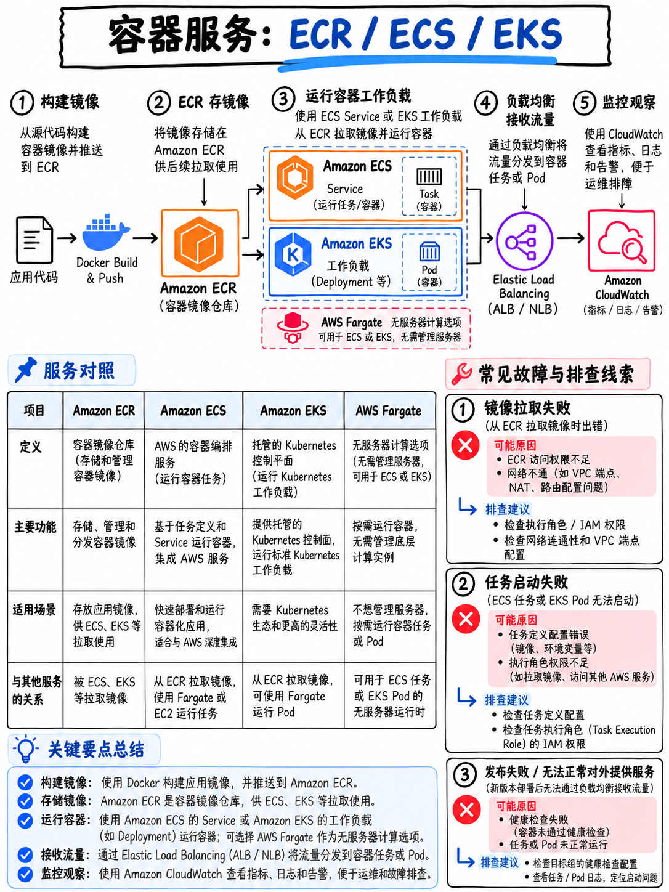

# 4.5 容器化服务：ECS、ECR、Fargate、EKS 与 Copilot (Containers: ECR, ECS, Fargate, EKS, Copilot)



**在 DVA-C02 中属于 Tier B 考点** —— ECR、ECS、EKS 与 Copilot 均在大纲考查范围之内 [1]，且容器镜像被明确列入任务 1 中；但在 **DVA-C03 中，容器的权重大幅提升**，考纲新增了“容器管理：使用 Amazon ECR 构建镜像并部署至 ECS、EKS 和 Fargate”的专项要求 [5]。掌握这部分内容对于备考与实际工程均具有关键价值。

## 4.5.1 Amazon ECR 托管容器镜像仓库

完全托管的私有 Docker 容器注册表。

```bash
# 获取临时登录凭证并向 ECR 进行 Docker 认证 —— 必须能够一眼识别的核心命令
aws ecr get-login-password --region eu-west-1 \
  | docker login --username AWS --password-stdin \
      111122223333.dkr.ecr.eu-west-1.amazonaws.com

docker build -t myapp .
docker tag myapp:latest 111122223333.dkr.ecr.eu-west-1.amazonaws.com/myapp:v1.2.3
docker push 111122223333.dkr.ecr.eu-west-1.amazonaws.com/myapp:v1.2.3
```

| 核心特性 | 考点场景与核心价值 |
|---|---|
| **镜像漏洞扫描 (Image scanning)** | 支持基础扫描（Basic，基于开源 Clair，推送时自动触发）与增强扫描（Enhanced，依托 Amazon Inspector 持续检测 CVE 漏洞）。考点对应：“自动化检测容器镜像的安全漏洞” |
| **生命周期策略 (Lifecycle policies)** | 自动过期清理未标记标签 (Untagged) 的残留镜像或超期旧镜像 —— 考点对应：“控制与缩减持续攀升的 ECR 存储账单成本” |
| **不可变标签 (Immutable tags)** | 强制禁止同名 Tag 被覆盖推送，确保 `v1.2.3` 无论何时拉取都严格指向同一个镜像指纹 |
| **存储库策略 (Repository policy)** | 附加在 ECR 仓库上的基于资源的策略 (Resource-based policy)，用于安全实现跨账号 (Cross-account) 镜像拉取授权 |
| **直通拉取缓存 (Pull through cache)** | 在私有 ECR 中全自动缓存来自公共上游镜像源（如 Docker Hub、Quay）的公开镜像 |

:::{important}
**“创建使用受批准版本的应用环境以进行集成测试（Lambda 别名、容器镜像标签、AWS Amplify 分支、AWS Copilot 环境）”是官方大纲中明确列出的技能 [1]。** 在容器化体系中，实现多环境严格隔离的标准实践是：**使用不可变的镜像标签 (Immutable image tags)** —— 严禁在生产中使用飘忽不定的 `latest` 标签 —— 并在每个环境中部署独立的任务定义修订版本 (Task Definition Revision)。
:::

## 4.5.2 Amazon ECS 弹性容器服务

| 核心概念 | 定义与架构角色 |
|---|---|
| **任务定义 (Task definition)** | 容器蓝图声明：指定镜像地址、CPU/内存配额、端口映射、环境变量、挂载存储卷、日志驱动、**任务角色 (Task role)** 以及 **任务执行角色 (Task execution role)** |
| **任务 (Task)** | 任务定义的一个具体运行实例（容器集） |
| **服务 (Service)** | 维护指定数量 (Desired Count) 的任务副本常驻运行，自动化接入负载均衡器 (ALB)，并处理滚动更新或蓝绿部署 |
| **集群 (Cluster)** | 运行任务与服务的底层计算资源逻辑隔离组 |
| **启动类型 (Launch type)** | **EC2**（自行管理底层的 EC2 虚拟机与补丁）或 **Fargate**（无服务器架构 —— 无需管理任何底层实例） |

::::{danger}
**两大角色极其容易混淆，是考场上的常青树考点：**

| 角色对比 | **任务角色 (Task role)** | **任务执行角色 (Task execution role)** |
|---|---|---|
| **使用者** | 运行在容器内部的**业务应用程序代码** | 宿主机上的 **ECS Agent 代理程序**（在用户代码启动之前执行） |
| **权限授予示例** | `dynamodb:PutItem`、`s3:GetObject`、`sqs:SendMessage` 等业务调用权限 | `ecr:GetAuthorizationToken`、`ecr:BatchGetImage`（拉取镜像）、`logs:CreateLogStream`（写入日志）、`secretsmanager:GetSecretValue`（拉取并注入机密） |
| **配置错误报错现象** | 应用业务代码在调用 AWS SDK 时抛出 `AccessDenied` 异常 | **容器任务启动即崩溃退出** —— 报错 `CannotPullContainerError` 或日志组无法创建 |

**解题口诀**：“任务刚拉起就退出并报错 `CannotPullContainerError`” → **任务执行角色 (Task execution role)** 权限缺失或网络不通；“应用运行后报错无法写入 DynamoDB 或 S3 `AccessDenied`” → **任务角色 (Task role)** 权限缺失。
::::

**安全注入机密**：在任务定义的 `secrets` 配置块中引用 AWS Secrets Manager 的 Secret ARN 或 Systems Manager Parameter Store 的参数名 —— **严禁直接明文写在 `environment` 环境变量块中**。

**网络模式**：`awsvpc` 模式为每一个 ECS Task 分配专有的弹性网卡 (ENI) 和独立的 VPC 内网 IP，拥有专属的安全组控制，且该模式是 **AWS Fargate 的强制必选模式**。

**AWS Fargate**：完全免除底层虚拟机运维。考题识别标志：凡是需求出现“运行容器化工作负载”、“无底层服务器运维开销 (No servers to manage)”、“最小运维工作量 (Least operational overhead)”，**AWS Fargate** 即为标准答案。

## 4.5.3 Amazon EKS 托管 Kubernetes 简述

AWS 托管的 Kubernetes 服务。在 DVA 考试中，只需将其识别为 Kubernetes 技术栈的托管选型，并掌握 Pod 容器获取 AWS 资源访问权限的现代标准方式：通过 **IAM Roles for Service Accounts (IRSA)** 或 **EKS Pod Identity** 机制将 IAM 角色绑定到 K8s 的 ServiceAccount 上 —— 这与 ECS 的 Task Role 逻辑一致，**严禁使用静态保存的长期访问凭证**。EKS 同样原生支持在 AWS Fargate 无服务器底座上运行 Pod。

## 4.5.4 AWS Copilot 命令行工具

专为开发者打造的高级 CLI 工具。只需一个 `Dockerfile`，Copilot 即可将容器化应用程序一键部署到 ECS/Fargate（或 App Runner）生产级架构中，并全自动生成底层的 VPC 网络、ALB 负载均衡、CI/CD 自动化流水线以及**独立环境隔离 (Environments)**。

```bash
copilot init          # 交互式初始化应用程序与微服务架构
copilot env init      # 创建独立环境（例如 test、prod 环境）
copilot deploy        # 本地构建 Docker 镜像、自动推送到 ECR 并部署到目标环境
copilot svc logs      # 查看并实时追踪服务的运行日志
```

**“AWS Copilot 环境 (AWS Copilot environments)”在大纲中被明确列出**，作为推荐的多环境隔离落地机制之一 [1]。这也是 Copilot 被收录进考试范围的核心原因：它在容器领域与 Lambda 别名、API Gateway 阶段扮演着相同的环境隔离治理角色。

## 4.5.5 考题场景中的计算服务选型决策全景

```
 事件驱动、短平快执行、瞬间突发并发、无需管理服务器 ──►  AWS LAMBDA
 长时间常驻运行的容器化微服务、完全无服务器免运维    ──►  ECS on FARGATE
 容器需要特殊的底层硬件配置
   (GPU 加速计算、超大物理内存、大规模超低成本核算)  ──►  ECS on EC2
 企业已有大量 Kubernetes 架构投资 / 强调跨多云可移植性 ──►  AMAZON EKS
 “只想最快交付我的 Web 应用，不在乎底层基础设施细节”  ──►  ELASTIC BEANSTALK 或 COPILOT
 对操作系统内核、特定补丁或驱动拥有完全底层掌控权    ──►  AMAZON EC2
```

:::{tip}
**15 分钟硬性超时定律：** AWS Lambda 的底层绝对最大执行超时时间为 **15 分钟**。任何在题干中描述运行时间超过 15 分钟的计算任务 —— 例如超大文件批量转换、高清视频转码渲染、超长报表统计导出 —— 都在强烈暗示应该选型 **ECS / Fargate**、**AWS Batch**，或者**使用 Step Functions 拆解编排更小的任务分片**，绝对不能指望调大 Lambda 的超时时间来解决。
:::

## 4.5.6 考前快速回顾 (Fast revision)

- 核心登录认证命令：`aws ecr get-login-password | docker login --password-stdin`。
- ECR 核心功能：**镜像安全扫描 (Image scanning)**、**生命周期策略 (Lifecycle policies)**、**不可变标签 (Immutable tags)** 与跨账号存储库策略。
- **任务角色 (Task role) = 容器内业务代码的 API 权限；任务执行角色 (Task execution role) = ECS Agent 拉取镜像与写入日志的权限。** 启动即报错秒退必查执行角色。
- 敏感机密数据必须配置在任务定义的 **`secrets`** 属性块中，不可明文暴露于 `environment`。
- **AWS Fargate** = 彻底消除实例运维 = 容器领域“最小运维开销”的首选答案。
- EKS Pod 通过 **IRSA / Pod Identity** 绑定 IAM 角色，坚决杜绝硬编码静态密钥。
- **Copilot 环境**与**不可变镜像标签**是容器化场景中实现多环境隔离的标准架构机制 [1]。
- 单次执行时长超过 15 分钟的任务，一票否决 Lambda 方案。
