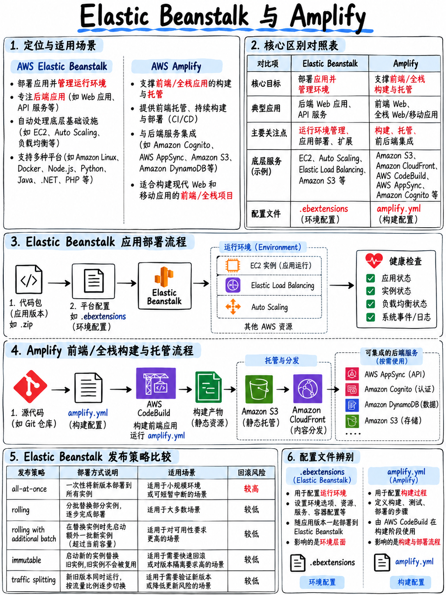

# 4.6 Elastic Beanstalk 与 AWS Amplify (Elastic Beanstalk and Amplify)



两者均在官方考纲覆盖范围内 [1]，并且都被明确纳入任务 4 的应用部署技能列表中。虽然这两项服务在总题量中的占比不算极高，但它们都各自独占了若干其他服务完全无法替代的经典题型。

## 4.6.1 AWS Elastic Beanstalk 弹性扩展托管平台

构建于 EC2、Auto Scaling、ELB 和 CloudWatch 之上的经典 PaaS（平台即服务）底座。**开发者只需提供应用源码；Beanstalk 负责全自动预置并托管底层基础设施** —— 但所有被创建的 AWS 资源均完全归属于开发者自己的 AWS 账号中，开发者保留对底层资源的完整可视性与修改权限。

| 核心概念 | 含义与职责 |
|---|---|
| **应用程序 (Application)** | 容纳各个环境与版本的顶层逻辑容器 |
| **应用程序版本 (Application version)** | 上传至 S3 存储桶中的特定应用源码打包文件（Zip 或 WAR） |
| **环境 (Environment)** | 承载某个具体版本运行的一组计算资源集合 —— 分为**Web 服务器层 (Web server tier)** 与 **工作线程层 (Worker tier)** |
| **平台 (Platform)** | 官方维护的运行环境底座（如 Node.js、Python、Java、Go、.NET、Docker 等） |
| **已保存的配置 (Saved configuration)** | 可在多个环境之间复用和快速复制的环境参数模板 |

### 部署策略 —— 必考核心对比表

| 部署策略 | 停机时间 | 部署期间集群容量 | 部署耗时 | 回滚机制与速度 |
|---|---|---|---|---|
| **一次性部署 (All at once)** | **存在停机** | —（全量中断） | 最快 | 慢（必须重新部署旧版本包） |
| **滚动更新 (Rolling)** | 无停机 | **降低**（更新批次下线） | 中等 | 较慢（再发起一次反向滚动部署） |
| **分批滚动部署 (Rolling with additional batch)** | 无停机 | **维持 100% 满载** | 较慢 | 较慢（反向滚动部署） |
| **不可变部署 (Immutable)** | 无停机 | 维持 100%（临时新实例组） | 最慢 | **极快 —— 直接销毁终止临时新实例组** |
| **流量分割 (Traffic splitting)** | 无停机 | 维持 100% | 较慢 | **极快 —— 立即将分流切回原实例组** |

:::{tip}
**根据题干要求精准锁定部署策略：**

- “在发布过程中集群必须自始至终维持 100% 的满载处理能力” → **分批滚动部署 (Rolling with additional batch)**（或不可变部署）
- “安全性最高，且部署失败绝不能影响正在正常运行的现存生产实例” → **不可变部署 (Immutable)**
- “将新版本引入一小部分真实生产流量进行线上金丝雀验证” → **流量分割 (Traffic splitting)**（Beanstalk 的金丝雀模式）
- “要求零停机 **且** 具备瞬时回滚能力” → 部署到同应用下的第二套全新环境，并执行**交换环境 CNAME (Swap Environment CNAMEs)** —— 这是 Beanstalk 原生的蓝绿发布方案，其本质属于环境级操作而非内置部署策略
- “开发测试环境发布，追求速度最快且成本最低，允许短暂停机” → **一次性部署 (All at once)**
:::

### `.ebextensions` 深度配置机制

在应用根目录下创建 `.ebextensions/` 目录，存放一个或多个 `.config` 配置文件（YAML 或 JSON 格式），在每次部署时自动由底层引擎执行解析：

```yaml
# .ebextensions/01-options.config
option_settings:
  aws:elasticbeanstalk:application:environment:
    LOG_LEVEL: info
  aws:autoscaling:asg:
    MinSize: 2
    MaxSize: 8

packages:
  yum:
    htop: []

container_commands:
  01_migrate:
    command: "python manage.py migrate"
    leader_only: true          # 仅在单台主控 (Leader) 实例上执行一次
```

**`leader_only: true` 是考题中解决“数据库迁移脚本在集群更新时被多台实例重复并发执行导致报错”的标准答案** —— 这是考试中反复出现的经典陷阱题。

### 工作线程层 (Worker tier)

Worker 环境底层自动从一个绑定的 **Amazon SQS 队列** 中长轮询消费消息，并通过本地守护进程将每条消息以 HTTP POST 请求的形式投递给运行在 `localhost` 上的应用程序。根目录下的 `cron.yaml` 文件可用于定义定期的定时调度任务。这是考题中解决“在 Elastic Beanstalk 中剥离耗时异步后台批处理任务”的标准架构。

### Beanstalk 考试定位

Beanstalk 在考试中代表“开发者只想快速交付应用代码，不愿手动编排底层网络与服务器”的托管解法，与 Copilot 和 App Runner 属于同一设计理念。考题的核心分水岭通常在于**部署策略选型**或 **`.ebextensions` 高级配置**。

## 4.6.2 AWS Amplify 全栈托管平台

专为现代 Web 前端与全栈应用打造的一体化平台：内置带 CI/CD 的全球静态资源与 SSR 托管服务，并支持可视化声明后端微服务（基于 Cognito 的身份认证、基于 AppSync/DynamoDB 的数据 API、基于 S3 的文件存储、基于 Lambda 的后端函数）。

| 核心特性 | 考纲考查重点与机制 |
|---|---|
| **基于分支的自动化部署 (Branch-based deployments)** | **“AWS Amplify 分支”在大纲中被显式列为多环境隔离机制之一** [1] —— 将特定的 Git 分支关联到独立的 Amplify 环境，每次向该分支 push 均自动触发全套构建与部署 |
| **Pull Request 预览环境 (PR previews)** | 为每个开启的 PR 全自动拉起临时预览环境，PR 合并或关闭时自动销毁 |
| **构建配置规范** | 使用项目根目录下的 `amplify.yml` 定义构建阶段，结构与 `buildspec.yml` 极为相似 |
| **高性能托管 (Hosting)** | 全球 CDN 分发加速，原子化部署 (Atomic deployments)，支持秒级瞬时切回至历史构建版本 |
| **全栈后端集成** | 自动生成、配置并编排与前端强绑定的 IAM、Cognito、GraphQL API 等资源 |

```yaml
# amplify.yml 构建规范
version: 1
frontend:
  phases:
    preBuild:
      commands: [npm ci]
    build:
      commands: [npm run build]
  artifacts:
    baseDirectory: dist
    files: ['**/*']
  cache:
    paths: [node_modules/**/*]
```

:::{important}
**Amplify 的高频典型题型：** “开发团队希望每次推送到不同的功能特性分支（Feature branch）时都能自动获得一个专属的独立访问 URL，并能为每个 PR 自动生成预览环境，同时保持最小的运维开销” → **AWS Amplify 基于分支的部署机制**。考试指南将 Amplify 分支与 Lambda 别名、容器镜像标签、Copilot 环境并列为实现“创建使用受批准版本的应用环境以进行集成测试”的四大标准化工具 [1] —— 它们的本质是同一种解题思维在不同计算形态上的映射。
:::

## 4.6.3 考纲四大环境隔离机制终极横向对比 (The four environment mechanisms)

这是整个领域 3 中最具横向统摄力的一张对比表，直接呼应官方考试大纲中的核心技能要求 [1]：

| 你正在部署的工作负载形态 | 标准推荐的环境隔离实现机制 (Environment mechanism) |
|---|---|
| **AWS Lambda 无服务器函数** | **不可变版本 (Versions) 与别名 (Aliases)**（结合 API Gateway 阶段变量） |
| **容器化微服务** | **不可变镜像标签 (Immutable image tags)** + 独立的任务定义修订版本 |
| **现代前端 / 单页 Web 应用** | **AWS Amplify 分支 (Amplify branches)** |
| **端到端容器微服务架构** | **AWS Copilot 环境 (Copilot environments)** |
| **API 接口网关** | **API Gateway 阶段 (Stages)**（结合阶段变量与 Canary 金丝雀） |
| **通用基础设施底座** | 为每个环境部署**独立的 CloudFormation / SAM 堆栈** |

## 4.6.4 考前快速回顾 (Fast revision)

- Beanstalk 部署策略速查：**一次性 (All at once) · 滚动 (Rolling) · 分批滚动 (Rolling with additional batch) · 不可变 (Immutable) · 流量分割 (Traffic splitting)**。维持 100% 满载容量选**分批滚动**；安全隔离最高选**不可变**；金丝雀灰度选**流量分割**；**零停机蓝绿发布选交换环境 CNAME**。
- **`.ebextensions/*.config`** 支持 `option_settings`、`packages` 与 `container_commands`；数据库迁移等单实例任务务必声明 **`leader_only: true`**。
- Beanstalk **Worker 环境**专用于消费绑定的 SQS 队列；定时任务由 `cron.yaml` 驱动。
- **Amplify 分支部署** = 每个 Git 分支对应独立的自动化在线环境，支持 PR 自动预览；构建行为通过 `amplify.yml` 定义。
