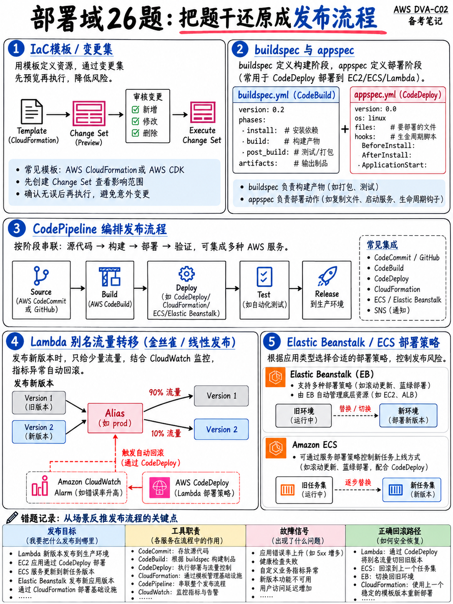

# 4.7 部署领域实战练习题：26 道高频全真模拟题及逐题详解 (Deployment Practice Set)

本练习题集严格对照官方考试大纲领域 3（Deployment）的四项任务陈述编写 [1]，全面覆盖 CI/CD 流水线、IaC 编排、流量平移部署策略及容器化核心考点。

:::{tip}
**建议用时：45 分钟。** 独立完成作答后，请仔细研读每一道题的官方解析与考点辨析。
:::

## 4.7.1 练习题 (Questions)

**1.** 在 AWS CodeBuild 的 `buildspec.yml` 中，下列哪项构建生命周期阶段（Phases）的执行顺序是正确的？  
A. `install` → `pre_build` → `build` → `post_build`。  
B. `pre_build` → `install` → `build` → `post_build`。  
C. `install` → `build` → `pre_build` → `post_build`。  
D. `build` → `install` → `pre_build` → `post_build`。  

**2.** 某构建任务必须在构建期间使用数据库密码，但绝不能将其明文保存在代码仓库中。应该在 `buildspec.yml` 中添加什么配置？  
A. 在 `env/secrets-manager` 块中声明机密引用。  
B. 在 `env/variables` 块中配置明文字符串。  
C. 在构建环境中硬编码静态 IAM 访问密钥（Access Key）。  
D. 将密码直接写在 Dockerfile 中。  

**3.** 在 AWS CodeDeploy 的生命周期钩子中，哪一个钩子运行的是**上一次已部署版本**中的脚本？  
A. `ApplicationStop`。  
B. `BeforeInstall`。  
C. `AfterInstall`。  
D. `ValidateService`。  

**4.** 下列哪项是 CodeDeploy 在 EC2 实例上可供开发者自定义编写脚本的生命周期事件的正确执行顺序？  
A. `BeforeInstall` → `ApplicationStop` → `ApplicationStart` → `AfterInstall` → `ValidateService`。  
B. `ApplicationStart` → `BeforeInstall` → `AfterInstall` → `ValidateService` → `ApplicationStop`。  
C. `ApplicationStop` → `BeforeInstall` → `AfterInstall` → `ApplicationStart` → `ValidateService`。  
D. `BeforeAllowTraffic` → `AfterAllowTraffic` → `ValidateService`。  

**5.** 在将代码部署至 AWS Lambda 时，CodeDeploy 原生支持下列哪些生命周期验证钩子？  
A. `ApplicationStop` 与 `ApplicationStart`。  
B. `BeforeInstall` 与 `AfterInstall`。  
C. `PreBuild` 与 `PostBuild`。  
D. `BeforeAllowTraffic` 与 `AfterAllowTraffic`。  

**6.** 部署配置名称 `Canary10Percent5Minutes` 的具体执行行为是什么？  
A. 每隔 5 分钟递增平移 10% 的流量，直到切换完成。  
B. 先平移 10% 的流量至新版本，等待观察 5 分钟，若无异常则一次性切换剩余的 90% 流量。  
C. 部署到 10% 的实例上运行 5 分钟，然后终止部署。  
D. 在正式部署前先对集群中 10% 的实例进行持续 5 分钟的测试。  

**7.** 某 Lambda 函数必须进行灰度部署：让新版本承接 10% 的流量并持续观察 10 分钟，一旦错误率告警触发必须自动回滚。哪项 SAM 配置能够实现该要求？  
A. 在 `Globals` 中配置更长的函数执行超时时间。  
B. 创建两个独立的函数，并在 Amazon Route 53 中配置加权路由记录。  
C. 配置 `AutoPublishAlias`，并将 `DeploymentPreference` 的 Type 设为 `Canary10Percent10Minutes` 并关联 `Alarms` 列表。  
D. 将该函数的预留并发（Reserved Concurrency）设置为 10。  

**8.** 客户端一直通过 Lambda 函数的具体版本 ARN（Version ARN）发起调用。开发团队开启了基于加权别名的金丝雀部署，但发现线上流量根本没有发生任何分流倾斜。这是为什么？  
A. 客户端必须调用别名 ARN（Alias ARN），而不是版本 ARN。  
B. 该别名缺少外部调用权限。  
C. 加权别名必须依赖预置并发（Provisioned Concurrency）。  
D. CodeDeploy 的部署配置参数设置错误。  

**9.** 在 AWS CloudFormation 模板的所有顶级段落中，哪一个是**唯一必填**的段落？  
A. `Parameters`。  
B. `Outputs`。  
C. `Mappings`。  
D. `Resources`。  

**10.** 某模板需要将一个 S3 存储桶的 ARN 属性传递给另一个资源，应该使用哪个内部函数？  
A. `!Ref MyBucket`。  
B. `!GetAtt MyBucket.Arn`。  
C. `!Sub MyBucket`。  
D. `!ImportValue MyBucket`。  

**11.** 某 CloudFormation 堆栈更新失败，报错原因是另一个堆栈正在导入该堆栈导出的某个输出值（Exported outputs）。导致该故障的根本原因是什么？  
A. 该导出值位于不同的 AWS 区域（Region）。  
B. 在所有情况下都必须先完全删除导入方的堆栈。  
C. 只要有其他堆栈正在导入该导出值，被引用的导出项就严禁进行任何修改或删除。  
D. 每个堆栈最多只能导出 10 个输出值。  

**12.** 开发团队希望在正式应用堆栈更新之前，提前预览该更新是否会导致生产数据库发生“物理替换（Replacement）”。他们应该使用什么功能？  
A. 漂移检测（Drift detection）。  
B. 更改集（Change set）。  
C. 堆栈策略（Stack policy）。  
D. 终止保护（Termination protection）。  

**13.** 哪项配置可以防止 DynamoDB 表在从 CloudFormation 堆栈模板中移除时被意外物理删除？  
A. 终止保护（Termination protection）。  
B. 堆栈策略（Stack policy）。  
C. `DeletionPolicy: Retain`。  
D. `UpdateReplacePolicy: Delete`。  

**14.** AWS SAM CLI 命令 `sam local generate-event s3 put` 的作用是什么？  
A. 部署一个监听并响应 S3 事件的 Lambda 函数。  
B. 向 S3 存储桶上传一个真实的测试文件对象。  
C. 在 S3 存储桶上创建事件通知配置。  
D. 生成用于本地模拟测试的真实 S3 PUT 事件 JSON 载荷（Payload）。  

**15.** 在目标 AWS 账号和区域首次使用 AWS CDK 执行部署之前，必须先执行哪条命令？  
A. `cdk synth`。  
B. `cdk bootstrap`。  
C. `cdk diff`。  
D. `cdk init`。  

**16.** 某 CI/CD 流水线在将代码发布至生产环境之前，必须暂停等待人工审核签字，并向团队发送审批通知。应该如何配置？  
A. 添加一个带有 sleep 命令的 CodeBuild 操作。  
B. 配置 CodePipeline 手动审批操作（Manual approval action）并绑定 Amazon SNS 主题。  
C. 仅禁用该阶段之间的转换开关（Transitions）。  
D. 编写一个循环轮询审批结果的 Lambda 函数。  

**17.** 某企业需要托管内部自研的私有 npm 依赖包，并严格管控开发人员允许拉取的公网开源依赖。应该使用哪项服务？  
A. Amazon S3。  
B. Amazon ECR。  
C. AWS CodeBuild。  
D. AWS CodeArtifact。  

**18.** 哪项服务可以在开发人员合并代码前，全自动审查 Pull Request 中的代码缺陷与安全漏洞？  
A. Amazon CodeGuru Profiler。  
B. AWS X-Ray。  
C. AWS CodeDeploy。  
D. Amazon CodeGuru Reviewer。  

**19.** 某 Elastic Beanstalk 应用在部署期间必须始终维持 100% 的满载处理能力，绝不能减少集群中健康实例的数量。应该选择哪种部署策略？  
A. 分批滚动部署（Rolling with an additional batch）。  
B. 一次性部署（All at once）。  
C. 滚动更新（Rolling）。  
D. 附带健康检查的一次性部署。  

**20.** 在 Elastic Beanstalk 的 `.ebextensions` 中配置的数据库迁移脚本在每次部署时都在所有实例上重复执行，导致数据损坏。应该添加什么配置来修复？  
A. 在 container_commands 中配置 `leader_only: true`。  
B. 增加该命令的超时时间限制。  
C. 改用 `packages` 代替 `container_commands`。  
D. 转换为 Worker 环境。  

**21.** 某前端团队希望每个 Git 分支在推送后都能全自动部署并获得专属的访问 URL，同时为每个 PR 提供自动化预览环境，且运维开销最小。哪项服务能够满足？  
A. Amazon S3 静态网站托管。  
B. AWS Elastic Beanstalk。  
C. 基于分支部署的 AWS Amplify。  
D. 基于 Fargate 的 Amazon ECS。  

**22.** 某 ECS 任务启动失败，报错提示无法从 Amazon ECR 拉取容器镜像（CannotPullContainerError）。应该首先检查哪个角色？  
A. 任务执行角色（Task execution role）。  
B. 任务角色（Task role）。  
C. 实例配置文件（Instance profile）。  
D. CodeDeploy 服务角色。  

**23.** 官方考试指南明确列出了哪些用于创建受批准版本应用环境以进行集成测试的机制？（多选：选择两项）  
A. 容器镜像标签（Container image tags）。  
B. Lambda 别名（Lambda aliases）。  
C. IAM 权限边界（Permission boundaries）。  
D. S3 存储桶版本控制（Bucket versioning）。  
E. CloudWatch 告警（Alarms）。  

**24.** 某 REST API 必须将 5% 的生产流量引导至新的后端服务，并为该部分流量生成独立的监控指标与日志流。应该如何配置？  
A. 创建第二个独立的 REST API。  
B. 在该 API 的 Stage 阶段配置金丝雀发布（Canary release）。  
C. 配置使用计划（Usage plan）。  
D. 挂载 Lambda 授权方（Authorizer）。  

**25.** 使用 AWS CodeDeploy 执行 ECS 蓝绿部署时，底层负载均衡器必须采用哪种配置？  
A. 单个目标组与单个侦听器。  
B. 仅使用网络型负载均衡器（NLB）。  
C. 两个目标组（Target groups），分别挂载生产侦听器（Production listener）与测试侦听器（Test listener）。  
D. 无需任何负载均衡器。  

**26.** 某线上应用在发布后收到用户报错，必须立即完成回滚。该工作负载是挂载在 Alias 别名后的 Lambda 函数。最快的回滚方式是什么？  
A. 重新将上一版本的代码推入流水线重新构建打包部署。  
B. 删除当前函数并重新创建。  
C. 从 S3 重新下载并覆盖上传旧部署包。  
D. 直接将别名（Alias）的指针重新指向上一稳定版本（Version）。  

---

## 4.7.2 答案与逐题详解 (Answers and reasoning)

**1 — 正确答案：A。** CodeBuild 的构建阶段严格按照 **`install` → `pre_build` → `build` → `post_build`** 顺序执行。即使 `build` 阶段命令失败，`post_build` 依然会强制执行，因此清理临时文件和上传测试报告的操作必须放在 `post_build` 中。

**2 — 正确答案：A。** 在 `buildspec.yml` 中使用 **`env/secrets-manager`**（或 `env/parameter-store`）块，CodeBuild 会在构建运行时借助自身的**服务角色 (Service role)** 自动拉取并注入机密。直接写入 `env/variables` 或写在 Dockerfile 中会导致密码明文泄露；在代码中配置 Access Key 违反安全底线。

**3 — 正确答案：A。** **`ApplicationStop`** 是在下载新版本代码之前触发的，因此它执行的是**上一次部署成功版本**中的旧脚本。如果上一个版本的 `ApplicationStop` 脚本存在 Bug，后续所有新版本部署都将被永久卡死。

**4 — 正确答案：C。** 完整的执行顺序为：`ApplicationStop` → (DownloadBundle) → `BeforeInstall` → (Install) → `AfterInstall` → `ApplicationStart` → `ValidateService`。括号内的两个步骤由 CodeDeploy Agent 自动处理，不可编写自定义脚本。选项 D 是针对 Lambda 和 ECS 的钩子。

**5 — 正确答案：D。** Lambda 与 ECS 在 CodeDeploy 中仅支持两个生命周期钩子：**`BeforeAllowTraffic`** 与 **`AfterAllowTraffic`**。与安装部署文件相关的钩子仅适用于 EC2 及本地机房环境。

**6 — 正确答案：B。** 望文生义即可准确解题：先将 **10%** 的流量导入新版本，等待观察 **5 分钟**；如果期间未触发任何报警，则将其余 90% 流量在下一步一次性全部切换。若要每隔固定时间均匀切换，对应的配置应为 `Linear…`（线性平移）。

**7 — 正确答案：C。** **`AutoPublishAlias`** 自动发布版本并绑定别名；**`DeploymentPreference.Type`** 指定具体的灰度策略；**`Alarms`** 关联 CloudWatch 告警实现超阈值自动回滚。Route 53 权重无法作用于单个函数内部的灰度，预留并发与灰度平移无关。

**8 — 正确答案：A。** CodeDeploy 驱动的流量平移发生在**别名 (Alias)** 层面。如果客户端显式调用某个特定的版本 ARN（Version ARN），请求会直接绕过别名的加权路由规则，导致流量权重完全无法生效。

**9 — 正确答案：D。** **`Resources`（资源段）** 是 CloudFormation 模板中唯一不可或缺的必填段落，其余段落（Parameters、Outputs、Mappings、Conditions 等）均为可选。

**10 — 正确答案：B。** **`!GetAtt MyBucket.Arn`**。对 S3 存储桶调用 `!Ref` 返回的是存储桶的**物理名称 (Bucket Name)**，只有调用 `!GetAtt` 才能获取其完整的 ARN。

**11 — 正确答案：C。** **被其他堆栈引用的导出值（Exported Output）在外部依赖完全解除前，处于锁定保护状态**，严禁进行修改或删除。必须先修改或删除所有导入方堆栈中的引用，才能对导出堆栈进行更新。

**12 — 正确答案：B。** **更改集 (Change set)** 能够详细预览堆栈更新带来的全部变更，并明确标记出哪些资源会被“物理替换（Replacement）”。漂移检测（Drift detection）只能检测在 CloudFormation 之外手动发生的配置偏差。

**13 — 正确答案：C。** 声明 **`DeletionPolicy: Retain`** 可以在资源从模板中移除或整个堆栈被销毁时，将物理资源安全保留在 AWS 账号中。终止保护只能保护整个堆栈不被误删，但无法阻止更新模板时移除非必要资源。

**14 — 正确答案：D。** 该命令用于**在本地快速生成真实格式的事件 JSON 载荷**，以便传递给 `sam local invoke` 进行本地函数调试，对应大纲中的“创建应用程序测试事件”技能 [1]。

**15 — 正确答案：B。** **`cdk bootstrap`** 会在目标账号和区域中自动预置 CDKToolkit 底座堆栈（包含专用的 S3 资产存储桶、ECR 仓库和 IAM 执行角色），每个账号/区域只需在首次部署前执行一次。

**16 — 正确答案：B。** CodePipeline 的**手动审批操作 (Manual approval action)** 能够挂起流水线，并原生集成 **Amazon SNS 主题**向运维或研发负责人发送审批通知，符合大纲中关于手动审批的明确考点要求 [1]。

**17 — 正确答案：D。** **AWS CodeArtifact** 是托管的私有软件包仓库，不仅支持托管内网自研的 npm/pip/Maven 制品，还能通过配置上游仓库（Upstream）缓存并管控外部公共开源源。ECR 专用于容器镜像，S3 不是合规的软件包管理器。

**18 — 正确答案：D。** **Amazon CodeGuru Reviewer** 依托机器学习技术，在 Pull Request 阶段对代码进行自动化审计，检测安全隐患与代码缺陷。CodeGuru Profiler 则用于生产运行时的 CPU 性能瓶颈分析。

**19 — 正确答案：A。** **分批滚动部署 (Rolling with an additional batch)** 会在更新前先启动一批额外的全新实例，确保在滚动替换现有实例的过程中，集群始终维持 100% 的满载计算能力。普通滚动更新会导致可用实例减少，一次性部署则会导致全量服务中断。

**20 — 正确答案：A。** 在 `container_commands` 中指定 **`leader_only: true`** 可以强制该命令仅在集群中的单台主控（Leader）实例上执行一次，避免多台实例并发运行数据库迁移造成死锁或数据损坏。

**21 — 正确答案：C。** **AWS Amplify 基于分支的部署机制 (Branch-based deployments)** 可以自动监听 Git 分支并为每个分支分配独立的访问域名，同时原生支持针对 PR 的临时预览环境，完全无需开发者自建部署流水线，运维成本最低。

**22 — 正确答案：A。** **任务执行角色 (Task execution role)** 授予 ECS Agent 拉取 ECR 镜像和向 CloudWatch Logs 写入日志的权限。如果该角色权限不足，容器根本无法拉起，直接报错 `CannotPullContainerError`。任务角色 (Task role) 则是在容器正常启动后，供业务代码调用 AWS API 时使用的。

**23 — 正确答案：A 与 B。** 官方考试大纲明确指出的四大环境隔离与集成测试机制包括：**Lambda 别名 (Lambda aliases)**、**容器镜像标签 (Container image tags)**、AWS Amplify 分支以及 AWS Copilot 环境 [1]。存储桶版本控制、告警和权限边界均不属于独立应用环境的治理机制。

**24 — 正确答案：B。** 在 API Gateway 的 Stage 阶段开启 **金丝雀发布 (Canary release)**，可以将指定比例（如 5%）的真实流量引导至新部署环境，并自动生成独立的 CloudWatch 性能指标与日志。

**25 — 正确答案：C。** 基于 CodeDeploy 的 ECS 蓝绿部署必须依托 Application Load Balancer（ALB）的**两个目标组**：一个绑定生产侦听器承接正常用户流量，另一个绑定测试侦听器供 `BeforeAllowTraffic` 钩子函数进行冒烟健康检查。

**26 — 正确答案：D。** 最快且零停机的回滚方式是**直接将别名 (Alias) 的指针瞬间指回上一个稳定版本 (Version)**。这一操作仅修改元数据指针，毫秒级生效；重新走 CI/CD 流水线构建打包耗时极长。

## 4.7.3 模考成绩评估与补弱指南 (Diagnosis)

| 答对题数 | 水平评估与后续行动建议 |
|---|---|
| **23–26 题** | 领域 3 基础非常扎实，且其中的绝大部分核心知识点已能直接覆盖 DOP-C02 的部署考点。 |
| **18–22 题** | 重点复习 {doc}`03-cicd-pipeline-services` 中的 §4.3.2 与 §4.3.3，并牢牢掌握 {doc}`04-deployment-strategies` §4.4.1 的部署策略对比表。 |
| **13–17 题** | 务必完成 {doc}`../80-toolkit/01-hands-on-lab-plan` 中的实验 7、8、9。只有亲手编写过一次 `buildspec.yml` 和 `appspec.yml`，生命周期钩子的记忆才能彻底巩固。 |
| **13 题以下** | 建议重新完整精读本模块的所有章节并重新测试。本领域在真实考试中占 **24%** 的极高权重，且属于考点最具体、最容易拿满分的一个模块。 |
