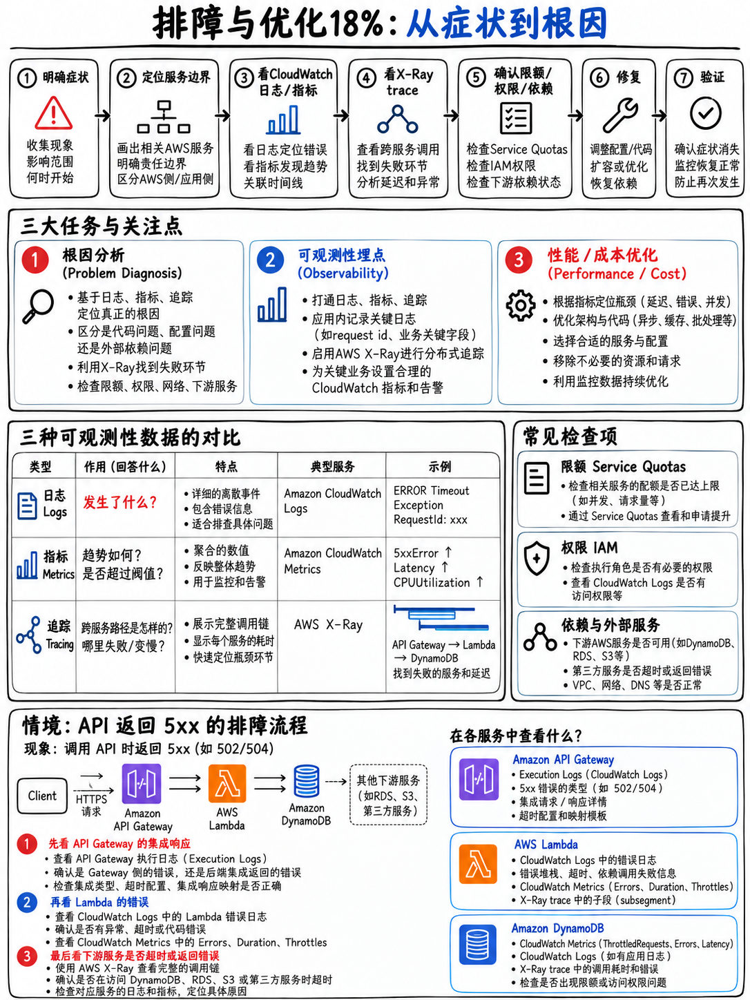

# 5.1 故障排查与优化领域概览 Domain 4 — Troubleshooting and Optimization (18%)



## 5.1.1 本领域的考查结构 (The shape of the domain)

| 维度 | 指标与说明 |
|---|---|
| 考试占比 | 计分内容的 **18%** [1] |
| 约合计分考题数 | 50 题中约占 **~9 题** |
| 任务陈述 (Tasks) | 3 项 |

在 **DVA-C03** 考试版本中，本领域的占比提升至 **22%** [5] —— 这是所有领域中增幅比例最大的一个。如果你参加的是 C03 版本，宁可过度准备这一模块，也绝不要轻视它。

AWS 官方考试指南中的三项任务陈述 [1]：

1. **协助进行根本原因分析 (Assist in a root cause analysis)**
2. **为系统可观测性进行代码探针埋点 (Instrument code for observability)**
3. **利用 AWS 服务和功能优化应用程序 (Optimize applications by using AWS services and features)**

## 5.1.2 各项任务具体考查内容 (What each task covers)

### 任务 1 — 协助根本原因分析 (Assist in a root cause analysis)

**核心知识点 (Knowledge of)** [1]：日志与监控系统 · **日志查询语言（例如 Amazon CloudWatch Logs Insights）** · 数据可视化 · 代码分析工具 · **常见 HTTP 状态码** · **SDK 生成的常见异常** · **AWS X-Ray 中的服务映射 (Service maps)**。

**核心技能要求 (Skills in)** [1]：调试代码以排查缺陷 · **解读应用程序指标、日志与分布式跟踪 (Metrics, logs, and traces)** · 查询日志 · **实现自定义指标（例如 CloudWatch 嵌入式指标格式 [EMF]）** · 使用仪表板监控应用程序健康状况 · **利用服务输出日志排查部署故障**。

### 任务 2 — 为系统可观测性进行代码探针埋点 (Instrument code for observability)

**核心知识点 (Knowledge of)** [1]：**分布式跟踪 (Distributed tracing)** · **日志、监控与可观测性之间的区别 (Differences between logging, monitoring, and observability)** · **结构化日志 (Structured logging)** · 应用程序指标（自定义指标、嵌入式 EMF、内置指标）。

**核心技能要求 (Skills in)** [1]：实施有效的日志策略 · **编写代码以发出自定义指标** · **为跟踪服务添加注解 (Annotations)** · 为特定事件配置告警通知（**配额限制、部署完成**）· 实施分布式跟踪。

### 任务 3 — 优化应用程序 (Optimize applications)

**核心知识点 (Knowledge of)** [1]：**缓存策略 (Caching)** · **并发控制 (Concurrency)** · 消息服务（SQS、SNS）。

**核心技能要求 (Skills in)** [1]：**对应用程序性能进行分析评测 (Profiling)** · **确定最低内存与计算资源配置** · **利用订阅筛选策略 (Subscription filter policies) 优化消息传递** · **基于请求标头 (Request headers) 缓存内容**。

## 5.1.3 日志 vs 监控 vs 可观测性 (Logging vs monitoring vs observability)

考试大纲明确指出了这三者之间的区分 [1]，因此你必须能够准确阐述：

| 维度 | 概念定义 | 对应 AWS 服务 |
|---|---|---|
| **日志 (Logging)** | 离散事件的历史记录 ——“发生了什么 (What happened)” | CloudWatch Logs |
| **监控 (Monitoring)** | 依据预设阈值度量已知指标信号 ——“系统是否健康 (Is it healthy)” | CloudWatch 指标 (Metrics) 与告警 (Alarms) |
| **跟踪 (Tracing)** | 追踪单次请求跨服务流转的全路径 ——“它流经了何处，在哪里发生延迟 (Where did it go, and where did it slow down)” | AWS X-Ray |
| **可观测性 (Observability)** | 无需重新发布新代码，即可洞察并回答关于系统的**全新未知**问题 —— 由上述三者以及充分的多维上下文组合而成的系统整体能力 | CloudWatch + X-Ray 协同构建 |

**可观测性的三大支柱是日志、指标与跟踪。** 当考题询问“团队无法分辨究竟是哪一个下游服务导致了延迟，应添加什么”时，正确答案永远是**跟踪 (Traces / X-Ray)**，而不是输出更多日志。

## 5.1.4 故障排查阶梯 (The debugging ladder)

这是一套值得刻入肌肉记忆的排查逻辑，考题场景往往从不同层级切入：

```
 1. 哪个组件报错？(WHAT is failing?)          HTTP 状态码或具体的异常类名称
 2. 故障发生在哪里？(WHERE is it failing?)     X-Ray 服务映射 → 哪个节点变红
 3. 为什么会失败？(WHY is it failing?)         查看该具体组件的 CloudWatch Logs
 4. 发生频次如何 / 始于何时？(HOW OFTEN?)      CloudWatch 指标与告警、Logs Insights 聚合查询
 5. 期间发生了什么变更？(WHAT CHANGED?)        CloudTrail 审计日志、部署历史、CloudFormation 事件
 6. 如何预防再次发生？(PREVENT RECURRENCE)     配置告警、自定义指标、重试/退避、自动化测试、回滚门禁
```

:::{tip}
**考试中最常见的两类排查场景**，它们分别在阶梯的不同层级给出答案：

- *“请求偶发性变慢，我们无法判断具体是哪个服务导致的。”*  
  → **AWS X-Ray**（阶梯第 2 级），而非盲目增加日志打印。
- *“我们需要统计过去一小时内，按客户维度划分，错误 X 一共发生了多少次。”*  
  → **CloudWatch Logs Insights**（阶梯第 4 级），若需要联动触发告警则使用**指标筛选器 (Metric Filter)**。
:::

## 5.1.5 模块内容编排 (How the domain is covered here)

| 文件 | 涵盖考点 |
|---|---|
| {doc}`02-cloudwatch-logs-metrics-alarms` | 日志、日志组、指标筛选器、Logs Insights、自定义指标、EMF、告警 |
| {doc}`03-x-ray-and-tracing` | 段 (Segments)、子段 (Subsegments)、注解 (Annotations) vs 元数据 (Metadata)、采样规则、服务映射 |
| {doc}`04-errors-limits-and-retries` | HTTP 状态码、SDK 常见异常、限流排查、退避抖动 —— 大纲中的“常见异常”专题 |
| {doc}`05-optimization-and-caching` | 缓存策略、CloudFront 优化、并发调优、内存选型计算、性能分析评测 |
| {doc}`06-troubleshooting-practice-set` | 20 道紧扣大纲任务陈述的深度实战解析题 |

## 5.1.6 快速复习要点 (Fast revision)

- 日志 = 发生了什么。指标 = 系统是否健康。跟踪 = 请求流经了何处。**可观测性** = 无需发布新代码即可解答系统的全新未知问题。
- “哪个下游服务变慢了？” → **X-Ray 服务映射 (Service Map)**。
- “事件 X 发生了多少次？” → **Logs Insights** 交互式查询；若需告警则使用**指标筛选器 (Metric Filter)**。
- “系统发生了什么变更/谁删除了资源？” → **CloudTrail** 与部署历史记录。
- 考试大纲明确点名提及了 **EMF**、**结构化日志**、**注解 (Annotations)**、**Logs Insights**、**服务映射 (Service Maps)** 和**订阅筛选策略 (Subscription Filter Policies)** —— 每一个都属于高频必考专业术语。
