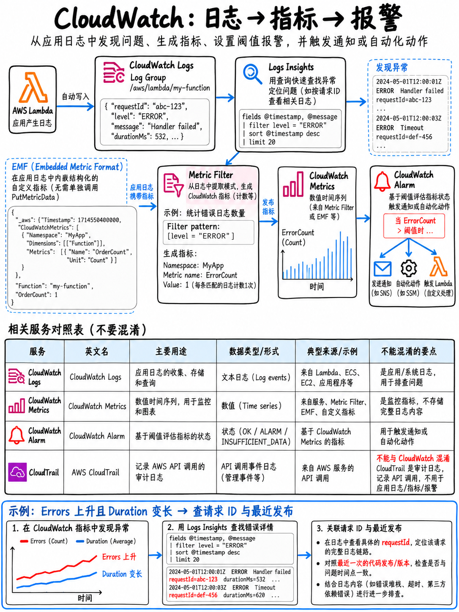

# 5.2 CloudWatch：日志、指标与告警 CloudWatch: Logs, Metrics, and Alarms



## 5.2.1 核心组件全景 (The pieces)

```
 CloudWatch 日志 (LOGS)                          CloudWatch 指标 (METRICS)
  日志组 Log Group (/aws/lambda/MyFn)             命名空间 Namespace (AWS/Lambda, MyApp)
    └ 日志流 Log Stream (每个实例/执行环境一个)       └ 指标 Metric (Invocations, Errors)
        └ 日志事件 Log Event                              └ 维度 Dimensions (FunctionName=MyFn)
                                                              └ 评估周期内的聚合统计量 (Statistics)
        │                                                     │
        │ 指标筛选器 (METRIC FILTER) ───────────────────────► │   将日志文本模式转化为
        │                                                     │   数值指标
        │ 订阅筛选器 (SUBSCRIPTION FILTER) ──► Lambda / Firehose / OpenSearch (实时流式导出)
        │                                                     │
        │ LOGS INSIGHTS (交互式查询语言)                       ▼
        │                                                 告警 (ALARM) ──► SNS 通知 / Auto Scaling /
        └ 保留期 RETENTION (默认: 永不过期)                                EC2 操作 / Systems Manager
```

## 5.2.2 日志系统 (Logs)

- **日志组 (Log Group)** 通常按应用程序或微服务/函数划分；**日志流 (Log Stream)** 则对应具体的执行环境容器或单个实例。
- **Lambda 会自动向 `/aws/lambda/<函数名称>` 写入日志** —— 前提是函数的执行角色 (Execution Role) 必须拥有 `logs:CreateLogGroup`、`logs:CreateLogStream` 和 `logs:PutLogEvents` 权限（即预置的 `AWSLambdaBasicExecutionRole` 托管策略）。

:::{danger}
**“Lambda 函数执行完全没有生成任何日志。”** 考题中出现此现象，第一排查点几乎永远是：**执行角色缺失 CloudWatch Logs 写入权限** —— 绝非代码中的日志记录库配置错误。这是故障排查领域中最稳定高频的单点考点之一。
:::

- **日志保留期 (Retention) 默认设置为“永不过期 (Never expire)”**，这往往会导致存储账单膨胀并违反企业合规策略。显式配置保留期（如 7 天、30 天）是解决“CloudWatch Logs 账单持续无休止增长”的标准答案。
- **EC2 实例和本地物理服务器必须安装并配置 Amazon CloudWatch Agent** 才能收集并推送系统日志。AWS 官方样题第 9 题的核心解法正是：“在 EC2 实例上安装并配置 **Amazon CloudWatch Agent**，将应用程序日志流式传输至 CloudWatch Logs” [18]。
- **加密控制**：使用 AWS KMS 密钥进行的静态加密是针对日志组 (Log Group) 级别进行配置的。

### 指标筛选器 (Metric Filters)

指标筛选器能够从非结构化或结构化的日志流文本中提取匹配模式，并将其转换为数字化的 **CloudWatch 指标**，随后便可在该指标上附加告警：

```
 筛选模式 (Filter pattern):  ?ERROR ?Exception ?"5xx"
 生成指标 (Metric):          MyApp/ErrorCount
 关联告警 (Alarm):           ErrorCount > 10（5 分钟内）→ 触发 SNS 通知
```

**再次参考 AWS 官方样题第 9 题** [18]：正确方案正是基于应用日志中的响应时间创建**指标筛选器 (Metric Filter)**，生成可视化图表，并创建 **CloudWatch 告警**，在响应时间平均值超出阈值时发送 Amazon SNS 通知。

**关键考点机制：指标筛选器仅对创建之后新摄入的日志事件生效** —— 它**不具备历史追溯计算能力 (Not retroactive)**。若需分析历史已有的日志数据，必须使用 **Logs Insights**。

### 订阅筛选器 (Subscription Filters)

订阅筛选器可近乎实时地将匹配指定模式的日志事件流式推送至外部目标：**AWS Lambda**、**Amazon Data Firehose**（原 Kinesis Data Firehose，进而写入 S3/Redshift）或 **Amazon OpenSearch Service**。当考题要求“将多源日志实时集中汇聚至 OpenSearch 进行检索”或“在产生某特定日志时即时触发无服务器计算响应”时，订阅筛选器是唯一的标准答案。

### CloudWatch Logs Insights

AWS 官方考试指南点名强调的专用交互式日志查询语言 [1]，语法清晰强大：

```
fields @timestamp, @message, @requestId
| filter @message like /ERROR/
| parse @message "duration=* ms" as duration
| stats count(*) as errors, avg(duration) as avgMs by bin(5m)
| sort @timestamp desc
| limit 100
```

你应当熟练掌握以下 Lambda 专属内置字段：`@duration`（实际执行时长）、`@billedDuration`（计费时长）、`@maxMemoryUsed`（最大内存消耗）、`@memorySize`（配置内存规格）、`@initDuration`（冷启动初始化时长）、`@requestId`（请求唯一 ID）。

:::{tip}
**通过对比 `@maxMemoryUsed` 与 `@memorySize`，是精准调整 Lambda 函数内存规格 (Right-sizing) 的法定标准方法**，对应大纲中的“确定应用程序的最低内存与计算资源配置”技能项 [1]。如果函数配置了 1024 MB，但日志分析显示其内存峰值从未超过 150 MB，则存在严重资源浪费（除非该函数为 CPU 密集型任务，需要依赖高内存配置换取成比例的多核算力）。
:::

## 5.2.3 指标系统 (Metrics)

| 特性维度 | 规则与考点细节 |
|---|---|
| **标准分辨率 (Standard Resolution)** | **1 分钟** 粒度 |
| **高分辨率 (High Resolution)** | **1 秒** 粒度（仅适用于自定义指标，需显式声明 `StorageResolution: 1`） |
| **EC2 基本监控 (Basic Monitoring)** | **5 分钟** 采样间隔，默认开启且完全免费 |
| **EC2 详细监控 (Detailed Monitoring)** | **1 分钟** 采样间隔，按指标收费 |
| **自定义指标 (Custom Metrics)** | 通过 SDK 的 `PutMetricData` API 进行推送发布 |
| **维度 (Dimensions)** | 每个指标最多支持 30 个键值对维度；**每一个独特的维度组合都会被视为完全独立的全新指标** |

**默认情况下绝不会由 AWS 自动采集的指标**（也是“如何监控 X”题目的核心陷阱）：EC2 实例内部的**内存利用率 (Memory Utilisation)** 和**磁盘可用空间 (Disk Space)**（必须安装 CloudWatch Agent 才能捕获），以及所有业务层指标（订单处理量、按客户划分的队列积压时长等）。

### 嵌入式指标格式 (Embedded Metric Format, EMF)

大纲显式点名考核项 [1]。开发者只需向 stdout 输出一段遵循特定 JSON Schema 结构的日志行，CloudWatch 即可**自动在后台异步提取出指标** —— 无需显式调用 `PutMetricData` API，没有任何额外的网络延迟开销，并且完整的业务上下文日志行依然保留在日志组中供深入排查。

```json
{
  "_aws": {
    "Timestamp": 1760000000000,
    "CloudWatchMetrics": [{
      "Namespace": "MyApp",
      "Dimensions": [["ServiceName", "Operation"]],
      "Metrics": [{ "Name": "ProcessingTime", "Unit": "Milliseconds" }]
    }]
  },
  "ServiceName": "orders",
  "Operation": "create",
  "ProcessingTime": 142,
  "orderId": "abc-123"
}
```

::::{important}
**EMF 是 AWS 官方在 DVA 考试中推荐 Lambda 发出自定义指标的绝对标准实践。**  
考题常见的题眼线索：
- `PutMetricData` 属于**同步 API 调用**，会直接增加函数运行执行时间（消耗计费时长），并在高并发突发时容易遭遇 API 限流 (`ThrottlingException`)。
- EMF 仅需执行本地日志打印（stdout），异步刷盘，吞吐量极大，成本显著低于频繁调用 API。
- EMF 能够将高基数业务字段（如上述 `orderId`）保留在日志中用于检索，同时将低基数维度作为聚合指标指标发布。
- 题目题干特征词：“在**不增加调用延迟**的前提下发布自定义业务指标”、“从 Lambda 函数高效输出自定义指标”、“既要聚合指标又需要保留详细业务上下文”。
::::

## 5.2.4 告警机制 (Alarms)

| 核心概念 | 考点说明 |
|---|---|
| **三大状态 (States)** | `OK`（正常）、`ALARM`（触发告警）、`INSUFFICIENT_DATA`（数据不足，处于初始或断流状态） |
| **评估周期机制** | `Period`（单周期时长）× `EvaluationPeriods`（连续评估周期数），配合 `DatapointsToAlarm` 支持 M 选 N 判定（如最近 5 个周期中有 3 次违例即报警） |
| **缺失数据处理策略 (Treat Missing Data)** | `missing`（标记为数据不足，默认）、`notBreaching`（视为正常安全）、`breaching`（视为超出阈值报警）、`ignore`（保持当前状态不变） |
| **关联触发操作 (Actions)** | 发送 Amazon SNS 通知、触发 Auto Scaling 伸缩策略、执行 EC2 停止/重启/终止操作、触发 Systems Manager 自动化运维流程 |
| **复合告警 (Composite Alarms)** | 使用逻辑与或非表达式（如 `ALARM(AlarmA) AND ALARM(AlarmB)`）将多个单项告警结合，极大降低误报与告警风暴 |
| **指标数学 (Metric Math) 与异常检测** | 支持基于多指标数学算式告警（如错误率 `(Errors/Invocations)*100`），或基于机器学习动态历史波段检测异常 |

基于**指标筛选器创建的告警**是实现根据日志异常关键字即时通知的黄金组合。而在 CI/CD 场景中，将告警绑定至 AWS CodeDeploy 的 `DeploymentPreference.Alarms` 配置项中，则是实现金丝雀部署违规**自动回滚**的关键解法（详见 {doc}`../40-deployment/04-deployment-strategies`）。

此外，大纲明确强调“针对特定操作配置告警通知（如**服务配额超限**或**部署成功/失败通知**）”[1] —— 结合 Service Quotas 指标告警以及基于 **EventBridge 规则监听 CodePipeline / CloudFormation 部署事件** 均是典型考点。

## 5.2.5 CloudWatch vs CloudTrail —— 绝对不可混淆

| 比较维度 | **Amazon CloudWatch** | **AWS CloudTrail** |
|---|---|---|
| **核心记录内容** | **运行性能与运行时日志** —— 应用程序在执行什么 | **管理与数据面 API 调用** —— 谁在何时从何地调用了哪个接口 |
| **解答的核心疑问** | “系统是否变慢？错误率是否超标？” | “**谁把生产数据库表删除了？**” |
| **默认状态** | 指标默认开启并保留 | 管理事件 (Management Events) 默认在事件历史中免费记录 90 天 |
| **数据事件 (Data Events)** | —— | S3 对象读写、Lambda 调用等细粒度数据操作，**默认关闭且需额外付费** |

**解题口诀**：“是谁（Who）删除/修改/创建了某个资源”永远选 **CloudTrail**；“为什么报错/当前运行速度有多慢”永远选 **CloudWatch**。

## 5.2.6 快速复习要点 (Fast revision)

- Lambda 完全不输出日志 → **执行角色缺失 `logs:*` 权限（如缺少 `AWSLambdaBasicExecutionRole`）**。
- 日志保留期默认**永不过期** —— 需手动配置 retention 策略控制存储成本。
- EC2 监控系统日志、**内存使用率**和**磁盘空间**必须安装配置 **CloudWatch Agent** [18]。
- **指标筛选器 (Metric Filter)**：日志文本模式 → 数值指标 → 告警通知；**不具备历史追溯能力**。
- **订阅筛选器 (Subscription Filter)**：将匹配的日志近实时流式转发至 Lambda、Data Firehose 或 OpenSearch。
- **Logs Insights**：交互式类 SQL 查询；利用 `@maxMemoryUsed` 和 `@initDuration` 进行性能规格压测调优。
- **EMF (嵌入式指标格式)**：以结构化 JSON 日志行异步输出自定义指标，绝不阻塞请求，规避 `PutMetricData` 延迟与限流。
- 告警状态包含 `OK` / `ALARM` / `INSUFFICIENT_DATA`；善用缺失数据策略；**复合告警 (Composite Alarms)** 可有效削减告警噪音。
- **CloudTrail 记录“谁在何时做了什么”；CloudWatch 记录“系统当前运行状态与性能”。**
