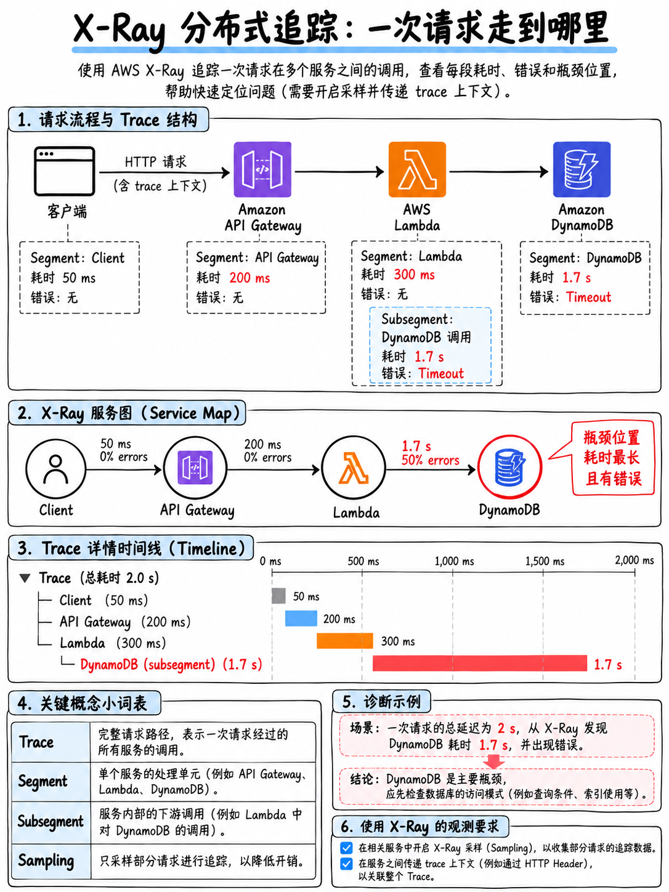

# 5.3 AWS X-Ray 与分布式跟踪 AWS X-Ray and Distributed Tracing



AWS 官方考试指南显式列出：“AWS X-Ray 中的服务映射 (Service maps)”、“分布式跟踪 (Distributed tracing)”、“为跟踪服务添加**注解 (Annotations)**”以及“使用 AWS 服务和工具实施跟踪” [1]。

## 5.3.1 X-Ray 的核心作用 (What X-Ray is for)

**全链路追踪单次请求跨越的所有微服务与底层组件。** 日志只能告诉你单个独立组件内部执行了什么；而分布式跟踪（Trace）则能描绘请求流转的完整拓扑图谱，并精准指出时间究竟消耗在哪个环节。

```
 客户端 ──► API Gateway ──► Lambda ──► DynamoDB
                             │
                             └──────► SNS ──► Lambda ──► 外部 HTTP API
                                                            ▲
   X-Ray 通过在请求头中传递的  X-Amzn-Trace-Id  全局唯一追踪 ID，
   将上述所有离散调用缝合成一条完整的跟踪记录 (ONE TRACE)。
```

## 5.3.2 核心专业术语表 (The vocabulary)

| 术语 | 定义与考点 |
|---|---|
| **跟踪 (Trace)** | 单次请求端到端的完整流转生命周期，由全局唯一的 Trace ID 唯一标识 |
| **段 (Segment)** | 请求流经的**单个计算服务节点**（如 API Gateway、Lambda 计算环境、ECS 容器）所计算记录的数据块 |
| **子段 (Subsegment)** | 段**内部**更细粒度的调用工作单元 —— 例如一次 DynamoDB 读写、一次下游 HTTP 外部请求，或一段自定义业务代码块 |
| **服务映射 (Service Map)** | 由 X-Ray 自动生成的端到端拓扑服务依赖图，展示各节点的调用延迟、请求速率与错误率。**是排查“哪个组件变慢/发生故障”的首选入口** |
| **采样规则 (Sampling Rule)** | 决定哪些请求需要被跟踪记录，防止高并发场景下产生过多数据与高昂成本 |
| **注解 (Annotation)** | **已建立索引 (Indexed)** 的键值对属性，支持在控制台或 API 筛选表达式中进行快速过滤检索 |
| **元数据 (Metadata)** | **未建立索引 (Not Indexed)** 的键值对数据 —— 随跟踪记录一同存储与展示，但无法用于表达式过滤检索 |

::::{important}
**注解 (Annotations) 与元数据 (Metadata) 的对比是 X-Ray 在考试中最核心的必考点。** 官方大纲明确指名考核“Annotations” [1]。

| 对比维度 | **注解 (Annotation)** | **元数据 (Metadata)** |
|---|---|---|
| 是否建立索引 (Indexed) | **是 (Yes)** | 否 (No) |
| 是否支持控制台/API 筛选过滤 | **支持**（如 `annotation.customerId = "abc"`） | 不支持（仅在打开 Trace 详情时展示） |
| 单条限制数量 | 每个 Trace 最多 **50 个** 键值对 | 支持存储体积更大、更复杂的任意对象结构 |
| 最佳适用场景 | 需要用于查询检索的标识符：客户 ID、订单 ID、租户标识 (Tenant)、环境类型 | 丰富的现场排查上下文：完整的请求/响应 Payload、中间计算过程变量等 |

**解题口诀**：“团队必须能够检索/筛选特定客户的所有请求链路” → **Annotation（注解）**。“团队希望在点击查看 Trace 详情时能够看到完整的请求报文” → **Metadata（元数据）**。
::::

## 5.3.3 启用与接入配置 (Enabling X-Ray)

| 运行环境 | 配置方法与权限要求 |
|---|---|
| **AWS Lambda** | 开启**主动跟踪 (Active Tracing)**（CloudFormation 中为 `TracingConfig: Active`；SAM 中为 `Tracing: Active`）。Lambda 服务自身会自动创建 Segment；X-Ray SDK 则负责捕获下游调用的 Subsegment。**函数的执行角色必须拥有 `xray:PutTraceSegments` 和 `xray:PutTelemetryRecords` 权限**（即托管策略 `AWSXRayDaemonWriteAccess`） |
| **Amazon API Gateway** | 在具体的 API 阶段 (**Stage**) 设置中直接勾选开启“Enable X-Ray Tracing” |
| **EC2 / ECS / 本地环境** | 必须在后台运行 **X-Ray 守护进程 (X-Ray Daemon)**（在 ECS 上通常作为 Sidecar 容器运行，监听 UDP 2000 端口），并在代码中引入 X-Ray SDK 埋点 |
| **AWS Elastic Beanstalk** | 在环境配置或 `.ebextensions` 配置文件中开启 X-Ray Daemon 选项 |
| **SDK 代码探针注入** | 使用 X-Ray SDK 包装/打补丁 (Patch) 原生 AWS SDK 客户端与 HTTP 客户端，所有下游远程调用将自动生成 Subsegment |

:::{warning}
**“已在服务中开启了 X-Ray，但控制台完全看不到任何 Trace 记录。”** 考题中最典型的两大根本原因：
1. **执行角色或实例角色缺失 `xray:PutTraceSegments` 权限**；
2. 在 EC2 或 ECS 容器环境中，**X-Ray 守护进程 (X-Ray Daemon) 没有启动运行**。  
注意：在 Lambda 环境中，AWS 会在底层宿主机自动托管守护进程，无需用户自行启动 Daemon，因此在 Lambda 题目中原因**一定是 IAM 权限配置缺失**。
:::

## 5.3.4 采样规则 (Sampling Rules)

默认采样规则 (Default Sampling Rule)：**每秒记录第 1 个请求（即储库 Reservoir = 1 req/sec），并对该秒内超出此限制的流量按 5% 的固定费率进行采样 (Fixed Rate = 0.05)**。

开发者可以通过创建自定义采样规则，针对特定的服务名、HTTP 请求方法、URL 路径或域名定制储库大小与采样率：
- **“高流量生产环境下跟踪成本过于高昂”** → 创建自定义采样规则，降低采样百分比。
- **“必须 100% 捕获所有对 `/checkout` 结账接口的请求跟踪”** → 为该接口路径单独配置专用规则，将固定采样率设为 1 (100%)。
- 采样判定一旦在入口节点做出，将通过 `X-Amzn-Trace-Id` 请求头向下游各服务透明透传，确保整条调用链要么全量采样，要么均不记录。

## 5.3.5 解读跟踪瀑布图 (Reading a trace)

```
 Trace 1-5f8a... 总延迟: 842 ms
 ├─ API Gateway                                 842 ms  ████████████████████
 │   └─ Lambda (orders-create)                  838 ms  ███████████████████▉
 │        ├─ Initialization (冷启动初始化)        410 ms  █████████▊
 │        ├─ DynamoDB PutItem                    12 ms  ▎
 │        └─ HTTP POST payments.example.com     402 ms  █████████▌   ← 瓶颈在此处
 └─ (fault) payments.example.com 返回 502
```

**考试考查的核心思维模型**：根据上述瀑布图，问题的根本瓶颈**并不是**业务自身代码执行缓慢，而是**冷启动耗时过长 (410 ms)** 加上**第三方支付依赖服务响应迟缓且抛错 (402 ms, 502 Fault)**。  
因此，正确的治理措施是配置 **预置并发 (Provisioned Concurrency)** 消除冷启动，并在对外 HTTP 请求处配置**超时控制、指数退避重试或断路器 (Circuit Breaker)** —— 盲目调大 Lambda 内存规格或扩大 DynamoDB 读写容量对于解决此问题毫无益处。

| 标记类型 (Marker) | 含义与判定依据 |
|---|---|
| **Error (错误)** | 对应客户端错误，即 HTTP **4xx** 状态码 |
| **Fault (故障)** | 对应服务端故障，即 HTTP **5xx** 状态码 |
| **Throttle (限流)** | 对应超过速率限制，即 HTTP **429** 状态码 |

## 5.3.6 周边关联可观测性工具

- **CloudWatch ServiceLens**：将 X-Ray 分布式链路拓扑图与 CloudWatch 指标、日志深度集成在统一界面中下钻分析。
- **CloudWatch Application Signals / Synthetics Canaries (合成监控金丝雀)**：通过定时执行无头脚本从外部主动探测端点，用于识别“API 是否发生宕机不可达”，而非被动观察“延迟是否偏高”。
- **AWS Distro for OpenTelemetry (ADOT)**：AWS 提供的厂商无关、遵循 OpenTelemetry 开源标准的探针分发版，支持将链路遥测数据无缝导出至 AWS X-Ray 及其他开源后端。

## 5.3.7 快速复习要点 (Fast revision)

- 链路全景：跟踪 (Trace) → 段 (Segment，单一服务) → 子段 (Subsegment，具体调用)。
- 寻找性能瓶颈时，“排查哪个服务变慢”永远**首选 X-Ray 服务映射 (Service Map)**。
- **注解 (Annotations) 已建立索引，支持表达式检索（上限 50 个）；元数据 (Metadata) 不建索引，不可用于搜索筛选。**
- Lambda 开启方式：**Active Tracing** + **执行角色配置 `xray:PutTraceSegments` 权限**。EC2/ECS 环境必须运行 **X-Ray Daemon**。
- Trace 缺失无数据：检查 **IAM 权限**，或检查 **Daemon 进程是否运行**。
- 默认采样策略：**1 次/秒 + 5% 超出流量**；通过自定义规则可灵活平衡成本与采样率。
- **4xx 记为 Error，5xx 记为 Fault，429 记为 Throttle。**
