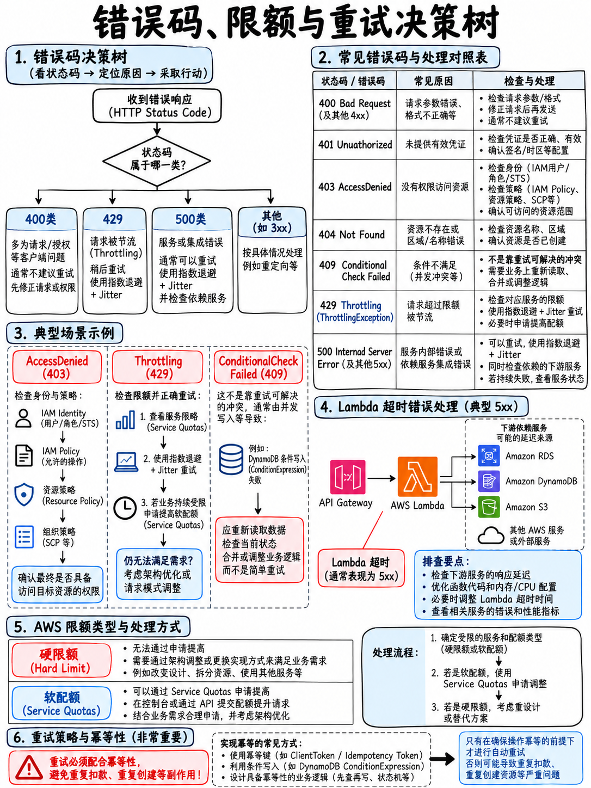

# 5.4 错误状态码、服务配额与重试退避 Errors, Limits, and Retries

“常见 HTTP 状态码”与“SDK 生成的常见异常”是考试大纲中明文列出的知识考点 [1]。本节内容是高频解题速查字典，值得重点精读 —— 在域 4（故障排查与优化）中，大量考题的核心就是考察对具体错误异常名称含义的理解。

## 5.4.1 HTTP 状态码核心速查 (HTTP status codes)

| 状态码 | 标准含义 | 在 AWS 考试场景下的典型触发条件 |
|---|---|---|
| **200** | OK（成功） | 请求处理成功并正常返回数据 |
| **201** | Created（已创建） | 资源创建成功（如 S3 PutObject、DynamoDB 插入新记录） |
| **202** | Accepted（已接受） | **异步处理长任务的标准响应**。请求已入队受理，但尚未完成处理 |
| **301 / 302** | Moved（永久/临时重定向） | 请求重定向（如 S3 存储桶网站静态重定向规则） |
| **304** | Not Modified（未修改） | 客户端缓存或 CloudFront 边缘缓存命中，无需重新传输数据体 |
| **400** | Bad Request（错误请求） | 请求格式不合规；API Gateway **请求验证器 (Request Validation)** 拦截非法 Payload |
| **401** | Unauthorized（未授权） | **身份认证 (Authentication)** 失败或缺失凭证（如缺 Authorization 请求头） |
| **403** | **Forbidden（禁止访问）** | **授权鉴权 (Authorization)** 失败：IAM 策略拒绝、资源策略拒绝、AWS WAF 规则拦截、缺失/无效的 API Key、S3 开启了阻止公共访问 (Block Public Access) |
| **404** | Not Found（未找到） | 资源路径错误、S3 对象不存在、API Gateway 未部署阶段 (Undeployed Stage) |
| **409** | Conflict（冲突） | 存在并发更新冲突或版本冲突 |
| **429** | **Too Many Requests（请求过多）** | **限流 (Throttling)**。超出 API Gateway 速率限制或使用计划配额；超出底层服务并发配额 |
| **500** | Internal Server Error（内部错误） | 后端计算代码抛出未捕获的运行时异常崩溃 |
| **502** | **Bad Gateway（网关错误）** | **Lambda 代理集成 (Proxy Integration) 返回的响应格式不合规**；或后端返回了无法解析的报文 |
| **503** | Service Unavailable（服务不可用） | 后端服务过载或宕机不可达 |
| **504** | **Gateway Timeout（网关超时）** | 集成后端处理超时 —— **API Gateway 严格限制最大集成超时为 29 秒** |

:::{important}
**401 与 403 的核心区分**：
- **401** 意味着“系统不知道你是谁”（身份未认证或凭证无效）。
- **403** 意味着“系统知道你是谁，但你无权执行此操作”（授权被拒绝）。在 AWS 考试中，绝大多数权限报错均表现为 **403 Forbidden**。

**502 与 504 的核心区分**：
- **502** 意味着后端虽然响应了，但返回的格式有误。在 API Gateway + Lambda 代理集成中，**502 几乎百分之百是响应报文格式不符合约定所致**（缺少 `statusCode` 或 `body` 不是字符串，详见 {doc}`../20-development/03-api-gateway` §2.3.2）。
- **504** 意味着后端在规定时间内根本没有做出响应，触发超时。
:::

## 5.4.2 常见 SDK 异常类解析 (SDK exceptions worth recognising)

| 异常类名称 | 所属服务 | 故障含义与标准应对方案 |
|---|---|---|
| **`ProvisionedThroughputExceededException`** | DynamoDB | 读写吞吐量超出预置配额，通常由于**热点分区键 (Hot Partition)** 导致。处理方案：指数退避重试；优化分区键离散度；开启自动伸缩或按需模式；引入 DAX 缓存加速 |
| **`ConditionalCheckFailedException`** | DynamoDB | `ConditionExpression` 条件判断为假 —— 说明**乐观并发锁竞争失败**，或尝试写入的主键已存在。这通常属于可预期的业务逻辑，并非系统故障 |
| **`ThrottlingException` / `TooManyRequestsException`** | 多种服务 | 触发 API 调用速率限制。处理方案：**实施带抖动的指数退避重试 (Exponential backoff with jitter)** |
| **`RequestLimitExceeded`** | EC2 等服务 | 触发控制面 API 调用速率上限 |
| **`ValidationException`** | 多种服务 | 请求参数格式错误、取值越界或缺失必填字段 —— 属于代码缺陷与 Bug，**绝不应重试** |
| **`AccessDeniedException`** | 多种服务 | 权限不足。排查顺序：身份策略、基于资源的策略、**以及 AWS KMS 密钥策略 (KMS Key Policy)** |
| **`ResourceNotFoundException`** | 多种服务 | 指定资源名称错误、所处 Region 错误或资源尚未创建就绪 |
| **`ServiceException` / `InternalServerError` (5xx)** | 多种服务 | **AWS 平台内部瞬态故障 —— 应当使用指数退避安全重试** |
| **`ExpiredIteratorException`** | Kinesis | 分区迭代器 (Shard Iterator) 已失效过期（默认寿命 5 分钟）；解决方案：重新向 Kinesis 申请新的迭代器 |
| **`ExpiredTokenException`** | STS | 临时安全凭据 (Security Credentials) 已过期；重新调用 STS AssumeRole 获取新凭证 |
| **`LimitExceededException`** | 多种服务 | 超出 AWS 账户或地域维度的软性服务配额限制 |
| **`InvalidParameterValueException`** | Lambda 等服务 | 配置参数值非法或不兼容 |

::::{tip}
**考试中的重试准则 (The retry rule):**

| 是否重试？ | 适用的错误状态与异常类型 |
|---|---|
| **是：使用带随机抖动的指数退避重试** | HTTP 429、500、502、503、504、`ThrottlingException`、`ProvisionedThroughputExceededException`、`ServiceException` |
| **否：直接捕获报错并修复代码** | HTTP 400、403、404、`ValidationException`、`AccessDeniedException`、`ResourceNotFoundException` |

**切记：对除 429 以外的 4xx 客户端错误进行重试永远是错误的答题选项** —— 这类错误由于入参或权限有缺陷，无论重复发送多少次，结果必然是一模一样的失败。
::::

## 5.4.3 服务配额体系：软性配额 vs 硬性限制 (Quotas: soft and hard)

| 配额类型 | 典型代表 | 是否可以通过工单调高？ |
|---|---|---|
| **软性配额 (Soft Quotas)** | Lambda 单 Region 并发执行数（默认 1,000）、每 Region VPC 数量、API Gateway 每秒请求速率限制 | **可以**。通过 AWS Service Quotas 控制台或提交 Support 申请工单上调 |
| **硬性限制 (Hard Limits)** | Lambda 最大超时 **900 秒 (15 分钟)**、Lambda `/tmp` 临时目录 **10,240 MB (10 GB)**、SQS 单条消息体 **256 KB**、KMS `Encrypt` 直接加密明文 **4 KB**、DynamoDB 单条记录 **400 KB**、API Gateway 最大集成超时 **29 秒** | **绝对不可调高**。遇到此类瓶颈必须在架构设计层面做出重构 |

:::{danger}
**考试中的典型陷阱选项：** 当场景中涉及的是**硬性限制**时，干扰选项往往给出“向 AWS 提交工单申请提升服务配额”。  
如果题目描述任务需要执行 20 分钟、SQS 需要传递 5 MB 报文、或 HTTP 请求需要等待 45 秒响应，正确答案永远是**重构架构设计** —— 改造为 AWS Step Functions 编排、使用 S3 存储桶暂存大文件并传递指针（Claim Check 模式）、改用 HTTP 202 异步轮询机制，而绝对不要选择提升服务限额。
:::

根据大纲技能要求，针对“**服务配额超限通知 (Quota Limits)**” [1]，可以通过 **Service Quotas** 联动 CloudWatch 指标和告警，在资源用量逼近阈值时提前预警。

## 5.4.4 Lambda 常见故障特征速查表 (Lambda failure signatures)

| 报错现象与特征 | 根本原因与解决方案 |
|---|---|
| `Task timed out after N seconds` | 函数执行超时 —— 下游外部依赖响应过慢，或分配的 CPU/内存算力不足 |
| `Runtime exited with error: signal: killed` / Out of Memory | 内存溢出 (OOM) 导致进程被终止 —— 需调大函数内存规格 (Memory Size) |
| 函数执行成功却完全没有任何日志 | **执行角色缺少 CloudWatch Logs 写入权限**（缺少 `AWSLambdaBasicExecutionRole`） |
| `Unable to import module` | 代码包中缺失依赖库 —— 将依赖构建为 **Lambda 层 (Layer)** 或重新打包分发 |
| Handler 内部抛出 `AccessDeniedException` | 函数执行角色缺少访问具体下游 AWS 资源的 IAM 权限 |
| 函数日志显示已正常执行完毕，但 API Gateway 报错 502 | **代理集成响应格式非法** —— 必须包含整数 `statusCode` 与字符串类型的 `body` |
| `TooManyRequestsException` / `Rate Exceeded` | 遭遇函数并发上限限流 —— 配置**预留并发 (Reserved Concurrency)** 或申请提升账户并发上限 |
| 首次调用响应极度缓慢，后续调用恢复正常 | **冷启动 (Cold Start)** 耗时 —— 为关键函数配置**预置并发 (Provisioned Concurrency)**，或开启 SnapStart（Java） |
| 将函数连接至 VPC 后，所有外部网络调用均发生超时 | 函数所在子网**缺失 NAT 网关**，或未配置对应的 **VPC 终端节点 (VPC Endpoints)** |
| SQS 队列中的同一条消息被 Lambda 重复消费处理 | **SQS 可见性超时 (Visibility Timeout) 设置短于 Lambda 函数的最大执行时长** |
| Kinesis 消息流处理卡死停滞不前 | 遭遇**毒丸记录 (Poison Record)** 导致不断重试失败 —— 开启故障二分法拆分批次 (Bisect on Error)、限制最大重试次数并配置失败目的地 (On-Failure Destination) |

## 5.4.5 部署故障排查指南 (Deployment failure diagnosis)

大纲显式要求掌握“利用服务输出日志排查部署故障”的技能 [1]：

| 部署工具/服务 | 首要排查位置与策略 |
|---|---|
| **AWS CloudFormation** | 查看 **Stack Events（堆栈事件）** —— 重点关注**第一个**状态为 `CREATE_FAILED` 或 `UPDATE_FAILED` 的事件（而非最后触发回滚的事件） |
| **AWS CodeBuild** | 查看 CloudWatch Logs 中的完整构建日志，定位报错发生在哪一个生命周期阶段 (`build`、`pre_build` 或 `post_build`) |
| **AWS CodeDeploy** | 查看控制台中的**部署生命周期事件 (Lifecycle Event)** 执行状态日志，以及目标 EC2 实例本地的 `/var/log/aws/codedeploy-agent/codedeploy-agent.log` |
| **AWS CodePipeline** | 查看失败阶段中具体 Action 的错误信息详情，跟随链接跳转至底层对应的 CodeBuild/CodeDeploy 控制台进一步深挖 |
| **Amazon ECS 任务部署** | 查看停止任务的 **Stopped Reason（停止原因）**（如 `Essential container in task exited`），并结合容器输出的 CloudWatch Logs 进行定位 |
| **Lambda 代码部署** | 查看 CloudFormation 事件，检查函数的 IAM 权限配置与包体积限制 |

:::{tip}
**CloudFormation 排查黄金法则：只看第一个失败事件，不要看最后一个。**  
堆栈回滚触发后会产生一连串级联的失败事件；唯独第一个带有详细状态说明 (Status Reason) 的 `..._FAILED` 事件，才记录了造成失败的真正根本原因。
:::

## 5.4.6 快速复习要点 (Fast revision)

- **403** = 授权失败/被拒绝（AWS 访问权限问题最常见状态码）。**429** = 被限流。**502** = Lambda 代理集成响应格式错误。**504** = 网关超时，API Gateway 硬性上限为 **29 秒**。
- 重试准则：**429 与 5xx 使用带抖动的指数退避重试**；对其他 4xx 错误**绝不重试**。
- `ProvisionedThroughputExceededException` → 热点分区/预置吞吐不足。`ConditionalCheckFailedException` → 乐观并发锁正常拦截。`ValidationException` → 代码传参缺陷。`ExpiredIteratorException` → 重新申请迭代器。
- **硬性配额**（Lambda 900 秒、SQS 256 KB、KMS 直接加密 4 KB、DynamoDB 单条记录 400 KB、API Gateway 29 秒、Lambda `/tmp` 10 GB）无法工单调高 —— 必须进行架构重构。
- Lambda 无日志输出 → **执行角色缺少 `logs:*` 权限**。
- CloudFormation 部署报错 → 检索事件列表中**最靠前的第一个** `_FAILED` 事件。
