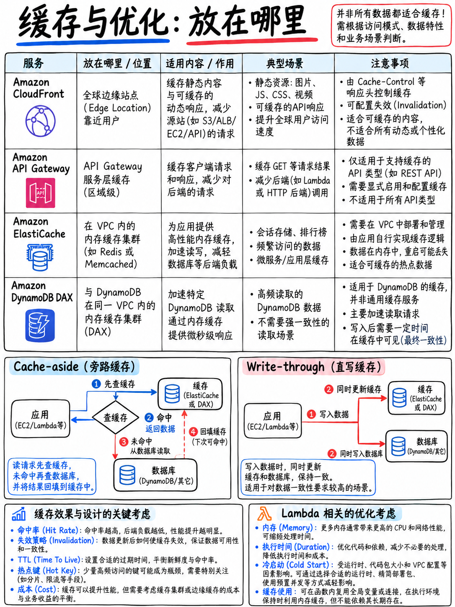

# 5.5 性能优化与缓存架构 Optimization and Caching



考试大纲在域 4 任务 3 中明确点名考核：缓存机制、并发控制、消息传递服务、“对应用程序性能进行分析评测 (Profiling)”、“确定最低内存与计算资源配置”、“利用订阅筛选策略优化消息传递”以及“基于请求标头 (Request headers) 缓存内容” [1]。

## 5.5.1 缓存策略详解：读伪代码识别核心模式 (The caching strategies)

| 缓存策略 | 工作原理与流程 | 优缺点权衡 (Trade-off) |
|---|---|---|
| **懒加载 / 旁路缓存 (Lazy Loading / Cache-Aside / Read-Through)** | 读取时先检查缓存；**未命中 (Cache Miss)** 时，从后端数据库读取数据，并将结果写入缓存后返回 | 仅缓存真正被访问的数据，节省内存；**初次请求响应较慢**；若无更新机制可能读到陈旧脏数据 |
| **写入直写 (Write-Through)** | 当应用程序执行**写入或更新**时，同时向数据库与缓存中写入最新数据 | 缓存中的数据永远保持最新；**写入延迟略有增加**；可能会缓存大量从未被读取过的数据 |
| **存活时间 (TTL - Time to Live)** | 为每个缓存条目设置过期生命周期 | 限制数据陈旧度的最有效兜底手段；通常与上述两种策略组合使用 |

::::{important}
**AWS 官方样题第 7 题要求根据伪代码特征识别懒加载模式** [18]：

```
record_value = cache.get(record_key)
if (record_value == NULL)
    record_value = db.query("SELECT Details FROM Records WHERE ID == {0}", record_key)
    cache.set(record_key, record_value)
```

AWS 官方权威解析：“懒加载 (Lazy loading) 是一种直到真正需要某条记录时才将其加载入缓存的策略。在实现懒加载时，应用程序**首先检查缓存**中是否存在该记录。如果不存在，应用程序再从底层数据库中检索数据，并**将检索结果存入缓存**” [18]。

**解题技巧：看伪代码的控制流骨架。**  
- “先读缓存 → 未命中读数据库 → 回填缓存” = **懒加载 (Lazy Loading)**。  
- “写数据库 → 紧接着写入缓存” = **写入直写 (Write-Through)**。
::::

**考试中的最佳实践组合**：**懒加载 (Lazy Loading) + TTL 过期控制** —— 既保证只缓存高频热点数据，又通过 TTL 确保数据陈旧度在可控时间窗口内。

## 5.5.2 缓存技术选型决策树 (Which cache to use)

```
 专门为 DYNAMODB 读操作提供微秒级加速  ────────►  Amazon DynamoDB Accelerator (DAX)
      微秒级响应、无缝兼容原有 API、直写模式、最终一致性
 缓存通用数据（会话 Session 状态、复杂 DB 查询结果、实时排行榜）
      ├── 需要丰富数据结构、发布订阅 (Pub/Sub)、持久化备份、跨 AZ 故障转移 ──►  ElastiCache for REDIS
      └── 纯简单键值存储、多线程并发架构、需要纯水平横向伸缩节点      ──►  ElastiCache for MEMCACHED
 在边缘节点缓存 HTTP 静态/动态响应  ──────────────►  Amazon CloudFront 边缘缓存
 在 API 接口层缓存 API 响应报文   ────────────────►  API Gateway 阶段缓存 (Stage Cache)
 在 Lambda 函数内部缓存配置参数或敏感凭据 ────────►  Parameters and Secrets 扩展程序，
                                                    或利用全局执行上下文变量 (Global Context)
```

| 特性对比 | **Amazon ElastiCache for Redis** | **Amazon ElastiCache for Memcached** |
|---|---|---|
| **复杂数据结构** | 支持字符串、列表 (List)、集合 (Set)、有序集合 (Sorted Set)、哈希 (Hash) | 仅支持简单字符串 (Strings / Key-Value) |
| **数据持久化与快照备份** | **支持**（AOF 与 RDB 快照） | 不支持（纯内存临时存储） |
| **高可用与多可用区故障转移** | **支持**（主从副本、Multi-AZ 自动故障转移） | 不支持（节点故障数据即丢失） |
| **高级能力** | 支持 Pub/Sub 消息机制、事务、Lua 脚本、地理空间索引 | 无 |
| **多线程支持** | 主要为单线程处理模型 | **原生多线程支持**，可充分压榨多核 CPU 算力 |
| **横向伸缩机制** | 通过集群分片 (Sharding) 与只读副本伸缩 | **直接水平横向增加节点 (Add Nodes)** |

**快速决策法则**：只要场景提及数据持久化、自动故障转移 (Failover)、只读副本或复杂数据结构（如排行榜）→ 选 **Redis**。如果是海量高并发、多线程、纯简单的无状态对象键值缓存 → 选 **Memcached**（官方样题第 7 题即以 Memcached 作为通用记录缓存 [18]）。

**注意区分 Amazon MemoryDB for Redis**：MemoryDB 具备完整的分布式事务日志持久化保证，是兼容 Redis 协议的**主数据库 (Primary Database)**，而非单纯的加速缓存层。当考题强调“将内存级超低延迟作为核心主数据库，且绝不可丢失数据”时选 MemoryDB。

## 5.5.3 CloudFront 边缘缓存与基于请求标头缓存

大纲明确列出“基于请求标头缓存内容 (Caching content based on request headers)”[1]：

- **缓存键 (Cache Key)**：决定了 CloudFront 将哪些请求视为同一份资源。默认仅使用 URL 路径；在缓存策略 (Cache Policy) 中，你可以将特定的 **Headers（请求标头）**、**Query Strings（查询字符串）** 与 **Cookies** 纳入缓存键。
- **缓存命中率权衡**：纳入缓存键的维度越多，不同请求的唯一组合就越多，**缓存命中率就会相应降低**。因此，仅将真正影响响应内容的标头（如 `Accept-Language`、`CloudFront-Viewer-Country`）加入缓存键。
- **源请求策略 (Origin Request Policy)**：专门控制在缓存未命中时，哪些标头、查询参数和 Cookie 需要**透传转发**给源站 —— 这与缓存键的定义是完全解耦的。
- **TTL 控制规则**：包含 `MinTTL`、`DefaultTTL` 和 `MaxTTL`。在三者限定的区间内，源站返回的 `Cache-Control: max-age` 或 `Expires` 响应头将决定生效时间。
- **失效刷新策略**：
  - **创建失效 (Invalidation)**：从边缘节点强制清除缓存（如 `/*`）；批量失效会产生调用费用。
  - **文件版本化命名 (Versioned Object Names)**（如 `main.v2.js` 或 `style.abc123.css`）：**推荐的最佳实践**，零成本、更新即时生效且规避版本混杂。
- **安全与私有访问**：
  - **源站访问控制 (Origin Access Control, OAC)**：配置 S3 专用身份策略，确保 S3 存储桶仅允许 CloudFront 分发访问，拒绝公网直连。
  - **签名 URL (Signed URLs)**：针对单个私有文件进行临时授权（如单个付费视频下载）。
  - **签名 Cookie (Signed Cookies)**：针对一组多个私有文件授权（如订阅用户访问受保护的整个静态站点）。
- **边缘计算选型**：
  - **CloudFront Functions**：轻量级纯 JavaScript 运行时、亚毫秒级延迟、仅在边缘节点处理 Viewer Request / Viewer Response。适用于标头重写、URL 重定向、规范化缓存键。
  - **Lambda@Edge**：支持完整 Node.js/Python 运行时、支持访问外部网络与 AWS SDK、可在 Origin Request / Origin Response 运行。适用于耗时复杂的身份鉴权、动态源站路由或响应体篡改。

## 5.5.4 计算资源深度优化 (Compute optimisation)

**AWS Lambda 内存是调节性能与成本的核心杠杆，因为 CPU 算力与网络带宽严格与分配的内存成正比**（详见 {doc}`../20-development/02-lambda-deep-dive` §2.2.2）。

标准性能调优方法论：
```
 1. 运行函数并在 CloudWatch Logs 中观察分析 @maxMemoryUsed、@duration 与 @billedDuration。
 2. 若 @maxMemoryUsed 远低于当前配置的 @memorySize，且函数主要处于 I/O 阻塞等待下游响应：
    应当下调内存规格以直接节省计费成本。
 3. 若函数为 CPU 密集型计算任务：
    应当尝试增大内存规格！此时 CPU 算力成比例提升，执行时长往往呈陡峭下降，
    最终计算出的综合总成本基本持平甚至更低，同时显著改善了用户端延迟。
 4. 在生产实践中，使用开源工具 AWS Lambda Power Tuning（基于 Step Functions 状态机）
    自动进行多规格网格化压测，经验性地找出成本与延迟的最佳平衡点 (Sweet Spot)。
```

**并发管理控制 (Concurrency)**：

| 业务痛点或优化目标 | 针对性应对策略 |
|---|---|
| 冷启动 (Cold Start) 拖累接口延迟 | 配置**预置并发 (Provisioned Concurrency)**；Java 运行时开启 **SnapStart** |
| 突发高并发冲垮下游脆弱的传统数据库 | 设置**预留并发 (Reserved Concurrency)** 作为最大上限；结合 **Amazon RDS Proxy** 实现数据库连接池复用与限流 |
| 业务高峰期遭遇 Lambda 限流 (429) | 向 AWS 申请调高账户地域级并发软配额；在函数前置接入 **Amazon SQS** 进行削峰填谷 |
| 突发安全事件或异常 Bug 需要立即切断函数执行 | **将该函数的预留并发直接设为 0 (Reserved Concurrency = 0)** |

**代码级性能剖析 (Profiling)**：大纲中专门列出“分析评测应用程序性能 (Profiling application performance)”技能 [1]，对应服务为 **Amazon CodeGuru Profiler**。它通过在运行实例或容器中注入轻量级探针，定位最消耗 CPU 与内存的热点代码路径（调用火焰图），并评估其对应的云资源花销。

## 5.5.5 消息系统优化模式 (Messaging optimisation)

- **Amazon SNS 订阅筛选策略 (Subscription Filter Policies)** —— 大纲明文考察考点 [1]。直接在 SNS 主题侧根据消息属性 (Message Attributes) 进行服务端过滤，订阅方仅会接收到自身感兴趣的特定消息，彻底避免了“消费者全量接收消息再在本地代码中大量丢弃”的资源浪费，大幅减少 Lambda 无效调用次数与网络计费。
- **Amazon SQS 长轮询 (Long Polling)**：将 `ReceiveMessageWaitTimeSeconds` 设为 1 至 20 秒（推荐 20 秒），若队列为空则挂起等待新消息到来，彻底消除了频繁发起空接收所带来的空调用 API 费用。
- **批量操作机制 (Batching)**：客户端调用 `SendMessageBatch` / `DeleteMessageBatch`；Lambda 事件源映射配置 `BatchSize` 与 `MaximumBatchingWindowInSeconds`；利用 Kinesis Producer Library (KPL) 实现记录聚合，成倍降低 API 调用开销。
- **部分批次失败响应 (Partial Batch Responses)**：在 Lambda 消费 SQS 时配置 `ReportBatchItemFailures`，仅向 SQS 报告失败的具体 Message ID，避免单条消息处理失败导致整批消息被全量重复消费。
- **大消息载荷处理 (Large Payloads)**：使用 **Amazon SQS Extended Client Library**，自动将超过 256 KB 限制的大报文转存至 S3 存储桶，而在 SQS 消息体中仅传递 S3 指针（Claim Check 模式）。

## 5.5.6 必须熟记的高频成本优化模式

| 费用激增症状与排查线索 | 标准修复方案 |
|---|---|
| CloudWatch Logs 账单居高不下 | 配置日志组的**保留期 (Retention)**；下调代码日志级别；优先使用 **EMF** 替代频繁调用 `PutMetricData` |
| Amazon ECR 镜像存储账单持续膨胀 | 配置 ECR **生命周期策略 (Lifecycle Policies)**，自动清理过期的旧标签或未标记 (Untagged) 镜像 |
| S3 存储桶产生未解的持续计费 | 存在未完成的**分段上传碎片 (Incomplete Multipart Uploads)** —— 配置生命周期规则自动丢弃中止的上传分段 |
| DynamoDB 流量起伏剧烈且无法预测 | 将计费模式切换为**按需模式 (On-Demand Capacity Mode)** |
| DynamoDB 流量庞大但稳定且具备可预测性 | 采用**预置模式 (Provisioned Mode)** 并配合 Auto Scaling 自动伸缩 |
| Lambda 账单过高，且代码为 I/O 等待型 | **调低配置的内存规格** |
| S3 静态加密引发大量细碎的 KMS 解密调用计费 | 开启 **S3 存储桶密钥 (S3 Bucket Keys)**，将 KMS 请求量削减 99% |
| Lambda 代码频繁高频调用 Secrets Manager 获密 | 引入 **Parameters and Secrets Lambda Extension**，开启本地进程内内存缓存 |
| VPC 内的 Lambda 访问 AWS 服务产生高额 NAT 网关流量费 | 为对应的 AWS 服务创建并配置专用 **VPC 终端节点 (VPC Endpoints)** |

## 5.5.7 快速复习要点 (Fast revision)

- **懒加载 (Lazy Loading)** = 查缓存，未命中则查数据库并回填；**写入直写 (Write-Through)** = 写入时双写；**TTL** 控制数据最大有效寿命。熟练根据**伪代码控制流**识别策略 [18]。
- **DAX** 专用于 DynamoDB 微秒加速；**Redis** 用于高可用、数据持久化、复杂数据结构；**Memcached** 用于水平横向伸缩的无状态纯键值缓存；**MemoryDB** 是主数据库。
- CloudFront：**缓存键**决定命中率；不要将无意义的 Header 加入缓存键；**版本化文件名远优于手动失效 (Invalidations)**；使用 **OAC** 限制源站私有访问。
- **Lambda 算力与内存成正比** —— 使用 `@maxMemoryUsed` 与 Power Tuning 工具寻找性能-成本平衡点。
- **预置并发**应对冷启动；**预留并发**保护下游服务；设为 **0** 紧急切断流量。
- 消息优化四大武器：**SNS 订阅筛选策略**、**SQS 长轮询**、**批量处理**与**部分批次失败响应 (`ReportBatchItemFailures`)**。
- 代码热点路径与花销性能剖析工具选 **Amazon CodeGuru Profiler**。
