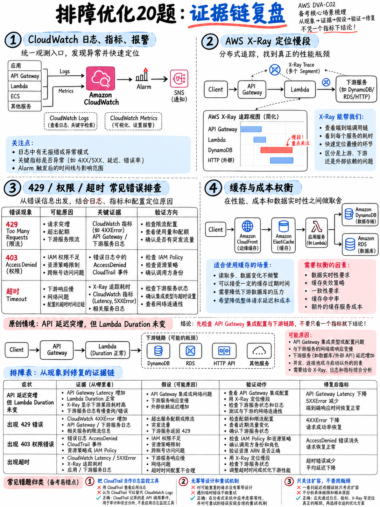

# 5.6 故障排查与优化实战练习题 Troubleshooting and Optimization Practice Set — 20 Items

本套实战练习题共 20 道，严格基于 AWS DVA-C02 考试大纲域 4（故障排查与优化）的任务陈述与考点编写 [1]，旨在对标真实考试的考察深度与题型设计。

:::{tip}
**建议答题时间：33 分钟。**
:::

## 5.6.1 练习题 (Questions)

**1.** 某 AWS Lambda 函数被成功调用执行，但在 Amazon CloudWatch Logs 中却完全没有生成任何日志记录。导致该现象的最可能原因是什么？  
A. 该函数的执行角色 (Execution Role) 缺失 `logs:CreateLogStream` 和 `logs:PutLogEvents` 权限。  
B. 该日志组的保留期被设置为 1 天。  
C. 函数代码中未包含任何 `print` 打印语句。  
D. 未开启 AWS X-Ray 跟踪。

**2.** 某团队需要排查一个偶发性高延迟问题。单次用户请求的调用链路流经 Amazon API Gateway、AWS Lambda、Amazon DynamoDB 以及第三方外部 HTTP API。团队应该实施哪种方案来准确定位是哪个下游服务导致了延迟？  
A. 引入 AWS X-Ray 分布式跟踪并查看服务映射 (Service Map)。  
B. 在 CloudWatch Logs 中开启更详细的详细日志记录 (Verbose Logs)。  
C. 在 CloudWatch 仪表板中绘制 Lambda 的执行时长指标。  
D. 开启 AWS CloudTrail 数据事件记录。

**3.** AWS X-Ray 的哪项特性允许开发者在控制台或 API 中按特定的客户标识符 (Customer Identifier) 检索筛选跟踪链路？  
A. 元数据 (Metadata)。  
B. 子段 (Subsegments)。  
C. 注解 (Annotations)。  
D. 采样规则 (Sampling Rules)。

**4.** 开发者已在某 Lambda 函数上启用了 X-Ray 主动跟踪，但 X-Ray 控制台中始终没有出现任何 Trace 数据。首先应该检查哪项配置？  
A. 检查 X-Ray 守护进程 (Daemon) 是否已在该函数内部启动运行。  
B. 检查该 Lambda 函数是否已关联至 VPC。  
C. 检查全局采样率是否已配置为 100%。  
D. 检查函数的执行角色是否包含 `xray:PutTraceSegments` 权限。

**5.** 某开发人员需要统计过去一周内，某 Lambda 函数的日志组中特定错误字符串出现的总次数，并按每小时进行分组聚合。最适用的工具是哪一个？  
A. 指标筛选器 (Metric Filter)。  
B. CloudWatch Logs Insights。  
C. AWS CloudTrail。  
D. AWS X-Ray。

**6.** 运维团队希望在应用程序日志中出现字符串 `OutOfMemory` 时立即收到告警通知。应该创建什么配置？  
A. 创建一条 CloudWatch Logs Insights 保存的查询语句。  
B. 在日志组上创建指标筛选器 (Metric Filter)，并基于生成的指标创建 CloudWatch 告警。  
C. 创建一条 AWS CloudTrail 跟踪。  
D. 创建一条 Amazon EventBridge 定时计划规则。

**7.** 某 Lambda 函数必须向监控系统发送自定义业务指标，且要求绝对不能因发起同步 API 调用而增加函数的执行延迟。开发人员应该采用哪种方案？  
A. 在每次函数被调用时，通过 SDK 调用 `PutMetricData` API。  
B. 每次发生业务事件时向 Amazon SNS 发送一条通知。  
C. 在 Amazon DynamoDB 中维护一个计数器。  
D. 按照 CloudWatch 嵌入式指标格式 (Embedded Metric Format, EMF) 将结构化 JSON 写入函数的标准输出日志中。

**8.** 部署在 Amazon EC2 实例上的应用程序需要向 CloudWatch 报告系统的内存利用率 (Memory Utilisation)。需要满足什么前置条件？  
A. 无需任何操作；内存利用率是 EC2 的默认监控指标。  
B. 在 EC2 实例上开启详细监控 (Detailed Monitoring)。  
C. 在实例上安装并配置 Amazon CloudWatch Agent。  
D. 在实例上部署运行 AWS X-Ray 守护进程。

**9.** 哪个 AWS 服务能够准确回答“是谁在何时删除了生产环境的 DynamoDB 表”这一审计问题？  
A. Amazon CloudWatch。  
B. AWS X-Ray。  
C. AWS CloudTrail。  
D. AWS Config 规则。

**10.** 某客户端向 Amazon API Gateway REST API 发起请求，由于后端处理任务需要耗时 45 秒，客户端收到了 HTTP 504 错误。针对该场景的最恰当修复架构是什么？  
A. 将 Lambda 函数的超时时间调高至 60 秒。  
B. 将 API Gateway 的集成超时时间 (Integration Timeout) 调高至 60 秒。  
C. 将接口改造为返回 HTTP 202 Accepted，并将耗时任务提交至后台异步处理。  
D. 为 API 开启阶段缓存 (Stage Caching)。

**11.** 客户端调用 API Gateway Lambda 代理集成接口时收到了 HTTP 502 Bad Gateway 响应，但 CloudWatch Logs 显示后端的 Lambda 函数已成功执行完毕且未抛出任何异常。应该修正什么？  
A. 增大 Lambda 函数的内存规格分配。  
B. 检查 API 的使用计划 (Usage Plan) 配置。  
C. 检查阶段变量 (Stage Variables) 是否配置正确。  
D. 检查函数的响应对象，其返回值必须包含整数类型的 `statusCode` 以及字符串类型的 `body`。

**12.** 在对 Amazon DynamoDB 执行条件写入操作时，若条件表达式校验失败，SDK 会抛出哪个特定的异常？  
A. `ProvisionedThroughputExceededException`。  
B. `ValidationException`。  
C. `ConditionalCheckFailedException`。  
D. `ResourceNotFoundException`。

**13.** 应用程序在业务流量高峰期频繁收到来自某 AWS 服务的 `ThrottlingException` 报错。第一优先级应采取的恰当处理方案是什么？  
A. 在客户端实施带随机抖动的指数退避重试 (Exponential backoff with jitter)。  
B. 立即向 AWS 提交工单申请提升服务配额。  
C. 将请求流量直接切换至其他备用 AWS Region。  
D. 捕获该异常并在代码中静默忽略。

**14.** 下列哪类错误**绝不应该**进行重试？  
A. HTTP 429。  
B. `ValidationException`。  
C. HTTP 503。  
D. `ServiceException`。

**15.** 某后台夜间批处理作业每次需要运行 25 分钟，目前在 AWS Lambda 中运行因超时而失败。应该如何重构该任务？  
A. 增大 Lambda 函数的超时时间设置。  
B. 将作业迁移至基于 AWS Fargate 的 Amazon ECS 容器任务中运行，或使用 AWS Step Functions 进行任务分拆编排。  
C. 将 Lambda 函数内存调大至 10,240 MB。  
D. 提交 AWS 工单申请提高 Lambda 超时配额。

**16.** 某段缓存处理伪代码逻辑为：首先检查缓存，若未命中则从数据库中查询记录，并将查询结果写入缓存后返回给客户端。该代码体现的是哪种缓存策略？  
A. 写入直写 (Write-Through)。  
B. 写入后写 (Write-Behind)。  
C. 预刷新 (Refresh-Ahead)。  
D. 懒加载 / 旁路缓存 (Lazy Loading / Cache-Aside)。

**17.** 某以读为主的高并发系统需要为 Amazon DynamoDB 的读取请求提供微秒级的超低延迟响应，同时希望应用程序代码改动量最小化。应该选用哪项技术？  
A. Amazon DynamoDB Accelerator (DAX)。  
B. Amazon ElastiCache for Redis。  
C. 创建全局二级索引 (Global Secondary Index, GSI)。  
D. 接入 Amazon CloudFront。

**18.** 哪两项措施能够有效减少 Amazon SNS 主题的订阅者接收到并丢弃不相关消息的情况？（请选择两项）  
A. 按消息业务类别拆分创建不同的独立主题。  
B. 为 SNS 主题添加 CloudFront 分发。  
C. 在 SNS 主题上开启长轮询 (Long Polling)。  
D. 基于消息属性配置订阅筛选策略 (Subscription Filter Policies)。  
E. 调大 SNS 单条消息的最大体积限制。

**19.** 某 CPU 密集型的 Lambda 函数在 512 MB 内存配置下执行耗时约 8 秒。团队希望在不显著增加成本的前提下大幅降低执行延迟。他们首先应该尝试什么操作？  
A. 为函数配置预置并发 (Provisioned Concurrency)。  
B. 增大函数的内存规格（因 CPU 算力与内存成正比增加），并度量新的执行时长与综合成本。  
C. 将该函数迁移部署至 VPC 内部子网。  
D. 调大函数的最大超时时间。

**20.** 某 AWS CloudFormation 堆栈在更新过程中失败并自动触发了回滚。开发人员在排查时应该首先查看哪条事件记录？  
A. 堆栈事件列表中**最靠前的第一个**带有明确原因说明的 `UPDATE_FAILED` 事件。  
B. 堆栈事件列表中按时间倒序排列的最新一条事件。  
C. AWS CloudTrail 管理事件日志。  
D. AWS CodePipeline 的执行历史记录。

---

## 5.6.2 参考答案与深度解析 (Answers and reasoning)

**1 — A。**  
Lambda 只有在被授予的**执行角色 (Execution Role)** 显式包含 `logs:CreateLogGroup`、`logs:CreateLogStream` 与 `logs:PutLogEvents` 权限时，才能向 CloudWatch Logs 写入日志 —— 这些权限通常由托管策略 `AWSLambdaBasicExecutionRole` 提供。日志保留期仅决定日志在云端保存的天数，不影响初次写入；print 语句并非日志输出的唯一来源，运行时系统日志（如 START/END/REPORT）也会默认产生；X-Ray 是否启用与日志系统完全独立。

**2 — A。**  
借助 **AWS X-Ray 分布式跟踪与服务映射 (Service Map)**，可以可视化查看整条请求链路上每一个微服务节点的调用耗时分布、吞吐量和错误率，一眼即可定位延迟瓶颈节点。单纯打印更多离散日志无法自动关联跨组件全链路；CloudWatch 仪表板只能反映 Lambda 自身总耗时变长，无法定位下游具体哪个调用变慢；CloudTrail 记录的是控制面/数据面 API 审计，不用于链路性能分析。

**3 — C。**  
**注解 (Annotations)** 是已建立索引 (Indexed) 的键值对，支持在控制台使用筛选表达式（如 `annotation.customerId = "123"`）进行高效检索。**元数据 (Metadata)** 不建立索引，无法用于搜索筛选；子段用于划分单节点内部代码逻辑块；采样规则用于决定流量记录比例。

**4 — D。**  
在 AWS Lambda 架构中，底层宿主机上的 X-Ray 守护进程 (Daemon) 是由 AWS 完全托管自动运行的，开发者无需也无法自行启动进程。因此，无 Trace 数据产生的根本原因几乎必然是函数的执行角色缺失 **`xray:PutTraceSegments`** 和 `xray:PutTelemetryRecords` 权限（可通过附加 `AWSXRayDaemonWriteAccess` 策略解决）。

**5 — B。**  
**CloudWatch Logs Insights** 提供了功能强大的交互式查询语法，支持使用 `filter` 匹配特定日志错误行，并使用 `stats count(*) by bin(1h)` 进行按小时分组聚合统计历史日志。指标筛选器不具备历史回溯能力；CloudTrail 记录管理 API；X-Ray 负责请求链路跟踪。

**6 — B。**  
在日志组中创建**指标筛选器 (Metric Filter)** 能够将匹配模式（如 `[..., msg = "*OutOfMemory*", ...]`）实时转换为自定义数值指标；随后在该指标上创建 **CloudWatch 告警**，即可在指标超出阈值时通过 Amazon SNS 发送实时报警通知 —— 此方案正是 AWS 官方样题第 9 题考核的标准解法模式 [18]。

**7 — D。**  
**嵌入式指标格式 (Embedded Metric Format, EMF)** 允许应用程序以标准 JSON 结构将指标直接写入 stdout/日志流中，CloudWatch 服务端会在后台异步解析并发布指标，完全没有同步网络 API 调用的阻塞开销，不增加 Lambda 计费执行时长，且保留了详细的高基数上下文。频繁调用 `PutMetricData` 是同步阻塞操作且容易被限流；SNS 和 DynamoDB 不是 CloudWatch 指标的标准发布途径。

**8 — C。**  
EC2 默认采集的基础指标仅包含 CPU 利用率、网络进出流量和基础磁盘 I/O，**不包含实例内部的内存利用率和可用磁盘空间**。必须在操作系统内部安装并运行 **Amazon CloudWatch Agent** 才能收集并推送这些系统级性能指标 [18]。开启详细监控仅仅是将现有指标的采样频率从 5 分钟缩短至 1 分钟，并不能凭空产生内存指标。

**9 — C。**  
**AWS CloudTrail** 专门记录 AWS 账户内的所有 API 调用历史（即“谁 (Who)、在何时 (When)、从何地 (Where) 执行了什么管理或数据操作”）。CloudWatch 监控性能与日志；X-Ray 跟踪请求；Config 评估资源合规状态。

**10 — C。**  
Amazon API Gateway 的最大后端集成超时时间存在不可调高的**硬性限制（严格上限为 29 秒）**，因此选项 A 和 B 均无法解决超时报错。对于处理耗时长达 45 秒的长任务，标准架构模式是采用异步解耦设计：API 接收请求后立即向客户端返回 **HTTP 202 Accepted**，将任务载荷放入 SQS 或触发 Step Functions 状态机在后台异步处理。

**11 — D。**  
当使用 API Gateway 的 Lambda 代理集成 (Proxy Integration) 时，API Gateway 严格要求 Lambda 函数返回约定格式的 JSON 对象，其中必须包含名为 `statusCode` 的 HTTP 状态码整数（如 200），以及字符串类型的 `body`。若返回格式错误，API Gateway 无法正确解析，便会向客户端返回 HTTP 502 Bad Gateway，即便函数自身在日志中显示执行成功。

**12 — C。**  
当 DynamoDB 的 `PutItem`、`UpdateItem` 或 `DeleteItem` 操作中携带了 `ConditionExpression`，且表中现有记录未满足该指定条件时，服务会抛出 **`ConditionalCheckFailedException`**。这通常是乐观并发控制 (Optimistic Locking) 竞争失败时的正常业务表现。

**13 — A。**  
当遭遇 AWS 服务的速率限流 (`ThrottlingException` / HTTP 429) 时，客户端标准的第一应对策略是采用**带随机抖动的指数退避重试 (Exponential Backoff with Full/Decorrelated Jitter)**，AWS 各主流 SDK 均在底层内置了该重试策略。在未分析明确调用激增根本原因前直接申请配额、跨地域迁移或静默吞掉异常均不是正确做法。

**14 — B。**  
**`ValidationException`** 表示客户端发送的请求参数不符合 API 规范要求（如缺少必填参数、字段越界等），属于代码缺陷或逻辑 Bug，针对原请求进行重试必然会百分之百重复失败。而 HTTP 429、503 以及 `ServiceException` 均属于可恢复的瞬态错误，应当实施退避重试。

**15 — B。**  
AWS Lambda 拥有 **900 秒（15 分钟）的硬性执行超时上限**，且该配额无法通过工单申请调高。对于需要运行 25 分钟的批处理长任务，应当将其容器化并运行在 **Amazon ECS on AWS Fargate** 上，或者使用 **AWS Step Functions** 将复杂长任务拆分为若干短步骤进行状态机编排。

**16 — D。**  
“读取时先查缓存，未命中则查数据库并将结果回写至缓存”是典型的**懒加载 / 旁路缓存 (Lazy Loading / Cache-Aside)** 模式，这与 AWS 官方样题第 7 题的伪代码及考查点完全一致 [18]。写入直写模式是在数据发生写入/更新时双写数据库与缓存。

**17 — A。**  
**Amazon DynamoDB Accelerator (DAX)** 专为 DynamoDB 提供内存级缓存加速，能将读延迟从毫秒级降低至微秒级；更重要的是，DAX 完全兼容原生的 DynamoDB API 协议，客户端只需替换 SDK 端点配置即可无缝接入，对应用程序业务代码改动量极小。引入 Redis 需要重写整套数据访问层逻辑；GSI 无法提供微秒级读取性能；CloudFront 用于边缘 HTTP 缓存。

**18 — A 与 D。**  
大纲显式点名的优化策略是配置 **SNS 订阅筛选策略 (Subscription Filter Policies)**（选项 D），允许在主题侧依据消息属性进行服务端过滤，只向下游投递订阅者感兴趣的消息；此外，按业务类型创建独立的专用主题（选项 A）也能从物理通道上彻底隔离无关消息。长轮询是 SQS 的专属特性（SNS 不支持）；CloudFront 和调整消息体积与订阅丢弃消息问题无关。

**19 — B。**  
在 AWS Lambda 底层架构中，**分配给函数的 CPU 计算资源严格与内存配置规格成正比**。对于 CPU 密集型任务，增加内存配置能够按比例获得更多更强的 CPU 算力，通常会导致执行耗时出现大幅度阶跃式下降 —— 最终由于计费时长成比例缩短，计算出来的函数总成本几乎持平甚至可能更低，同时显著提升了性能。预置并发仅用于消除冷启动，对纯计算执行时长无影响；放入 VPC 无法提升 CPU 速度；延长超时不会加快运行速率。

**20 — A。**  
CloudFormation 堆栈更新失败触发回滚后，会产生大量级联回滚的派生失败事件。在事件时间流中，排查的核心法则是**寻找并定位最靠前的第一个状态为 `..._FAILED` 且附带详细状态说明 (Status Reason) 的事件**，该事件记录了直接导致整套堆栈部署中断的核心根本原因。

---

## 5.6.3 成绩诊断与针对性备考建议 (Diagnosis)

| 得分区间 | 水平评估与后续行动指南 |
|---|---|
| **18–20 题** | 恭喜！你对域 4（故障排查与优化）的核心考点掌握非常扎实，可直接推进后续模块。 |
| **14–17 题** | 重点重温 {doc}`04-errors-limits-and-retries` —— 多数失分源于对具体 SDK 异常类名称、HTTP 状态码差异或软硬配额边界的记忆模糊。 |
| **10–13 题** | 建议完整重新精读本模块的所有章节。务必引起重视：在最新的 **DVA-C03** 考试版本中，本领域的计分占比已大幅提升至 **22%** [5]。 |
| **10 题以下** | 务必亲自动手完成 {doc}`../80-toolkit/01-hands-on-lab-plan` 中的实验 5 与实验 6 —— 亲自在 AWS 控制台中配置一次报错、查看日志并排查故障，是彻底攻克该领域考点的最佳路径。 |
