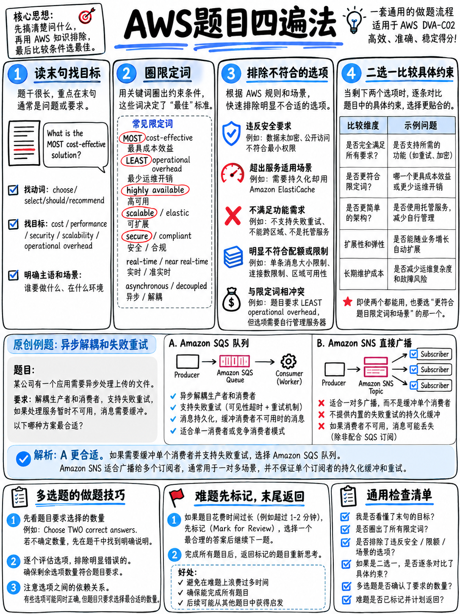

# 6.1 How AWS Exam Questions Are Built / AWS 试题命题机制与解题思维



:::{important}
**S 级核心应试心法，终身受用于你的 AWS 职业生涯。** AWS 的每一项认证考试——无论是基础级 (Foundational)、助理级 (Associate)、专业级 (Professional) 还是专项级 (Specialty)——均严格采用完全相同的两种试题格式（单选题与多选题）以及高度一致的命题构造模型。一次性彻底掌握这套解题技法，将为你在未来的每一门 AWS 认证中持续带来提分回报（参见 {doc}`../00-foundations/01-the-aws-certification-series` §0.1.3）。
:::

## 6.1.1 试题解构剖析 (The anatomy)

AWS 认证考试中的每一道情境案例题（Scenario Question）都由完全相同的四个逻辑部分构成，而其中前两部分在本质上多为背景装饰：

```
 ┌───────────────────────────────────────────────────────────────────┐
 │ 业务背景 (SETUP)        "A company is migrating a legacy           │  快速略读
 │                         application to Amazon EC2 instances..."    │
 ├───────────────────────────────────────────────────────────────────┤
 │ 现状痛点 (SITUATION)    "The application uses a user name and      │  快速略读
 │                         password that are stored in the source..." │
 ├───────────────────────────────────────────────────────────────────┤
 │ 核心需求 (REQUIREMENT)  "...the company needs to implement a       │  ★ 重点精读
 │                         secure way to store and AUTOMATICALLY      │    锁定目标
 │                         ROTATE the database credentials."          │
 ├───────────────────────────────────────────────────────────────────┤
 │ 提问与限定词 (QUESTION) "Which solution will meet these            │  ★ 终极裁决
 │                         requirements?"                             │    决定胜负
 │                         (+ 限定词: MOST, LEAST, Select TWO)        │
 └───────────────────────────────────────────────────────────────────┘
```

上面这个典型案例直接摘自 AWS 官方发布的样题第 1 题 [18]。其中全大写突出的核心短语 **"AUTOMATICALLY ROTATE"（自动轮转）** 承担了决定性的破题工作：它直接排除了 Systems Manager Parameter Store、明文环境变量以及烘焙 AMI 镜像等方案，无可争议地锁定 **AWS Secrets Manager**。

::::{tip}
**整场考试中最具提分价值的核心阅读习惯：先读题干的最后一句话，再看具体提问与限定词，最后再倒回去通读背景。**

真正的业务需求与架构约束，几乎总是隐藏在提问之前的最后一句话中。带着核心需求反向通读题干，意味着你的大脑是在*带着明确的目标线索去匹配事实*，而不是盲目地在脑海中建立复杂的架构模型后，又不得不根据尾句推翻重构。
::::

## 6.1.2 限制词与限定条件 (The qualifier words)

AWS 在考卷中会特意大写标注核心甄别词（Discriminator）。这些限定词之所以存在，是因为**通常有不止一个选项在技术上可行**，限定词的作用正是从多个“能用”的方案中选出唯一的“最优解”。

| 限定词 (Qualifier) | 命题深层意图 (What it is really asking) | 倾向的技术选型 (Favours) |
|---|---|---|
| **MOST cost-effective** (最具成本效益 / 最经济) | 在完全满足需求的前提下，总成本最低 | Serverless (无服务器)、按需计费模式 (On-demand)、低成本存储分层 (S3 Glacier/IA)、避免资源闲置浪费 |
| **LEAST operational overhead** (最低运维开销) | 日常持续性的人工维护与管理工作量最少 | **托管服务 (Managed services)**。选 Lambda 而非 EC2，选 Fargate 而非自管 EC2 集群，选原生自动轮转而非自写 Cron 脚本 |
| **LEAST amount of configuration** (最少配置工作量 / 最少架构改动) | 装配或配置的活动组件最少 | 善用单资源参数化（如阶段变量），避免在各环境复制部署 N 份重复资源 |
| **MOST secure** (最高安全性) | 最严格的最小权限与访问控制隔离 | IAM 角色 (Role) 优先于长期密钥 (Key)、严格遵循最小特权、传输/静态加密、VPC 私有端点 (Private Endpoints) |
| **MOST performant / lowest latency** (最高性能 / 最低延迟) | 追求极限吞吐量与毫秒级响应速度 | 缓存机制 (DAX/ElastiCache)、边缘分发 (CloudFront)、Lambda 预置并发 (Provisioned Concurrency)、Kinesis 增强型扇出 |
| **MOST highly available / resilient** (最高可用性 / 最具弹性容灾) | 面对硬件或区域故障时具备自我恢复能力 | 多可用区架构 (Multi-AZ)、指数退避重试 (Exponential Backoff)、异步解耦队列、死信队列 (DLQ) |
| **MOST reliable / durable** (最高可靠性 / 数据持久不丢) | 保证消息绝对不丢失、严格有序且防重 | SQS FIFO 队列、DynamoDB 事务、强持久化存储后端 |
| **in near real time** (近实时 / 毫秒到秒级推送) | 采用推送模型 (Push)，严禁客户端低效轮询 (Poll) | WebSocket API、AppSync GraphQL 订阅、流式通道 (Kinesis / DynamoDB Streams) |
| **(Select TWO / THREE)** (多选题：选两项/选三项) | 复合多步方案拆解 | 独立严格评估**每一个**选项；切记按无部分得分标准全力攻坚 |

:::{danger}
**“LEAST operational overhead” 是 DVA 考试中出现频率最高的限定词，且它拥有一个近乎定理的默认答案：全托管服务 / Serverless 方案。** 如果一个选项提议“在 EC2 实例上运行 Cron 定时任务执行任务”，而另一个选项是“利用服务的内置原生功能”，那么无论 EC2 方案在技术逻辑上多么通顺、在纸面计算上看似多么便宜，内置托管特性必定胜出。
:::

## 6.1.3 四遍扫读法 (The four-pass method)

面对长题干情境题，切忌从头到尾匀速硬读。推荐采用经过千万考生验证的高效四步解题节奏：

```
 步骤 1 (PASS 1)  精读尾句与提问限定词        ~10 秒   核心诉求与关键限制究竟是什么？
 步骤 2 (PASS 2)  快速扫读四个选项           ~10 秒   选项之间的核心分歧轴 (Axis of difference) 在哪？
 步骤 3 (PASS 3)  带着问题回读情境找约束      ~25 秒   寻找并发规模、延迟上限、成本红线、合规要求、
                                                      已有服务栈以及调用方身份
 步骤 4 (PASS 4)  先排除再决断               ~45 秒   果断排除两个荒谬项，紧扣限定词在剩余两项中决断
```

**步骤 2（扫读选项）的重要性远超多数考生的直觉。** 提前扫读选项能够瞬间揭示本题考查的核心技术领域。例如，如果四个选项中有三个提及 DynamoDB 索引机制，而只有一个提到 S3，你就立刻知道本题的考点在于“数据访问模式与索引选型”，此时再回读题干，就能带着雷达般的敏锐度精确抓取分区键基数与查询过滤模式。

## 6.1.4 排除法优于选择法 (Elimination before selection)

绝大多数 DVA 考题的标准结构是：**2 个明显错误的荒谬选项 + 2 个高度逼真的候选选项**。先快速识别并剔除那两个错误项，比直接在四个选项中大海捞针要迅速得多、准确率也高得多。

**遇到以下反模式，无需犹豫，立即划掉排除：**

| 典型错误模式 (Pattern) | 排除底层逻辑 (Why) |
|---|---|
| 将**长期访问密钥 (Access Key / Secret Key)** 存储于任何静态介质中 | 违背云原生安全基线，必错无疑（参见 {doc}`../30-security/01-domain-overview` §3.1.3） |
| 将 S3 存储桶或后端服务直接**设为公网公开 (Public)** | 凡是存在受控范围凭证方案时，公开暴露必然属于危险干扰项 |
| 使用了**根本不具备该功能**的服务机制 | Parameter Store 不支持自动轮转；API 密钥 (API Key) 不具备用户身份鉴权能力；GSI 永远不支持强一致性读取 |
| 相比于同等满足要求的替代方案，引入了**额外的人工运维工作** | 在全托管和自动化方案面前必败 |
| 触碰了 AWS 的**硬性服务配额 (Hard Quota)** | 例如设置超时 20 分钟的 Lambda、发送 5 MB 的单条 SQS 消息、配置 40 秒超时的 API Gateway 集成——在物理层面上根本无法运行 |
| 针对不可更改的硬限制宣称**“向 AWS 申请提高服务配额”** | 硬性物理上限绝不支持通过工单提升 |
| 属于**时机错位的真实有效操作 (Real action at the wrong time)** | 例如在题干明确要求解决现有热分区限流问题时，选项提议“在表上创建一个 GSI” |

## 6.1.5 选项中的高频暗号与破绽 (The tells inside options)

在命题心理学中，选项所使用的措辞往往蕴含着极高的概率线索：

**通常为正确答案特征 (Usually right):**

- “使用 IAM **角色 (Role)**…”
- “使用 **AWS Secrets Manager**… 配置自动轮转 (Automatic Rotation)”（当题干要求周期性更新密码时）
- “生成 **预签名 URL (Presigned URL)**”（客户端需要直接安全上传或下载 S3 数据时）
- “使用 **Lambda 层 (Lambda Layer)**”（解决跨函数共享依赖包或依赖体积超限时）
- “配置 **死信队列 (DLQ)** / 异步调用失败 **目的地 (On-failure Destination)**”
- “采用带抖动的 **指数退避重试 (Exponential Backoff)**”
- “启用 **AWS X-Ray** 追踪”（当问题定位核心在于“链路哪一环变慢/耗时瓶颈”时）
- “添加 **全局二级索引 (GSI)**”（当业务产生全新的非主键查询访问模式时）
- “配置 **阶段变量 (Stage Variable)**”（在 API Gateway 上实现多环境低开销流量解耦时）

**通常为错误干扰项特征 (Usually wrong):**

- “将敏感凭证保存在环境变量 / AMI 镜像 / 代码仓库中”
- “授予 `*` 通配符权限” 或直接 “附加 `AdministratorAccess` 管理员策略”
- “将 S3 存储桶权限设为公网公开 (Public)”
- “单纯增加超时时间 (Increase timeout)”（当遭遇的是不可逾越的硬限制，或根本原因在于下游阻塞时）
- “通过添加 Filter Expression 筛选表达式来降低 DynamoDB 读取消耗 (RCU)”
- “第一步先提交工单申请提升服务配额 (Request a quota increase)”
- “在 EC2 实例上运行 Cron 定时脚本来…”（当已有开箱即用的托管服务功能时）
- “客户端每隔 N 秒进行一次轮询 (Poll)”（当存在事件驱动或长连接推送方案时）

:::{warning}
**以上规律属于统计学高频概率，绝非不可违背的数学定理。** 一道精心设计的高区分度考题，常常会故意制造看似“伟光正”却在细微处致命的陷阱——例如在一道函数属于 I/O 阻塞型超时的情境中提供“增加 Lambda 内存”选项；或者在题干仅仅要求“统计过去一周错误发生次数”时提供“启用 X-Ray”选项（实际应为 CloudWatch Logs Insights 查询）。务必将暗号作为快速构建假设的工具，再用题干的最终核心需求句进行严密回验。
:::

## 6.1.6 多选题应对策略 (Multiple-response questions)

- **留意选项目标数量：** 题干结尾会以大写明确标注数量，例如 **"Which TWO options..."** 或 **"Select THREE"**。
- **牢固树立“无部分得分”意识：** AWS 官方从未公开承认过多选题提供部分得分（Partial Credit）机制（参见 {doc}`../00-foundations/04-exam-mechanics-and-scoring` §0.4.2）。必须确保选出的每一个答案都坚实可靠。
- **独立审查每个选项：** 切忌先入为主地去寻找“看起来天生是一对”的选项组合。尽管在实操中，两个正确答案往往恰好分别构成一个完整方案的两半（例如官方样题 4 中：一方面在 API Gateway 设置 `AWS_IAM` 授权，另一方面在 SQS 上创建资源策略授予权限 [18]）。
- **攻克分歧项技巧：** 如果你对其中一个选项具有 100% 把握，而在剩下两个候选项之间犹豫不决，应优先选择那个**针对题干中不同子需求/不同架构层面**进行补充覆盖的选项，避免选择与已定答案在功能上重复堆叠的选项。

## 6.1.7 考场时间把控与标记战术 (Time and flagging)

考试总时长为 **130 分钟**（如已获批非母语英语 ESL 延时则为 160 分钟），共需完成 **65 道题目**，平均每道题拥有充裕的 **120 秒** 作答时间（参见 {doc}`../00-foundations/04-exam-mechanics-and-scoring` §0.4.3）。

```
 第一轮穿透 (FIRST PASS)：全速作答每一道题，边做边打标记 (Flag)。
   • 绝不要在系统里留下任何一道空题 —— AWS 答错绝不倒扣分 [1]
   • 遇到卡壳题目，若在 60 秒内毫无头绪：坚决排除明显荒谬项，凭直觉选定一个最可能项，
     立即打上 Flag 标记，绝不停留，果断进入下一题！
 第二轮复查 (SECOND PASS)：利用交卷前结余的 20~30 分钟，专攻打了 Flag 标记的题目。
```

**时刻在心中牢记：65 题中有 15 题属于纯粹的“不计分预备实验题 (Unscored Pretest Items)” [1]。** 这意味着整套试卷中几乎有四分之一的题目只是 AWS 官方用来测试统计学参数的试验品，即便完全答错对你的成绩也没有任何实质损伤。遇到表述极其怪异、超出常规大纲知识库的晦涩题目时，千万不可慌乱，更不要让它们击溃你的应试节奏和考场自信。

## 6.1.8 极速破题考前复习法则 (Fast revision)

- **执行“倒序锚定法”：** 先读题干最后一句话锁定核心需求，看清提问和限定词，扫读四个选项，最后回读题干挖掘边界限制。
- **利用大写限定词裁决平局：** 当两个选项在技术上均成立时，限定词即是答案裁判。“**LEAST operational overhead**”直接无脑指向托管服务与 Serverless。
- **优先砍掉两个伪装项：** 任何暴露凭据、公网公开暴露、服务功能张冠李戴、触碰物理硬性限额的选项，全部就地处决。
- **永不留空，果断标记跳过：** 没有负分惩罚；遇阻先选一个，标记后在第二轮从容复盘。
- **蔑视实验题：** 卷面中暗藏 15 道不计分试题，遇怪不惊，保持稳健节奏即可轻松锁定 720 分通关线。
