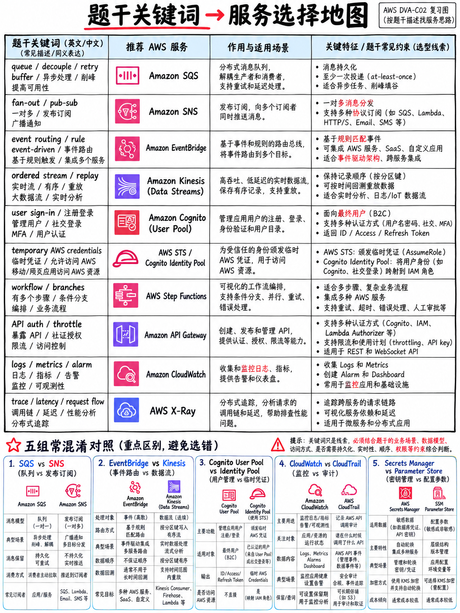

# 6.2 Keyword-to-Service Map / 核心关键词与 AWS 服务映射表

这是在 DVA-C02 考场上秒级锁定试题考点的最强工具表。**请务必注意：本表中的映射关系是概率极高的“强提示信号”，而非教条铁律**——在最终选定答案前，必须严格对照题干末尾的核心需求句进行回验闭环（参见 {doc}`01-how-aws-questions-work` §6.1.5）。

## 6.2.1 按题干高频考查短语检索 (By phrase)

| 题干中出现的核心表述 (The question says) | 脑海中第一时间浮现的解法 (Think) |
|---|---|
| “automatically rotate credentials”（自动轮转密码凭证） | **AWS Secrets Manager** [18] |
| “store configuration at the lowest cost”（以最低成本安全存储配置） | **Systems Manager Parameter Store `SecureString`** |
| “feature flag”, “validate before applying”, “roll back on alarm”（特性开关、灰度发布前验证、触发告警时自动回退） | **AWS AppConfig** |
| “without passing through our servers”, “upload directly to S3”（无需经由服务器中转、直接安全上传到 S3） | **S3 预签名 URL (Presigned URL)** |
| “near real time”, “push to the client”, “two-way”（近实时推送、向客户端主动推送、双向全双工通信） | **API Gateway WebSocket API** 或 **AppSync 订阅 (Subscriptions)** [18] |
| “GraphQL”, “clients request exactly the fields they need”（GraphQL 架构、客户端按需精确声明获取指定字段） | **AWS AppSync** |
| “decouple”, “buffer”, “smooth out spikes”（异步解耦、削峰填谷、缓冲突发流量洪峰） | **Amazon SQS** |
| “one message, many independent consumers”（单次消息发布、多个独立消费者各自并行消费） | **SNS → SQS 扇出架构模式 (Fan-out Pattern)** |
| “replay events”, “multiple consumers at their own position”, “ordered per key”（重放历史事件、多个消费者维护各自独立的消费位点游标、按分区键严格按序处理） | **Amazon Kinesis Data Streams** |
| “deliver streaming data to S3/Redshift/OpenSearch with no code”（零代码编写直接将实时流数据归档投递至 S3 / Redshift / OpenSearch） | **Amazon Data Firehose** |
| “route events based on content”, “schedule”, “SaaS events”（基于消息内容规则路由事件、Cron 表达式定时调度、接收来自 SaaS 第三方的事件驱动） | **Amazon EventBridge** |
| “workflow”, “sequence of steps”, “retry each step”, “wait for approval”（多阶段状态工作流编排、各状态步骤独立重试机制、等待人工审批回调） | **AWS Step Functions** |
| “microsecond reads from DynamoDB”（针对 DynamoDB 的微秒级超低延迟读取） | **DynamoDB Accelerator (DAX)** |
| “cache database query results / session state”（缓存关系型数据库热点查询结果 / Web 分布式用户会话状态） | **Amazon ElastiCache** |
| “cache at the edge”, “users worldwide”, “static content”（在离用户最近的边缘节点缓存、全球多区域低延迟访问、加速分发静态资源） | **Amazon CloudFront** |
| “new query pattern on an existing table”（在现有的 DynamoDB 表上支持全新的查询访问模式） | **全局二级索引 (GSI, Global Secondary Index)** |
| “strongly consistent read on a non-key attribute”（针对非主键属性执行强一致性读取） | **绝不可用 GSI**（GSI 仅支持最终一致性；必须重新设计主键架构或采用本地二级索引 LSI） |
| “expire items automatically without consuming write capacity”（数据记录到期自动删除淘汰，且绝不消耗任何写入容量 WCU） | **DynamoDB 生存时间 (TTL, Time to Live)** |
| “react to item changes”（捕获并异步响应 DynamoDB 表内数据行的逐条变更增删改事件） | **DynamoDB Streams** |
| “only the user's own rows”（严格限制用户仅能访问或修改属于其本人的数据记录行） | **`dynamodb:LeadingKeys` 条件键** + Cognito 身份池 |
| “sign up and sign in”（托管用户注册、登录、找回密码与身份目录管理） | **Amazon Cognito 用户池 (User Pool)** |
| “temporary AWS credentials for a mobile app”（为前端或移动端 App 获取直接访问 AWS 后端资源的临时凭据） | **Amazon Cognito 身份池 (Identity Pool)** |
| “run code after sign-in”（在用户成功通过登录认证后，无缝自动触发执行一段自定义业务代码） | **Cognito 认证后触发器 (Post Authentication Trigger)** [18] |
| “corporate SAML identity provider”（对接企业内部 SAML 2.0 身份提供商实现组织级单点登录 SSO） | **SAML 联合身份验证 (SAML Federation)**，调用 `AssumeRoleWithSAML` |
| “encrypt data larger than 4 KB with KMS”（使用 KMS 对体积超过 4 KB 的数据对象执行加密） | **信封加密技术 (Envelope Encryption)** [18] |
| “control the key, audit its use, rotate it”（自主完全掌控密钥策略、完整审计调用轨迹、支持年度自动轮转） | **客户托管密钥 (Customer Managed KMS Key)** |
| “certificate for CloudFront”（为 CloudFront 分发配置自定义域名的免费 SSL/TLS 证书） | **必须在 `us-east-1` (弗吉尼亚北部) 区域申请 ACM 证书** |
| “dependencies too large / shared across functions”（依赖包体积超出限额 / 多个 Lambda 函数间共享相同的基础库代码） | **Lambda 层 (Lambda Layer)** [18] |
| “eliminate cold starts”（彻底消除高敏场景下的 Lambda 函数冷启动延迟） | **预置并发 (Provisioned Concurrency)**（Java 运行时可搭配 **SnapStart**） |
| “protect the downstream database from Lambda”（防止无服务器 Lambda 洪峰瞬间耗尽下游关系型数据库连接池） | **保留并发 (Reserved Concurrency)** + **Amazon RDS Proxy** |
| “dev and prod with least configuration”（以最低配置维护工作量在同一个 API Gateway 上区分开发与生产环境） | **API Gateway 阶段变量 (Stage Variable)** + **Lambda 别名 (Alias)** [18] |
| “mock the backend”, “test before the backend exists”（在后端接口代码就绪前，为前端提供联调所需的测试挡板） | **API Gateway `MOCK` 模拟集成** |
| “reject invalid payloads before the backend”（在请求触达下游后端算力前，前置校验并拒绝非法请求载荷） | **使用请求模型执行数据校验 (Request Validation with a Model)** |
| “throttle per customer”, “monetise the API”（按客户维度进行独立限流防刷，对 API 调用量进行分层商业化计费） | **API 密钥 (API Key) + 使用计划 (Usage Plan)** |
| “canary”, “shift 10% of traffic”（金丝雀发布、先将 10% 真实生产流量切入新版本验证稳定性） | **Lambda 加权别名 (Weighted Alias)** / **CodeDeploy 金丝雀部署策略** / **API Gateway 金丝雀发布** |
| “roll back automatically if errors rise”（在版本灰度部署过程中一旦错误率突增立即触发自动回滚） | **CodeDeploy 关联 CloudWatch 告警 (CloudWatch Alarm)** |
| “validate the new version before traffic shifts”（在生产流量正式切换导入新版本前执行端到端健康预检） | **CodeDeploy `PreTraffic` 生命周期钩子 (Hook)** |
| “human must approve the release”（版本在正式部署上线到生产环境前必须经过主管人工审核批准） | **CodePipeline 人工审批操作 (Manual Approval Action) + SNS 通知** |
| “private npm/pip/Maven repository”（搭建企业内部受控的私有软件依赖包管理中心） | **AWS CodeArtifact** |
| “automated code review before merge”（在代码合并到主干前自动执行静态代码审查与安全弱点扫描） | **Amazon CodeGuru Reviewer** |
| “which method uses the most CPU in production”（在生产环境中精准分析具体哪个 Java/Python 方法占用了最多的 CPU 周期） | **Amazon CodeGuru Profiler** |
| “preview infrastructure changes before applying”（在基础设施代码生效前，预先生成并核对将要创建或破坏的资源差异列表） | **CloudFormation 更改集 (Change Set)** |
| “do not delete the database when the stack is deleted”（当 CloudFormation 堆栈被删除时，保护核心生产数据库不被意外销毁） | **`DeletionPolicy: Retain` 保留策略** |
| “every Git branch gets its own deployed URL”（每个 Git 特性分支均自动部署并生成独一无二的独立预览访问地址） | **AWS Amplify 分支部署管理 (Amplify Branches)** |
| “deploy a container app with least overhead”（以最低运维工作量部署并运行容器化微服务应用） | **AWS Fargate**（或搭配 **AWS Copilot CLI**） |
| “task cannot pull the image”（ECS 任务启动失败，报错提示由于凭证或网络问题无法从 ECR 拉取镜像） | **ECS 任务执行角色 (Task Execution Role)** |
| “application gets AccessDenied calling DynamoDB”（容器内部运行的业务程序调用 DynamoDB 时遭遇 AccessDenied 权限拒绝） | **ECS 任务角色 (Task Role)** |
| “which service is causing the latency”（在庞大的分布式服务拓扑中精准定位究竟是哪个下游微服务引入了延迟瓶颈） | **AWS X-Ray 服务映射图 (Service Map)** |
| “filter traces by customer ID”（在 X-Ray 控制台中按特定租户 ID 或业务标识快速筛选检索 Trace 调用链） | **AWS X-Ray 注解 (Annotation)**（支持建立系统索引） |
| “count occurrences in logs over last week”（对过去 7 天内存储在日志组中的特定错误日志进行统计分析与聚合查询） | **Amazon CloudWatch Logs Insights** |
| “alarm when a string appears in logs”（实时监控并在日志流中一旦检测到指定错误文本模式时立即发出告警） | **CloudWatch 指标筛选器 (Metric Filter) + 告警 (Alarm)** [18] |
| “custom metrics without added latency”（以零网络开销、绝对不增加函数执行耗时的方式上报自定义业务指标） | **CloudWatch 嵌入式指标格式 (Embedded Metric Format, EMF)** |
| “memory or disk metrics from EC2”（采集并监控 EC2 虚拟机的操作系统内存利用率或磁盘空间占用） | **安装并配置 Amazon CloudWatch Agent** [18] |
| “who deleted it?”（审计调查某项关键云资源究竟是由哪个特定 IAM 用户或角色在什么时刻执行了删除操作） | **AWS CloudTrail 事件历史记录 (Event History)** |
| “job runs longer than 15 minutes”（后台单次批处理计算任务的持续执行时间超过了 15 分钟） | **绝不可用 Lambda**（必须选用 AWS Fargate 容器任务或 Step Functions） |
| “message larger than 256 KB”（单条消息体积超过了消息中间件所能承载的 256 KB 物理上限） | **S3 载荷中转 + 消息内携带指针引用**，或使用 **SQS 扩展客户端库 (Extended Client Library)** |
| “subscribers discard most messages”（订阅者收到广播后由本地逻辑过滤丢弃绝大部分无用消息） | **配置 SNS 订阅筛选策略 (Subscription Filter Policy)** |
| “empty receives are costing money”（频繁发起空轮询导致产生大量无意义的空接收 API 账单费用） | **开启 SQS 长轮询机制 (Long Polling，将等待时间设为 20 秒)** |
| “messages processed twice”（队列中的同一条消息被消费者重复提取并处理了多次） | **合理调大可见性超时 (Visibility Timeout)** + **业务端保证接口幂等性 (Idempotency)** |
| “one bad record stopped the shard”（数据流中单条畸形“毒丸”记录引发业务异常，阻塞了整条分片的后续消费进度） | **启用 `BisectBatchOnFunctionError` (分批折半重试)** + **配置失败目标位置 (On-failure Destination)** |

## 6.2.2 按 AWS 核心服务反向锚定考点 (By AWS service, what it is the answer *to*)

当你扫读选项发现题目的争夺焦点集中在特定服务时，请用下表对照题干情境：

| 核心服务 (Service) | 当题目的考查重心落在以下场景时，该服务通常为正确答案… |
|---|---|
| **AWS Lambda** | 事件驱动的无服务器计算、执行时间在 15 分钟以内、免除服务器底层运维 |
| **Amazon API Gateway** | 全托管的 HTTP / REST / WebSocket 入口层，集成鉴权、流控节流与多阶段环境发布 |
| **Amazon DynamoDB** | 海量弹性伸缩的键值/文档数据库、单毫秒级稳定读写延迟、Serverless 免运维存储 |
| **Amazon S3** | 非结构化对象存储、静态网站资产托管、客户端直传、归档合规与现代数据湖基石 |
| **Amazon SQS** | 异步解耦各微服务子系统、削峰填谷平滑突发流量、实现任务缓冲池 |
| **Amazon SNS** | 发布/订阅模式下的单点广播扇出通知 (Fan-out)、跨多个消费者派发事件 |
| **Amazon EventBridge** | 基于事件内容的精细模式路由过滤、基于时间的 Cron 计划任务编排、集成第三方 SaaS 事件 |
| **AWS Step Functions** | 编排复杂多步骤、带状态管理、支持分支与异常重试机制的长时工作流 |
| **Amazon Kinesis** | 高吞吐、强保序、多消费者各持消费游标、支持数据历史回溯重放的大规模数据流 |
| **Amazon Cognito** | 终端用户注册登录认证系统 (用户池) 以及向前端安全分发 AWS 临时临时临时凭据 (身份池) |
| **AWS KMS** | 统一密钥管理、硬件安全模块支持、跨账号数据加密与信封加密规范 |
| **AWS Secrets Manager** | 必须由系统托管定期**自动轮转**的敏感机密数据（如数据库密码、第三方 API 凭证） |
| **AWS Systems Manager Parameter Store** | 低成本甚至零成本的通用配置参数管理与基础密钥存储（**不支持原生自动轮转**） |
| **AWS AppConfig** | 运行时动态特性开关与配置托管，内置前置校验器与基于 CloudWatch 告警的自动回滚 |
| **CloudFormation / SAM / CDK** | 声明式或编程式的基础设施即代码 (IaC)，保障架构可复现与版本受控 |
| **AWS CodeBuild** | 全托管的源码编译、运行自动化单元测试、打包构建产物 |
| **AWS CodeDeploy** | 将构建制品安全平滑地部署至各类计算环境 (EC2/ECS/Lambda)，支持金丝雀灰度与自动回滚 |
| **AWS CodePipeline** | 将构建、测试、部署等环节无缝串联形成端到端自动化流水线，支持人工审批介入 |
| **AWS CodeArtifact** | 企业级受控的安全私有依赖软件构件包仓库（npm/pip/Maven/NuGet 等） |
| **Amazon CodeGuru** | 静态源代码自动化缺陷扫描评审 (Reviewer) 与线上生产运行时热点性能分析剖析 (Profiler) |
| **Amazon CloudWatch** | 云上指标监控、日志统一收集检索、阈值告警触发与全局可视化仪表盘 |
| **AWS X-Ray** | 揭示分布式调用链中每一个请求的生命周期轨迹，精准定位请求究竟在哪一环产生高延迟 |
| **AWS CloudTrail** | 权威记录账号内由谁、在何时、调用了哪一个底层 AWS API（专注于审计合规） |
| **ECS / Fargate / ECR / Copilot** | 容器化镜像构建存储、任务定义调度与无服务器弹性容器编排执行 |
| **AWS Elastic Beanstalk** | “把代码交给我，底层基础设施全部搞定”的经典 PaaS 平台托管服务 |
| **AWS Amplify** | 专注于全栈前端开发者的极速脚手架，深度集成基于 Git 分支的 CI/CD 自动化构建预览 |
| **Amazon CloudFront** | 分布在世界各地的边缘分发网络 (CDN)，提供动静态内容加速就近分发 |
| **ElastiCache / DAX / MemoryDB** | 极速全内存数据存储与缓存加速，提供亚毫秒到微秒级的极限性能响应 |

## 6.2.3 极易混淆的 15 对高频孪生概念深度辨析 (The pairs that are constantly confused)

考卷中最致命的陷阱往往不是考查完全不相干的两个服务，而是将功能高度近似的孪生概念故意成对放置。牢记以下关键分水岭：

| 概念 A | 对比 | 概念 B | 核心本质区别与考点分水岭 |
|---|---|---|---|
| **CloudWatch** | vs | **CloudTrail** | **性能与运行指标** (CPU、延迟、日志、业务告警) vs **审计与调用追溯** (谁在什么时间调用了什么 API) |
| **Secrets Manager** | vs | **Parameter Store** | **支持原生定期自动轮转** (需收费) vs **零成本或极低成本配置存储** (标准版免费，但不支持自动轮转) |
| **Cognito 用户池 (User Pool)** | vs | **Cognito 身份池 (Identity Pool)** | **身份认证与用户目录托管** (获取 JWT Token) vs **获取临时 AWS IAM 访问凭据** (STS AssumeRole) |
| **本地二级索引 (LSI)** | vs | **全局二级索引 (GSI)** | **仅限建表时指定、共享表容量、支持强一致性** vs **随时创建删除、独享独立容量、仅支持最终一致性** |
| **DynamoDB Query** | vs | **DynamoDB Scan** | **根据确定分区键精准查找局部数据，高效低成本** vs **全表无脑线性遍历扫描，耗尽 RCU 且极其昂贵** |
| **ECS 任务角色 (Task Role)** | vs | **ECS 任务执行角色 (Task Execution Role)** | **容器内运行的业务代码调用 AWS 资源的权限** vs **ECS 代理底层拉取 ECR 镜像和写 CloudWatch 日志的权限** |
| **Lambda 执行角色 (Execution Role)** | vs | **Lambda 资源策略 (Resource Policy)** | **决定 Lambda 函数内部代码“有权去调用哪些 AWS 资源”** vs **决定“外部由谁有权触发调用本 Lambda 函数”** |
| **死信队列 (DLQ)** | vs | **异步调用目的地 (Destinations)** | **仅捕获抛出异常失败的消息本体** vs **全面支持成功和失败，且自动附带调用堆栈、错误详情等全景上下文** |
| **Amazon SQS** | vs | **Amazon Kinesis** | **消息被消费后由消费者主动删除，不支持多端回溯** vs **数据流长期物理保留，多个独立消费者维护各自游标重复重放** |
| **Amazon SNS** | vs | **Amazon EventBridge** | **专注于高吞吐广播扇出 (Fan-out) 给众多端点** vs **专注于基于 JSON 消息内容的复杂过滤路由与定时计划调度** |
| **金丝雀部署 (Canary)** | vs | **线性灰度部署 (Linear)** | **先切入固定一小撮流量验证，观察无误后一次性全量切换** vs **按固定时间间隔等步长梯次增加流量 (例如每 10 分钟增加 10%)** |
| **X-Ray 注解 (Annotations)** | vs | **X-Ray 元数据 (Metadata)** | **键值对经过系统索引，支持在控制台进行复杂查询过滤** vs **键值对不建立索引，仅用于在追踪详情页展示辅助排错信息** |
| **指标筛选器 (Metric Filter)** | vs | **Logs Insights** | **面向未来实时产生指标告警，但无法追溯过去历史日志** vs **面向过去海量历史日志进行即席 SQL 风格的统计与深度聚合查询** |
| **CodeGuru Reviewer** | vs | **CodeGuru Profiler** | **提交代码合并 (PR) 前进行静态语法和逻辑安全代码审查** vs **生产环境线上应用运行时持续分析 CPU 与内存调用热点瓶颈** |
| **`!Ref`** | vs | **`!GetAtt`** | **在 CloudFormation 中通常返回资源的物理 ID (如 Bucket 名称)** vs **获取资源的特定专属属性 (如 S3 Bucket 或 IAM Role 的完整 ARN)** |
| **API Gateway 502 错误** | vs | **API Gateway 504 错误** | **后端 Lambda 返回的响应格式错误 (Bad Gateway / 缺少正确 JSON 包装)** vs **后端处理超时 (Gateway Timeout，硬顶 29 秒上限)** |

## 6.2.4 本篇使用建议与复习策略 (How to use this page)

建议的消化节奏：在系统刷题前通读一次本表建立直觉，然后**在进入考场的前一天晚上再完整精读一遍**。无需死记硬背枯燥的词条，绝大部分技术映射在你完成后续的强化练习题时会自然沉淀为直觉条件反射。

如需查看涵盖参数上限的浓缩版速查手册，请参阅 {doc}`../80-toolkit/02-cheat-sheets`。
