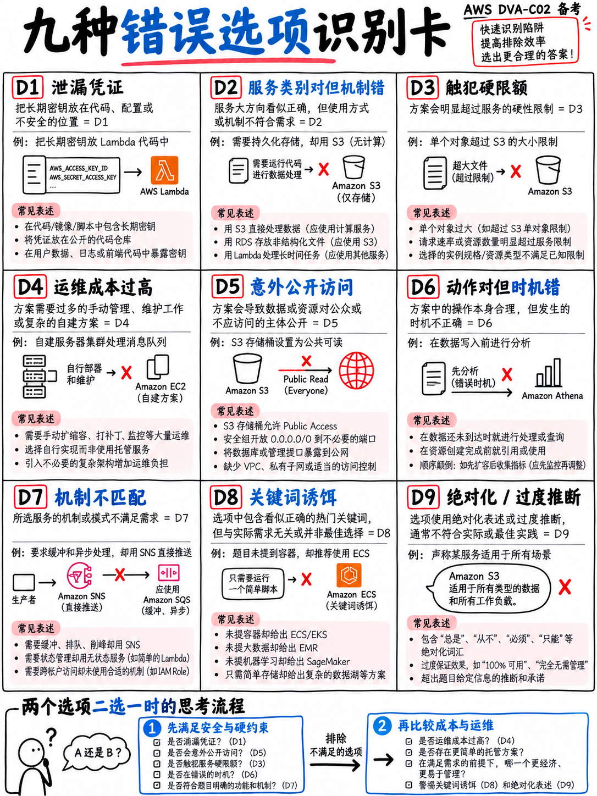

# 6.3 The Distractor Taxonomy / 干扰项分类学与排除技法



AWS 官方考试指南中对干扰项有着极为坦率的界定：“**干扰项（Distractors）** 即错误选项，是那些仅掌握不完整知识或技能的考生极易选择的备选项。干扰项通常被设计得**高度逼真且合理（Plausible）**，且完全契合题目的技术考查范畴。” [1]

这些干扰项绝非考官随意拼凑，而是遵循着标准化的工程化逻辑制造出来的。在实战中，干扰项可以归纳为**九大经典原型**。识破这九种原型，能够将茫无头绪的盲目猜测转化为胜算极高的精准排除——在整场考试的 50 道计分题中，这将直接为你抢回数道关键题目的分数。

## 6.3.1 九大干扰项原型深度解析 (The nine shapes)

### D1 — 凭证泄露原型 (The Credential Leak)

**形态特征：** 提议将硬编码的访问密钥（Access Key / Secret Key）存储于各种静态介质中：操作系统环境变量、AMI 镜像、源代码、配置文件、容器镜像层或客户端移动 App 中。

> *“将 IAM 用户凭据以明文形式作为环境变量存储在 Lambda 函数的配置中。”*
> —— 摘自 AWS 官方样题第 5 题的典型干扰项 [18]

**破局心法：** 在 AWS 现代云架构中，计算组件访问受保护资源的唯一标准答案永远是 **IAM 角色 (IAM Role)**。任何在选项中看到长期静态凭据的方案，见之即行剔除。

### D2 — 张冠李戴原型 (The Wrong Service, Right Category)

**形态特征：** 选项给出了属于正确技术领域（如存储类、配置类、数据库类）的服务，但该服务**根本不具备**题干所要求的某项核心能力。

> *“将数据库凭证保存在 AWS Systems Manager Parameter Store 中，并配置 Parameter Store **自动轮转 (Automatically rotate)** 该凭据。”*
> —— 摘自 AWS 官方样题第 1 题 [18]

Parameter Store 确实是极其优秀的配置存储服务，但它**本身绝不提供原生自动轮转机制**。同类的经典张冠李戴还包括：“创建支持强一致性读取的 GSI”（GSI 仅支持最终一致性）、“使用 API Key 对调用用户进行身份认证”（API Key 仅用于流量计量和限流）、“添加 Filter Expression 来削减 DynamoDB 读取容量消耗”（Filter 发生在读取之后，容量照扣不误）。

**破局心法：** 重点核查具体**功能特性 (Feature)**，而非仅仅看服务大类是否对口。

### D3 — 触碰硬限原型 (The Hard Quota Violation)

**形态特征：** 方案提出了在物理层面上被 AWS 系统硬性配额（Hard Limit）直接禁止的做法，且常被粉饰为“申请调高配额”。

- “将 AWS Lambda 的函数超时时间增加至 30 分钟”（Lambda 执行时间上限固定为 **900 秒 / 15 分钟**，无法提升）
- “将 API Gateway 的后端集成超时时间延长至 60 秒”（集成超时上限固定为 **29 秒**，硬性限额）
- “申请提升 Lambda 同步调用的请求载荷配额”（上限固定为 6 MB）
- “直接调用 KMS `Encrypt` API 加密一个 50 MB 的大文件”（KMS 单次加解密物理上限为 **4 KB**）

**破局心法：** 牢记 {doc}`../80-toolkit/03-numbers-and-limits` 中梳理的核心高频硬限制清单。

### D4 — 运维开销陷阱原型 (The Operational Overhead Trap)

**形态特征：** 方案在技术逻辑上完全可行且能够跑通，但它要求考生用纯手工“重复造轮子”的方式去实现云平台早已有成熟托管服务支持的功能：例如在 EC2 上自建 Cron 定时任务轮转密码、写一个死循环 Lambda 定时轮询状态变化、自写分布式调度器、或手写重试逻辑。

**破局心法：** 当题干中出现 “**LEAST operational overhead**”（最低运维开销）这一最高频限定词时，全托管服务必胜。自建脚本和手撕架构无论多么精巧，一概淘汰。

### D5 — 公开暴露越权原型 (The Public Exposure)

**形态特征：** 为了解决接口连通或权限不足问题，粗暴地采取破坏安全边界的手段：“将 S3 存储桶设为公开”、“安全组允许 `0.0.0.0/0` 全网访问”、“直接为角色附加 `AdministratorAccess` 全局管理员策略”、“禁用 S3 阻止公开访问 (BPA) 特性”。

**破局心法：** 只要考卷中存在受控的细粒度授权方案（如最小权限策略、预签名 URL、接口端点），过度放权的选项永远是自杀式陷阱。

### D6 — 时机错位原型 (Right Action, Wrong Time)

**形态特征：** 选项提出的操作在 AWS 工程体系中是一个真实且标准的操作，但它**完全没有对准题干当前需要紧急解决的矛盾**（答非所问）。

> 题干描述某 Lambda 函数因消费 Kinesis 数据流中的一条格式错误的“毒丸记录”导致整个分片完全堵死；选项提议：*“延长数据流的数据保留期（Data retention period）”*。保留期确实是 Kinesis 的重要参数，但延长保留期对解决当前卡死的毒丸记录毫无帮助。

**破局心法：** 重新审视题干末尾的核心需求句，自问一句：“这个操作做下去，能立刻解除*眼前这个具体痛点*吗？”

### D7 — 机制错配原型 (The Mechanism Mismatch)

**形态特征：** 概念方向正确，但套用了属于其他服务或异构计算环境的具体实现载体：例如针对 Lambda 函数部署套用 EC2 专用的 `appspec.yml` 安装生命周期钩子（Lambda 仅支持 `BeforeInstall`、`AfterInstall` 等专属钩子）；或者在 ECS 容器服务中试图使用 API Gateway 阶段变量；在需要返回完整 ARN 的 CloudFormation 属性中使用只能返回物理 ID 的 `!Ref`。

**破局心法：** 在评估具体配置细节之前，先看清当前方案的目标计算平台究竟是 Lambda、EC2 还是 ECS。

### D8 — 关键词磁铁原型 (The Keyword Magnet)

**形态特征：** 选项故意疯狂重复题干情境中出现频率最高的技术名词，诱导依靠关键词联想盲猜的考生。例如题干连续四次提到“DynamoDB”，选项就强行设计一个看似高深却与需求风马牛不相及的 DynamoDB 生僻特性。

**破局心法：** 在执行“四遍扫读法”的步骤 2 时，先形成自己独立的架构推断，再看选项。当一个选项过度谄媚地迎合题干关键词时，反而应当提高警惕。

### D9 — 极端绝对与大动干戈原型 (The Absolute or the Over-Reach)

**形态特征：** 措辞中包含 *always*（总是）、*never*（绝不）、*all*（所有）、*immediately*（立即）、*every*（每一个）等绝对化字眼；或者试图用极其夸张的架构重构来解决局部的小微问题（如“将整个单体应用拆分为微服务”、“全量迁移到底层完全不同的新型数据库引擎”）。

**破局心法：** AWS 认证考试的核心导向是“以最小的架构变动成本精准解决特定业务痛点”。架构过度设计必被淘汰。

## 6.3.2 两强相争的终局决断法则 (The two-option endgame)

在利用排除法剔除两个明显荒谬的原型之后，你通常会在剩下的两个候选项之间陷入纠结。请严格按照以下优先级决策树逐级判定：

```
 1. 是否有一项直接违背了题干核心需求句的字面红线？               → 坚决排除
 2. 题干的核心大写限定词 (QUALIFIER) 倒向哪一方？
       LEAST operational overhead (最低运维)  → 选择全托管 / Serverless 方案
       MOST cost-effective        (最省成本)  → 选择按需计费 / 免费层 / 无闲置资源方案
       MOST secure                (最高安全)  → 选择 IAM 角色 / 最小权限 / 私网端点方案
 3. 哪一个选项采用了原生从属于该服务的标准机制？                  → 选择原生机制项
 4. 哪一个选项属于改动量更小、侵入性更低的轻量级修复？             → 选择更小改动项
 5. 是否有一项直击根因 (CAUSE)，而另一项仅仅是治标 (SYMPTOM)？
       题干要求 "fix it now" (紧急排障恢复)      → 控制表象的止血方案可能胜出
       题干要求 "prevent / avoid" (根本性预防)   → 直击技术根因的方案胜出
 6. 依然僵持不决：选择表述更加具体、贴合情境的选项 (SPECIFIC)。
    泛泛而谈的通用“最佳实践”往往是命题者敷衍拼凑的陪衬，唯有针对具体架构量身定制的选项才是正解。
```

第 6 条决断法则是最有效却最少为人知的考场破局利器。命题专家在撰写正确答案时，会费尽心思使其与情境中的上下文紧密咬合；而制造出来的“高仿备选项”，往往是一句就算复制粘贴到其他二十道题目中也看似挑不出毛病的通用正确废话。

## 6.3.3 实战排除全流程推演 (Worked elimination)

> 一名开发者正在 AWS Lambda 上构建无服务器应用，该应用需要读取数据库密码。密码必须每 30 天轮转一次，且该解决方案必须具备最低运维开销（LEAST operational overhead）。
>
> A. 将数据库密码存储在 Lambda 环境变量中，并每隔 30 天通过管理控制台手动更新。  
> B. 将数据库密码保存在 AWS Secrets Manager 中，并开启自动轮转功能。  
> C. 将数据库密码保存在 AWS Systems Manager Parameter Store 中，并通过定时执行的 Lambda 函数执行轮转逻辑。  
> D. 将 IAM 访问密钥打包内置在函数部署包的代码中，并每隔 30 天轮转一次该密钥。

| 选项 | 命中干扰项原型 | 最终裁决与破题依据 |
|---|---|---|
| **D** | **D1 — 凭证泄露原型** | 立即划掉排除；不仅严重违背安全基线硬编码密钥，而且试图用 IAM 用户密钥替代数据库密码，答非所问 |
| **A** | **D4 — 运维开销陷阱** | 排除；“手动更新 (manually)”与题干限定词 “LEAST operational overhead” 形成直接冲突 |
| **C** | **D4 — 运维开销陷阱** | 排除；Parameter Store 本身不支持自动轮转，选项要求开发者自行编写并维护轮转 Lambda 函数，属于手造轮子 |
| **B** | — | **正确答案。** 完美命中 “Secrets Manager + 自动轮转” 标准技术组合，全托管且运维开销最低 |

**仔细体会这个案例所蕴含的解题启示：** 你甚至无需对数据库驱动连接的具体细节有深入研究，仅凭对选项**行为特征**的解构，就能在 30 秒内干净利落地锁定答案。这正是干扰项分类学的威力所在：在遇到完全陌生的冷门盲区题目时，它能稳定地将你 25% 的盲猜胜率拉升到 50% 甚至更高。

## 6.3.4 干扰项原型速辨自测演练 (Self-check: name the shape)

请快速审视以下 10 个选项片断，尝试在 3 秒内报出它所属的干扰项原型代号：

1. “将 SQS 队列的最大消息大小配额增加至 1 MB。” → **D3**（触碰硬限，SQS 单条消息物理上限为 256 KB）
2. “为 Lambda 函数授予 `AdministratorAccess` 权限策略以便其向 DynamoDB 写入数据。” → **D5**（公开暴露与过度越权）
3. “使用 API Gateway 的 API 密钥（API Key）对调用 REST API 的终端用户进行身份认证。” → **D2**（张冠李戴，API Key 仅用于流量计费与限流，无法执行身份鉴权）
4. “在 DynamoDB Scan 操作中添加 Filter Expression 过滤表达式，以降低所消耗的读容量单位（RCU）。” → **D2**（张冠李戴，Filter 在读取之后执行过滤，RCU 照常全额扣除）
5. “启动一台带有 Cron 定时任务的 EC2 实例，定期将对象从一个 S3 存储桶复制到另一个存储桶。” → **D4**（运维开销陷阱，S3 跨区域复制 CRR 或 EventBridge 即可原生搞定）
6. “在现有的 DynamoDB 生产表上追加创建一个本地二级索引（LSI）。” → **D2 / D3**（触碰机制硬限，LSI 只能且必须在建表阶段指定，建表后不可新增）
7. “将 Cognito 用户访问令牌（Access Token）直接硬编码保存在客户端前端应用程序的源代码中。” → **D1**（凭证泄露原型）
8. “为了解决某一个 REST 接口高延迟瓶颈，将整个单体系统彻底重构为微服务架构。” → **D9**（极端绝对与大动干戈）
9. “启用 AWS X-Ray 追踪，用于统计过去一周内应用错误日志发生的累计总次数。” → **D6 / D2**（时机与工具错配，统计历史日志频次应使用 CloudWatch Logs Insights）
10. “将 Lambda 函数的分配内存提升至最高规格，以解决访问私有 VPC 内资源超时的问题。” → **D6**（时机与根本原因错位，VPC 超时是路由或 NAT 网关缺失导致的网络问题，加内存无济于事）

## 6.3.5 实战落地：以“原型标签”重塑做题复盘 (Using this in practice)

在进行全真模拟题演练时，每次订正错题，请不要仅仅泛泛地记录“我做错了某某服务的题目”，而是要明确标注**“我掉进了哪一个干扰项原型的陷阱”**。

在连续记录三套模拟题后，你的错题本上就会浮现出极具指导价值的量化诊断结论，例如：“每套试卷我都会因为 D4 丢掉 3 分，因为 D6 丢掉 2 分”——这样的洞察具有极强的实操纠偏价值，远比一句空洞的“我的部署知识域比较薄弱”更能让你在考前迅速补齐短板。具体的复盘记录表格模板请参见 {doc}`../80-toolkit/04-error-log-method`。
