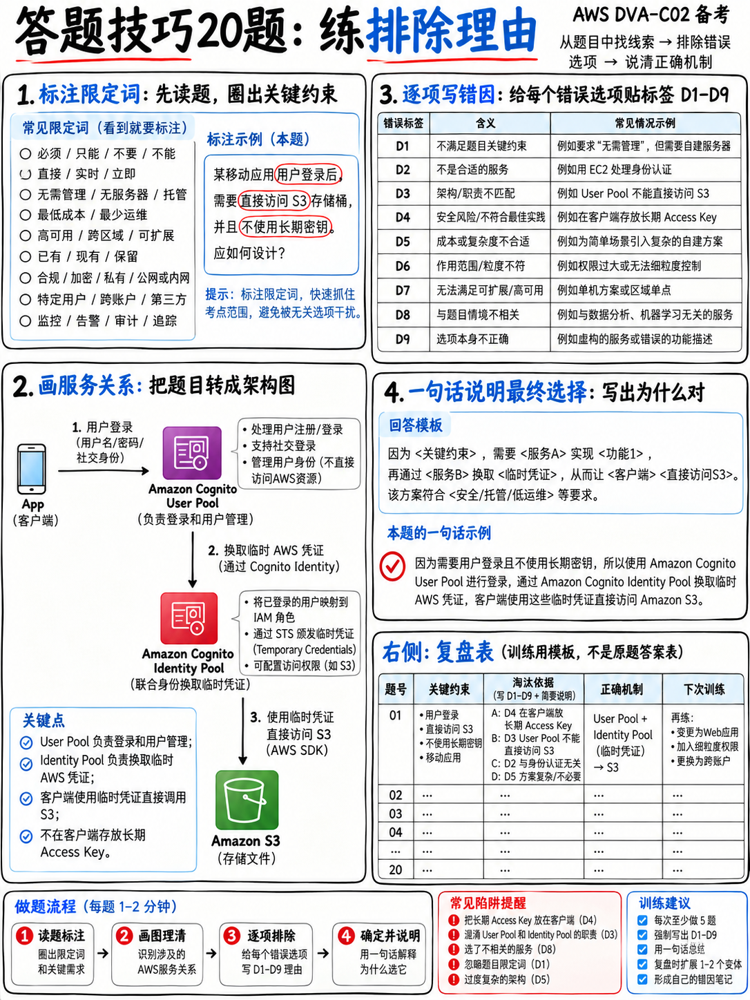

# 6.4 Technique Drill Bank / 解题技法专项演练 20 题

本套 20 道专项训练题的核心目标是**全方位锤炼解题方法论**，而非单纯灌输新的零散知识点。每一道题都可以完全通过“四遍扫读法”（参见 {doc}`01-how-aws-questions-work`）配合“九大干扰项原型”（参见 {doc}`03-distractor-taxonomy`）实现秒杀破解；每道题目的逐题解析中均明确指出了命题人故意埋设的干扰项原型代号。

:::{tip}
**如果备考冲刺时间紧迫，强烈建议在刷四大知识域的练习题之前，优先完成这套技法演练。** 核心解题技法具有全局普适性，能直接为你全部 50 道计分题目保驾护航；相比之下，任何单个孤立技术考点在考卷上充其量只占 1~2 分。  
合格通关目标：**16 / 20 以上**，且至少有 14 道题能够明确准确地说出破题依据与所识破的干扰项原型。
:::

## 6.4.1 全真专项题库 (Questions)

**1.** 某公司需要运行一项耗时 40 分钟的数据转换任务。以下哪种方案具备最低运维开销（LEAST operational overhead）？  
A. 将超时时间调大至 40 分钟的 AWS Lambda 函数。  
B. 由团队自行管理、运行 Cron 定时任务的 Amazon EC2 实例。  
C. 配置了 10,240 MB 最大内存规格的 AWS Lambda 函数。  
D. 按计划定时触发运行在 AWS Fargate 上的 Amazon ECS 容器任务。  

**2.** 某无服务器应用需要存储供 Lambda 函数调用的第三方 API 密钥。该密钥一经配置永不改变。公司希望以最低成本（LOWEST cost）满足该需求。应当选用哪种方案？  
A. AWS Secrets Manager。  
B. 以明文形式保存在 Lambda 环境变量中。  
C. 存放在启用了 SSE-KMS 加密的 Amazon S3 存储桶对象中。  
D. 采用 `SecureString` 类型的 AWS Systems Manager Parameter Store。  

**3.** 终端用户反馈某 API 响应迟缓，开发团队无法确定高延迟瓶颈究竟是由数据库查询还是由第三方接口调用引起的。应当优先实施（FIRST）哪项措施？  
A. 开启 AWS X-Ray 分布式追踪并审查生成的服务映射图（Service Map）。  
B. 调大 Lambda 函数的分配内存规格。  
C. 在业务代码中打印输出更多的 CloudWatch Logs 日志语句。  
D. 创建一个展示 API 整体平均延迟的 CloudWatch 可视化仪表盘。  

**4.** 开发者需要为外部合作伙伴的 AWS 账号授予对本账号内单个 S3 存储桶的只读访问权限，并严格遵循最小特权原则（LEAST privilege）。应当采取什么做法？  
A. 在合作伙伴账号中创建一个 IAM 用户，并将长期访问密钥共享给对方。  
B. 禁用存储桶的“阻止公开访问（Block Public Access）”特性，将该存储桶配置为公开可读。  
C. 添加存储桶策略（Bucket Policy），仅授予合作伙伴账号指定角色对该特定存储桶的 `s3:GetObject` 权限。  
D. 为合作伙伴扮演的角色附加全局管理员策略 `AmazonS3FullAccess`。  

**5.** 某 SQS 消费者存在每条消息被重复消费处理两次的问题。经排查，后端消费函数单次处理耗时 90 秒，而队列当前的可见性超时（Visibility Timeout）设置为 60 秒。最合适的修复方案（MOST appropriate fix）是什么？  
A. 将队列的可见性超时时间至少调整至 540 秒。  
B. 将 Lambda 函数的执行超时上限缩短至 60 秒。  
C. 将标准 SQS 队列转换为 FIFO 先入先出队列。  
D. 在 SQS 队列上启用长轮询（Long Polling）。  

**6.** 团队希望部署 Lambda 函数新版本时，先通过 10% 的真实生产流量检验是否存在异常，确认健康后再全量铺开上线，且在错误率上升时能够自动回滚。哪种方案所需的配置工作量最少（LEAST configuration）？  
A. 部署两个独立的函数，并在 Route 53 中配置加权路由记录集分配流量。  
B. 在 AWS SAM 模板中使用 `AutoPublishAlias`，并声明 `DeploymentPreference` 为 `Canary10Percent10Minutes` 且关联 `Alarms` 告警。  
C. 执行手动全量部署，随后由运维人员人工监控指标变化。  
D. 配置一条 EventBridge 规则，在部署开始 10 分钟后自动触发脚本切换版本别名。  

**7.** 应用程序需要在 S3 存储桶创建新对象时自动收到通知，且必须能够对处理失败的情况进行自动重试，并在最终失败后能够留存原始事件上下文以便事后排查分析。哪种架构设计最为合适（MOST appropriate）？  
A. 编写一个每分钟执行一次 `ListObjects` 遍历存储桶的 Lambda 函数。  
B. 配置 S3 事件通知异步触发 Lambda，并为该 Lambda 配置异步调用失败目的地（On-failure Destination）。  
C. 启动一台 EC2 虚拟机持续向 S3 存储桶发送轮询拉取请求。  
D. 配置 S3 事件通知触发 Lambda，不在函数上配置任何错误重试与容错捕获机制。  

**8.** 某 DynamoDB 生产表以 `status` 属性作为分区键（Partition Key）。该表近期在承接高并发写入时频繁遭遇请求限流（Throttled）。导致该限流现象的技术根本原因（Root Cause）是什么？  
A. 数据表整体预置的读写容量配额（Provisioned Capacity）不足。  
B. 分区键的数据基数过低（Low-cardinality），导致产生访问严重失衡的热分区（Hot Partition）。  
C. 客户端应用程序执行了最终一致性读取。  
D. 表上缺少全局二级索引（GSI）辅助分流。  

**9.** 对于部署在 EC2 实例上、需要向 DynamoDB 表写入数据的业务程序，哪种权限配置方案具备最高安全性（MOST secure）？  
A. 将 IAM 访问密钥硬编码存放在操作系统的 `/etc/environment` 环境变量配置文件中。  
B. 将长期 IAM 访问密钥直接烘焙固化进自定义 AMI 虚拟机镜像中。  
C. 创建具备必要写入权限的 IAM 角色，并通过实例配置文件（Instance Profile）绑定至该 EC2 实例。  
D. 将 DynamoDB 表的访问控制权限调整为全网公网可写。  

**10.** 同一个 REST API 需要以最少的配置维护工作量（LEAST amount of configuration）分别将外部请求代理分发至开发环境（dev）与生产环境（prod）两个不同的 Lambda 别名。应当选用什么方案？  
A. 在 API Gateway 中创建两个完全独立的 REST API，并各自维护独立的部署阶段。  
B. 创建两个独立的 Lambda 函数，并使用 Route 53 DNS 记录集根据环境进行域名权重解析。  
C. 创建一个 REST API，并在前置自定义 Lambda Authorizer 中解析请求特征动态路由至目标环境。  
D. 创建一个 REST API，在各个阶段分别配置阶段变量（Stage Variable）以动态指向对应的 Lambda 别名。  

**11.** 团队的持续集成构建流水线绝不能依赖外部公共 npm 仓库的网络可用性，且公司安全部门必须对允许引入的第三方依赖包实施统一合规审查准入。应当选用哪项 AWS 服务？  
A. 使用附带对象清单（Manifest）管理的 Amazon S3 存储桶。  
B. Amazon Elastic Container Registry (ECR)。  
C. 将第三方 `node_modules` 依赖包完整提交并纳入 Git 源代码版本控制中。  
D. 配置了上游公共源（Upstream Repository）连接的 AWS CodeArtifact 私有软件仓库。  

**12.** 部署在私有 VPC 内的 Lambda 函数可以正常访问同 VPC 内的 RDS 数据库实例，但在通过公网域名调用 Amazon S3 时遭遇连接超时。最具成本效益的修复方案（MOST cost-effective fix）是什么？  
A. 在 VPC 的公有子网中创建并配置 NAT 网关（NAT Gateway）。  
B. 直接移除该 Lambda 函数的所有 VPC 绑定网络配置。  
C. 在 VPC 路由表中为 Amazon S3 配置免费的网关型 VPC 端点（Gateway VPC Endpoint）。  
D. 调大 Lambda 函数的执行超时时间上限。  

**13.** 运维排障团队需要精准统计在过去的 14 天内，某特定错误代码在应用日志中累计出现的具体总次数。他们应当使用什么工具？  
A. 在 CloudWatch 中今天刚刚创建的指标筛选器（Metric Filter）。  
B. AWS CloudTrail 事件历史记录。  
C. 针对目标日志组执行 CloudWatch Logs Insights 历史查询语句。  
D. AWS X-Ray 的追踪注解（Annotations）。  

**14.** 某应用程序向 DynamoDB 写入单条体积超过 400 KB 的记录项时频繁报错失败。开发者应当采取什么合规应对策略？  
A. 将大体积数据载荷保存在 Amazon S3 中，并在 DynamoDB 数据项内仅保留指向该 S3 对象的指针引用。  
B. 提交服务工单申请提高 DynamoDB 单项体积配额限制。  
C. 将该数据项强行拆分成两半分别存储到两张不同的 DynamoDB 表中。  
D. 使用压缩算法将数据项压缩至 399 KB 后强行写入原表。  

**15.** 移动端用户通过 Amazon Cognito 用户池完成登录后，哪种架构能够安全为移动端颁发用于直接向 S3 存储桶上传文件的临时 AWS 访问凭证？  
A. 为移动端的每一位注册用户在 AWS 账号内分别创建一个独立的 IAM 用户。  
B. 配置 Amazon Cognito 身份池（Identity Pool），通过 AWS STS 兑换用户池 JWT 令牌换取临时凭证。  
C. 将固定的 IAM 长期访问密钥直接硬编码内置在移动端 App 安装包中。  
D. 编写一个专属的 Lambda 函数，直接向客户端明文返回 AWS 账号根用户（Root）凭据。  

**16.** 当执行 CloudFormation 堆栈更新且模板中移除了某生产环境 DynamoDB 表资源声明时，必须确保底层真实的物理数据库表绝不被意外删除。应当在模板中配置什么属性？  
A. 在 CloudFormation 堆栈级别开启终止保护（Termination Protection）。  
B. 绑定拒绝一切资源更新操作的堆栈策略（Stack Policy）。  
C. 在 DynamoDB 表资源属性块中声明 `DeletionPolicy: Retain`。  
D. 在表资源属性块中配置 `UpdateReplacePolicy: Delete`。  

**17.** 某 ECS 容器任务无法正常启动，底层集群事件日志报错提示由于认证或网络原因无法从 Amazon ECR 仓库拉取容器镜像。首要排查（FIRST）哪项配置？  
A. ECS 任务角色（Task Role）。  
B. ECS 任务执行角色（Task Execution Role）。  
C. 容器内业务代码所使用的 IAM 权限策略。  
D. ECR 镜像仓库的生命周期管理策略。  

**18.** 公司要求其 Lambda 函数在每成功处理完一笔交易订单时，都必须对外上报一个自定义业务监控指标，且该操作绝不能为单次函数调用增加任何额外的网络延迟。应当采用什么方案？  
A. 在标准日志输出中写入符合 CloudWatch 嵌入式指标格式（EMF）规范的 JSON 文本。  
B. 在每次函数执行的末尾同步发起 API 请求调用 `PutMetricData`。  
C. 在 DynamoDB 中自建一个原子计数器，并由监控仪表盘定时抓取读取。  
D. 每处理完一笔订单均向 Amazon SNS 发送一条通知消息。  

**19.** 某 API 接口接收的业务请求需要后端服务器执行耗时两分钟的长事务计算，且前端调用方绝不能被同步阻塞挂起等待。最合理的设计架构（MOST appropriate design）是什么？  
A. 申请调大 API Gateway 的后端集成超时时间。  
B. 改用 WebSocket API 并在任务执行的两分钟期间全程保持全双工长连接通道。  
C. 将后端 Lambda 函数的执行超时时间提高至 120 秒。  
D. API Gateway 立即向客户端返回 HTTP 202 Accepted，将请求推入 SQS 队列，由后端 Lambda 异步消费处理。  

**20.** 开发者需要在 AWS X-Ray 控制台中快速检索出与某个具体订单号（Order ID）关联的所有 Trace 追踪调用链。应当在代码插桩中加入什么？  
A. 包含订单 ID 键值对的 X-Ray 注解（Annotation）。  
B. 包含订单 ID 键值对的 X-Ray 元数据（Metadata）。  
C. 创建一个以该订单 ID 直接命名的自定义子分段（Subsegment）。  
D. 针对每个独立的订单 ID 分别创建一条专属的自定义采样规则（Sampling Rule）。  

---

## 6.4.2 答案与破题依据（标明干扰项原型） (Answers, with the shape you were meant to spot)

**1 — 答案 D。** Lambda 的 900 秒（15 分钟）单次执行上限是不可逾越的**硬性物理配额**，因此选项 A 与 C 均直接命中 **D3（触碰硬限原型）**。选项 B 命中 **D4（运维开销陷阱）**——需要研发团队自行配置、运维与维护虚拟机的底层操作系统与 Cron 定时脚本，在无服务器容器 Fargate 面前必败。*裁决限定词：LEAST operational overhead。*

**2 — 答案 D。** 选用 **Parameter Store `SecureString`**——标准层级的参数存储完全免费，且题干明确说明该 API 密钥永不改变，因此无需使用 Secrets Manager 的定期自动轮转特性（选项 A 属于反向命中 **D4**：为业务根本不需要的高级功能多付账单）。选项 B 命中 **D1 变种（明文暴露机密）**。*裁决限定词：LOWEST cost。*

**3 — 答案 A。** 题干的核心痛点在于*无法厘清究竟是哪一个下游组件拖慢了系统*，这属于典型的分布式链路追踪（Tracing）职责范畴，绝非单纯看指标（Metrics）或零散打日志（Logging）所能解决。选项 B 命中 **D6（时机与根本原因错位）**；选项 C 和 D 只能告诉你系统“变慢了”这个表象，根本无法告诉你具体慢在何处。

**4 — 答案 C。** 通过精细化存储桶策略，将授权操作严格收敛在单个 S3 存储桶的 `s3:GetObject` 这一最小动作上。选项 A 命中 **D1（共享长期静态密钥）**；选项 B 命中 **D5（公网裸奔暴露）**；选项 D 命中 **D5 / D9（过度越权与通配符泛滥）**。*裁决限定词：LEAST privilege。*

**5 — 答案 A。** AWS 官方的黄金运维实践准则是：将 SQS 队列的可见性超时时间设置为函数执行超时的**至少 6 倍**——90 × 6 = 540 秒，以防止消息尚未被处理完成就提前重新对其他消费者可见导致重复消费。选项 B 会直接掐死函数的正常业务执行；选项 C 改变了消息传输语义但根本未解决并发超时问题；选项 D 命中 **D6（长轮询解决的是空读取 API 成本，与防重复消费无关）**。

**6 — 答案 B。** 仅需在 SAM 模板中声明一行极简的属性配置即可由系统全托管调度。选项 A 与 D 均命中 **D4（手造轮子实现流量切换）**；选项 C 属于纯人工操作，根本不具备自动化快速回滚机制。*裁决限定词：LEAST configuration。*

**7 — 答案 B。** Lambda 的异步调用失败**目的地（On-failure Destination）**不仅支持完整的自动重试，还能将最终失败调用的**全景错误上下文与原始请求载荷**自动持久化保存下来供后续审查。选项 A 与 C 命中 **D4（低效轮询反模式）**；选项 D 虽能处理正常通知，但缺失了重试与失败审查诉求，属于 **D6（残缺半成品）**。

**8 — 答案 B。** 高并发流量集中倾斜在基数极低的少数分区键属性上（如有限的状态值枚举），是产生 DynamoDB 热分区（Hot Partition）的经典反模式诱因。选项 A 看似合理，但题干指出了分区键设计缺陷；选项 C 和 D 命中 **D8（强塞无关的 DynamoDB 关键词，答非所问）**。

**9 — 答案 C。** 运用 IAM 角色准则（Role Heuristic）秒杀。选项 A 和 B 均命中 **D1（凭证泄露原型）**；选项 D 命中 **D5（公网完全裸奔）**，且在架构工程上属于不可理喻的错误。*裁决限定词：MOST secure。*

**10 — 答案 D。** 在同一个 API Gateway 上通过“阶段变量 + Lambda 别名”实现多环境动态路由，是官方样题考查的标准考点 [18]。选项 A 命中 **D4（复制多套孤立资源导致高配置量）**；选项 B 和 C 命中 **D7（机制错配，在不适合的层级做环境分发）**。*裁决限定词：LEAST amount of configuration。*

**11 — 答案 D。** **AWS CodeArtifact** 内置上游公共源镜像与本地缓存机制，既能彻底规避公网公共仓库故障带来的中断风险，又能实现组织级的合规准入把控。选项 A 和 C 命中 **D4（手工维护构件版本极其低效）**；ECR 专用于托管 Docker 容器镜像，命中 **D2（张冠李戴）**。

**12 — 答案 C。** **S3 网关型 VPC 端点（Gateway VPC Endpoint）完全免费**；相比之下，NAT 网关不仅存在固定的小时运行费，还要按流经的数据流量（GB）收取昂贵的流量处理费，因此选项 A 技术上通顺但绝非 *cost-effective*。选项 B 拆除 VPC 会直接导致函数无法连接私有 RDS；选项 D 命中 **D6（网络路由不通盲目加超时无济于事）**。*裁决限定词：MOST cost-effective。*

**13 — 答案 C。** **CloudWatch Logs Insights** 支持对已存储的海量历史日志进行追溯式即席查询。选项 A 命中 **D6（指标筛选器不具备追溯历史能力，从创建生效后才开始统计）**；CloudTrail 审计的是 API 管理面调用而非应用内部日志，命中 **D2**；X-Ray 专精于链路追踪而非日志全量文本计数，命中 **D2**。

**14 — 答案 A。** DynamoDB 单个数据项大小上限为 **400 KB，属于硬性物理限额**，无法提升，因此选项 B 命中 **D3**；选项 D 依赖脆弱的压缩手段，一旦下次遇到无法充分压缩的载荷依然会暴死崩溃。选项 C 水平分表并未改变单项体积限制规则。将大对象转储至 S3 并由主表维持引用是指针模式的标准解法。

**15 — 答案 B。** 终端用户身份认证（Cognito 用户池）向 AWS 资源访问凭证（Cognito 身份池 + STS AssumeRole）的标准兑换路径。选项 A 在用户量庞大时完全无法扩展且触碰账户配额；选项 C 命中 **D1（移动端内置静态秘钥）**；选项 D 命中 **D1 最极端形态（泄露 Root 根凭据）**。

**16 — 答案 C。** 在资源声明中显式设置 **`DeletionPolicy: Retain`**。选项 A 的堆栈终止保护仅用于防止整个 CloudFormation Stack 被意外销毁，无法阻止堆栈更新时模板内被剔除资源的销毁，命中 **D6**；选项 B 的拒绝更新堆栈策略命中 **D9（过度绝对化直接冻结业务正常更新）**；选项 D 恰好适得其反。

**17 — 答案 B。** **任务执行角色（Task Execution Role）**用于授权 ECS 容器运行时代理去执行底层的“拉取 ECR 镜像”和“推送日志至 CloudWatch”。而任务角色（Task Role）则是容器内业务代码启动后访问 AWS 资源的权限，两者界限极其分明，选错命中 **D7（机制层级错配）**。

**18 — 答案 A。** **嵌入式指标格式（EMF）**直接将指标打包进日志输出流异步解析投递，完全不需要发起任何同步的外部 HTTP API 网络请求，带来真正的零执行延迟。选项 B 产生同步网络 I/O 阻塞，直接违背了“绝不增加执行延迟”的题干红线；选项 C 和 D 命中 **D2（方案并未直接生成 CloudWatch 指标）**。

**19 — 答案 D。** API Gateway 的后端集成超时时间上限为 **29 秒（硬性物理限额）**，因此选项 A 和 C 均直接命中 **D3**。选项 B 强制客户端保持两分钟长连接等待，直接违背了题干中“客户端绝不能等待”的核心诉求。返回 202 并利用 SQS 异步解耦缓冲是标准微服务模式。

**20 — 答案 A。** **X-Ray 注解（Annotations）支持建立系统倒排索引**，因此支持在控制台进行快速过滤检索；而元数据（Metadata）不支持索引，仅用于在追踪详情页展示辅助文本，选 B 命中 **D2**。以订单 ID 命名子分段命中 **D7**；为每个订单 ID 创建一条采样规则命中 **D9（规则配额瞬间打满崩溃）**。

---

## 6.4.3 成绩诊断与能力评估 (Diagnosis)

| 本次模考得分 | 能力所处段位与针对性备考建议 |
|---|---|
| **18 – 20 分**（且破题逻辑清晰） | 解题方法论已完全内化为下意识直觉。你可以信心百倍地进入各专业知识域模拟题库实战。 |
| **14 – 17 分** | 处于正常过渡区间。请重新通读 {doc}`03-distractor-taxonomy`，复盘究竟是哪几种干扰项原型成功迷惑了你。 |
| **10 – 13 分** | 仍在过度依赖死记硬背的 AWS 散碎知识点答题，缺乏系统破题战术。请重新精读 {doc}`01-how-aws-questions-work` §6.1.1–6.1.4 并重做本套习题。 |
| **10 分以下** | 在将方法论两篇核心文档研读透彻之前，建议重做本演练。掌握解题思维模型所带来的提分效率，远胜于孤立死抠任何单个云服务。 |

做错题时，请严格按照**干扰项原型标签（D1~D9）**进行归因登记，而非仅仅记录知识点模块，模板详见 {doc}`../80-toolkit/04-error-log-method`。
