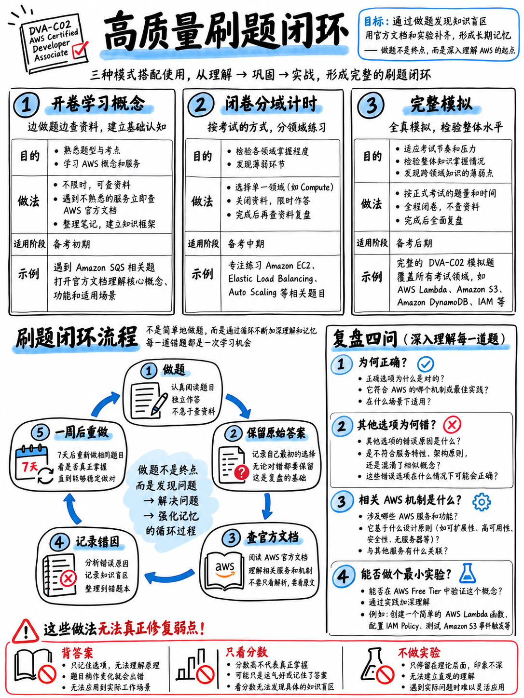

# 7.1 科学刷题方法论：错题复盘闭环、时间分配与高效备考实践 (How to Practise)



## 7.1.1 最关键的一条铁律 (The rule that matters most)

:::{important}
**花在复盘题目上的时间，至少要与作答题目的时间一样长。**

50 分钟完成 30 道题，接下来就必须保证至少 50 分钟的深度复盘。如果你没有充裕的时间进行复盘，宁可只做 15 道题，也不要贪多做 30 道。一道你做完了却没有真正理解透彻的题目，对你没有任何价值；而一道**凭错误理由碰巧蒙对**的题目，其危害甚至大于做错——因为这种错误的因果认知无法迁移到真实考试中，反而会误导你的决策。
:::

## 7.1.2 刷题的三种实战模式 (The three modes)

| 模式 (Mode) | 具体形式 (What) | 介入时机 (When) |
|---|---|---|
| **学习模式 (Learning)** | 每次做 10–15 题，不计时间，每做完一题立即精读解析 | 初次通读各知识模块核心章节时 |
| **套题专项模式 (Set)** | 每次 20–40 题，严格限时作答，交卷评分后再统揽全局复盘 | 核心训练主力，从备考第一周贯穿始终 |
| **全真模考模式 (Mock)** | 完整 65 道全真试题，单次连续坐打 130 分钟 | **全程仅需两次**：备考进程过半时一次，考前 4 天左右一次 |

绝大多数备考失败的考生都会陷入同一个误区：一直在“学习模式”中磨蹭到考前最后一周。正确的策略是：**一旦通读完某个模块，立即切换到限时套题专项模式**——在温和的时间压力下暴露错误并被纠正，其记忆深刻程度远胜于机械反复阅读。

## 7.1.3 科学复盘错题：必须书面回答的四个黄金问题 (Reviewing properly: the four questions)

对于你做错的**每一道题**，以及作答时犹豫不决、靠猜蒙中的每一道题，务必以文字形式快速记录以下四个问题的答案（每题耗时约 90 秒）：

```
 1. 题干的【核心需求句 (REQUIREMENT SENTENCE)】究竟要求实现什么？
 2. 审题解题的哪一个环节发生了崩塌？
       误读了核心需求 · 漏掉了关键限定词 · 没有横向纵览选项对比 ·
       误排除了正解 · 耗时过多导致心态失衡
 3. 我掉进了哪一种【干扰项套路陷阱 (DISTRACTOR SHAPE)】？   D1–D9
 4. 究竟是哪一个核心事实 (Single Fact) 让正解成为正解？（用自己的话概括为一句话）
```

如果你无法在不照抄答案解析的前提下写出第 **4** 条的核心事实，说明你根本没有掌握这道题的考点。在进入下一道题之前，必须翻阅对应的知识模块（模块 20 至 50）彻底弄清该事实。

## 7.1.4 动手实验胜过重复翻看文档 (Hands-on beats re-reading)

DVA-C02 考查大量非常具体的工程落地细节：`appspec.yml` 中包含哪些配置段、哪个生命周期钩子执行的是前一个部署版本的脚本、API Gateway 阶段变量的具体作用、DynamoDB 在特定失败时抛出哪种异常名称。只有当你在命令行或控制台中亲手敲过、配置过，这些事实才能真正烙印在大脑中。

**实战法则：每次完成一套专项练习题后，挑出你失分最惨痛的一个核心薄弱主题，直接执行对应的动手实验**（详见 {doc}`../80-toolkit/01-hands-on-lab-plan`）。对于 DVA-C02 这门侧重于动手与编码的考试，在 AWS 控制台或终端中投入 30 分钟，效果远超 3 个小时走马观花式的死记硬背。

## 7.1.5 练习材料与推荐训练次序 (What to practise, in what order)

```
 当你读完每一个知识模块时：
   60-exam-technique/04-technique-drill-bank          20 题   ← 最先完成（掌握审题拆解法）
   20-development/09-development-practice-set         30 题
   30-security/06-security-practice-set               24 题
   40-deployment/07-deployment-practice-set           26 题
   50-troubleshooting/06-troubleshooting-practice-set 20 题
 随后进阶：
   70-practice/02-official-sample-questions-walkthrough  10 题  ← AWS 官方正统样题
   70-practice/03-mini-mock-65-questions                 65 题，严格限时全真模考
 最后（如果你打算购买付费补充题库）：
   选购口碑权威的第三方全真模考题库，完整模拟两次
```

**必须尽早演练官方公开样题，切勿压箱底拖到考前！** 这 10 道题是市面上唯一由官方命题组公开、且 100% 具备正统 DVA-C02 出题口吻与辨析维度的黄金基准题，并且完全免费 [18]。将其留到考前最后突击，就彻底浪费了它们最重要的核心价值——**锚定真实出题基准（Calibration）**。

## 7.1.6 如何甄别与选择外部练习资源 (Choosing external practice material)

当你刷完本教程自带的练习集后，可能会寻找第三方题库补充刷题量。请务必根据以下五大特征严苛评估任何外部题库：

1. **题干必须是真实的业务场景 (Scenario)**，绝不能是干瘪的单一名词定义默写。
2. **题干必须明确包含决策限定词 (Qualifier)**——例如 MOST cost-effective（最具成本效益）、LEAST operational overhead（运维开销最小）等，因为真实考试正是靠限定词来区分方案优劣。
3. **四个选项都必须具备高度迷惑性 (Plausible)**。如果有两个选项明显荒诞可笑，这道题就毫无辨析训练价值。
4. **解析必须详述“错误选项为什么错”**，而不能只单薄地解释正确答案为什么对。这是衡量一套题库质量的最关键试金石。
5. **必须明确标注适配 DVA-C02**（或 2026 年 12 月 1 日改版后的 DVA-C03）。任何标注为 DVA-C01 的资料都已经彻底过时淘汰。

:::{danger}
**坚决抵制考场盗录题库（Exam Dumps/机经）。** 
在正式开考前，你必须点击同意 AWS 考生保密协议（NDA，参见 {doc}`../00-foundations/05-booking-policies-and-exam-day` §0.5.7）。除违规风险外，网络流传的所谓 Dumps 答案错漏百出，大量混杂着过时的旧考纲题目，且死记硬背机经只会训练对死题目的机械反应，根本无法培养真实考试所考查的架构工程决策能力。
:::

## 7.1.7 全真模拟实战流程 (Simulating the real thing)

对于两场 65 题的全真模考，必须严格模拟正式考场状态：

```
 65 道全真试题 · 130 分钟 · 单次不间断坐打 · 严禁翻看任何笔记与官方文档 · 手机静音放置于另一个房间
 【第一遍作答】：从头到尾完成所有题目，遇到不确定的题目做上标记（Flag），坚决不留空题
 【第二遍复查】：利用剩余时间，集中火力审查标记过的疑难题
 【交卷评分与复盘】：评分后立即进行全面复盘，复盘耗时不得少于作答时间
```

如果你申请了 **ESL +30 分钟非母语延时支持**（参见 {doc}`../00-foundations/05-booking-policies-and-exam-day` §0.5.4），请将模考时限设为 **160 分钟**，以确保你的答题配速与正式考试完全契合。

## 7.1.8 备考常见刷题反模式 (Anti-patterns)

| 刷题误区 (Anti-pattern) | 为什么会导致惨重失分 (Why it costs you) |
|---|---|
| **刷了数百道题却从不复盘** | 只是训练了“快速碰运气猜答案”的坏习惯，准确率和理解力毫无长进 |
| **死记硬背具体题目的题干与答案** | 真实考场上绝对不会出现一字不差的重复题目 |
| **只刷自己擅长熟悉的技术领域** | AWS 采用综合补偿计分制，边际提分潜力最大的一定是你最薄弱的知识盲区 |
| **只通读海量官方文档而不刷题** | AWS 文档浩瀚无涯，而考试是有限的、基于场景驱动的决策考核 |
| **在考前最后 48 小时刷整套模考** | 若模考分数不理想会极大摧毁考前自信，且临考前根本没有时间纠偏错题；即使考得好也无法增量吸收 |
| **把精力耗费在超纲边缘服务上** | 超纲服务不会计分，详见考纲范围清单 {doc}`../00-foundations/02-dva-c02-at-a-glance` §0.2.5 |

## 7.1.9 本模块包含的实战演练内容 (The material in this module)

| 章节文件 | 内容性质与目标定位 |
|---|---|
| {doc}`02-official-sample-questions-walkthrough` | AWS 官方公开的 **10 道经典样题**，逐字透视其命题考点与陷阱 |
| {doc}`03-mini-mock-65-questions` | 严格对照真实考试领域比例命制的 **65 道全真限时模考试题**（130 分钟） |
| {doc}`04-mini-mock-answers` | 65 题标准答案、正解深度剖析、干扰项排除逻辑及知识域薄弱点诊断 |
| {doc}`05-readiness-benchmarks` | 五大就绪评估关卡、各大题库达标分数线与考前冲刺/延期决策矩阵 |
