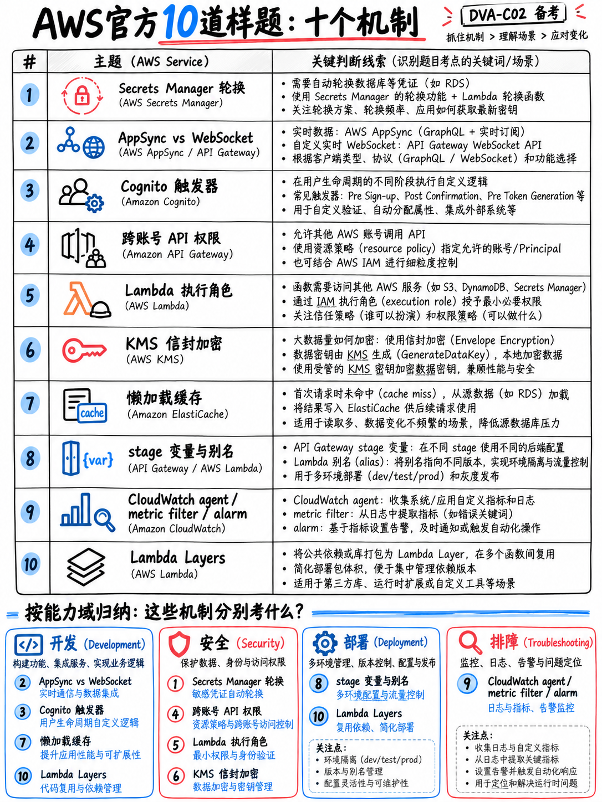

# 7.2 官方 10 道样题深度逐题拆解 (Official Sample Questions Walkthrough)

AWS 官方公开发布了一份包含 **10 道完整样题、标准答案及官方解析** 的 DVA-C02 样题手册（PDF）[18]。这 10 道题目是市面上唯一由官方命题团队直接编写、具备 100% 正统 DVA-C02 考查深度与辨析口吻的权威题目，其研究价值远胜于市面上数百道平庸的第三方练习题。

:::{important}
**请在阅读本解析之前，先独立完成官方样题 PDF。** 
官方 PDF 下载链接请见 {doc}`../90-references/01-sources-and-reliability`。在不查阅任何资料的情况下独立做完这 10 道题，然后再回到本章查看每道题深层传达的命题逻辑——这些考点和陷阱模式往往比题目本身更加深刻。
:::

## 7.2.1 10 道样题的整体命题规律 (The pattern across all ten)

| 题号 | 核心考点 | 对应知识域 | 题型格式 |
|---|---|---|---|
| 1 | Secrets Manager 自动轮换凭证 | 域 2 安全性 | 单选 |
| 2 | AppSync / WebSocket 实现近实时通信 | 域 1 应用开发 | **多选（Select TWO）** |
| 3 | Cognito + 认证后 Lambda 触发器 | 域 2 安全性 | **多选（Select TWO）** |
| 4 | 跨账号调用 API Gateway 的 IAM 鉴权 | 域 2 安全性 | **多选（Select TWO）** |
| 5 | Lambda 函数执行角色授权 | 域 2 安全性 | 单选 |
| 6 | KMS 信封加密机制 | 域 2 安全性 | 单选 |
| 7 | 根据伪代码识别 ElastiCache 惰性加载 | 域 1 应用开发 | 单选 |
| 8 | API Gateway 阶段变量与 Lambda 别名环境管理 | 域 3 部署发布 | 单选 |
| 9 | CloudWatch Agent + 指标筛选器 + SNS 告警 | 域 4 故障排查 | 单选 |
| 10 | Lambda 层解耦第三方共享依赖包 | 域 1 应用开发 | 单选 |

**10 题中有 3 道是多选题（Select TWO）**，这一比例为我们提供了一个关键的实战参考基准：预计在正式考试中，大约有 25% 至 33%（即四分之一到三分之一）的题目属于“五选二”或“六选三”的多选形态。

**10 题中有 5 道属于安全领域（Domain 2 Security）**，而在官方考纲中安全领域的权重占比为 26%。虽然我们不能过分解读这只有 10 题的微型样本，但这非常契合考生的普遍体感——在真实考场中，安全相关的技术方案往往贯穿在各种架构题目中高频出现。

## 7.2.2 逐题深度透视：答案背后的命题意图与考点 (Question by question: the lesson behind the answer)

### 1 — Secrets Manager 自动轮换 (答案：D)

> 题干背景：数据库连接凭据硬编码在源代码中，目前正在迁移到 Amazon RDS for MySQL，核心需求是“安全存储并**全自动轮换 (automatically rotate)**”凭据。

**核心命题逻辑：** “automatically rotate（全自动轮换）”在 AWS 认证考试中是一个具有唯一答案的触发关键词。AWS 官方解析特别强调：Secrets Manager “原生支持针对 Amazon RDS、Amazon Redshift 以及 Amazon DocumentDB 的内置免代码自动轮换” [18]。

**值得深入研究的干扰项：** 选项 B 提到了 Systems Manager Parameter Store，并宣称其“被配置为自动轮换”——这属于典型的高迷惑性陷阱：该服务真实存在，类别也非常相近，但**根本不具备内置自动轮换功能**。这就是典型的 **D2 伪功能陷阱（Phantom feature）**（详见 {doc}`../60-exam-technique/03-distractor-taxonomy`）。

→ 深入复习：{doc}`../30-security/05-secrets-and-config`

### 2 — AppSync 与 WebSocket API (答案：A, B)

> 题干背景：用户发表评论，并需要**在近实时（in near real time）**状态下接收反馈通知。要求选择两项（Select TWO）。

**核心命题逻辑：** 在这个层级的考试中，支持服务端向客户端主动推送消息的“近实时 (near real time)”架构，AWS 官方只有两个标准答案——**AWS AppSync 订阅 (Subscriptions)** 和 **API Gateway WebSocket API**。AWS 官方解析中将 WebSocket API 与传统 REST API 进行了鲜明对比，指出 WebSocket 专门“支持客户端与后端之间的全双工双向长连接通信” [18]。

**值得深入研究的干扰项：** 选项 D 提出了“在 Amazon API Gateway 中创建一个 GraphQL 端点”——它巧妙地将两个真实存在的技术名词捏合在了一起，但 API Gateway 本身根本不支持创建原生的 GraphQL 端点。这是典型的 **D7 机制错配/虚构组合陷阱**。

→ 深入复习：{doc}`../20-development/07-step-functions-and-appsync`，{doc}`../20-development/03-api-gateway`

### 3 — Cognito 认证后触发器 (答案：A, E)

> 题干背景：为应用增加用户注册和登录功能，**并且**在用户每次登录时调用自定义数据分析 API 记录登录审计事件。

**核心命题逻辑：** 两个正确选项分别对应了题干中的**两个不同子需求**——Cognito 负责用户认证流程，Lambda 负责在事件发生后触发异步副作用。AWS 官方解析明确指出了具体的技术载体：“使用 Amazon Cognito 的**认证后触发器 (post authentication trigger)** 来调用该 Lambda 函数” [18]。

**解题技巧提炼：** 在遇到“五选二”的多选题时，当你已经百分之百锁定了其中一个选项后，请优先去寻找**满足题干中另一个不同维度需求**的选项，而不是在同一个功能分支下纠结两个雷同的选项。

→ 深入复习：{doc}`../30-security/03-cognito-and-federation`

### 4 — 跨账号调用 API Gateway (答案：A, D)

> 题干背景：只允许来自**另一个 AWS 账号**的 IAM 用户调用当前账号下的 REST API。要求选择两项（Select TWO）。

**核心命题逻辑：** 实现安全的跨账号 API 调用必须**双管齐下**：一方面，API Gateway 方法的授权类型必须配置为 `AWS_IAM` 并基于 **SigV4** 算法进行请求签名；另一方面，必须在 API Gateway 上配置**资源策略 (Resource Policy)**，显式放行另一个账号的 ARN。AWS 官方解析写道：“资源策略可以通过配合 Signature Version 4 (SigV4) 协议，将一个 AWS 账号中的 API 访问权限精准授予另一个 AWS 账号中的用户” [18]。

**值得深入研究的干扰项：** 选项 B 和 C 均提议“将外部账号的 IAM 用户直接加入到 Cognito 用户池或身份池中”——这在 AWS 架构中完全是反模式且不可行的操作。这种看似合乎逻辑的拼凑正是典型的 **D2/D7 陷阱**。

→ 深入复习：{doc}`../30-security/02-iam-policies-and-roles`，{doc}`../20-development/03-api-gateway`

### 5 — Lambda 执行角色 (答案：A)

> 题干背景：已经编写好了 IAM 权限策略，Lambda 函数如何才能获取并运用这些权限来访问其他 AWS 资源？

**核心命题逻辑：** “Lambda 函数的**执行角色 (Execution Role)** 赋予了该函数访问其他 AWS 服务与资源的权限。在创建函数时指定该角色，**当函数被调用执行时，Lambda 运行时会自动扮演 (Assume) 该角色**” [18]。

**值得深入研究的干扰项：** 四个选项中有三个涉及创建“IAM 用户 (User)”，其中一个甚至建议“将 IAM 用户的 Access Key 存放在 Lambda 的环境变量中”——这就是最典型的 **D1 凭据泄漏陷阱**。单单这道题就向考生传达了整场考试中最可靠的黄金准则：**在 AWS 计算服务中永远使用 Role，绝不在代码或配置中存储 User Access Key**。

→ 深入复习：{doc}`../20-development/02-lambda-deep-dive` §2.2.3

### 6 — KMS 信封加密机制 (答案：D)

> 题干背景：数据库中存放高度机密的数据，要求结合 AWS KMS 实施**信封加密 (Envelope Encryption)**。

**核心命题逻辑（摘自官方原话）：** “**你必须持久化保存数据密钥的密文形式 (encrypted form of the data key)**，以便后续能够使用该密文数据密钥通过 KMS 解密后，进一步解密数据库中的业务密文” [18]。

**值得深入研究的干扰项：** 选项 C 建议“只保存数据密钥的 Key ID”而不是保存加密后的数据密钥本身——仅仅一词之差，就会导致密文彻底无法解密。选项 B 建议“加密后丢弃数据密钥”，导致数据永久丢失。选项 A 提议“直接调用 KMS 主密钥对所有数据加密”，这在数据量超过 **4 KB** 时会直接抛出异常失败。

→ 深入复习：{doc}`../30-security/04-kms-and-encryption` §3.4.2

### 7 — 根据伪代码识别惰性加载 (答案：B)

> 题干背景：给出一段伪代码，问哪一种代码逻辑正确实现了基于 ElastiCache for Memcached 的**惰性加载 (Lazy Loading / Cache-Aside)** 策略？

**核心命题逻辑：** 考试不仅要求你背诵缓存术语的定义，还要求你**能够直接从代码或伪代码逻辑中辨识具体的缓存实现模式**。惰性加载的标准代码骨架是：**先查缓存 → 若未命中 (cache miss) 则读取数据库 → 将读出的数据写入缓存并返回**。

**值得深入研究的干扰项：** 选项 D 的代码首先读取数据库，然后再写入缓存——这更偏向于预加载或定期刷新的行为，并非惰性加载。选项 A 在数据更新时同时写数据库和缓存——这是写入穿透 (Write-Through) 模式。核心分水岭在于**第一次读取操作的目标究竟是缓存还是底层数据库**。

→ 深入复习：{doc}`../50-troubleshooting/05-optimization-and-caching` §5.5.1

### 8 — 阶段变量与 Lambda 别名环境管理 (答案：B)

> 题干背景：存在 dev 开发环境与 prod 生产环境，使用同一个 Lambda 函数的两个不同别名，要求以**最少的配置工作量 (LEAST amount of configuration)** 完成环境区分。

**核心命题逻辑：** “你可以使用 API Gateway 的**阶段变量 (Stage Variables)**，直接在不同发布阶段动态引用同一个 AWS Lambda 函数的不同版本或别名 (Aliases)” [18]。这是 DVA 考试中最为经典的环境解耦与部署架构范式。

**解题技巧提炼：** 选项 C 和 D 均提议采用“金丝雀发布 (Canary Deployments)”来隔离这两个环境——这是典型的把真实功能用在错误场景下的 **D7 机制错配陷阱**。金丝雀发布适用于单次软件版本迭代时的渐进式灰度放量，绝不能用来长期维护两套独立的开发与生产环境。此外请高度注意限定词：选项 A 也能工作，但需要维护两倍的 API 配置，违反了“最少配置”要求。

→ 深入复习：{doc}`../20-development/03-api-gateway` §2.3.3，{doc}`../40-deployment/06-elastic-beanstalk-and-amplify` §4.6.3

### 9 — CloudWatch Agent、指标筛选器与告警联动 (答案：C)

> 题干背景：追踪一组 EC2 实例集群的平均及最大请求延迟，并在平均延迟超过指定阈值时**立即收到邮件通知**。

**核心命题逻辑：** 正确答案完美串联了监控三部曲——**CloudWatch Agent** 负责将服务器日志实时推送到 CloudWatch Logs，**指标筛选器 (Metric Filter)** 将日志中的延迟数值转化为自定义 CloudWatch Metric，**CloudWatch Alarm** 监控该指标并在超标时触发 **Amazon SNS** 发送告警通知 [18]。请务必牢记这条链路，它能直接解答故障排查领域（Domain 4）的大量场景题。

**值得深入研究的干扰项：** 选项 A 通过定时任务、S3 事件、Lambda 和 OpenSearch 自建了一套复杂的日志管道——运维管理开销呈指数级膨胀（**D4 运维过度复杂陷阱**）。选项 B 宣称使用“Amazon Inspector Agent”去读取日志，但 Inspector 的核心职责是漏洞扫描，根本不负责日志采集（**D2 工具职能错配**）。选项 D 提议在 Amazon QuickSight 中查看指标，无法满足“立即告警通知”的实时性要求。

→ 深入复习：{doc}`../50-troubleshooting/02-cloudwatch-logs-metrics-alarms`

### 10 — Lambda 层解耦共享依赖 (答案：D)

> 题干背景：开发者为了避免超过 Lambda 部署包的大小配额，在打包时移除了第三方依赖库；导致函数上传后在云端执行时报错失败。

**核心命题逻辑：** “**Lambda 层 (Layer)** 是一个包含代码库、自定义运行时或其他依赖项的 .zip 归档文件。通过使用层，Lambda 函数可以直接引用外部共享依赖，**而无需将这些庞大的第三方库打入函数的部署代码包中**” [18]。

**值得深入研究的干扰项：** 选项 B 建议“在部署代码包内部嵌套一个包含依赖的 .zip 压缩包”——解压后的体积没有任何减少，依然会触发配额超限，完全是自欺欺人的无用功。

→ 深入复习：{doc}`../20-development/02-lambda-deep-dive` §2.2.7

## 7.2.3 这 10 道样题揭示的真实考场底层规律 (What these ten tell you about the real exam)

1. **题干大多精炼短小。** 这 10 道题没有一道超过一个简短的自然段。DVA-C02 绝非像架构师专家级（SAP-C02）那样考查英语阅读长跑耐力，而是直奔工程技术核心。
2. **核心需求无一例外位于最后一句话。** 每一道题的破题题眼都在题干末尾。
3. **架构限定词全部大写高亮。** 例如第 8 题中的 “LEAST amount of configuration”。在实战中必须紧盯大写单词。
4. **约三分之一的题目是多选（Select TWO）。** 作答时必须注意分配好时间，确保选全两项。
5. **代码片段与配置细节频繁登场。** 例如第 7 题直接给出了代码逻辑。在实际考试中，`buildspec.yml`、`appspec.yml`、IAM Policy JSON 以及 AWS SDK 代码片段都属于高频考查形式。
6. **干扰项均由真实存在的技术名词构造，但用在错误上下文。** 考题几乎不会编造不存在的荒谬词汇，而是考查你对技术边界的精准把控。这也是为什么研读 {doc}`../60-exam-technique/03-distractor-taxonomy` 极具价值的原因。
7. **安全性（Security）考点无处不在。** 单凭“优先使用 IAM Role，坚决不硬编码 Access Key”这一条黄金法则，就能在这 10 题中秒杀第 1、4、5 题。

## 7.2.4 官方样题的“两段式”黄金利用法则 (Use them twice)

在备考的**最开始阶段**做一次，用来锚定考试深度与建立题感；在考前的**最后一周**再做一次，用作考前信心的校准闭环。能够彻底搞清并讲透这 10 道官方样题的底层原理，远胜于浑浑噩噩刷上百道死记硬背的低质题库。
