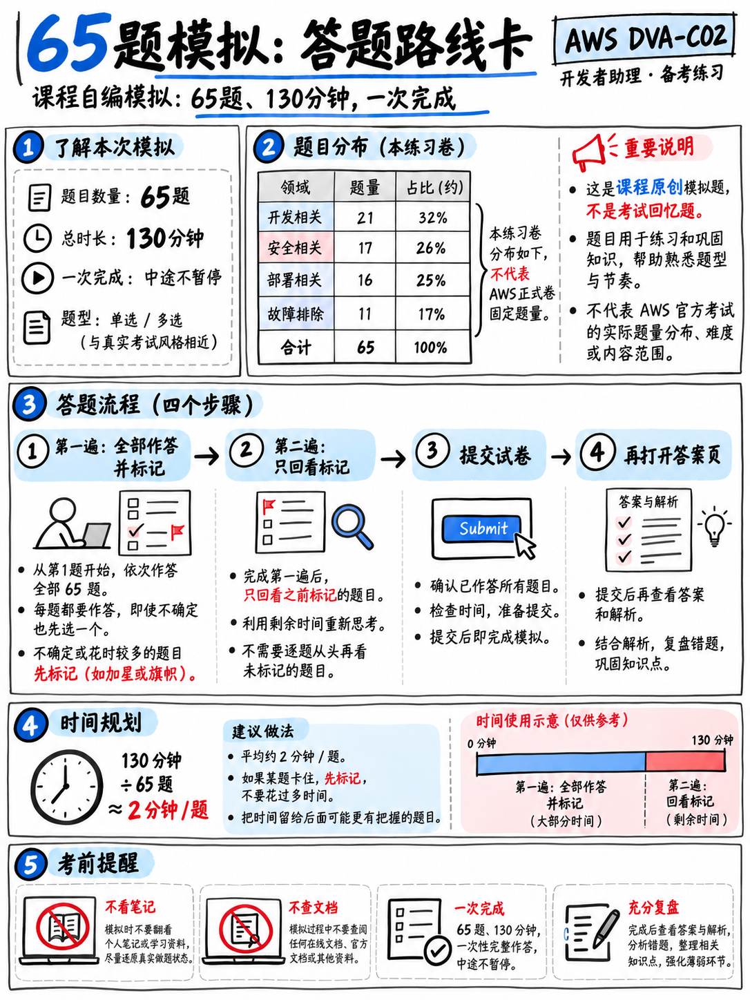

# 7.3 全真迷你模考：65 道全真试题限时演练 (Mini-Mock — 65 Questions)

本套全真模拟试卷共 65 道试题，严格按照 AWS 官方 DVA-C02 考试大纲各知识域比例命制：**域 1 应用开发 21 题（32%）· 域 2 安全性 17 题（26%）· 域 3 部署发布 16 题（25%）· 域 4 监控与故障排查 11 题（17%）**（真实考场标准比例为 32% / 26% / 24% / 18% [1]）。本套试题均为对照官方知识点与考查深度原创编写，**绝非考场真题机经盗录**。

:::{warning}
**模考实战纪律要求：**
- **考试限时：** 130 分钟。
- **环境要求：** 单次不间断闭卷完成，严禁查阅任何文档与笔记，手机静音放置于其他房间。
- **答题策略：** **第一遍作答**按顺序完成所有试题，遇到不确定的题目快速标记（Flag），**坚决不能留空**；**第二遍复查**利用剩余时间集中攻克标记的疑难题。
- **延时说明：** 若你申请了 **ESL +30 分钟非母语延时支持**，请将模考时限设为 **160 分钟**，以保持与实战考场节奏一致。
- **交卷提醒：** 在完全做完并记录你的最终选项之前，**严禁提前翻阅** {doc}`04-mini-mock-answers`！
:::

---

**1.** 某开发者需要配置一个 AWS Lambda 函数来消费处理来自 Amazon SQS 队列的消息批次。当批次中某一条消息处理失败时，该失败消息不得阻塞或导致批次中的其他正常消息被重复处理。应该如何配置？  
A. 增大 SQS 批次处理大小 (Batch size)。  
B. 将队列修改为 SQS FIFO 先入先出队列。  
C. 开启批次部分成功响应特性，在函数返回值中通过 `ReportBatchItemFailures` 返回失败消息 ID。  
D. 为 Lambda 函数配置预置并发 (Provisioned Concurrency)。  

**2.** 下列哪一种 Lambda 调用类型在发生执行故障时会自动重试两次？  
A. 同步调用 `RequestResponse`。  
B. 来自 SQS 的事件源映射 (Event Source Mapping)。  
C. 来自 AWS Step Functions 的直接状态调用。  
D. 异步调用 `Event`。  

**3.** 某应用程序需要以每秒 40 次的频率向 Amazon DynamoDB 表写入大小为 2.5 KB 的项目。至少需要预置多少个写入容量单位 (WCU)？  
A. 40  
B. 80  
C. 100  
D. 120  

**4.** 开发者需要为一张已经上线运行一年的生产环境 DynamoDB 表新增一种全新的查询访问模式。可以为该表动态添加哪种索引类型？  
A. 本地二级索引 (Local Secondary Index, LSI)。  
B. 本地二级索引或全局二级索引均可。  
C. 两者都无法添加，必须新建一张 DynamoDB 表。  
D. 全局二级索引 (Global Secondary Index, GSI)。  

**5.** 在消耗的读取容量单位 (RCU) 方面，下列哪种 DynamoDB 读取操作成本最低？  
A. 强一致性读取 (Strongly Consistent Read)。  
B. 事务性读取 (Transactional Read)。  
C. 两者与最终一致性读取消耗相同。  
D. 最终一致性读取 (Eventually Consistent Read)。  

**6.** 某个部署在私有子网中的 Lambda 函数需要访问同 VPC 内的 Amazon RDS 数据库，同时还需要频繁调用 Amazon DynamoDB API。哪种网络架构配置是正确的？  
A. 仅将 Lambda 函数挂载到该 VPC 的私有子网。  
B. 移除 Lambda 函数的 VPC 配置，让其运行在 AWS 默认托管网络中。  
C. 为私有子网直接附加一个互联网网关 (Internet Gateway)。  
D. 将 Lambda 函数挂载到该 VPC，并在 VPC 中为 DynamoDB 创建网关型 VPC 终端节点 (Gateway VPC Endpoint)。  

**7.** Amazon SQS 单条标准消息的最大有效负载体积是多少？  
A. 64 KB  
B. 1 MB  
C. 256 KB  
D. 10 MB  

**8.** 开发者需要编排一个业务工作流：按顺序依次调用五个服务，针对单步故障执行指数退避重试，并在重试失败时执行分支降级逻辑。应该选用哪项 AWS 服务？  
A. Amazon EventBridge  
B. Amazon SQS  
C. AWS Step Functions  
D. AWS Batch  

**9.** 当业务数据的访问模式未知或随时间频繁发生动态变化时，最适合选用哪种 Amazon S3 存储类？  
A. S3 Intelligent-Tiering（智能分层）  
B. S3 Standard-IA（标准不频度访问）  
C. S3 Glacier Deep Archive（深度归档）  
D. S3 One Zone-IA（单区不频度访问）  

**10.** 某 Web 浏览器前端需要直接将一个 3 GB 的大文件上传到 Amazon S3，且不能向前端分发长期 AWS 凭据。后端应用程序应该向前端提供什么？  
A. 将目标 S3 存储桶配置为公开可写。  
B. 生成一个预签名 URL (Presigned URL)。  
C. 签发一个具有写入权限的临时 IAM Access Key。  
D. 配置一个拥有 `s3:*` 权限的未认证 Cognito 身份池角色。  

**11.** 应用程序必须确保 Lambda 函数在处理 SQS 队列消息时达到“实际上的仅处理一次（Exactly-once in effect）”。开发者必须在代码中实现什么？  
A. 幂等性处理逻辑（例如在 DynamoDB 中基于消息去重键执行条件写入）。  
B. 短轮询 (Short polling)。  
C. 延长 SQS 消息保留周期 (Message Retention Period)。  
D. 为 Lambda 函数配置预留并发 (Reserved Concurrency)。  

**12.** 哪项 AWS 服务能够提供严格保序的数据记录、可配置的数据保留窗口，并支持多个独立的消费者在各自的位置并行读取数据流？  
A. Amazon Kinesis Data Streams  
B. Amazon SQS  
C. Amazon SNS  
D. Amazon MQ  

**13.** 开发者希望以微秒级延迟缓存 DynamoDB 的读取请求，并且要求应用程序代码改动量最小。应该选用哪项服务？  
A. Amazon ElastiCache for Redis  
B. Amazon CloudFront  
C. Amazon DynamoDB Accelerator (DAX)  
D. Amazon MemoryDB for Redis  

**14.** 一个 AWS Lambda 函数单次执行的最大超时时间限制是多少？  
A. 15 分钟  
B. 5 分钟  
C. 30 分钟  
D. 1 小时  

**15.** 哪一种 API Gateway 集成类型会将完整的 HTTP 请求原封不动地透传给 Lambda，并强制要求 Lambda 返回包含特定结构（如 `statusCode` 与 `body`）的响应？  
A. `AWS` 集成  
B. `AWS_PROXY`（Lambda 代理集成）  
C. `HTTP` 集成  
D. `MOCK` 集成  

**16.** 在后端服务尚未开发完成前，REST API 需要向测试前端返回固定的模拟响应内容以支持联调。应该选用哪种集成类型？  
A. `AWS_PROXY`  
B. `MOCK`  
C. `HTTP_PROXY`  
D. `AWS`  

**17.** 应用程序需要让 DynamoDB 表中的会话数据在生成 24 小时后自动过期删除，且该删除操作不得消耗任何写入容量 (WCU)。应该如何配置？  
A. 编写定时扫描 (Scan) 并调用 DeleteItem 的脚本。  
B. 配置 S3 生命周期规则。  
C. 启用 DynamoDB Streams 并在触发器中执行删除。  
D. 启用 TTL 特性并指定存储 Unix 时间戳 (Epoch timestamp) 的属性。  

**18.** 哪项 Lambda 特性允许 5 个不同的函数共享同一个体积庞大的第三方依赖包，而无需在每个函数的部署代码包中重复包含它？  
A. 环境变量 (Environment variables)  
B. 临时存储 (Ephemeral storage `/tmp`)  
C. 容器镜像打包部署 (Container Image)  
D. Lambda 层 (Lambda Layer)  

**19.** 开发者需要处理来自 DynamoDB 表数据变更的 Stream 流记录，并且业务逻辑需要同时比对变更前后的数据值。需要配置哪种流视图类型 (StreamViewType)？  
A. `NEW_AND_OLD_IMAGES`  
B. `KEYS_ONLY`  
C. `NEW_IMAGE`  
D. `OLD_IMAGE`  

**20.** DynamoDB 单个 Item（项目）所允许的最大尺寸是多少？  
A. 400 KB  
B. 64 KB  
C. 256 KB  
D. 1 MB  

**21.** 某应用程序需要构建一个具备实时订阅功能的 GraphQL API，并以 DynamoDB 作为底层数据源。应该选用哪项 AWS 服务？  
A. Amazon API Gateway REST API  
B. AWS AppSync  
C. Amazon API Gateway HTTP API  
D. Amazon CloudFront  

**22.** 哪种做法是为运行在 Amazon EC2 实例上的应用赋予调用 AWS 服务权限的最优解？  
A. 通过实例配置文件 (Instance Profile) 为 EC2 实例挂载 IAM 角色 (IAM Role)。  
B. 将长期 Access Key 存放在应用程序的本地配置文件中。  
C. 将 Access Key 直接打包烧录进自定义 AMI 镜像。  
D. 在应用代码中使用 AWS 账号的 Root 凭据。  

**23.** 某公司需要使用 AWS KMS 对一个大小为 100 MB 的数据文件进行加密。正确的技术方案是什么？  
A. 生成数据密钥 (GenerateDataKey)，在本地使用明文密钥加密数据，随后将加密后的密文数据密钥与密文数据一同持久化存储。  
B. 直接调用 `kms:Encrypt` API 传入该 100 MB 数据。  
C. 生成数据密钥，将明文数据密钥连同密文数据一同保存在存储介质中。  
D. 使用 SSE-C 配合 KMS 主密钥进行加密。  

**24.** 哪个 Amazon Cognito 组件负责将已登录的移动端用户令牌兑换为临时的 AWS 访问安全凭证？  
A. 身份池 (Identity Pool / Federated Identities)  
B. 用户池 (User Pool)  
C. Lambda 授权方 (Lambda Authorizer)  
D. IAM 用户 (IAM User)  

**25.** 关于 IAM 权限策略评估逻辑的描述，下列哪一项是正确的？  
A. 显式允许 (Explicit allow) 的优先级高于显式拒绝 (Explicit deny)。  
B. 基于资源的策略 (Resource-based policy) 始终优先于基于标识的策略 (Identity policy)。  
C. 显式拒绝 (Explicit deny) 始终具有最高优先级（一票否决）。  
D. 服务控制策略 (SCP) 能够直接为主体授予具体的访问权限。  

**26.** 某个拥有 `s3:GetObject` 权限的 Lambda 函数在读取一个使用客户托管 KMS 密钥 (CMK) 加密的 S3 对象时遇到 `AccessDenied` 报错。缺少了什么关键配置？  
A. 存储桶级别的 `s3:ListBucket` 权限。  
B. 函数执行角色缺少 `kms:Decrypt` 权限，或者 KMS 密钥策略中未显式放行该函数角色。  
C. 针对 S3 服务的专用 VPC 终端节点。  
D. S3 存储桶访问控制列表 (Bucket ACL)。  

**27.** 某数据库密码需要每隔 30 天自动轮换一次，应该使用哪项服务来存储该凭据？  
A. Systems Manager Parameter Store 的 `String` 类型参数。  
B. Lambda 函数的静态环境变量。  
C. AWS Secrets Manager。  
D. 存放在私有 S3 存储桶中的配置文件对象。  

**28.** AWS KMS 的 `kms:Encrypt` API 直接加密所能处理的单次最大明文数据量是多少？  
A. 64 KB  
B. 256 KB  
C. 1 MB  
D. 4 KB  

**29.** 每一个 IAM 角色 (IAM Role) 都必定包含哪两种核心策略？（请选择两项，Select TWO）  
A. 服务控制策略 (Service Control Policy, SCP)  
B. 权限策略 (Permissions Policy)  
C. 会话策略 (Session Policy)  
D. 存储桶策略 (Bucket Policy)  
E. 信任策略 (Trust Policy)  

**30.** 某个 API Gateway REST API 必须限制为只能由特定的 VPC 终端节点 (VPC Endpoint) 调用。应该如何配置？  
A. 为 API 开启 API Key 校验。  
B. 创建 API 使用计划 (Usage Plan)。  
C. 为 API Gateway 配置资源策略 (Resource Policy)，并在 Condition 中添加 `aws:SourceVpce` 限制。  
D. 配置 Cognito 用户池授权方。  

**31.** 哪一项 Amazon Cognito 特性能够在终端用户成功通过身份认证后，立即自动触发一段自定义业务代码执行？  
A. 预注册触发器 (Pre sign-up trigger)  
B. 用户迁移触发器 (Migrate user trigger)  
C. 认证后触发器 (Post authentication trigger)  
D. 自定义消息触发器 (Custom message trigger)  

**32.** 关于 AWS 托管式 KMS 密钥 (AWS Managed Keys) 的表述，下列哪一项是正确的？  
A. 开发者可以手动修改其密钥策略 (Key Policy)。  
B. 支持跨 AWS 账号进行密钥共享。  
C. 每年全自动轮换一次密钥材料，且轮换计划不支持自定义修改。  
D. 支持用户手动导入外部密钥材料 (Imported key material)。  

**33.** 某个 Lambda 函数的环境变量中包含第三方服务的敏感 API 令牌。如何防止拥有控制台只读权限的 IAM 用户在控制台中直接查看到该令牌的明文？  
A. 使用默认的 AWS 托管静态加密。  
B. 使用加密帮助程序 (Encryption Helpers) 结合客户托管 KMS 密钥进行加密，并在函数代码内部解密。  
C. 为 Lambda 函数配置预留并发。  
D. 将 Lambda 函数挂载到私有 VPC 子网中。  

**34.** 编写 IAM 策略时，哪个条件键能够限制用户只能访问与自身身份标识相匹配的 DynamoDB 分区键数据？  
A. `dynamodb:LeadingKeys`  
B. `aws:SourceIp`  
C. `aws:PrincipalTag`  
D. `dynamodb:Select`  

**35.** 针对 Application Load Balancer (ALB)，哪种 SSL/TLS 证书来源既完全免费又能提供全自动证书轮换续期？  
A. AWS Certificate Manager (ACM) 公网托管证书  
B. AWS Private CA 私有证书颁发机构  
C. 自签名 SSL 证书  
D. AWS KMS 生成的数字证书  

**36.** 应用程序需要对日志输出进行安全脱敏。下列哪一项符合安全工程最佳实践？  
A. 在日志中输出完整的原始 HTTP 请求体以便于调试排错。  
B. 在将日志写入日志流之前，在代码层将 PII 敏感个人信息进行遮蔽脱敏 (Redact)。  
C. 将 Bearer 认证令牌完整写入日志以跟踪用户会话。  
D. 将日志保留期配置为永久不过期 (Never expire)。  

**37.** 将单个 S3 存储桶的只读权限安全授予外部合作伙伴 AWS 账号，哪两种方式是合规有效的？（请选择两项，Select TWO）  
A. 在当前 S3 存储桶上配置 Bucket Policy，主体显式指向合作伙伴账号中的角色 ARN。  
B. 为该 S3 存储桶配置生命周期转换规则。  
C. 关闭该 S3 存储桶的 Block Public Access（阻止公共访问）设置。  
D. 在当前账号中创建一个具备读取权限的角色，并在信任策略中允许合作伙伴账号扮演 (AssumeRole)。  
E. 将当前账号管理员的 IAM Access Key 分享给合作伙伴。  

**38.** 调用 STS 的 `sts:AssumeRole` API 成功后会返回什么？  
A. 一对永久有效的 IAM 访问密钥。  
B. 包含 Access Key、Secret Key 以及 Session Token 的临时安全凭证。  
C. 经过签名的 JWT 令牌。  
D. 一个 X.509 数字证书。  

**39.** 在 AWS CodeBuild 的 `buildspec.yml` 规范文件中，各个执行阶段 (Phases) 的正确生命周期顺序是什么？  
A. `pre_build` → `install` → `build` → `post_build`  
B. `build` → `install` → `post_build`  
C. `install` → `pre_build` → `build` → `post_build`  
D. `install` → `build` → `pre_build`  

**40.** 在 AWS CodeDeploy 的部署生命周期事件中，哪一个钩子 (Hook) 执行的是来自**前一个部署版本 (previously deployed revision)** 的脚本？  
A. `BeforeInstall`  
B. `ValidateService`  
C. `ApplicationStop`  
D. `AfterInstall`  

**41.** 当使用 AWS CodeDeploy 将应用程序部署到 Amazon ECS 服务时，支持配置哪一组专用的生命周期挂钩？  
A. `BeforeInstall` 与 `AfterInstall`  
B. `ApplicationStop` 与 `ApplicationStart`  
C. `PreBuild` 与 `PostBuild`  
D. `BeforeAllowTraffic` 与 `AfterAllowTraffic`  

**42.** 某种部署配置策略要求：每隔两分钟平滑将 10% 的流量分流切换到新版本，直至 100% 切换完毕。这是指哪一种部署策略？  
A. `Canary10Percent5Minutes`  
B. `AllAtOnce`  
C. `HalfAtATime`  
D. `Linear10PercentEvery2Minutes`  

**43.** 在 AWS SAM 模板中，哪个配置属性可以在每次执行 `sam deploy` 时自动为 Lambda 发布新版本并平滑将别名指向该版本？  
A. `DeploymentPreference`  
B. `AutoPublishAlias`  
C. `Globals`  
D. `Tracing`  

**44.** 在 AWS CloudFormation 模板中，哪个内置函数能够获取资源的特定底层属性（例如某个资源的 ARN）？  
A. `!GetAtt`  
B. `!Ref`  
C. `!Sub`  
D. `!FindInMap`  

**45.** 在 CloudFormation 中，哪项功能允许在实际执行堆栈更新之前，提前预览本次变更是否会导致现有资源被中断或直接替换重建 (Replace)？  
A. 更改集 (Change Sets)  
B. 偏差检测 (Drift Detection)  
C. 堆栈策略 (Stack Policy)  
D. 嵌套堆栈 (Nested Stacks)  

**46.** 哪项 CloudFormation 设置能确保当其所属的 Stack 堆栈被删除时，保留底层的 S3 存储桶不被随之删除？  
A. 开启 Termination Protection（终止保护）。  
B. 配置 `UpdateReplacePolicy: Delete`。  
C. 配置 S3 存储桶策略。  
D. 为资源声明 `DeletionPolicy: Retain`。  

**47.** 持续交付流水线需要在关键部署步骤前暂停执行，等待指定审批人核准，并向团队通信频道推送通知。应该在流水线中添加什么组件？  
A. 在 CodeBuild 中添加 sleep 休眠等待脚本。  
B. 禁用流水线阶段之间的转换 (Disable transition)。  
C. 编写一个轮询等待审批的 Lambda 函数。  
D. 在 AWS CodePipeline 中添加人工审批操作 (Manual Approval action)，并关联一个 Amazon SNS 主题。  

**48.** 某企业需要托管私有的 npm 和 pip 软件包仓库，同时要求能够无缝上游代理并缓存公共开源镜像源。应该选用哪项 AWS 服务？  
A. Amazon ECR  
B. AWS CodeArtifact  
C. Amazon S3  
D. AWS CodeBuild  

**49.** 哪种 AWS Elastic Beanstalk 部署策略能够确保在整个发布过程中集群**始终维持 100% 满额计算容量**，同时完全避免服务停机中断？  
A. 一次性全部部署 (All at once)  
B. 包含额外批次的滚动部署 (Rolling with an additional batch)  
C. 普通滚动部署 (Rolling)  
D. 仅在部署失败后回退的不可变部署  

**50.** 在 Elastic Beanstalk 的 `.ebextensions` 配置文件中，如果需要确保某条环境初始化命令仅在集群中的**单个 Leader 实例**上执行一次（例如执行数据库表结构 Migration），应该添加什么参数？  
A. `ignoreErrors: true`  
B. `test:`  
C. `leader_only: true`  
D. `cwd:`  

**51.** 在将 AWS CDK 应用程序首次部署到某个 AWS 账号和区域之前，必须先在本地运行哪条初始化准备命令？  
A. `cdk synth`  
B. `cdk bootstrap`  
C. `cdk diff`  
D. `cdk deploy --all`  

**52.** 官方考试指南中明确指出的、专门用于为前端 Web 应用程序按 Git 分支快速提供独立预览环境的机制是什么？  
A. AWS Amplify 分支托管 (Amplify branches)  
B. Lambda 别名 (Lambda aliases)  
C. API Gateway 阶段 (Stages)  
D. ECS 任务定义版本  

**53.** 某 Amazon ECS 任务启动失败，报错提示无法从 Amazon ECR 拉取容器镜像。排查时应首先检查哪一个角色？  
A. ECS 任务角色 (Task Role)  
B. CodeDeploy 服务角色  
C. ECS 任务执行角色 (Task Execution Role)  
D. EC2 实例配置文件角色  

**54.** 开发者需要使用 AWS SAM CLI 在本地运行调试某个 Lambda 函数，并向其传入生成的模拟测试事件 JSON。应该使用哪条命令？  
A. `sam local invoke`  
B. `sam deploy`  
C. `sam build`  
D. `sam package`  

**55.** 某 API Gateway 阶段需要将 5% 的生产流量灰度导入到新发布版本中，并能够独立观测该分流版本的指标和日志。应该如何配置？  
A. 创建一个全新的使用计划 (Usage Plan)。  
B. 在该阶段上配置金丝雀发布 (Canary release)。  
C. 重新创建一个全新的 REST API。  
D. 配置阶段变量 (Stage variable)。  

**56.** 某个 Lambda 函数执行后在 Amazon CloudWatch Logs 中完全找不到任何对应的日志流和日志输出。排查时首先应该核实什么？  
A. 函数执行角色是否具备 CloudWatch Logs 的写入权限（`logs:CreateLogGroup`、`CreateLogStream`、`PutLogEvents`）。  
B. 日志组的保留期 (Retention) 设置。  
C. 函数配置的内存大小。  
D. AWS X-Ray 的跟踪开启状态。  

**57.** 在 AWS X-Ray 中，哪一类元数据会被系统建立索引，从而支持在控制台中使用筛选表达式检索分布式调用链路？  
A. Metadata（元数据）  
B. Annotations（注释）  
C. Subsegment 名称  
D. Sampling rules（采样规则）  

**58.** 运维团队需要统计并分析过去 10 天内某个 CloudWatch 日志组中特定错误字符串出现的频次与分布。应该使用哪种工具？  
A. 此时新建一个 Metric Filter（指标筛选器）。  
B. AWS CloudTrail。  
C. CloudWatch Logs Insights。  
D. AWS X-Ray。  

**59.** 当 API Gateway 使用 Lambda 代理集成 (`AWS_PROXY`) 时，如果 Lambda 函数返回的 JSON 结构缺少 `statusCode` 或响应体不合规，API Gateway 会向客户端返回什么 HTTP 状态码？  
A. 400 Bad Request  
B. 403 Forbidden  
C. 504 Gateway Timeout  
D. 502 Bad Gateway  

**60.** Amazon API Gateway 针对后端集成的单次请求硬性超时时限 (Integration Timeout) 是多少？  
A. 15 秒  
B. 29 秒  
C. 60 秒  
D. 900 秒  

**61.** 在 DynamoDB 中执行条件写入或条件更新时，如果数据不满足 `ConditionExpression` 预期，客户端会收到哪种特定异常？  
A. `ProvisionedThroughputExceededException`  
B. `ConditionalCheckFailedException`  
C. `ValidationException`  
D. `ItemCollectionSizeLimitExceededException`  

**62.** 在与 AWS SDK 交互时，遇到下列哪一种客户端报错时**绝对不应该**发起自动重试？  
A. HTTP 429 Too Many Requests  
B. HTTP 503 Service Unavailable  
C. `ThrottlingException`  
D. `ValidationException`  

**63.** 某个高并发 Lambda 函数需要在极低延迟开销下上报自定义业务指标，且要求避免在执行关键路径上调用同步 API。应该采用什么机制？  
A. 在代码中同步调用 CloudWatch 的 `PutMetricData` API。  
B. 发送 Amazon SNS 消息通知。  
C. 在 DynamoDB 中自增计数器。  
D. 使用 CloudWatch 嵌入式指标格式 (Embedded Metric Format, EMF) 写入标准日志。  

**64.** 哪项 AWS 服务能够精准回答审计问题：“究竟是谁在什么时间通过什么方式删除了这个 S3 存储桶”？  
A. Amazon CloudWatch  
B. AWS X-Ray  
C. AWS CloudTrail  
D. Amazon Inspector  

**65.** 哪种缓存策略在应用程序查询数据时首先检查缓存，仅当缓存未命中 (Cache Miss) 时才读取数据库并将结果回写到缓存中？  
A. 写入穿透 (Write-through)  
B. 异步回写 (Write-behind)  
C. 惰性加载 (Lazy loading / Cache-aside)  
D. 提前预刷新 (Refresh-ahead)  

---

**请停止作答。记录你的总耗时与选项**，随后翻阅 {doc}`04-mini-mock-answers` 开展深度复盘。
